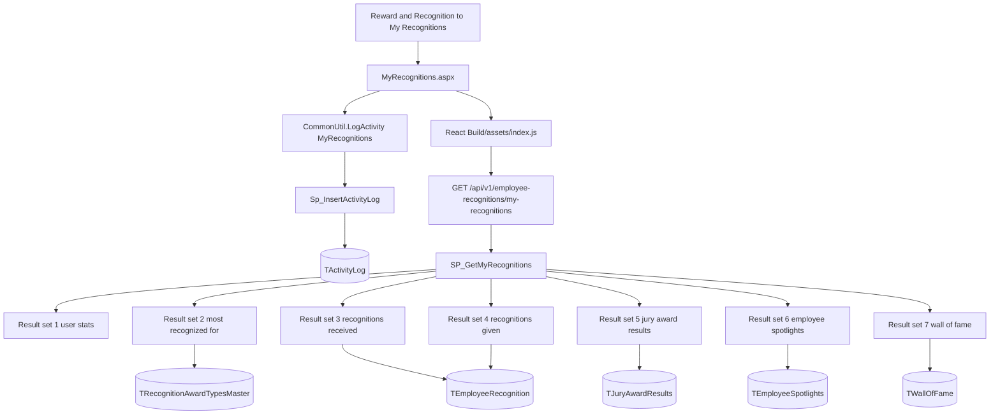
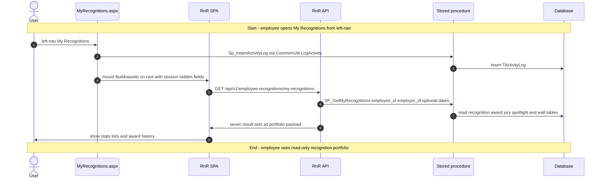
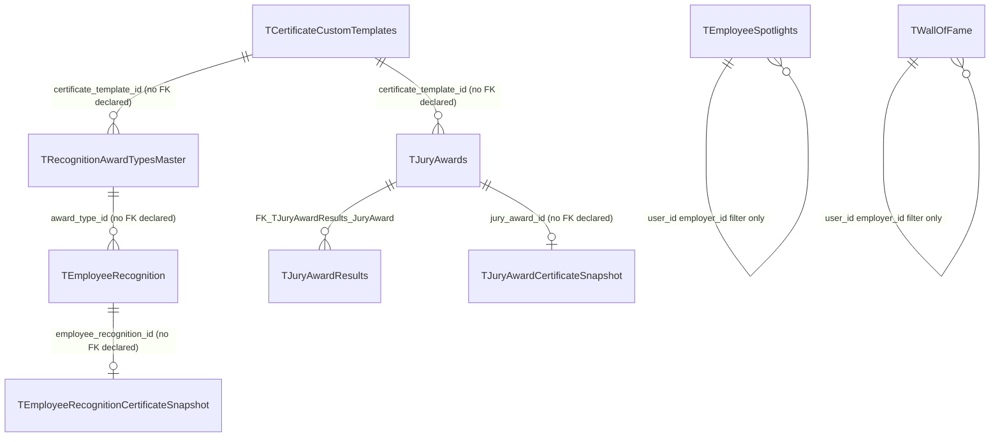

# My Recognitions

## Overview

An employee opens **Reward & Recognition → My Recognitions** (`~/HRM/RewardsAndRecognition/MyRecognitions.aspx`) to review their own recognition history: stats (received, given, points, company rank), peer recognitions they received and gave, jury-award wins, Employee Spotlight entries, and Wall of Fame entries. The WebForms host only logs activity `MyRecognitions` (438), stamps session identity into hidden fields, and mounts the shared RnR React bundle on `#root`. There is no WebForms postback for business data.

After mount, the SPA loads the signed-in employee’s portfolio from the separate Rewards & Recognition Node API (`GET /api/v1/employee-recognitions/my-recognitions`), which executes `SP_GetMyRecognitions` against the `RewardNRecognition` database and returns seven result sets. This page does not create or approve recognitions — Give Recognition and Notifications own those flows.

The RnR React `Build/` bundle and backend source are **not** present in the SourceCode workspace analyzed for this guide. API route and procedure linkage come from `TDataCatalog` plus the inventoried SQL. There is no llm-wiki domain page for Reward & Recognition in this checkout.

**Who's involved:**

- **Employee (viewer)** — opens My Recognitions to see recognitions and awards tied to their employee id for the current employer.
- **Sender / admin / jury cron (elsewhere)** — create and approve peer recognitions, spotlights, Wall of Fame, and jury results that later appear here; those write paths are not this screen.

## Workflow

## Request journey

### Employee — open My Recognitions

## Entry points

`~/HRM/RewardsAndRecognition/MyRecognitions.aspx` is the live HRMS host. `Page_Load` logs `ActivityDescription.MyRecognitions` (438) and stamps hidden fields (`hdnEmpId`, `hdnEmployerId`, `hdnCustomerId`, role, email, and related). The React module mounts at `#root` via relative `Build/assets/index.js` (same host pattern as Give Recognition, Recognition Dashboard, and other RnR aspx pages). Menu node text **My Recognitions** uses MenuId `1243` in `TMenuDetails` seed scripts.

Sibling aspx hosts under `HRM/RewardsAndRecognition/` share the same bundle; they are separate left-nav features and are out of scope here.

| UI page / surface | Purpose |
|---|---|
| `HRM/RewardsAndRecognition/MyRecognitions.aspx` | WebForms host, activity log, session stamp |
| `HRM/RewardsAndRecognition/Build/assets/index.js` | Deployed RnR SPA bundle (not in SourceCode git tree) |
| RnR backend `GET /api/v1/employee-recognitions/my-recognitions` | Loads employee portfolio via `SP_GetMyRecognitions` (`TDataCatalog`) |

## Code → database call chain

Host-side hops are verified in SourceCode. SPA → API → procedure hops are from `TDataCatalog` (`TEmployeeRecognition` UI API) and the inventoried `SP_GetMyRecognitions` script (RnR frontend/backend source and `Build/` were not in this workspace).

| Entry | Method | Stored procedure / data access |
|---|---|---|
| Page load (activity) | `Page_Load` (`MyRecognitions.aspx.cs:26`) → `CommonUtil.LogActivity` (`Common.cs:52`) → `LogUserActivity.LogActivity` (`LogUserActivity.cs:36`) → `ActivityLog.LogActivityAsync` (`ActivityLog.cs:22`) → `ActivityHelper.LogActivity` (`ActivityHelper.cs:32`) | [`Sp_InsertActivityLog`](/docs/database/hrms/Sp_InsertActivityLog) → `TActivityLog` |
| SPA portfolio load | RnR SPA → `GET /api/v1/employee-recognitions/my-recognitions` → RnR backend (repo not in workspace) | [`SP_GetMyRecognitions`](/docs/database/hrms-rewardnrecognition/SP_GetMyRecognitions) on `RewardNRecognition` |

## API endpoints

Not WebForms postback for recognition data. The host page has no PageMethods. After mount, the RnR React app calls the Rewards & Recognition Node API under `/api/v1` (base URL is configured in the RnR frontend env, not in the aspx).

| Verb | Route | Parameters | Purpose | Source |
|---|---|---|---|---|
| GET | `/api/v1/employee-recognitions/my-recognitions` | Query/body mapping to `@employee_id`, `@employer_id` (required); `@start_date`, `@end_date` (optional) on `SP_GetMyRecognitions` — exact HTTP param names not verified in this workspace | Load the signed-in employee’s recognition portfolio (seven result sets) | `TDataCatalog` + `SP_GetMyRecognitions.sql` |

No Core `HRMS.Core.WebAPI.Node` controller for this screen was found in SourceCode.

## Stored procedures & tables involved

| Object | File path | Purpose | llm-wiki |
|---|---|---|---|
| [`Sp_InsertActivityLog`](/docs/database/hrms/Sp_InsertActivityLog) | `HRMS-DATABASE/HRMS/STOREPROCEDURE/Sp_InsertActivityLog.sql` | Activity row on every page open | — |
| [`SP_GetMyRecognitions`](/docs/database/hrms-rewardnrecognition/SP_GetMyRecognitions) | `HRMS-DATABASE/HRMS-RewardNRecognition/STORED_PROCEDURE/SP_GetMyRecognitions.sql` | Seven read-only result sets for the employee portfolio | No llm-wiki page |
| `TEmployeeRecognition` | `HRMS-DATABASE/HRMS-RewardNRecognition/TABLES/TEmployeeRecognition.sql` | Peer recognitions given/received; points and rank stats | — |
| `TRecognitionAwardTypesMaster` | `…/TABLES/TRecognitionAwardTypesMaster.sql` | Award display name / icon; certificate template id | — |
| `TCertificateCustomTemplates` | `…/TABLES/TCertificateCustomTemplates.sql` | Issuing manager name for certificates | — |
| `TEmployeeRecognitionCertificateSnapshot` | `…/TABLES/TEmployeeRecognitionCertificateSnapshot.sql` | Certificate design snapshot for a recognition | — |
| `TJuryAwardResults` | `…/TABLES/TJuryAwardResults.sql` | Declared jury winners for the employee | — |
| `TJuryAwards` | `…/TABLES/TJuryAwards.sql` | Jury award window and reward metadata | — |
| `TJuryAwardCertificateSnapshot` | `…/TABLES/TJuryAwardCertificateSnapshot.sql` | Certificate snapshot for a jury award | — |
| `TEmployeeSpotlights` | `…/TABLES/TEmployeeSpotlights.sql` | Spotlight stories received by the employee | — |
| `TWallOfFame` | `…/TABLES/TWallOfFame.sql` | Wall of Fame entries for the employee | — |
| `TActivityLog` | HRMS core | Host activity audit | — |

`SP_GetMyRecognitions` calls no nested procedures or functions. Nested-level database pages beyond this direct SP are not required for this screen.

## Table relationships

No domain `erDiagram` exists for Reward & Recognition in llm-wiki. Edges below are either a declared FK on `CREATE TABLE` or logical keys used by `SP_GetMyRecognitions` with **no FK declared**.

## Known gaps

- **RnR React source and `Build/assets`** are not in the SourceCode tree; SPA route/component names and any extra GETs (for example employee-name enrichment) are unverified.
- **RnR backend repo** is not in the workspace; controller/service `file:line` for `GET /api/v1/employee-recognitions/my-recognitions` and exact HTTP query parameter names were not confirmed beyond `TDataCatalog` + SP parameters.
- **SystemModel-2** has no page for My Recognitions in this SourceCode checkout.
- **llm-wiki** has no Reward & Recognition domain page here; ER edges are derived from DDL/SP joins only.
- Host does **not** gate on dynamic menu in `Page_Load` (unlike some other React hosts); access relies on left-nav visibility alone.

## Reference

Confidence is **medium**: WebForms host → activity log → `Sp_InsertActivityLog` is verified in SourceCode; portfolio data is tied to `SP_GetMyRecognitions` and `GET /api/v1/employee-recognitions/my-recognitions` via catalog and SQL, but the RnR SPA/API source was not available to confirm `file:line` or extra endpoints.

### SourceCode

- `HRMS.Web/HRMS.Web/HRM/RewardsAndRecognition/MyRecognitions.aspx`
- `HRMS.Web/HRMS.Web/HRM/RewardsAndRecognition/MyRecognitions.aspx.cs`
- `HRMS.Shared/HRMS.Common/Common.cs`
- `HRMS.Shared/TDG.ActivityAuditLog/Activity/LogUserActivity.cs`
- `HRMS.Shared/TDG.ActivityAuditLog/ActivityLog/ActivityLog.cs`
- `HRMS.Shared/TDG.ActivityAuditLog/DAL/ActivityHelper.cs`
- `HRMS.Shared/HRMS.DataContract/Common/Enums.cs` (`ActivityDescription.MyRecognitions = 438`)

### TDG HRMS DB

- `HRMS-DATABASE/HRMS-RewardNRecognition/STORED_PROCEDURE/SP_GetMyRecognitions.sql`
- `HRMS-DATABASE/HRMS-RewardNRecognition/TABLES/TEmployeeRecognition.sql` (and related tables listed above)
- `HRMS-DATABASE/HRMS/DML/TDataCatalog_DML.sql` (`TEmployeeRecognition` → `GET /api/v1/employee-recognitions/my-recognitions`)
- `HRMS-DATABASE/HRMS/DML/Tmenudetails DML.sql` (MenuId `1243` My Recognitions)
- Existing database page [`Sp_InsertActivityLog`](/docs/database/hrms/Sp_InsertActivityLog)
