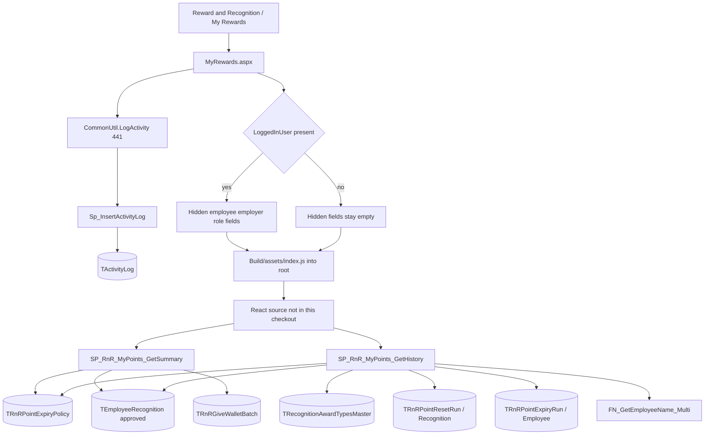
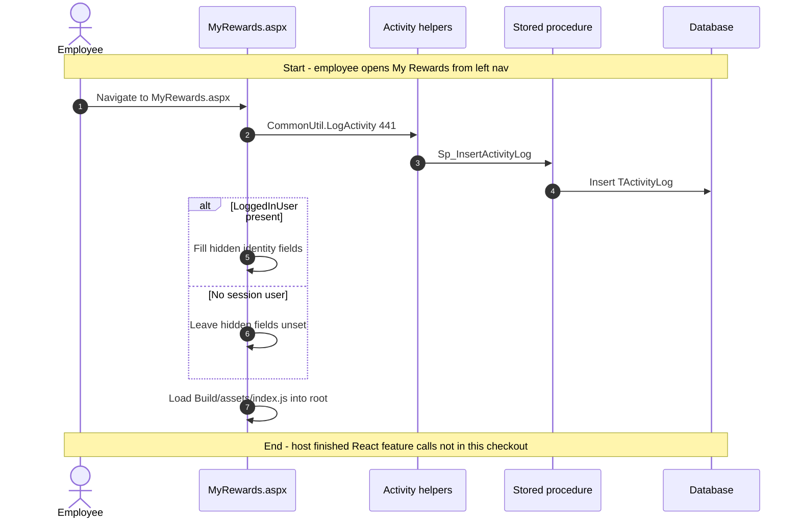
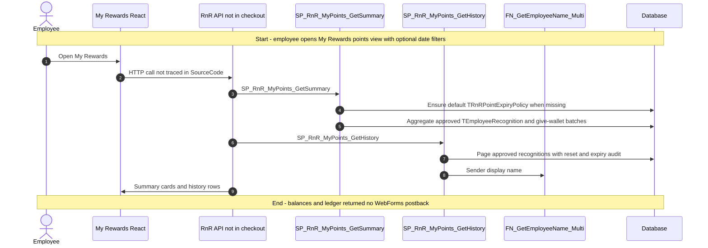
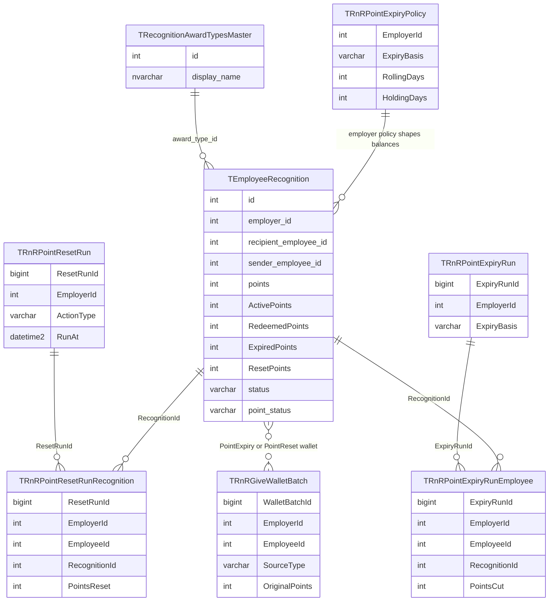

# My Rewards

## Overview

An employee opens **Reward & Recognition → My Rewards** (menu id **1259**) to see their recognition-points balance summary and a paged history of approved points earned as a recipient. The live NavigateURL is `~/HRM/RewardsAndRecognition/MyRewards.aspx` (`DML/RnR Phase2/Index.sql`). Customer License Dashboard menu XML places My Rewards immediately after Marketplace (then Notifications, Admin Console).

`MyRewards.aspx` is a thin WebForms host. On `Page_Load` it logs activity type **441** (`ActivityDescription.MyRewards`), copies the session `LoggedInUser` into hidden fields (`hdnEmpId`, employer, role, global-access flag, email, user id), and loads `Build/assets/index.js` into `#root`. There is no WebForms postback for points data on this page.

Balance cards and the points ledger are implemented by RewardNRecognition procedures `SP_RnR_MyPoints_GetSummary` and `SP_RnR_MyPoints_GetHistory`. Those procedures read approved `TEmployeeRecognition` rows for the signed-in recipient, apply the employer’s `TRnRPointExpiryPolicy`, and enrich history with award-type names, reset/expiry audit, and sender display names. The React Build tree and the `Rewards_and_Recognition` Node backend are **not** in this SourceCode checkout, so controller/DAL `file:line` hops for those HTTP calls cannot be cited here.

Marketplace gift-card redeem history (`SP_GetEmployeeRedemptionDeatils`) belongs to the Marketplace leaf, not this screen.

**Who's involved:**

- **Employee** — opens My Rewards when menu 1259 is granted; views available / earned / redeemed / expired (and give-wallet moved) point totals plus a filterable history of recognitions they received.
- **Recognition giver** — does not act on this screen; their approved gifts appear as history rows with sender name/code.
- **Administrator / finance** — configures point-expiry policy and runs point reset elsewhere (Admin Console); those policy and audit tables shape what My Rewards displays.

There is no SystemModel-2 page for My Rewards.

## Workflow

## Request journey

### Employee — open My Rewards

### Employee — load points summary and history (intended SP path)

No WebForms save journey exists on this aspx. Point expiry crons and admin point reset belong to other surfaces.

## Entry points

| Entry point | Purpose | Live? |
|---|---|---|
| `~/HRM/RewardsAndRecognition/MyRewards.aspx` | Host page; activity 441; hidden session fields; React mount | Yes |
| Left-nav menu id **1259** under parent **1240** | `tMenuDetails` / `TMenuHierarchy` / `TModuleMenuMapping` from RnR Phase 2 DML | Yes |
| `Build/assets/index.js` + `Build/assets/styles.css` | Client shell loaded by the aspx | Build folder not in this checkout |
| Sibling RnR aspx pages (Marketplace, Notifications, …) | Other module leaves; same Build pattern | Yes (separate guides) |

## Code → database call chain

Verified host chain uses WebForms + shared activity audit only. Feature procedures are the RewardNRecognition MyPoints scripts whose parameters match an employee points summary/history leaf; app callers for those SPs are not in this workspace.

| Step | Entry point | App code | Stored procedure |
|---|---|---|---|
| Activity on open | `MyRewards.aspx.cs:27` | `CommonUtil.LogActivity` (`Common.cs:52`) → `LogUserActivity.LogActivity` (`LogUserActivity.cs:36`) → `ActivityLog.LogActivityAsync` (`ActivityLog.cs:22`) → `ActivityHelper.LogActivity` (`ActivityHelper.cs:32`) | `Sp_InsertActivityLog` (HRMS; activity **441**) |
| Seed hidden fields | `MyRewards.aspx.cs:28-42` | Session `LoggedInUser` → aspx hidden inputs | None |
| Load React shell | `MyRewards.aspx:6`, `:26` | Script/link to `Build/assets/*` | None in host |
| Points balance summary (intended) | React / RnR API **not in checkout** | MyPoints summary SP | `SP_RnR_MyPoints_GetSummary` (may insert default `TRnRPointExpiryPolicy`) |
| Points history page (intended) | React / RnR API **not in checkout** | MyPoints history SP | `SP_RnR_MyPoints_GetHistory` → nested `FN_GetEmployeeName_Multi` |

`ActivityDescription.MyRewards` is `441` in `Enums.cs:384`.

## API endpoints

This screen is **not** a WebForms postback for points summary or history. The aspx only logs activity and mounts the React shell.

Feature HTTP routes live in the missing `Rewards_and_Recognition` backend / `Build/assets/index.js` client. They are **not** present under `HRMS.CoreAPI` or `HRMS.Web/.../RewardsAndRecognition` in this checkout, so no employee Method / Path / Handler table can be cited from source. Inventoried `TDataCatalog` lists `SP_RnR_MyPoints_GetHistory` among `TRecognitionAwardTypesMaster` consumers and does not publish a dedicated My Rewards `/api/v1/...` route string for these two procedures.

## Stored procedures & tables involved

| Object | File | Purpose | Wiki |
|---|---|---|---|
| `Sp_InsertActivityLog` | `HRMS/STOREPROCEDURE/Sp_InsertActivityLog.sql` | Page-open activity type 441 | [Sp_InsertActivityLog](/docs/database/hrms/Sp_InsertActivityLog) |
| `SP_RnR_MyPoints_GetSummary` | `HRMS-RewardNRecognition/STORED_PROCEDURE/SP_RnR_MyPoints_GetSummary.sql` | Available / earned / redeemed / cut / wallet / next-expiry summary | [SP_RnR_MyPoints_GetSummary](/docs/database/hrms-rewardnrecognition/SP_RnR_MyPoints_GetSummary) |
| `SP_RnR_MyPoints_GetHistory` | `HRMS-RewardNRecognition/STORED_PROCEDURE/SP_RnR_MyPoints_GetHistory.sql` | Paged recipient points ledger with status labels | [SP_RnR_MyPoints_GetHistory](/docs/database/hrms-rewardnrecognition/SP_RnR_MyPoints_GetHistory) |
| `FN_GetEmployeeName_Multi` | HRMS function (nested from history) | Sender display name on history rows | [FN_GetEmployeeName_Multi](/docs/database/hrms/FN_GetEmployeeName_Multi) |
| `TEmployeeRecognition` | RewardNRecognition TABLES | Approved recipient points source | RewardNRecognition catalog |
| `TRnRPointExpiryPolicy` | RewardNRecognition TABLES | Employer expiry basis driving summary/history UI | RewardNRecognition catalog |
| `TRnRGiveWalletBatch` | RewardNRecognition TABLES | Give-wallet moved points for summary | RewardNRecognition catalog |
| `TRecognitionAwardTypesMaster` | RewardNRecognition TABLES | Award display name on history reason | RewardNRecognition catalog |
| `TRnRPointResetRun`, `TRnRPointResetRunRecognition` | RewardNRecognition TABLES | Reset audit on history rows | RewardNRecognition catalog |
| `TRnRPointExpiryRun`, `TRnRPointExpiryRunEmployee` | RewardNRecognition TABLES | Min-holding cut signal on history | RewardNRecognition catalog |
| `TEmployeeInfo` | HRMS / linked | Sender employment number on history | — |

## Table relationships

No FK from MyPoints procedures is required for the summary path. History joins award types and reset/expiry audit by recognition id; sender name is via function / `TEmployeeInfo`. Edges below are logical from the inventoried SQL.

## Known gaps

- **`HRM/RewardsAndRecognition/Build/` is missing** from this SourceCode checkout, so React routes, filters, and API client calls for My Rewards cannot be traced to `file:line`.
- **`Rewards_and_Recognition` Node backend** referenced by `TDataCatalog` is not a folder under this workspace; no controller or DAL for the MyPoints procedures is available to cite.
- **No dedicated My Rewards `/api/v1/...` route string** appears in inventoried `TDataCatalog` rows for these two procedures.
- **`TDataCatalog` does not label a screen as My Rewards** for the MyPoints tables; linkage is by SP naming (`SP_RnR_MyPoints_*`) and menu leaf intent.
- **`SP_RnR_MyPoints_GetSummary` can INSERT a default `TRnRPointExpiryPolicy`** (`Never`) when the employer row is missing — side effect on an otherwise read-oriented summary call.
- **Marketplace redemption activity** is out of scope for this leaf.
- **No SystemModel-2** page for My Rewards.
- **Host does not gate menu access**; it only logs activity and seeds hidden fields when `LoggedInUser` is present.

## Reference

Confidence is **medium**: the ASPX host, activity **441**, menu **1259**, and the two RewardNRecognition MyPoints procedures were read from source/SQL. The React UI and feature HTTP handlers are not in this checkout.

### SourceCode

- `HRMS.Web/HRMS.Web/HRM/RewardsAndRecognition/MyRewards.aspx`
- `HRMS.Web/HRMS.Web/HRM/RewardsAndRecognition/MyRewards.aspx.cs`
- `HRMS.Shared/HRMS.DataContract/Common/Enums.cs`
- `HRMS.Shared/HRMS.Common/Common.cs`
- `HRMS.Shared/TDG.ActivityAuditLog/Activity/LogUserActivity.cs`
- `HRMS.Shared/TDG.ActivityAuditLog/ActivityLog/ActivityLog.cs`
- `HRMS.Shared/TDG.ActivityAuditLog/DAL/ActivityHelper.cs`

### TDG HRMS DB

- `HRMS-DATABASE/HRMS/DML/RnR Phase2/Index.sql`
- `HRMS-DATABASE/HRMS/DML/Customer License Dashboard/TMenuDetails DML.sql`
- `HRMS-DATABASE/HRMS/DML/TDataCatalog_DML.sql` (`TRecognitionAwardTypesMaster` lists `SP_RnR_MyPoints_GetHistory`)
- `HRMS-DATABASE/HRMS/STOREPROCEDURE/Sp_InsertActivityLog.sql`
- `HRMS-DATABASE/HRMS-RewardNRecognition/STORED_PROCEDURE/SP_RnR_MyPoints_GetSummary.sql`
- `HRMS-DATABASE/HRMS-RewardNRecognition/STORED_PROCEDURE/SP_RnR_MyPoints_GetHistory.sql`
- `HRMS-DATABASE/HRMS-RewardNRecognition/TABLES/TRnRPointExpiryPolicy.sql`
- `HRMS-DATABASE/HRMS-RewardNRecognition/TABLES/TRnRGiveWalletBatch.sql`
- `HRMS-DATABASE/HRMS-RewardNRecognition/TABLES/TEmployeeRecognition.sql`
