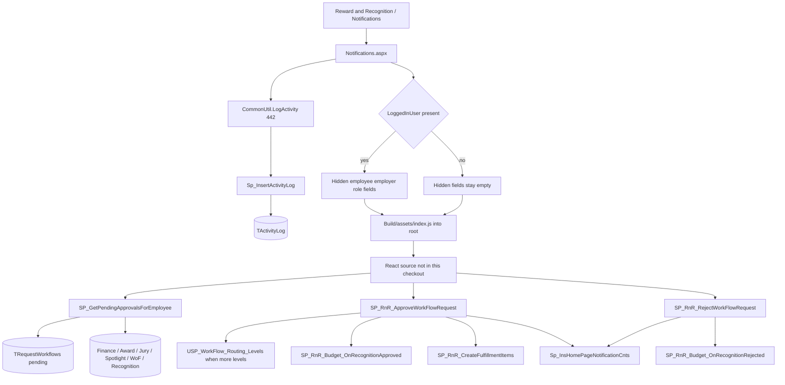
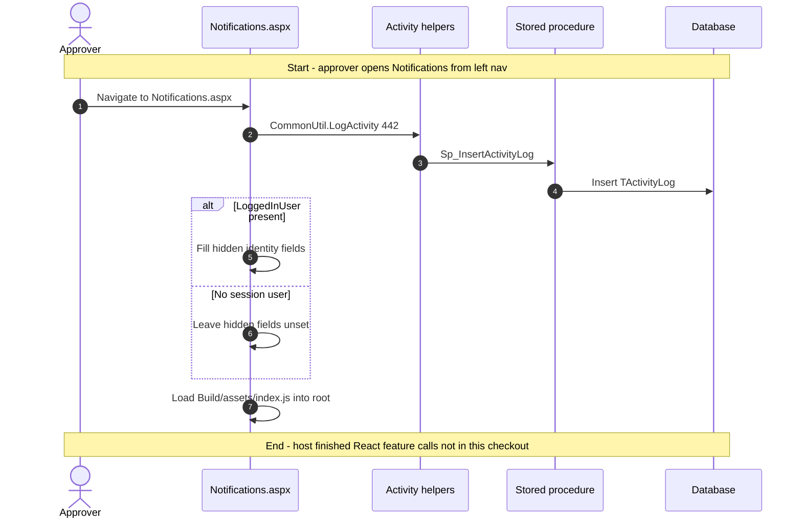
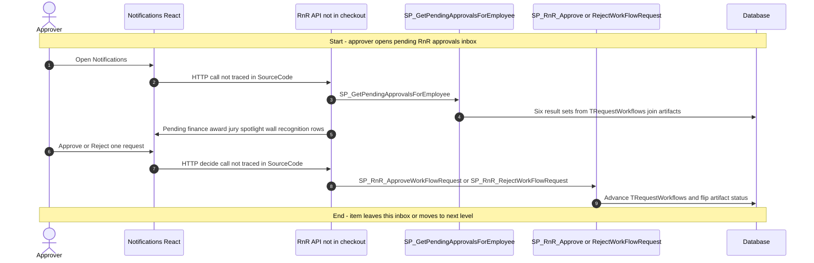
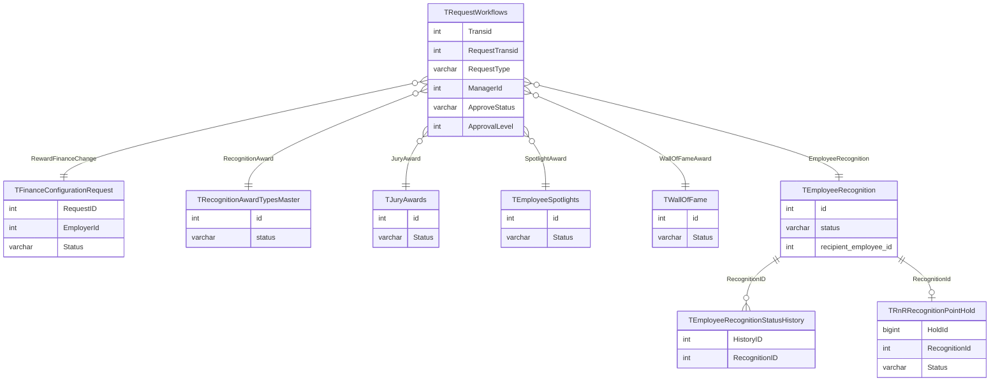

# Notifications

## Overview

An approver opens **Reward & Recognition → Notifications** (menu id **1244**) to work the RnR approval inbox. The live host is `~/HRM/RewardsAndRecognition/Notifications.aspx`. Customer License Dashboard menu XML places Notifications after My Rewards (then Admin Console). Home-page / chatbot deep links land here with `?NotificationId=RPI_Pending…` for finance, recognition award type, jury, spotlight, wall of fame, employee recognition, and point-request notification names (`NotificationList.js`).

`Notifications.aspx` is a thin WebForms host. On `Page_Load` it logs activity type **442** (`ActivityDescription.RewardsRecognitionNotifications`), copies the session `LoggedInUser` into hidden fields, and loads `Build/assets/index.js` into `#root`. There is no WebForms postback for approval data on this page.

The inventory that matches this leaf is `SP_GetPendingApprovalsForEmployee` (six pending queues keyed by `TRequestWorkflows.ManagerId`) plus decide procedures `SP_RnR_ApproveWorkFlowRequest` and `SP_RnR_RejectWorkFlowRequest`. Those procedures advance `TRequestWorkflows`, flip status on the request artifact, adjust home-page notification counts, and for employee recognitions settle or release budget holds. The React Build tree and the `Rewards_and_Recognition` Node backend are **not** in this SourceCode checkout, so controller/DAL `file:line` hops for those HTTP calls cannot be cited here.

Chatbot also deep-links **Point Request** into this aspx (`RPI_PendingPointRequestChange`), but `SP_GetPendingApprovalsForEmployee` does **not** return PointRequest rows — that path is expected to use budget point-request decide/list procedures instead (see Known gaps).

**Who's involved:**

- **Approver** — opens Notifications when menu 1244 is granted; sees pending items where they are `TRequestWorkflows.ManagerId` with `ApproveStatus = 'P'`; approves or rejects.
- **Request initiator** — submitted finance config, award type, jury, spotlight, wall of fame, or employee recognition elsewhere (Admin Console / Give Recognition); does not decide on this screen.
- **Recipient / budget systems** — on final EmployeeRecognition approval, budget settle and optional fulfillment run; on reject, holds are released.

There is no SystemModel-2 page for RnR Notifications.

## Workflow

## Request journey

### Approver — open Notifications

### Approver — load pending queue and decide (intended SP path)

No WebForms save journey exists on this aspx. Creating requests happens on Admin Console / Give Recognition; Point Request decide may use `SP_RnR_Budget_DecidePointRequest` outside the six-set pending SP.

## Entry points

| Entry point | Purpose | Live? |
|---|---|---|
| `~/HRM/RewardsAndRecognition/Notifications.aspx` | Host page; activity 442; hidden session fields; React mount | Yes |
| Left-nav menu id **1244** under parent **1240** | Customer License Dashboard / `tMenuDetails` menu XML | Yes |
| `?NotificationId=RPI_PendingRnRFinanceChange` (and sibling RPI names) | Chatbot / home-page deep link expands matching queue | Yes — `ChatBot/.../NotificationList.js` |
| `Build/assets/index.js` + `Build/assets/styles.css` | Client shell loaded by the aspx | Build folder not in this checkout |
| Sibling RnR aspx pages (My Rewards, Admin Console, …) | Other module leaves; same Build pattern | Yes (separate guides) |

## Code → database call chain

Verified host chain uses WebForms + shared activity audit only. Feature procedures are the RewardNRecognition pending / approve / reject scripts; app callers for those SPs are not in this workspace.

| Step | Entry point | App code | Stored procedure |
|---|---|---|---|
| Activity on open | `Notifications.aspx.cs:26` | `CommonUtil.LogActivity` (`Common.cs:52`) → `LogUserActivity.LogActivity` (`LogUserActivity.cs:36`) → `ActivityLog.LogActivityAsync` (`ActivityLog.cs:22`) → `ActivityHelper.LogActivity` (`ActivityHelper.cs:32`) | `Sp_InsertActivityLog` (HRMS; activity **442**) |
| Seed hidden fields | `Notifications.aspx.cs:27-41` | Session `LoggedInUser` → aspx hidden inputs | None |
| Load React shell | `Notifications.aspx:5`, `:25` | Script/link to `Build/assets/*` | None in host |
| Pending inbox (intended) | React / RnR API **not in checkout** | Pending approvals SP | `SP_GetPendingApprovalsForEmployee` |
| Approve (intended) | React / RnR API **not in checkout** | Approve workflow SP | `SP_RnR_ApproveWorkFlowRequest` → nested `USP_WorkFlow_Routing_Levels`, `Sp_InsHomePageNotificationCnts`, `USP_SaveHistory` (synonym), `SP_RnR_Budget_OnRecognitionApproved`, `SP_RnR_CreateFulfillmentItems`, `FN_GetEmployeeName_Multi`, `Fn_GetHomePageNotificationIdByRequestType` |
| Reject (intended) | React / RnR API **not in checkout** | Reject workflow SP | `SP_RnR_RejectWorkFlowRequest` → nested `Sp_InsHomePageNotificationCnts`, `USP_SaveHistory` (synonym), `SP_RnR_Budget_OnRecognitionRejected`, `FN_GetEmployeeName_Multi`, `Fn_GetHomePageNotificationIdByRequestType` |
| Point Request deep link (related) | Chatbot `RPI_PendingPointRequestChange` | Not in `SP_GetPendingApprovalsForEmployee` | Likely `SP_RnR_Budget_DecidePointRequest` / list SPs (already documented under Give Recognition budget) |

`ActivityDescription.RewardsRecognitionNotifications` is `442` in `Enums.cs:385`.

## API endpoints

This screen is **not** a WebForms postback for approvals. The aspx only logs activity and mounts the React shell.

Feature HTTP routes live in the missing `Rewards_and_Recognition` backend / `Build/assets/index.js` client. They are **not** present under `HRMS.CoreAPI` or `HRMS.Web/.../RewardsAndRecognition` in this checkout, so no Method / Path / Handler table can be cited from source. Inventoried `TDataCatalog` labels many tables with screen **Reward & Recognition > Notifications** and lists `SP_GetPendingApprovalsForEmployee` / `SP_RnR_ApproveWorkFlowRequest` / `SP_RnR_RejectWorkFlowRequest` among consumers, but does not publish a dedicated Notifications `/api/v1/...` route string for the pending-approvals procedure.

## Stored procedures & tables involved

| Object | File | Purpose | Wiki |
|---|---|---|---|
| `Sp_InsertActivityLog` | `HRMS/STOREPROCEDURE/Sp_InsertActivityLog.sql` | Page-open activity type 442 | [Sp_InsertActivityLog](/docs/database/hrms/Sp_InsertActivityLog) |
| `SP_GetPendingApprovalsForEmployee` | `HRMS-RewardNRecognition/STORED_PROCEDURE/SP_GetPendingApprovalsForEmployee.sql` | Six pending queues for one manager | [SP_GetPendingApprovalsForEmployee](/docs/database/hrms-rewardnrecognition/SP_GetPendingApprovalsForEmployee) |
| `SP_RnR_ApproveWorkFlowRequest` | `…/SP_RnR_ApproveWorkFlowRequest.sql` | Approve current level / finalise artifact | [SP_RnR_ApproveWorkFlowRequest](/docs/database/hrms-rewardnrecognition/SP_RnR_ApproveWorkFlowRequest) |
| `SP_RnR_RejectWorkFlowRequest` | `…/SP_RnR_RejectWorkFlowRequest.sql` | Reject current level / artifact | [SP_RnR_RejectWorkFlowRequest](/docs/database/hrms-rewardnrecognition/SP_RnR_RejectWorkFlowRequest) |
| `USP_WorkFlow_Routing_Levels` | HRMS (nested from approve) | Next-level managers | [USP_WorkFlow_Routing_Levels](/docs/database/hrms/USP_WorkFlow_Routing_Levels) |
| `Sp_InsHomePageNotificationCnts` | HRMS (nested) | Home-page counter deltas | [Sp_InsHomePageNotificationCnts](/docs/database/hrms/Sp_InsHomePageNotificationCnts) |
| `SP_RnR_Budget_OnRecognitionApproved` | RewardNRecognition (nested) | Settle recognition hold on final approve | [SP_RnR_Budget_OnRecognitionApproved](/docs/database/hrms-rewardnrecognition/SP_RnR_Budget_OnRecognitionApproved) |
| `SP_RnR_Budget_OnRecognitionRejected` | RewardNRecognition (nested) | Release recognition hold on reject | [SP_RnR_Budget_OnRecognitionRejected](/docs/database/hrms-rewardnrecognition/SP_RnR_Budget_OnRecognitionRejected) |
| `SP_RnR_CreateFulfillmentItems` | RewardNRecognition (nested) | Physical reward fulfillment on final ER approve | [SP_RnR_CreateFulfillmentItems](/docs/database/hrms-rewardnrecognition/SP_RnR_CreateFulfillmentItems) |
| `FN_GetEmployeeName_Multi` | HRMS (nested) | Approver / status display names | [FN_GetEmployeeName_Multi](/docs/database/hrms/FN_GetEmployeeName_Multi) |
| `Fn_GetHomePageNotificationIdByRequestType` | HRMS (nested) | Map request type to home notification id | [Fn_GetHomePageNotificationIdByRequestType](/docs/database/hrms/Fn_GetHomePageNotificationIdByRequestType) |
| `USP_SaveHistory` | HRMS via RnR synonym | Row history copy on some approve/reject paths | Synonym only in this tree — no baseline CREATE page |
| `TRequestWorkflows` | RewardNRecognition / HRMS shared pattern | Pending routing rows for the inbox | catalog |
| `TFinanceConfigurationRequest` | RewardNRecognition TABLES | Finance change requests | catalog |
| `TRecognitionAwardTypesMaster` | RewardNRecognition TABLES | Award type pending/approved | catalog |
| `TJuryAwards` / `TJuryMembers` | RewardNRecognition TABLES | Jury award pending queue | catalog |
| `TEmployeeSpotlights` | RewardNRecognition TABLES | Spotlight pending queue | catalog |
| `TWallOfFame` | RewardNRecognition TABLES | Wall of Fame pending queue | catalog |
| `TEmployeeRecognition` | RewardNRecognition TABLES | Employee recognition pending queue | catalog |
| `TEmployeeRecognitionStatusHistory` | RewardNRecognition TABLES | Recognition status trail | catalog |
| `TEmailNotification` | HRMS synonym | Email seed on approve/reject | catalog / synonym |
| `TRnR_AwardGiverRoleMaster` | RewardNRecognition TABLES | Role names on recognition-type pending rows | catalog |

## Table relationships

Edges below are logical from the inventoried pending and decide SQL. Many RnR links are application-enforced (no FK scripts in baseline).

## Known gaps

- **`HRM/RewardsAndRecognition/Build/` is missing** from this SourceCode checkout, so React routes, accordion UI, and API client calls for Notifications cannot be traced to `file:line`.
- **`Rewards_and_Recognition` Node backend** referenced by `TDataCatalog` is not a folder under this workspace; no controller or DAL for pending/approve/reject is available to cite.
- **No dedicated Notifications `/api/v1/...` route string** appears in inventoried `TDataCatalog` for `SP_GetPendingApprovalsForEmployee`.
- **Point Request chatbot deep link** targets this aspx, but `SP_GetPendingApprovalsForEmployee` has no PointRequest result set — UI/API wiring for that accordion is unverified here.
- **`USP_SaveHistory`** is only a synonym into HRMS in this tree; no baseline `CREATE OR ALTER` script was found to document as a database page.
- **Home-page counter SP name typo** `Sp_InsHomePageNotIficationCnts` appears alongside `Sp_InsHomePageNotificationCnts` in approve SQL (same synonym target pattern).
- **No SystemModel-2** page for RnR Notifications.
- **Host does not gate menu access**; it only logs activity and seeds hidden fields when `LoggedInUser` is present.

## Reference

Confidence is **medium**: the ASPX host, activity **442**, menu **1244**, chatbot deep links, and the RewardNRecognition pending/approve/reject procedures were read from source/SQL. The React UI and feature HTTP handlers are not in this checkout.

### SourceCode

- `HRMS.Web/HRMS.Web/HRM/RewardsAndRecognition/Notifications.aspx`
- `HRMS.Web/HRMS.Web/HRM/RewardsAndRecognition/Notifications.aspx.cs`
- `HRMS.Web/HRMS.Web/HRM/ChatBot/Areas/Notification/Components/NotificationList.js`
- `HRMS.Shared/HRMS.DataContract/Common/Enums.cs`
- `HRMS.Shared/HRMS.Common/Common.cs`
- `HRMS.Shared/TDG.ActivityAuditLog/Activity/LogUserActivity.cs`
- `HRMS.Shared/TDG.ActivityAuditLog/ActivityLog/ActivityLog.cs`
- `HRMS.Shared/TDG.ActivityAuditLog/DAL/ActivityHelper.cs`

### TDG HRMS DB

- `HRMS-DATABASE/HRMS/DML/Customer License Dashboard/TMenuDetails DML.sql`
- `HRMS-DATABASE/HRMS/DML/TDataCatalog_DML.sql` (Notifications screen labels on RnR tables)
- `HRMS-DATABASE/HRMS/STOREPROCEDURE/Sp_InsertActivityLog.sql`
- `HRMS-DATABASE/HRMS-RewardNRecognition/STORED_PROCEDURE/SP_GetPendingApprovalsForEmployee.sql`
- `HRMS-DATABASE/HRMS-RewardNRecognition/STORED_PROCEDURE/SP_RnR_ApproveWorkFlowRequest.sql`
- `HRMS-DATABASE/HRMS-RewardNRecognition/STORED_PROCEDURE/SP_RnR_RejectWorkFlowRequest.sql`
- `HRMS-DATABASE/HRMS-RewardNRecognition/STORED_PROCEDURE/SP_RnR_Budget_OnRecognitionRejected.sql`
- `HRMS-DATABASE/HRMS-RewardNRecognition/STORED_PROCEDURE/SP_RnR_Budget_OnRecognitionApproved.sql`
- `HRMS-DATABASE/HRMS-RewardNRecognition/STORED_PROCEDURE/SP_RnR_CreateFulfillmentItems.sql`
