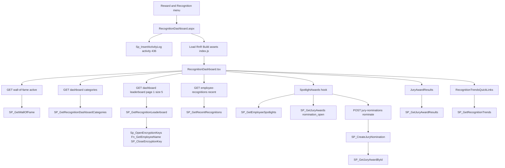
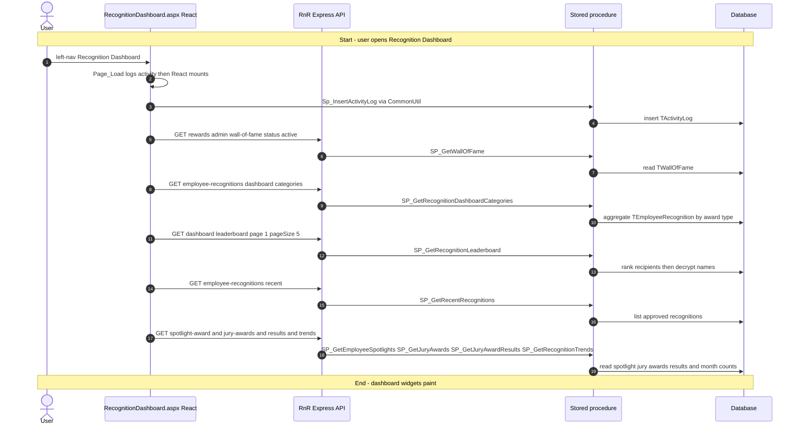
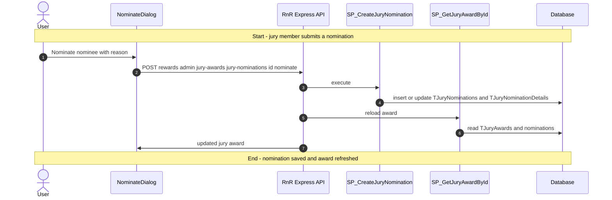
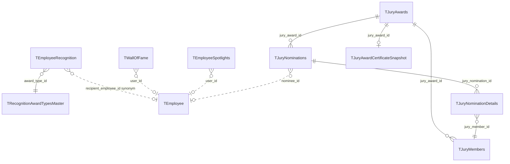

# Recognition Dashboard

## Overview

An employee or manager opens **Reward & Recognition → Recognition Dashboard** (`~/HRM/RewardsAndRecognition/RecognitionDashboard.aspx`) to see organisation recognition widgets for the current month: Wall of Fame carousel, Employee Spotlight, open jury awards (with nominate), jury award results, recent recognitions, recognition trends (last 6 months), category breakdown, and a mini leaderboard (top 5). The React H1 says **Recognition Dashboard**. A **Give Recognition** button navigates to the Give Recognition leaf (iframe redirect when integrated).

The WebForms host only logs activity `RecognitionDashboard` (436), seeds session identity into hidden fields, and mounts the Rewards & Recognition Vite React bundle (`Build/assets/index.js`) on `#root`. Chart and widget traffic is Axios to the separate RnR Express API under `/api/v1` (`Web.config` `APIBaseUrl`), against database `RewardNRecognition`. The ASPX code-behind does not bind dashboard data. The React/API sources live in Azure DevOps repo **rewards and recognition** (not under `HRMS.CoreAPI`).

Widgets always request **Current Month** with no business-unit or location filter on this leaf. KPI endpoint `GET .../dashboard/kpis` exists in the API/Redux slice but is **not** dispatched from `RecognitionDashboard.tsx`.

**Who's involved:**

- **Employee** — browses dashboard widgets; may nominate when a jury member on an open award.
- **Manager / peer** — same shell; recognition lists are employer-scoped approved rows.
- **Admin** — configures Wall of Fame, Spotlight, and Jury awards elsewhere (Admin Console); this leaf only reads those lists (plus nominate write).

SystemModel-2 for this product lives in the RnR repo (`docs/SystemModels/SystemModel-2/`), not under SourceCode.

## Workflow

This page is a React SPA hosted in WebForms. Widget traffic uses JWT plus `x-employer-id` on the RnR API. No WebForms postback binds the widgets.

## Request journey

### Load dashboard — widgets for current month

### Jury member — nominate from open award

## Entry points

| Entry | Purpose |
|---|---|
| `~/HRM/RewardsAndRecognition/RecognitionDashboard.aspx` | Left-nav leaf **Recognition Dashboard**. WebForms host for the RnR React SPA. |
| React route `/RecognitionDashboard` and `/hrm/RewardsAndRecognition/RecognitionDashboard.aspx` | `App.tsx` / `lazyRoutes.ts` mount `RecognitionDashboard`. |
| Sibling RnR ASPX hosts (`SocialFeed`, `Leaderboard`, …) | Same `Build/assets` pattern; different React routes. Not this leaf. |

## Code → database call chain

| Entry | Method | Database |
|---|---|---|
| Page load, `RecognitionDashboard.aspx.cs:26` | `CommonUtil.LogActivity` → `Common.cs:52` → `ActivityHelper.LogActivity:32` | `Sp_InsertActivityLog` (`ActivityHelper.cs:13`). Activity type `RecognitionDashboard` = 436 (`Enums.cs`). HRMS DB. |
| Mount, `RecognitionDashboard.tsx:43` | `getWallOfFameByEmployerAsync` → `wallOfFameSlice.ts:36` → `GET /rewards/admin/wall-of-fame` → `wall-of-fame.service.ts:99` | `SP_GetWallOfFame` |
| Mount, `RecognitionDashboard.tsx:44` | `getDashboardCategoriesAsync` → `dashboardSlice.ts:126` → `GET .../dashboard/categories` → `employee-recognition.service.ts:390` | `SP_GetRecognitionDashboardCategories` |
| Mount, `RecognitionDashboard.tsx:46-50` | `getDashboardLeaderboardAsync` → `dashboardSlice.ts:139` → `GET .../dashboard/leaderboard` → `employee-recognition.service.ts:453` | `SP_GetRecognitionLeaderboard`. Nested `Sp_OpenEncryptionKeys`, `Fn_GetEmployeeName`, `SP_CloseEncryptionKey`. |
| Mount, `RecognitionDashboard.tsx:52` | `getRecentRecognitionsAsync` → `dashboardSlice.ts:207` → `GET .../recent` → `employee-recognition.service.ts:535` | `SP_GetRecentRecognitions` |
| Spotlight section, `useSpotlightAwards.ts:27` | `getSpotlightByEmployerAsync` → `spotlightSlice.ts:40` → `GET /rewards/admin/spotlight-award` → `spotlight-award.service.ts:108` | `SP_GetEmployeeSpotlights` |
| Spotlight section, `useSpotlightAwards.ts:28` | `getJuryAwardsAsync` → `jurySlice.ts:50` → `GET /rewards/admin/jury-awards` → `jury-award.service.ts:159` | `SP_GetJuryAwards` |
| Results, `JuryAwardResults.tsx:81` | `getJuryAwardsResultsAsync` → `jurySlice.ts:118` → `GET .../jury-awards/results` → `jury-award.service.ts:308` | `SP_GetJuryAwardResults` |
| Trends, `RecognitionTrendsQuickLinks.tsx:25` | `getDashboardTrendsAsync` → `dashboardSlice.ts:187` → `GET .../dashboard/trends` → `employee-recognition.service.ts:553` | `SP_GetRecognitionTrends` |
| Nominate, `NominateDialog` → `jurySlice.ts:101` | `POST .../jury-nominations/:id/nominate` → `jury-award.service.ts:245` then `:247` | `SP_CreateJuryNomination` then `SP_GetJuryAwardById` |

Paths under `frontend/` and `backend/` are in ADO repo **rewards and recognition**. ASPX and `CommonUtil` are in SourceCode.

## API endpoints

No WebForms postback binds widget data. Dashboard calls the RnR API base (`APIBaseUrl` → `/api/v1/...`) with Bearer JWT and `x-employer-id`.

| Verb | Route | Parameters | Purpose | Source |
|---|---|---|---|---|
| GET | `/rewards/admin/wall-of-fame` | `status=active` | Wall of Fame carousel. | `wallOfFameSlice.ts:36` |
| GET | `/employee-recognitions/dashboard/categories` | `fromDate`, `toDate` (optional `unitId`, `locationId`) | Top award-type category counts. | `employee-recognition.routes.ts:32` |
| GET | `/employee-recognitions/dashboard/leaderboard` | dates, `page`, `pageSize` (dashboard uses 5) | Mini leaderboard. | `employee-recognition.routes.ts:33` |
| GET | `/employee-recognitions/recent` | dates | Recent approved recognitions. | `employee-recognition.routes.ts:36` |
| GET | `/rewards/admin/spotlight-award` | `status=active` | Employee Spotlight cards. | `spotlightSlice.ts:40` |
| GET | `/rewards/admin/jury-awards` | `status=nomination_open` | Open jury awards for nominate. | `jurySlice.ts:50` |
| GET | `/rewards/admin/jury-awards/results` | — | Jury results carousel (`RESULT_OPEN`). | `jurySlice.ts:118` |
| GET | `/employee-recognitions/dashboard/trends` | — | Last 6 months counts. | `employee-recognition.routes.ts:37` |
| POST | `/rewards/admin/jury-awards/jury-nominations/:juryAwardId/nominate` | body nominee + reason | Submit jury nomination. | `jury-award.routes.ts:15` |
| GET | `/employee-recognitions/dashboard/kpis` | same filters as categories | KPI tiles + recognition rate. **Not called by this page.** | `employee-recognition.routes.ts:31` |

## Stored procedures & tables involved

| Object | File | Purpose | Wiki |
|---|---|---|---|
| `Sp_InsertActivityLog` | `HRMS/STOREPROCEDURE/Sp_InsertActivityLog.sql` | Page-access log. | [Sp_InsertActivityLog](/docs/database/hrms/Sp_InsertActivityLog) |
| `SP_GetWallOfFame` | `HRMS-RewardNRecognition/STORED_PROCEDURE/SP_GetWallOfFame.sql` | Active Wall of Fame rows + status counts. | [SP_GetWallOfFame](/docs/database/hrms-rewardnrecognition/SP_GetWallOfFame) |
| `SP_GetRecognitionDashboardCategories` | `.../SP_GetRecognitionDashboardCategories.sql` | Top 10 award categories. | [SP_GetRecognitionDashboardCategories](/docs/database/hrms-rewardnrecognition/SP_GetRecognitionDashboardCategories) |
| `SP_GetRecognitionLeaderboard` | `.../SP_GetRecognitionLeaderboard.sql` | Paged recipient ranks. | [SP_GetRecognitionLeaderboard](/docs/database/hrms-rewardnrecognition/SP_GetRecognitionLeaderboard) |
| `Sp_OpenEncryptionKeys` / `SP_CloseEncryptionKey` / `Fn_GetEmployeeName` | HRMS (synonyms on RnR) | Name decrypt for leaderboard. | existing HRMS / synonym pages |
| `SP_GetRecentRecognitions` | `.../SP_GetRecentRecognitions.sql` | Recent approved recognition feed. | [SP_GetRecentRecognitions](/docs/database/hrms-rewardnrecognition/SP_GetRecentRecognitions) |
| `SP_GetEmployeeSpotlights` | `.../SP_GetEmployeeSpotlights.sql` | Spotlight list + counts. | [SP_GetEmployeeSpotlights](/docs/database/hrms-rewardnrecognition/SP_GetEmployeeSpotlights) |
| `SP_GetJuryAwards` | `.../SP_GetJuryAwards.sql` | Jury awards with members/nominations JSON. | [SP_GetJuryAwards](/docs/database/hrms-rewardnrecognition/SP_GetJuryAwards) |
| `SP_GetJuryAwardResults` | `.../SP_GetJuryAwardResults.sql` | `RESULT_OPEN` awards and nominees. | [SP_GetJuryAwardResults](/docs/database/hrms-rewardnrecognition/SP_GetJuryAwardResults) |
| `SP_GetRecognitionTrends` | `.../SP_GetRecognitionTrends.sql` | Six-month recognition counts. | [SP_GetRecognitionTrends](/docs/database/hrms-rewardnrecognition/SP_GetRecognitionTrends) |
| `SP_CreateJuryNomination` | `.../SP_CreateJuryNomination.sql` | Insert nomination detail (and count). | [SP_CreateJuryNomination](/docs/database/hrms-rewardnrecognition/SP_CreateJuryNomination) |
| `SP_GetJuryAwardById` | `.../SP_GetJuryAwardById.sql` | Reload award after nominate. | SQL script; page not generated this pass |
| `TEmployeeRecognition`, `TRecognitionAwardTypesMaster`, `TWallOfFame`, `TEmployeeSpotlights`, `TJuryAwards`, `TJuryMembers`, `TJuryNominations`, `TJuryNominationDetails`, `TJuryAwardCertificateSnapshot`, `TEmployee` / `TEmployeeInfo` / `TOrgHierarchyDetails` (synonyms) | matching TABLES / SYNONYMS | Widget source tables. | RnR catalog |

## Table relationships

## Known gaps

- **RnR React `Build/` is not in the SourceCode tree** under `HRM/RewardsAndRecognition/`; it is produced from the separate **rewards and recognition** repo and deployed beside the ASPX hosts.
- **`getDashboardKpisAsync` / `SP_GetRecognitionDashboardKpis` / `SP_RnR_GetEmployeeCountForEmployer`** are implemented in API and Redux but not dispatched from `RecognitionDashboard.tsx` (categories only). Older combined `SP_GetRecognitionDashboardStats` remains in SQL inventory.
- **Department leaderboard and recognition-type filters** (`SP_GetRecognitionLeaderboardByDepartment`, `USP_RnR_GetLeaderboardAwardTypes`) power the Leaderboard leaf, not this dashboard mount.
- **Admin recent-activity** (`GET /rewards/admin/dashboard/recent-activity` → `SP_GetRecentActivity`) is in `dashboardSlice` but unused by this page.
- **SocialFeed.aspx** also logs activity `RecognitionDashboard` (436), same enum as this leaf.
- **No SystemModel-2 page under SourceCode** for this screen; RnR SystemModel-2 is in the product repo (last model refresh ~2026-10-19).

## Reference

Confidence is **high** for the ASPX host, RnR React page/slices, Express routes/services (cloned from ADO `rewards and recognition` `dev`), and the listed `HRMS-RewardNRecognition` STOREPROCEDURE scripts.

### SourceCode

- `HRMS.Web/HRMS.Web/HRM/RewardsAndRecognition/RecognitionDashboard.aspx`
- `HRMS.Web/HRMS.Web/HRM/RewardsAndRecognition/RecognitionDashboard.aspx.cs`
- `HRMS.Web/HRMS.Web/Web.config` (`APIBaseUrl`)
- `HRMS.Shared/HRMS.Common/Common.cs` (`CommonUtil.LogActivity`)
- `HRMS.Shared/TDG.ActivityAuditLog/DAL/ActivityHelper.cs`
- `HRMS.Shared/HRMS.DataContract/Common/Enums.cs` (`RecognitionDashboard = 436`)

### rewards and recognition (ADO)

- `frontend/src/pages/RecognitionDashboard/RecognitionDashboard.tsx`
- `frontend/src/pages/RecognitionDashboard/Components/**`
- `frontend/src/pages/RecognitionDashboard/hooks/useSpotlightAwards.ts`
- `frontend/src/store/slices/dashboardSlice.ts`
- `frontend/src/store/slices/wallOfFameSlice.ts`
- `frontend/src/store/slices/spotlightSlice.ts`
- `frontend/src/store/slices/jurySlice.ts`
- `frontend/src/App.tsx`, `frontend/src/routes/lazyRoutes.ts`
- `backend/src/routes/employee-recognition.routes.ts`
- `backend/src/routes/wall-of-fame.routes.ts`, `jury-award.routes.ts`, `spotlight-award.routes.ts`
- `backend/src/services/employee-recognition.service.ts`
- `backend/src/services/wall-of-fame.service.ts`, `spotlight-award.service.ts`, `jury-award.service.ts`
- `backend/src/routes/index.ts`

### TDG HRMS DB

- `HRMS-DATABASE/HRMS-RewardNRecognition/STORED_PROCEDURE/SP_GetRecognitionDashboardCategories.sql`
- `HRMS-DATABASE/HRMS-RewardNRecognition/STORED_PROCEDURE/SP_GetRecognitionLeaderboard.sql`
- `HRMS-DATABASE/HRMS-RewardNRecognition/STORED_PROCEDURE/SP_GetRecentRecognitions.sql`
- `HRMS-DATABASE/HRMS-RewardNRecognition/STORED_PROCEDURE/SP_GetRecognitionTrends.sql`
- `HRMS-DATABASE/HRMS-RewardNRecognition/STORED_PROCEDURE/SP_GetWallOfFame.sql`
- `HRMS-DATABASE/HRMS-RewardNRecognition/STORED_PROCEDURE/SP_GetEmployeeSpotlights.sql`
- `HRMS-DATABASE/HRMS-RewardNRecognition/STORED_PROCEDURE/SP_GetJuryAwards.sql`
- `HRMS-DATABASE/HRMS-RewardNRecognition/STORED_PROCEDURE/SP_GetJuryAwardResults.sql`
- `HRMS-DATABASE/HRMS-RewardNRecognition/STORED_PROCEDURE/SP_CreateJuryNomination.sql`
- `HRMS-DATABASE/HRMS/STOREPROCEDURE/Sp_InsertActivityLog.sql`
