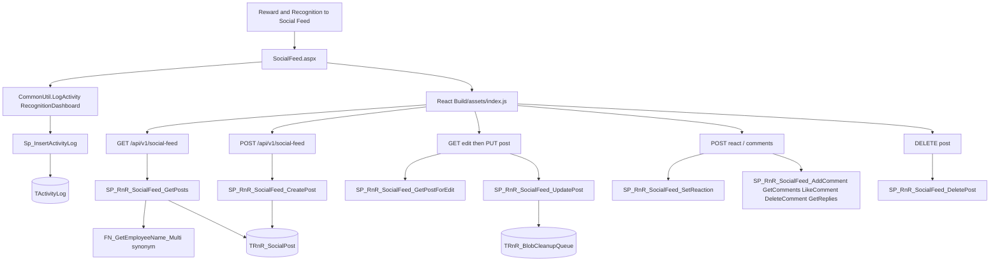
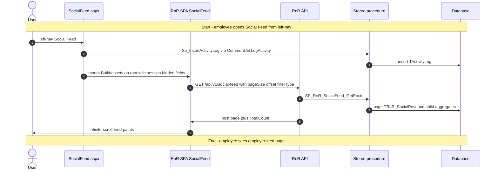
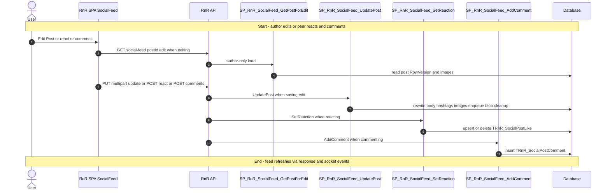
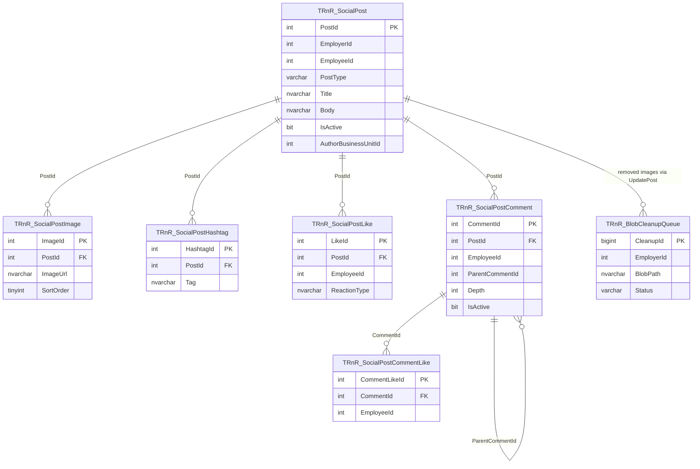

# Social Feed

## Overview

An employee opens **Reward & Recognition → Social Feed** (`~/HRM/RewardsAndRecognition/SocialFeed.aspx`) to browse employer-scoped posts, create or edit their own posts (text, optional title/badge, up to five images, hashtags), react with one of six reaction types, and leave threaded comments. The WebForms host only logs activity and stamps session identity into hidden fields, then mounts the shared RnR React bundle on `#root`. There is no WebForms postback for feed data.

After mount, the SPA talks to the separate Rewards & Recognition Node API under `/api/v1/social-feed/*` (plus blob upload under `/api/v1/azure-blob-storage/social-feed/:uniqueId`). Those handlers execute `SP_RnR_SocialFeed_*` procedures against the `RewardNRecognition` database. Live updates use socket.io room `feed:{employerId}` (`post.created`, `post.updated`, `reaction.updated`, `comment.added`).

This screen is independent of formal peer recognition (Give Recognition / My Recognitions). A social post has its own author and does not reference a recognition row.

The RnR React `Build/` bundle and backend source are **not** present in the SourceCode workspace analyzed for this guide. Host behaviour is verified from the aspx triad; API ↔ SP linkage comes from inventoried SQL, `TDataCatalog`, and the cached RnR SystemModel-2 workflow. Menu seed uses MenuId `1303` under parent `1240`.

**Who's involved:**

- **Employee (author / viewer)** — browses the feed, posts, edits or deletes own posts, reacts, comments, replies, likes comments.
- **Co-workers (same employer)** — see posts live via the feed list and socket events; react and comment.
- **Background blob cleanup job (Node)** — after an edit removes images, rows land in `TRnR_BlobCleanupQueue`; a 10-minute cron claims and deletes blobs (not part of the aspx UI path beyond enqueue from `UpdatePost`).

## Workflow



## Request journey

### Employee — open Social Feed



### Employee — create a post

```mermaid
sequenceDiagram
  autonumber
  actor User
  participant React as RnR SPA SocialFeed
  participant Blob as azure-blob-storage
  participant App as RnR API social-feed
  participant Create as SP_RnR_SocialFeed_CreatePost
  participant DB as Database

  Note over User,DB: Start - employee publishes a new social post
  User->>React: compose body images hashtags and Post
  React->>Blob: POST social-feed uniqueId for each image when needed
  Blob-->>React: image URLs
  React->>App: POST /api/v1/social-feed JSON body
  App->>Create: execute with HashtagsJson ImageUrlsJson
  Create->>DB: insert TRnR_SocialPost hashtags images
  App-->>React: created post payload
  App-->>React: socket post.created to feed room
  Note over User,DB: End - post appears for employer peers
```

### Employee — edit post, react, or comment



## Entry points

`~/HRM/RewardsAndRecognition/SocialFeed.aspx` is the live HRMS host. `Page_Load` logs `ActivityDescription.RecognitionDashboard` (436) — the same enum value used by Recognition Dashboard — and stamps hidden fields (`hdnEmpId`, `hdnEmployerId`, `hdnCustomerId`, role, email, and related). The React module mounts at `#root` (class `vmsModule`) via relative `Build/assets/index.js`. Menu node text **Social Feed** uses MenuId `1303` (`RnRSocialFeedPage/Index.sql`).

Sibling aspx hosts under `HRM/RewardsAndRecognition/` share the same bundle; React Router selects the Social Feed page from the browser path. Those siblings are separate left-nav features.

| UI page / surface | Purpose |
|---|---|
| `HRM/RewardsAndRecognition/SocialFeed.aspx` | WebForms host, activity log, session stamp |
| `HRM/RewardsAndRecognition/Build/assets/index.js` | Deployed RnR SPA bundle (not in SourceCode git tree) |
| RnR backend `/api/v1/social-feed/*` | Feed CRUD, reactions, comments |
| RnR backend `POST /api/v1/azure-blob-storage/social-feed/:uniqueId` | Image upload for posts |
| socket.io room `feed:{employerId}` | Live post/reaction/comment events |

## Code → database call chain

Host-side hops are verified in SourceCode. SPA → API → procedure hops are from inventoried `SP_RnR_SocialFeed_*.sql`, `TDataCatalog` (`TRnR_SocialPost` UI API `GET /api/v1/social-feed`), and RnR SystemModel-2 (`social-feed-post-flow.md` / `service-apis.md`). Frontend/backend `file:line` paths below name the expected RnR repo files; those sources were not on disk in this workspace.

| Entry | Method | Stored procedure / data access |
|---|---|---|
| Page load (activity) | `Page_Load` (`SocialFeed.aspx.cs:27`) → `CommonUtil.LogActivity` (`Common.cs:52`) → `LogUserActivity.LogActivity` (`LogUserActivity.cs:36`) → `ActivityLog.LogActivityAsync` (`ActivityLog.cs:22`) → `ActivityHelper.LogActivity` (`ActivityHelper.cs:32`) | [`Sp_InsertActivityLog`](/docs/database/hrms/Sp_InsertActivityLog) → `TActivityLog` |
| Feed list | RnR SPA `SocialFeed.tsx` → `GET /api/v1/social-feed` → `social-feed.service.ts` | [`SP_RnR_SocialFeed_GetPosts`](/docs/database/hrms-rewardnrecognition/SP_RnR_SocialFeed_GetPosts) (calls synonym [`FN_GetEmployeeName_Multi`](/docs/database/hrms/FN_GetEmployeeName_Multi)) |
| Create post | SPA → `POST /api/v1/social-feed` | [`SP_RnR_SocialFeed_CreatePost`](/docs/database/hrms-rewardnrecognition/SP_RnR_SocialFeed_CreatePost) |
| Load for edit | SPA → `GET /api/v1/social-feed/:postId/edit` | [`SP_RnR_SocialFeed_GetPostForEdit`](/docs/database/hrms-rewardnrecognition/SP_RnR_SocialFeed_GetPostForEdit) |
| Update post | SPA → `PUT /api/v1/social-feed/:postId` (after blob upload) | [`SP_RnR_SocialFeed_UpdatePost`](/docs/database/hrms-rewardnrecognition/SP_RnR_SocialFeed_UpdatePost) → inserts `TRnR_BlobCleanupQueue`; Node may later call `SP_RnR_BlobCleanup_MarkResult` / cron `ClaimBatch` |
| Delete post | SPA → `DELETE /api/v1/social-feed/:postId` | [`SP_RnR_SocialFeed_DeletePost`](/docs/database/hrms-rewardnrecognition/SP_RnR_SocialFeed_DeletePost) |
| React | SPA → `POST /api/v1/social-feed/:postId/react` | [`SP_RnR_SocialFeed_SetReaction`](/docs/database/hrms-rewardnrecognition/SP_RnR_SocialFeed_SetReaction) |
| List comments | SPA → `GET .../comments` | [`SP_RnR_SocialFeed_GetComments`](/docs/database/hrms-rewardnrecognition/SP_RnR_SocialFeed_GetComments) |
| Add comment / reply | SPA → `POST .../comments` | [`SP_RnR_SocialFeed_AddComment`](/docs/database/hrms-rewardnrecognition/SP_RnR_SocialFeed_AddComment) |
| Like comment | SPA → `POST .../comments/:commentId/like` | [`SP_RnR_SocialFeed_LikeComment`](/docs/database/hrms-rewardnrecognition/SP_RnR_SocialFeed_LikeComment) |
| Delete comment | SPA → `DELETE .../comments/:commentId` | [`SP_RnR_SocialFeed_DeleteComment`](/docs/database/hrms-rewardnrecognition/SP_RnR_SocialFeed_DeleteComment) |
| List replies | SPA → `GET .../comments/:commentId/replies` | [`SP_RnR_SocialFeed_GetReplies`](/docs/database/hrms-rewardnrecognition/SP_RnR_SocialFeed_GetReplies) |

`SP_RnR_SocialFeed_ToggleLike` and `SP_RnR_SocialFeed_GetMyDept` exist in the SQL inventory / catalog but are not on the current SystemModel API surface for this page (`SetReaction` replaced toggle-like; `myDept` filter uses client-supplied `businessUnitId`).

## API endpoints

Not WebForms postback for feed data. The host page has no PageMethods. After mount, the RnR React app calls the Rewards & Recognition Node API under `/api/v1` (base URL from RnR frontend env, not the aspx).

| Verb | Route | Parameters | Purpose | Source |
|---|---|---|---|---|
| GET | `/api/v1/social-feed/` | `pageSize`, `offset`, `filterType` (`all`\|`myDept`\|`news`\|`trending`), `businessUnitId`, `employeeId`, `searchQuery` | Paginated feed | SystemModel `service-apis.md` + `SP_RnR_SocialFeed_GetPosts` |
| POST | `/api/v1/social-feed/` | JSON `body`, optional `title`, `badge`, `imageUrls` (≤5), `authorBusinessUnitId`, `hashtags` | Create post | SystemModel + `SP_RnR_SocialFeed_CreatePost` |
| GET | `/api/v1/social-feed/:postId/edit` | path `postId` | Author-only edit load | `SP_RnR_SocialFeed_GetPostForEdit` |
| PUT | `/api/v1/social-feed/:postId` | multipart `body`, `retainedImageIds`, `expectedVersion`, `newImages` | Update owned post (409 on stale version) | `SP_RnR_SocialFeed_UpdatePost` |
| DELETE | `/api/v1/social-feed/:postId` | path `postId` | Delete owned post | `SP_RnR_SocialFeed_DeletePost` |
| POST | `/api/v1/social-feed/:postId/react` | reaction type | Set / replace / toggle-off reaction | `SP_RnR_SocialFeed_SetReaction` |
| GET | `/api/v1/social-feed/:postId/comments` | `pageSize`, `lastCommentId` | Cursor-paged top-level comments | `SP_RnR_SocialFeed_GetComments` |
| POST | `/api/v1/social-feed/:postId/comments` | body + optional parent | Add comment or reply | `SP_RnR_SocialFeed_AddComment` |
| POST | `/api/v1/social-feed/:postId/comments/:commentId/like` | path ids | Toggle comment like | `SP_RnR_SocialFeed_LikeComment` |
| DELETE | `/api/v1/social-feed/:postId/comments/:commentId` | path ids | Delete own comment | `SP_RnR_SocialFeed_DeleteComment` |
| GET | `/api/v1/social-feed/:postId/comments/:commentId/replies` | `pageSize`, `lastReplyId` | Cursor-paged replies | `SP_RnR_SocialFeed_GetReplies` |
| POST | `/api/v1/azure-blob-storage/social-feed/:uniqueId` | multipart image | Upload post image to Azure Blob | SystemModel blob APIs |

No Core `HRMS.Core.WebAPI.Node` controller for this screen was found in SourceCode.

## Stored procedures & tables involved

| Object | File path | Purpose | llm-wiki |
|---|---|---|---|
| [`Sp_InsertActivityLog`](/docs/database/hrms/Sp_InsertActivityLog) | `HRMS-DATABASE/HRMS/STOREPROCEDURE/Sp_InsertActivityLog.sql` | Activity row on page open | — |
| [`SP_RnR_SocialFeed_GetPosts`](/docs/database/hrms-rewardnrecognition/SP_RnR_SocialFeed_GetPosts) | `HRMS-DATABASE/HRMS-RewardNRecognition/STORED_PROCEDURE/SP_RnR_SocialFeed_GetPosts.sql` | Paged feed + aggregates | No llm-wiki page |
| [`SP_RnR_SocialFeed_CreatePost`](/docs/database/hrms-rewardnrecognition/SP_RnR_SocialFeed_CreatePost) | `…/SP_RnR_SocialFeed_CreatePost.sql` | Insert post, hashtags, images | — |
| [`SP_RnR_SocialFeed_GetPostForEdit`](/docs/database/hrms-rewardnrecognition/SP_RnR_SocialFeed_GetPostForEdit) | `…/SP_RnR_SocialFeed_GetPostForEdit.sql` | Author-only edit payload | — |
| [`SP_RnR_SocialFeed_UpdatePost`](/docs/database/hrms-rewardnrecognition/SP_RnR_SocialFeed_UpdatePost) | `…/SP_RnR_SocialFeed_UpdatePost.sql` | Optimistic update + blob enqueue | — |
| [`SP_RnR_SocialFeed_DeletePost`](/docs/database/hrms-rewardnrecognition/SP_RnR_SocialFeed_DeletePost) | `…/SP_RnR_SocialFeed_DeletePost.sql` | Hard-delete post and children | — |
| [`SP_RnR_SocialFeed_SetReaction`](/docs/database/hrms-rewardnrecognition/SP_RnR_SocialFeed_SetReaction) | `…/SP_RnR_SocialFeed_SetReaction.sql` | Insert / switch / remove reaction | — |
| [`SP_RnR_SocialFeed_GetComments`](/docs/database/hrms-rewardnrecognition/SP_RnR_SocialFeed_GetComments) | `…/SP_RnR_SocialFeed_GetComments.sql` | Top-level comments | — |
| [`SP_RnR_SocialFeed_AddComment`](/docs/database/hrms-rewardnrecognition/SP_RnR_SocialFeed_AddComment) | `…/SP_RnR_SocialFeed_AddComment.sql` | Add comment or reply | — |
| [`SP_RnR_SocialFeed_LikeComment`](/docs/database/hrms-rewardnrecognition/SP_RnR_SocialFeed_LikeComment) | `…/SP_RnR_SocialFeed_LikeComment.sql` | Toggle comment like | — |
| [`SP_RnR_SocialFeed_DeleteComment`](/docs/database/hrms-rewardnrecognition/SP_RnR_SocialFeed_DeleteComment) | `…/SP_RnR_SocialFeed_DeleteComment.sql` | Hard-delete comment + replies | — |
| [`SP_RnR_SocialFeed_GetReplies`](/docs/database/hrms-rewardnrecognition/SP_RnR_SocialFeed_GetReplies) | `…/SP_RnR_SocialFeed_GetReplies.sql` | Direct replies to a comment | — |
| [`FN_GetEmployeeName_Multi`](/docs/database/hrms/FN_GetEmployeeName_Multi) | HRMS function via RnR synonym | Author display name in GetPosts | — |
| `TRnR_SocialPost` / `TRnR_SocialPostImage` / `TRnR_SocialPostHashtag` / `TRnR_SocialPostLike` / `TRnR_SocialPostComment` / `TRnR_SocialPostCommentLike` | `HRMS-DATABASE/HRMS-RewardNRecognition/TABLES/` | Feed persistence | — |
| `TRnR_BlobCleanupQueue` | `…/TABLES/` | Removed-image cleanup queue | — |
| `TEmployee` (synonym) | RnR → HRMS employee | Author name fallback joins | — |
| `TActivityLog` | HRMS core | Host activity audit | — |

No Social Feed SP `EXEC`s another procedure. Nested function used by GetPosts: `FN_GetEmployeeName_Multi`. App-level follow-up after UpdatePost may call `SP_RnR_BlobCleanup_MarkResult` / cron `ClaimBatch` (not EXEC nesting from the feed SPs).

## Table relationships

No domain `erDiagram` exists for Reward & Recognition Social Feed in llm-wiki. Edges below follow `TDataCatalog` / SP joins; many keys are application-enforced with **no FK declared** in the inventoried DDL.



## Known gaps

- **RnR React source and `Build/assets`** are not in the SourceCode tree; SPA component names and exact client query param wiring are from SystemModel, not a local `file:line` read.
- **RnR backend repo** is not in this workspace; controller/service `file:line` for `/api/v1/social-feed` were not confirmed on disk.
- Host logs **`RecognitionDashboard` (436)** rather than a dedicated Social Feed activity enum — same id as Recognition Dashboard.
- Inventoried `TRnR_SocialPost` DDL in TABLES/ lags live SP usage (`ModifiedAt`, `RowVersion`, `ModifiedByEmployeeId` appear in Update/GetPostForEdit but not in the checked CREATE TABLE script).
- SystemModel describes comment soft-delete via `IsActive`; inventoried `SP_RnR_SocialFeed_DeleteComment` / `DeletePost` perform hard `DELETE`s.
- **llm-wiki** has no Reward & Recognition Social Feed domain page here.
- `SP_RnR_SocialFeed_GetEditMetadata` appears in `TDataCatalog` but has **no** matching `.sql` under `HRMS-RewardNRecognition`.
- Nested DB page for `FN_GetEmployeeName_Multi` already exists under `content/database/hrms/` (file present; not regenerated). Blob cleanup procs are app/cron side-paths, not SQL-nested from feed SPs.

## Reference

Confidence is **medium**: WebForms host → activity log is verified in SourceCode; feed data paths are tied to inventoried `SP_RnR_SocialFeed_*` SQL, `TDataCatalog`, and RnR SystemModel-2, but the RnR SPA/API source was not available on disk to confirm `file:line`.

### SourceCode

- `HRMS.Web/HRMS.Web/HRM/RewardsAndRecognition/SocialFeed.aspx`
- `HRMS.Web/HRMS.Web/HRM/RewardsAndRecognition/SocialFeed.aspx.cs`
- `HRMS.Shared/HRMS.Common/Common.cs`
- `HRMS.Shared/TDG.ActivityAuditLog/Activity/LogUserActivity.cs`
- `HRMS.Shared/TDG.ActivityAuditLog/ActivityLog/ActivityLog.cs`
- `HRMS.Shared/TDG.ActivityAuditLog/DAL/ActivityHelper.cs`
- `HRMS.Shared/HRMS.DataContract/Common/Enums.cs` (`ActivityDescription.RecognitionDashboard = 436`)

### TDG HRMS DB

- `HRMS-DATABASE/HRMS-RewardNRecognition/STORED_PROCEDURE/SP_RnR_SocialFeed_*.sql`
- `HRMS-DATABASE/HRMS-RewardNRecognition/TABLES/TRnR_SocialPost*.sql`
- `HRMS-DATABASE/HRMS-RewardNRecognition/SYNONYMS/FN_GetEmployeeName_Multi.sql`
- `HRMS-DATABASE/HRMS/DML/TDataCatalog_DML.sql` (`TRnR_SocialPost` → `GET /api/v1/social-feed`)
- `HRMS-DATABASE/HRMS/DML/RnRSocialFeedPage/Index.sql` (MenuId `1303`)

### Cached SystemModel (RnR repo not cloned)

- `docs/SystemModels/SystemModel-2/behavior/workflows/social-feed-post-flow.md`
- `docs/SystemModels/SystemModel-2/interface/apis/service-apis.md`
