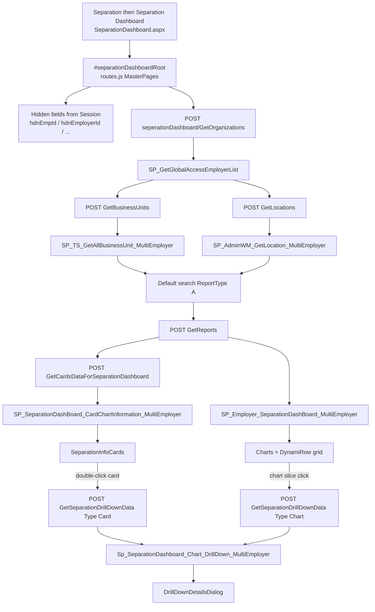
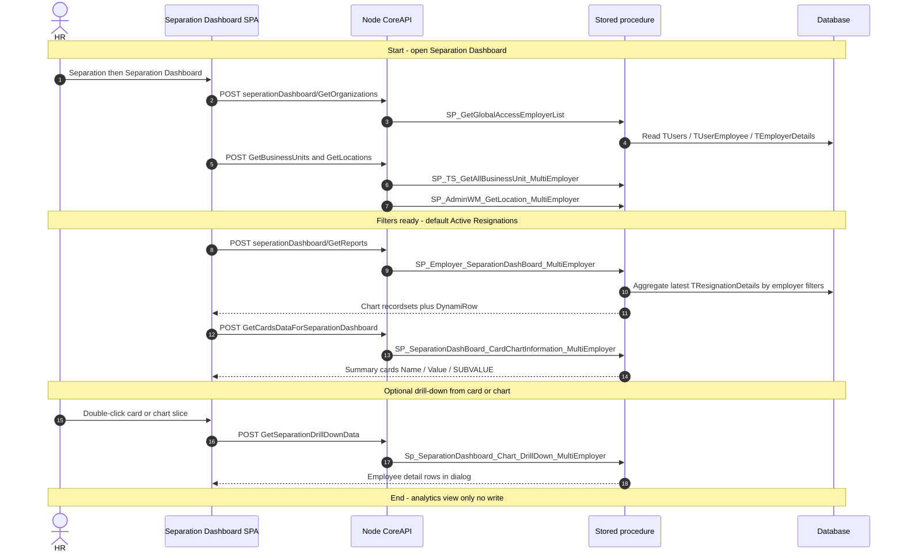
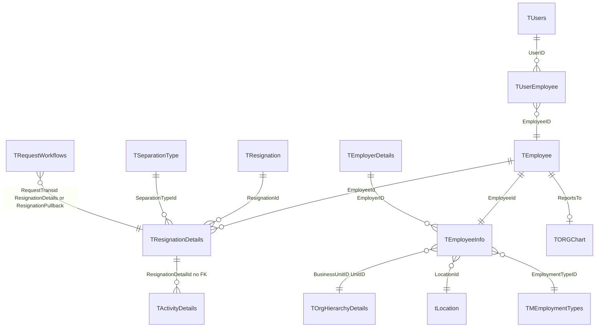

# Separation Dashboard

## Overview

**Separation → Separation Dashboard** is the analytics board for exits already in flight or completed. It is not the inbox (Notifications) and not the tab strip where people record, approve, clear, or deactivate (Separation Tasks). HR or a manager with menu access opens charts and summary cards for one of three report modes: **Active Resignations** (`ReportType=A`), **Resignation Pullback** (`C`), or **Left Employees** (`B`, optionally with a comparison date range).

The WebForms shell `SeparationDashboard.aspx` only stamps session credentials into hidden fields and mounts `#separationDashboardRoot`. The React router binds that URL to `MasterPages`, which loads org / business-unit / location filters, posts the chart report, then loads info cards. Double-clicking a card or a chart slice opens a drill-down grid of employee rows. Export to PDF is client-side (`html2canvas` + `jsPDF`); it does not call the API.

This page is read-only against resignation data. Creating or approving resignations, pullbacks, clearance, and deactivation live on Separation Tasks / Notifications. Broader exit lifecycle context is in `llm-wiki/domain/employee-lifecycle.md` and the sibling guides `separation.md`, `notifications.md`, and `separation-tasks.md`.

## Workflow

Filter labels for business unit come from a side call `GET /Dashboard/GetCustomerSettings` (`SP_GetCustomerSettings`) via `businessUnitReducer`; that is display text only, not chart data.

## Request journey

This page does not create resignation or pullback rows. The “request” that starts and ends here is a filtered analytics load (and optional drill-down). Mode switches and Search re-run the same chain with a new `ReportType` / date window.

## Entry points

| Entry point | Purpose | Live? |
|---|---|---|
| `HRM/Separation_React/SeparationDashboard.aspx` | WebForms shell; session hidden fields; loads `BuildJS/separation_module.min.js` into `#separationDashboardRoot` | Yes |
| `~/HRM/Separation_React/SeparationDashboard.aspx` | Same page via app-relative URL | Yes |
| React router `ROUTES.SeparationDashboard` → `MasterPages` | SPA surface for filters, charts, cards, drill-down | Yes |
| Node CoreAPI `/seperationDashboard/*` (V1) | Backing API mounted in `routeIndex.js` | Yes |
| Node CoreAPI `/V2/seperationDashboard/*` | Parallel V2 router + DAL | Mounted; React `apiURLConstants` paths have no `/V2` prefix, so the SPA hits V1 |
| `seperationDashboardRoutes_V3` / `*_V3` controller/DAL | Versioned rewrite | No — not mounted in `routeIndex.js` |
| WebForms postback on this page | N/A | No — code-behind only logs activity and stamps session fields |

## Code → database call chain

| Step | Entry point | App code | Stored procedure |
|---|---|---|---|
| Page load / session stamp | `SeparationDashboard.aspx.cs:20-38` | Sets `hdnEmpId`, `hdnEmployerId`, `hdnCustomerId`, … from `Session["LoggedInUser"]`; `CommonUtil.LogActivity(Seprations)` | — (no SP) |
| Mount SPA | `index.js:11-20`, `routes.js:28-29` | `createRoot(#separationDashboardRoot)` → `MasterPages` | — |
| Org picker | `MasterPages.js:150-155` | `POST /seperationDashboard/GetOrganizations` → `seperationDashboardController.js:8-12` → `seperationDashboardDAL.js:15-21` | `SP_GetGlobalAccessEmployerList` |
| Business units | `MasterPages.js:192-201` | `POST /seperationDashboard/GetBusinessUnits` → `seperationDashboardController.js:18-20` → `seperationDashboardDAL.js:28-34` | `SP_TS_GetAllBusinessUnit_MultiEmployer` |
| Locations | `MasterPages.js:232-241` | `POST /seperationDashboard/GetLocations` → `seperationDashboardController.js:28-31` → `seperationDashboardDAL.js:42-48` | `SP_AdminWM_GetLocation_MultiEmployer` |
| Chart report (Search / default) | `MasterPages.js:369-404` | `POST /seperationDashboard/GetReports/` → `seperationDashboardController.js:37-63` → `seperationDashboardDAL.js:56-76` | `SP_Employer_SeparationDashBoard_MultiEmployer` |
| Info cards | `MasterPages.js:470-482` | `POST /seperationDashboard/GetCardsDataForSeparationDashboard` → `seperationDashboardController.js:79-82` → `seperationDashboardDAL.js:117-131` | `SP_SeparationDashBoard_CardChartInformation_MultiEmployer` |
| Card drill-down | `MasterPages.js:498-521` | `POST /seperationDashboard/GetSeparationDrillDownData` (`Type: "Card"`, `Category: card.Name`) → `seperationDashboardController.js:69-72` → `seperationDashboardDAL.js:92-110` | `Sp_SeparationDashboard_Chart_DrillDown_MultiEmployer` |
| Chart slice drill-down | `MasterPages.js:807-833` (also `ChartContainer.js`, `CompariasonChartContainer.js`, `ChartByResignationTrend.js`) | Same `GetSeparationDrillDownData` with `Type: "Chart"`, `Category`, `SubCategory` | `Sp_SeparationDashboard_Chart_DrillDown_MultiEmployer` |
| Business-unit label | `businessUnitReducer.js:44` | `GET /Dashboard/GetCustomerSettings?CustomerId=` → `dashBoardDAL.js:457-463` | `SP_GetCustomerSettings` |

Controller reshapes `GetReports` recordsets into named keys (`ByStatus`, `ByBusinessUnit`, …, `DynamiRow`) in `seperationDashboardController.js:41-61` — different index map for `ReportType` `A`/`C` vs `B` (Left Employees drops the Status set).

## API endpoints

Routes below are relative to the Node CoreAPI mount `/seperationDashboard` in `routeIndex.js:136` (`seperationDashboardRoutes.js`). Handlers sit behind `Authorize` via `guards`. There is **no WebForms postback** data path on this page.

| Verb | Route | Parameters | Purpose | Source |
|---|---|---|---|---|
| POST | `/seperationDashboard/GetOrganizations` | body: `EmployeeId` (controller also forces `req.EID`) | Employers the user may analyze | `seperationDashboardRoutes.js:8`, `seperationDashboardController.js:8` |
| POST | `/seperationDashboard/GetBusinessUnits` | body: `EmployerIds` varchar comma-separated | Active BU options for selected orgs | `seperationDashboardRoutes.js:9`, `seperationDashboardController.js:18` |
| POST | `/seperationDashboard/GetLocations` | body: `EmployerIds` varchar comma-separated | Active location options | `seperationDashboardRoutes.js:10`, `seperationDashboardController.js:28` |
| POST | `/seperationDashboard/GetReports` | body: `ReportType` (`A`/`B`/`C`), `BusinessUnit`, `Location`, `EmployerIDs`, `EmployeeId`, `FromDate`/`ToDate`, optional `CompFromDate`/`CompToDate` (dates sent when `ReportType=B`) | Chart + detail aggregations | `seperationDashboardRoutes.js:11`, `seperationDashboardController.js:37` |
| POST | `/seperationDashboard/GetCardsDataForSeparationDashboard` | body: `ReportType`, `LoginID`, `EmployerIDs`, `BusinessUnit`, `Location`, date fields | Summary cards | `seperationDashboardRoutes.js:13`, `seperationDashboardController.js:79` |
| POST | `/seperationDashboard/GetSeparationDrillDownData` | body: same filters plus `Category`, optional `SubCategory` / `excludeSubCategory`, `Type` (`Card`/`Chart`) | Employee rows for dialog | `seperationDashboardRoutes.js:12`, `seperationDashboardController.js:69` |
| GET | `/Dashboard/GetCustomerSettings` | query: `CustomerId` | Tenant label for “Business Unit” text | `DashBoardRoutes.js:45` → `SP_GetCustomerSettings` |

UI constants live in `apiURLConstants.js:19-24` (note the misspelled route segment `seperationDashboard`, matching the server mount).

## Stored procedures & tables involved

| Object | File path | Purpose | Wiki / docs |
|---|---|---|---|
| `SP_GetGlobalAccessEmployerList` | `HRMS-DATABASE/HRMS/STOREPROCEDURE/SP_GetGlobalAccessEmployerList.sql` | Org list for global vs single-employer users | [SP_GetGlobalAccessEmployerList](/docs/database/hrms/SP_GetGlobalAccessEmployerList) |
| `SP_TS_GetAllBusinessUnit_MultiEmployer` | `…/SP_TS_GetAllBusinessUnit_MultiEmployer.sql` | Active BUs across employers | [SP_TS_GetAllBusinessUnit_MultiEmployer](/docs/database/hrms/SP_TS_GetAllBusinessUnit_MultiEmployer) |
| `SP_AdminWM_GetLocation_MultiEmployer` | `…/SP_AdminWM_GetLocation_MultiEmployer.sql` | Active locations across employers | [SP_AdminWM_GetLocation_MultiEmployer](/docs/database/hrms/SP_AdminWM_GetLocation_MultiEmployer) |
| `SP_Employer_SeparationDashBoard_MultiEmployer` | `…/SP_Employer_SeparationDashBoard_MultiEmployer.sql` | Chart aggregations + DynamiRow detail | [SP_Employer_SeparationDashBoard_MultiEmployer](/docs/database/hrms/SP_Employer_SeparationDashBoard_MultiEmployer) |
| `SP_SeparationDashBoard_CardChartInformation_MultiEmployer` | `…/SP_SeparationDashBoard_CardChartInformation_MultiEmployer.sql` | Summary cards by report mode | [SP_SeparationDashBoard_CardChartInformation_MultiEmployer](/docs/database/hrms/SP_SeparationDashBoard_CardChartInformation_MultiEmployer) |
| `Sp_SeparationDashboard_Chart_DrillDown_MultiEmployer` | `…/Sp_SeparationDashboard_Chart_DrillDown_MultiEmployer.sql` | Card/chart employee drill-down | [Sp_SeparationDashboard_Chart_DrillDown_MultiEmployer](/docs/database/hrms/Sp_SeparationDashboard_Chart_DrillDown_MultiEmployer) |
| `Sp_OpenEncryptionKeys` / `SP_CloseEncryptionKey` | `…/STOREPROCEDURE/` | Opened by report/card/drill SPs (close on main report SP) | existing database pages |
| `SP_EmployeeDashboard_GetLocationByEmployeeId` | nested from card/drill | Work-location enrichment per employer | [SP_EmployeeDashboard_GetLocationByEmployeeId](/docs/database/hrms/SP_EmployeeDashboard_GetLocationByEmployeeId) |
| `SP_CM_GetTitle` | nested from card/drill | Designation titles per employer | [SP_CM_GetTitle](/docs/database/hrms/SP_CM_GetTitle) |
| `Fn_GetEmployeeName` | called in dynamic detail SELECTs | Display names | [Fn_GetEmployeeName](/docs/database/hrms/Fn_GetEmployeeName) |
| `SP_GetCustomerSettings` | side call for label | Business-unit display name | [SP_GetCustomerSettings](/docs/database/hrms/SP_GetCustomerSettings) |
| `TResignationDetails`, `TResignation`, `TSeparationType` | `HRMS-DATABASE/HRMS/TABLES/` | Latest resignation row and reason/type | `llm-wiki/domain/employee-lifecycle.md` |
| `TRequestWorkflows` | `…/TABLES/` | Pending/approval status text for charts | `llm-wiki/domain/approval-workflow.md` |
| `TActivityDetails` | `…/TABLES/` | Clearance Initiated / Completed status branches | `domain/employee-lifecycle.md` |
| `TEmployee`, `TEmployeeInfo`, `TORGChart`, `TOrgHierarchyDetails`, `tLocation`, `TMEmploymentTypes` | `…/TABLES/` | Org, location, employment-type dimensions | — |
| `TEmployerDetails`, `TUsers`, `TUserEmployee` | `…/TABLES/` | Org picker / multi-employer scope | — |

## Table relationships

Exit-table FKs follow `llm-wiki/domain/employee-lifecycle.md`. Dashboard SPs take the latest `ResignationDetailId` per employee, join org dimensions, and read polymorphic `TRequestWorkflows` / `TActivityDetails` for status labels. No FK is declared from workflows to resignation details.

## Known gaps

- **Route spelling.** Server and UI both use `seperationDashboard` (missing second “a”). Correct English spelling will 404.
- **`SeparationType` chart set is built but not returned.** `SP_Employer_SeparationDashBoard_MultiEmployer` inserts Sno `7` (`[SeparationType]`) into `@ResultSet`, but dynamic SQL only runs `Sno < 7` and `Sno > 7`, so that aggregation never becomes a recordset. Controller also never maps a SeparationType chart key.
- **V3 API not mounted.** `seperationDashboardRoutes_V3.js` and `*_V3` DAL/controller exist; `routeIndex.js` mounts only V1 and V2. The SPA posts to unsuffixed V1 paths.
- **Card SP does not call `SP_CloseEncryptionKey`.** The main report SP opens and closes keys; card and drill-down open keys and rely on connection teardown.
- **Read-only board.** No approve/reject/create endpoints on this page; deep links to Separation Tasks are not part of `MasterPages` (unlike Notifications).
- **`apiDashboardHelper.js` unused here.** `MasterPages` uses `APIHelper` (`API_URL`), not `API_DASHBOARD_URL`.
- **Script header `USE [HRM-CL-Prod]`** appears in `SP_AdminWM_GetLocation_MultiEmployer.sql` source; Liquibase/deploy must not rely on that hardcoded database name (workspace rule: no env DB names).

## Reference

Call chain verified from `SeparationDashboard.aspx` through `MasterPages.js` POSTs to V1 `seperationDashboardDAL.js` `execute(...)` names and the matching `HRMS-DATABASE/HRMS/STOREPROCEDURE/*MultiEmployer*.sql` scripts. Nested encryption / location / title helpers confirmed from those scripts. Sibling guides cover apply/inbox flows; this guide does not replace them.

### SourceCode

- `HRMS.Web/HRMS.Web/HRM/Separation_React/SeparationDashboard.aspx(.cs)`
- `HRMS.Web/HRMS.Web/HRM/Separation_React/index.js`, `routes.js`
- `HRMS.Web/HRMS.Web/HRM/Separation_React/Areas/MasterPages/Containers/MasterPages.js`
- `HRMS.Web/HRMS.Web/HRM/Separation_React/Areas/MasterPages/Components/SearchBar.js`, `SeparationInfoCards.js`
- `HRMS.Web/HRMS.Web/HRM/Separation_React/Common/apiURLConstants.js`, `apiHelper.js`, `dashboardConstants.js`
- `HRMS.Web/HRMS.Web/HRM/Separation_React/store/businessUnitReducer.js`
- `HRMS.CoreAPI/HRMS.Core.WebAPI.Node/Routes/routeIndex.js`, `seperationDashboardRoutes.js`
- `HRMS.CoreAPI/HRMS.Core.WebAPI.Node/Controllers/seperationDashboardController.js`
- `HRMS.CoreAPI/HRMS.Core.WebAPI.Node/Core/DataAccessLayer/seperationDashboardDAL.js`

### TDG HRMS DB

- `llm-wiki/domain/employee-lifecycle.md`
- `llm-wiki/domain/approval-workflow.md`
- `HRMS-DATABASE/HRMS/STOREPROCEDURE/SP_Employer_SeparationDashBoard_MultiEmployer.sql`
- `HRMS-DATABASE/HRMS/STOREPROCEDURE/SP_SeparationDashBoard_CardChartInformation_MultiEmployer.sql`
- `HRMS-DATABASE/HRMS/STOREPROCEDURE/Sp_SeparationDashboard_Chart_DrillDown_MultiEmployer.sql`
- `HRMS-DATABASE/HRMS/STOREPROCEDURE/SP_TS_GetAllBusinessUnit_MultiEmployer.sql`
- `HRMS-DATABASE/HRMS/STOREPROCEDURE/SP_AdminWM_GetLocation_MultiEmployer.sql`
- `HRMS-DATABASE/HRMS/STOREPROCEDURE/SP_GetGlobalAccessEmployerList.sql`
