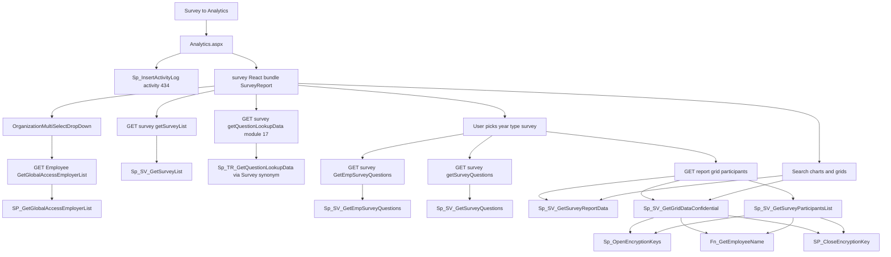
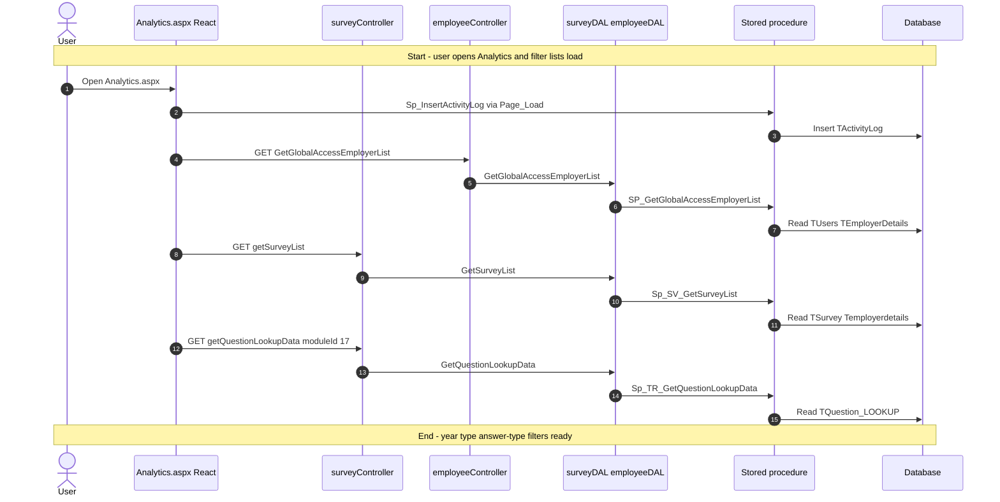
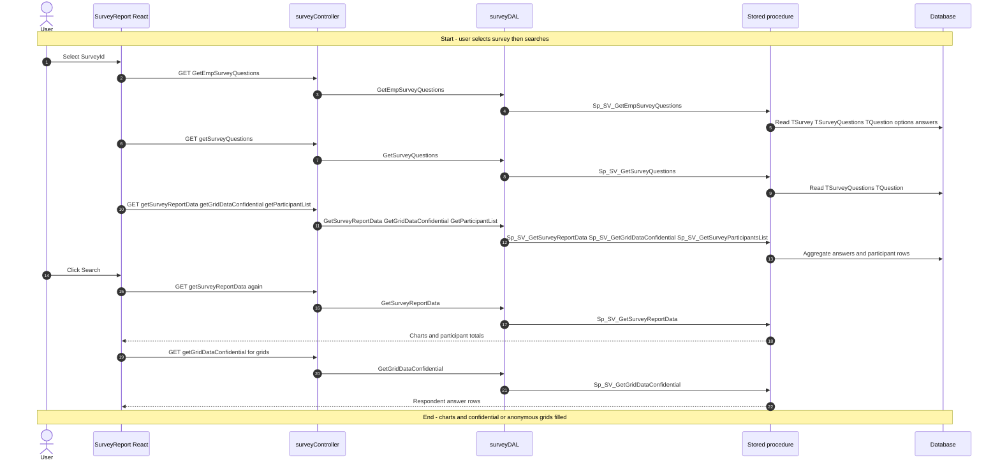
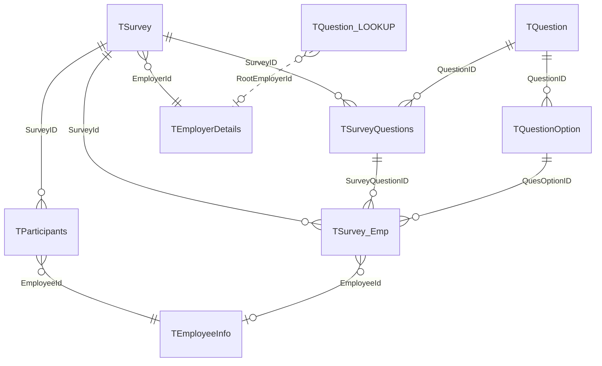

# Analytics

## Overview

A Survey user opens **Survey → Analytics**. The left-nav leaf loads `~/HRM/Survey/Analytics.aspx` (`RouteConstants.REPORT`). The host stamps session identity into hidden fields, writes activity `SurveyAnalytics` (434) via `CommonUtil.LogActivity`, seeds `localStorage.Authorization` from the session token, and mounts the webpack Survey React bundle into `#root`.

The live UI is `SurveyReport` (`Areas/Analytics/Containers/surveyReport.js`). Filters are employer multi-select, survey year, survey type (Confidential / Anonymous), survey title (In Progress / Completed only), graph type (Individual / Collective), answer type, and question multi-select. Search loads chart aggregates from `getSurveyReportData` and respondent grids from `getGridDataConfidential` (used for both survey types). There is no SystemModel-2 page for this leaf in the SourceCode checkout. Runtime database slug is **hrms-survey** (lookups via Training synonym `Sp_TR_GetQuestionLookupData`; employer list and activity log via HRMS).

## Workflow

No WebForms `__doPostBack` binds the report charts or grids. Traffic uses the Survey WebAPI base (`API_URL`), routes under `/survey` and `/Employee`.

## Request journey

### Analyst — open Analytics and load filter data

### Analyst — select a survey and run Search

## Entry points

| UI / API | Purpose |
|---|---|
| `HRM/Survey/Analytics.aspx` | Left-nav host; hidden fields for employee/employer/role/token. |
| React route `RouteConstants.REPORT` | `/HRM/Survey/Analytics.aspx` → `SurveyReport`. |
| Activity `SurveyAnalytics` (434) | Page_Load activity log. |
| `api/survey/*` | Survey list, lookups, questions, report, grid, participants. |
| `api/Employee/GetGlobalAccessEmployerList` | Employer multi-select. |

`ClaimConstants` in the Survey React module is empty; this leaf does not enforce an in-bundle claim beyond menu/session access.

## Code → database call chain

| Entry point | DAL / BLL method | Stored procedure |
|---|---|---|
| `Analytics.aspx.cs:34` `Page_Load` | `CommonUtil.LogActivity(SurveyAnalytics)` | `Sp_InsertActivityLog` (HRMS; activity 434) |
| `organizationMultiSelectDropDown.js:42` → `GET GetGlobalAccessEmployerList` (`employeeController.js:38`) | `employeeDAL.GetGlobalAccessEmployerList` (`employeeDAL.js:69`) | `SP_GetGlobalAccessEmployerList` (Survey synonym → HRMS) |
| `surveyReport.js:135` / `:738` → `GET getSurveyList` (`surveyController.js:8`) | `surveyDAL.GetSurveyList` (`surveyDAL.js:16`) | `Sp_SV_GetSurveyList` |
| `surveyReport.js:144` → `GET getQuestionLookupData` (`surveyController.js:286`) | `surveyDAL.GetQuestionLookupData` (`surveyDAL.js:535`) | `Sp_TR_GetQuestionLookupData` (Survey synonym → Training) |
| `surveyReport.js:202` → `GET GetEmpSurveyQuestions` (`surveyController.js:153`) | `surveyDAL.GetEmpSurveyQuestions` (`surveyDAL.js:297`) | `Sp_SV_GetEmpSurveyQuestions` |
| `surveyReport.js:414` → `GET getSurveyQuestions` (`surveyController.js:245`) | `surveyDAL.GetSurveyQuestions` (`surveyDAL.js:489`) | `Sp_SV_GetSurveyQuestions` |
| `surveyReport.js:242` / `:448` → `GET getSurveyReportData` (`surveyController.js:183`) | `surveyDAL.GetSurveyReportData` (`surveyDAL.js:363`) | `Sp_SV_GetSurveyReportData` |
| `surveyReport.js:243` / `:682` / `:760` / `:839` / `:866` → `GET getGridDataConfidential` (`surveyController.js:267`) | `surveyDAL.GetGridDataConfidential` (`surveyDAL.js:520`) | `Sp_SV_GetGridDataConfidential` (+ nested `Sp_OpenEncryptionKeys`, `Fn_GetEmployeeName`, `SP_CloseEncryptionKey`) |
| `surveyReport.js:244` → `GET getParticipantList` (`surveyController.js:91`) | `surveyDAL.GetParticipantList` (`surveyDAL.js:172`) | `Sp_SV_GetSurveyParticipantsList` (+ nested encryption open/close and `Fn_GetEmployeeName`) |

## API endpoints

Survey WebAPI route prefixes `api/survey/{action}` and `api/Employee/{action}` (Authorize middleware). Active React constants use the non-`V3` paths in `apiURLConstants.js`.

| Method | Path | Role on this page |
|---|---|---|
| GET | `/survey/getSurveyList` | Survey dropdown source (client filters year/type/status) |
| GET | `/survey/getQuestionLookupData` | Answer-type lookup (`moduleId=17`) |
| GET | `/survey/GetEmpSurveyQuestions` | Question sequence / descriptive flags for selected survey |
| GET | `/survey/getSurveyQuestions` | Question multi-select list |
| GET | `/survey/getSurveyReportData` | Chart aggregates, total participants, survey dates |
| GET | `/survey/getGridDataConfidential` | Respondent grid (confidential and anonymous UI paths) |
| GET | `/survey/getParticipantList` | Assigned participant count / list |
| GET | `/Employee/GetGlobalAccessEmployerList` | Employer multi-select |

`getGridDataAnonymous` exists on `surveyController` but is **not** called from Analytics React in this checkout.

No ASPX `__doPostBack` report binding.

## Stored procedures & tables involved

| Procedure | Role | Database docs |
|---|---|---|
| [`Sp_InsertActivityLog`](/docs/database/hrms/Sp_InsertActivityLog) | Page-access log | existing (hrms) |
| [`SP_GetGlobalAccessEmployerList`](/docs/database/hrms/SP_GetGlobalAccessEmployerList) | Employer picker | existing (hrms; Survey synonym) |
| [`Sp_SV_GetSurveyList`](/docs/database/hrms-survey/Sp_SV_GetSurveyList) | Survey list | written |
| [`Sp_TR_GetQuestionLookupData`](/docs/database/hrms-training/Sp_TR_GetQuestionLookupData) | Answer-type lookup | written (Training; Survey synonym) |
| [`Sp_SV_GetEmpSurveyQuestions`](/docs/database/hrms-survey/Sp_SV_GetEmpSurveyQuestions) | Question sequence for selected survey | written |
| [`Sp_SV_GetSurveyQuestions`](/docs/database/hrms-survey/Sp_SV_GetSurveyQuestions) | Question filter list | written |
| [`Sp_SV_GetSurveyReportData`](/docs/database/hrms-survey/Sp_SV_GetSurveyReportData) | Chart aggregates | written |
| [`Sp_SV_GetGridDataConfidential`](/docs/database/hrms-survey/Sp_SV_GetGridDataConfidential) | Respondent grid | written |
| [`Sp_SV_GetSurveyParticipantsList`](/docs/database/hrms-survey/Sp_SV_GetSurveyParticipantsList) | Assigned participants | written |
| [`Sp_OpenEncryptionKeys`](/docs/database/hrms/Sp_OpenEncryptionKeys) | Nested decrypt open | existing |
| [`SP_CloseEncryptionKey`](/docs/database/hrms/SP_CloseEncryptionKey) | Nested decrypt close | existing |
| [`Fn_GetEmployeeName`](/docs/database/hrms/Fn_GetEmployeeName) | Nested employee display name | existing |

Primary tables: `TSurvey`, `TSurveyQuestions`, `TQuestion`, `TQuestionOption`, `TSurvey_Emp`, `TParticipants`, `TQuestion_LOOKUP`, plus HRMS-facing `TEmployeeInfo` / `TEmployee` / `TOrgHierarchyDetails` / `TLocation` / `TEmployerDetails` (via Survey synonyms) and `TActivityLog` on page load.

## Table relationships

## Known gaps

- **`ClaimConstants` is empty** — Analytics has no in-React claim gate; access is menu/session only in this checkout.
- **`surveyDAL.GetQuestionLookupData` passes `@pModuleId`**, but Liquibase `Sp_TR_GetQuestionLookupData` declares only `@pRootEmployerID` (Training). Extra parameter behavior depends on the deployed Training definition.
- **Survey synonym `SP_GetGlobalAccessEmployerList` hardcodes `[HRM-CL-Prod]`** in `HRMS-SURVEY/SYNONYMS/SP_GetGlobalAccessEmployerList.sql`.
- **`GetSurveyList` ignores `employeeId` / `viewType`** that the React helper still builds into the URL; the SP filters only by comma-separated `@pEmployerId`.
- **Anonymous Analytics still calls `getGridDataConfidential`**; `getGridDataAnonymous` is unused by this UI.
- **Several Survey SP scripts still carry `USE [Survey]`** headers in Liquibase source.
- **SystemModel-2** has no dedicated Survey Analytics workflow page in this checkout.

## Reference

- `HRMS.Web/HRMS.Web/HRM/Survey/Analytics.aspx` (+ `.cs`)
- `HRMS.Web/.../HRM/Survey/Areas/routes.js`
- `HRMS.Web/.../HRM/Survey/Areas/Analytics/Containers/surveyReport.js`
- `HRMS.Web/.../HRM/Survey/SharedComponent/UI/OrganizationMultiSelectDropDown/organizationMultiSelectDropDown.js`
- `HRMS.Web/.../HRM/Survey/Common/apiURLConstants.js`
- `HRMS.Web/.../HRM/Survey/Common/routeConstants.js`
- `HRMS.Web/.../HRM/Survey/Common/claimConstants.js`
- `HRMS.Survey/HRMS.Survey.WebAPI.Node/Routes/surveyRoutes.js`
- `HRMS.Survey/HRMS.Survey.WebAPI.Node/Routes/employeeRoutes.js`
- `HRMS.Survey/HRMS.Survey.WebAPI.Node/Controllers/surveyController.js`
- `HRMS.Survey/HRMS.Survey.WebAPI.Node/Controllers/employeeController.js`
- `HRMS.Survey/HRMS.Survey.WebAPI.Node/Core/DataAccessLayer/surveyDAL.js`
- `HRMS.Survey/HRMS.Survey.WebAPI.Node/Core/DataAccessLayer/employeeDAL.js`
- `HRMS-DATABASE/HRMS-SURVEY/STOREPROCEDURE/Sp_SV_GetSurveyList.sql` (and sibling Analytics procedures)
- `HRMS-DATABASE/HRMS-TRAINING/STOREPROCEDURE/Sp_TR_GetQuestionLookupData.sql`
