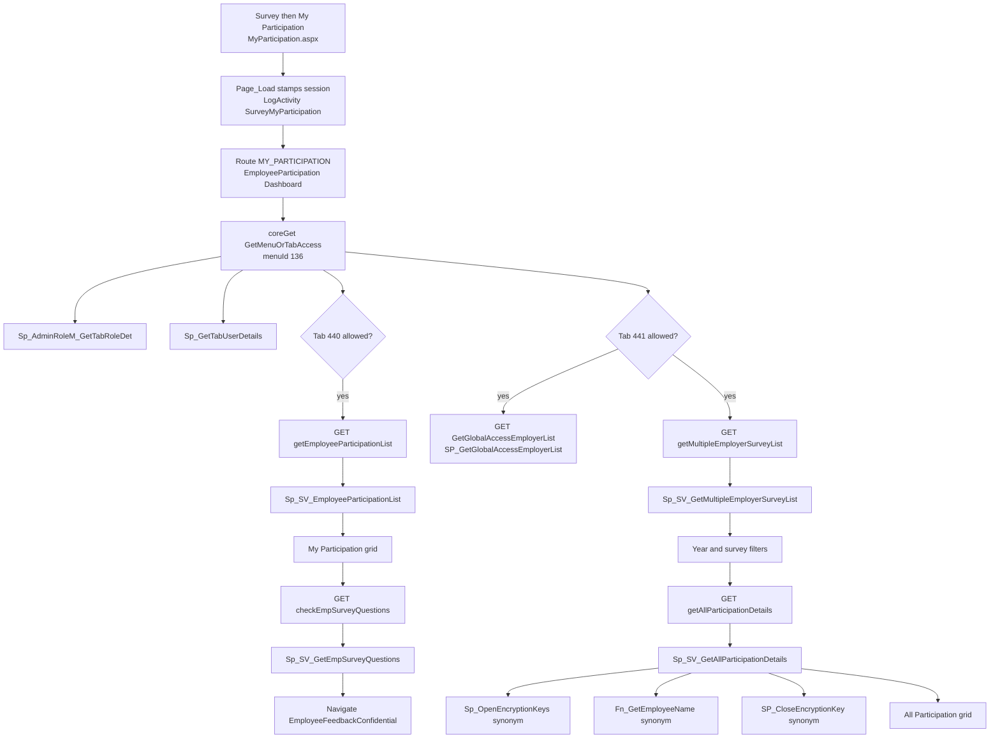
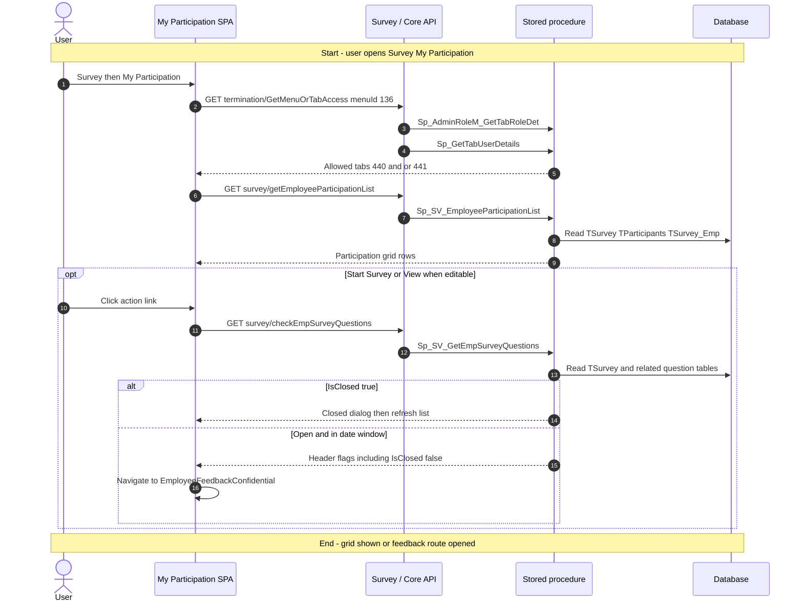
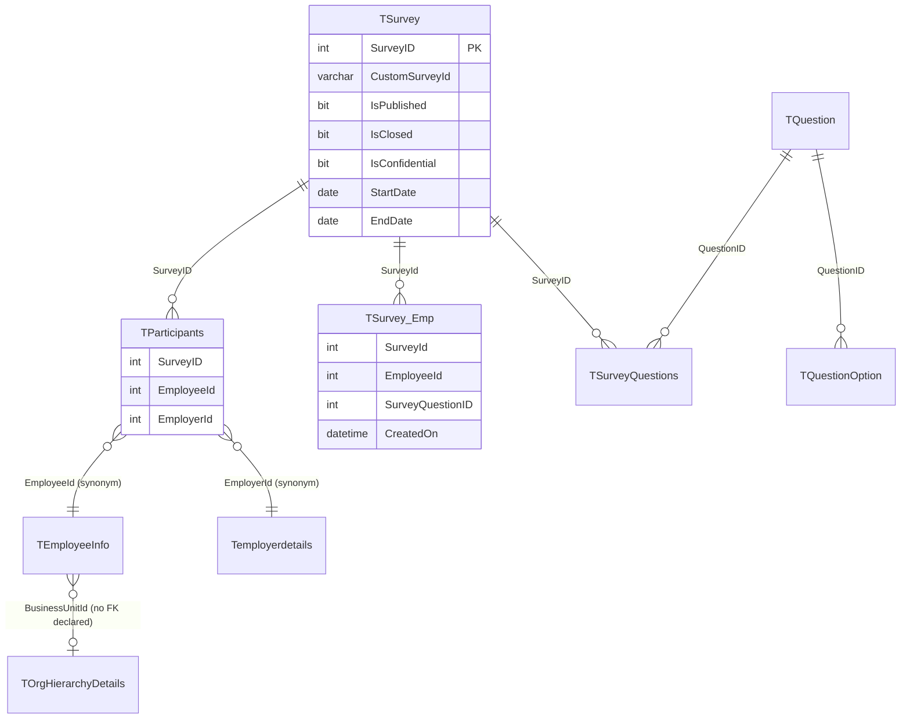

# My Participation

## Overview

An employee opens **Survey → My Participation** (left-nav value **136**) and lands on `HRM/Survey/MyParticipation.aspx`. The WebForms shell stamps session identity into hidden fields, logs activity `SurveyMyParticipation` (435), and mounts the Survey React SPA. React Router maps that ASPX to the **Participations** dashboard, which loads tab access for menu **136** and shows up to two tabs: **My Participation** (tab **440**) and **All Participation** (tab **441**).

On **My Participation**, the signed-in employee sees published surveys they were added to as a participant, with Pending vs Submitted status and an action link to **Start Survey** or **View**. The default filter shows only in-progress surveys where participation is still pending. Choosing Start Survey / View first calls a closed-check endpoint; if the survey is not closed and the date window is valid, React navigates to the confidential feedback route (`EmployeeFeedbackConfidential`) — answering and submit live on that screen, not here.

On **All Participation** (when the role/user has tab **441**), an admin-style search filters by employer(s), year, and survey, then lists every participant’s submission status for that survey.

**Who's involved:**

- **Employee / participant** — reviews own assigned surveys and opens Start Survey / View.
- **Role or user with tab 440 / 441** — tab visibility and editability come from Core `GetMenuOrTabAccess` (role tabs + user tabs for menu 136).
- **Root admin (roleId 1)** — sees the organisation multi-select on All Participation.

Runtime truth is the Survey WebForms shell plus `HRMS.Survey.WebAPI.Node` against database slug **hrms-survey**, with Core Node for tab and employer-list helpers against **hrms**.

## Workflow

## Request journey

My Participation does not insert answers. The journey that starts on this screen is a **participation list load**, optionally followed by a closed-check and navigation to the feedback SPA.

## Entry points

> Live entry point: WebForms shell stamps session into hidden fields and loads Survey `BuildJS` bundles. React Router maps `MyParticipation.aspx` to `EmployeeParticipation/Container/dashboard`.

| Entry point | Purpose | Live? |
|---|---|---|
| `HRM/Survey/MyParticipation.aspx` (+ `.cs`) | WebForms shell; session → hidden fields; React bundles; activity log | Yes |
| React `Dashboard` (`Areas/EmployeeParticipation/Container/dashboard.js`) | Tab host; Core tab access for menu 136 | Yes — `Areas/routes.js` path `MY_PARTICIPATION` |
| `participationList.js` | My Participation grid, pending filter, closed-check, navigate to feedback | Yes — tab 440 |
| `allParticipations.js` | All Participation search grid | Yes — tab 441 |
| Survey Node `/survey/*` | Participation and survey list reads | Yes — `surveyRoutes.js` (live constants are non-V2/V3) |
| Core Node `/termination/GetMenuOrTabAccess`, `/Employee/GetGlobalAccessEmployerList` | Tab ACL and org multi-select | Yes |

## Code → database call chain

Live `apiURLConstants.js` uses non-versioned `/survey/...` and `/termination/...` / `/Employee/...` paths (V2/V3 blocks are commented). Survey DAL from `surveyDAL.js`; Core tab DAL from `terminationDAL.js`.

| Step | Entry point | App code | Stored procedure |
|---|---|---|---|
| Page load | `MyParticipation.aspx` | `Page_Load` (`MyParticipation.aspx.cs:32-50`) — session → hidden fields; `LogActivity(SurveyMyParticipation)` | none (activity via shared util) |
| Mount SPA | `Areas/routes.js:24` | `Dashboard` | none |
| Tab access | `dashboard.js:42-53` | `GetMenuOrTabAccess` (`terminationController.js:367`) → `GetTabsByRole` / `GetTabsByUser` (`terminationDAL.js:355` / `:370`) | `Sp_AdminRoleM_GetTabRoleDet`, `Sp_GetTabUserDetails` (HRMS) |
| My list | `participationList.js:65-70` | `GetEmployeeParticipationList` (`surveyController.js:205`) → DAL `:426` | `Sp_SV_EmployeeParticipationList` |
| Closed check before Start/View | `participationList.js:46-50` | `CheckEmpSurveyQuestions` (`surveyController.js:163`) → DAL `:327` | `Sp_SV_GetEmpSurveyQuestions` |
| Org multi-select (All Participation, role 1) | `organizationMultiSelectDropDown.js:42` | Core `GetGlobalAccessEmployerList` → `dashBoardDAL.js:824` | `SP_GetGlobalAccessEmployerList` (HRMS) |
| Survey dropdown | `allParticipations.js:110-115` | `GetMultipleEmployerSurveyList` (`surveyController.js:235`) → DAL `:474` | `Sp_SV_GetMultipleEmployerSurveyList` |
| All participants grid | `allParticipations.js:185-187` | `GetAllParticipationDetails` (`surveyController.js:215`) → DAL `:442` | `Sp_SV_GetAllParticipationDetails` → `Sp_OpenEncryptionKeys`, `Fn_GetEmployeeName`, `SP_CloseEncryptionKey` (Survey synonyms → HRMS) |

## API endpoints

No WebForms postback for data. All list/check traffic is HTTP GET to Survey or Core Node APIs (Authorize).

| Verb | Route | Parameters | Purpose | Source |
|---|---|---|---|---|
| GET | `/termination/GetMenuOrTabAccess` | `employerId`, `userId`, `userRoleId`, `menuId` (136), `returnAllTabsFromMenu` (1) — required query | Tabs 440/441 for this menu | `terminationController.js:367`; `dashboard.js:48-53` |
| GET | `/survey/getEmployeeParticipationList` | `EmployerId`, `EmployeeId` — required query | My Participation rows | `surveyController.js:205`; `surveyRoutes.js:25` |
| GET | `/survey/checkEmpSurveyQuestions` | `surveyId`, `empId` — required query | Closed / header flags before navigate | `surveyController.js:163`; `surveyRoutes.js:21` |
| GET | `/Employee/GetGlobalAccessEmployerList` | `employeeId` — query | Org multi-select options | `organizationMultiSelectDropDown.js:42`; `dashBoardDAL.js:824` |
| GET | `/survey/getMultipleEmployerSurveyList` | `EmployerId` — comma-separated, required | Year/survey filter source | `surveyController.js:235`; `surveyRoutes.js:28` |
| GET | `/survey/getAllParticipationDetails` | `EmployerId`, `SurveyId` — required query | All Participation grid | `surveyController.js:215`; `surveyRoutes.js:26` |

## Stored procedures & tables involved

| Object | Database | File | Purpose |
|---|---|---|---|
| `Sp_SV_EmployeeParticipationList` | hrms-survey | `HRMS-DATABASE/HRMS-SURVEY/STOREPROCEDURE/Sp_SV_EmployeeParticipationList.sql` | Published surveys for one participant with Pending/Submitted and ViewLink |
| `Sp_SV_GetEmpSurveyQuestions` | hrms-survey | `…/Sp_SV_GetEmpSurveyQuestions.sql` | Survey header + questions (Check uses first result set, including `IsClosed`) |
| `Sp_SV_GetMultipleEmployerSurveyList` | hrms-survey | `…/Sp_SV_GetMultipleEmployerSurveyList.sql` | Surveys for one or more employers for filter dropdown |
| `Sp_SV_GetAllParticipationDetails` | hrms-survey | `…/Sp_SV_GetAllParticipationDetails.sql` | Per-participant status for one survey across employers |
| `Sp_OpenEncryptionKeys` / `SP_CloseEncryptionKey` | hrms (via Survey synonym) | HRMS `STOREPROCEDURE` + Survey `SYNONYMS` | Open/close encryption around All Participation select |
| `Fn_GetEmployeeName` | hrms (via Survey synonym) | HRMS `FUNCTIONS` + Survey `SYNONYMS` | Display name on All Participation |
| `Sp_AdminRoleM_GetTabRoleDet` | hrms | `HRMS-DATABASE/HRMS/STOREPROCEDURE/Sp_AdminRoleM_GetTabRoleDet.sql` | Role-level tab ACL |
| `Sp_GetTabUserDetails` | hrms | `…/Sp_GetTabUserDetails.sql` | User-level tab ACL |
| `SP_GetGlobalAccessEmployerList` | hrms | `…/SP_GetGlobalAccessEmployerList.sql` | Employers for org multi-select |

Primary Survey tables: `TSurvey`, `TParticipants`, `TSurvey_Emp`, `TSurveyQuestions`, `TQuestion`, `TQuestionOption`. Synonym reads: `TEmployeeInfo`, `Temployerdetails` / `TEmployerDetails`, `TOrgHierarchyDetails`.

## Table relationships

## Known gaps

- Submitting answers is **out of scope** for this page: Start Survey / View only navigates to `EmployeeFeedbackConfidential`; `submitSurvey` / `Sp_SV_InsertEmpSurveyDetails` are not called from My Participation.
- `Sp_SV_EmployeeParticipationList` does not filter by `@pEmployerId` (parameter is accepted; `EmployerId` predicate is commented out) — multi-org participants see all published assigned surveys.
- `ViewLink` CASE has no branch for **Force Closed**; those rows can surface with a null action label.
- Client pending filter compares `SurveySubmitted === "Pending"` while also excluding `Status` Closed / Force Closed; server status strings must stay in sync with that filter.
- Survey React still ships commented V2/V3 URL blocks; live constants are the non-versioned `/survey/...` set.
- No SystemModel-2 or llm-wiki domain page was found for Survey My Participation; relationships above are derived from the SP scripts and Survey TABLES/SYNONYMS folders.

## Reference

Confidence is **high** for the live ASPX → React dashboard → Survey/Core Node → SP chain (file:line verified). Nested encryption/name objects are Survey synonyms to HRMS; their Backstage pages already exist under `/docs/database/hrms/…`.

### SourceCode

- `HRMS.Web/HRMS.Web/HRM/Survey/MyParticipation.aspx`
- `HRMS.Web/HRMS.Web/HRM/Survey/MyParticipation.aspx.cs`
- `HRMS.Web/HRMS.Web/HRM/Survey/Areas/routes.js`
- `HRMS.Web/HRMS.Web/HRM/Survey/Areas/EmployeeParticipation/Container/dashboard.js`
- `HRMS.Web/HRMS.Web/HRM/Survey/Areas/EmployeeParticipation/Components/participationList.js`
- `HRMS.Web/HRMS.Web/HRM/Survey/Areas/EmployeeParticipation/Components/allParticipations.js`
- `HRMS.Web/HRMS.Web/HRM/Survey/Common/apiURLConstants.js`
- `HRMS.Web/HRMS.Web/HRM/Survey/Common/routeConstants.js`
- `HRMS.Survey/HRMS.Survey.WebAPI.Node/Routes/surveyRoutes.js`
- `HRMS.Survey/HRMS.Survey.WebAPI.Node/Controllers/surveyController.js`
- `HRMS.Survey/HRMS.Survey.WebAPI.Node/Core/DataAccessLayer/surveyDAL.js`
- `HRMS.CoreAPI/HRMS.Core.WebAPI.Node/Controllers/terminationController.js`
- `HRMS.CoreAPI/HRMS.Core.WebAPI.Node/Core/DataAccessLayer/terminationDAL.js`

### TDG HRMS DB

- `HRMS-DATABASE/HRMS-SURVEY/STOREPROCEDURE/Sp_SV_EmployeeParticipationList.sql`
- `HRMS-DATABASE/HRMS-SURVEY/STOREPROCEDURE/Sp_SV_GetEmpSurveyQuestions.sql`
- `HRMS-DATABASE/HRMS-SURVEY/STOREPROCEDURE/Sp_SV_GetMultipleEmployerSurveyList.sql`
- `HRMS-DATABASE/HRMS-SURVEY/STOREPROCEDURE/Sp_SV_GetAllParticipationDetails.sql`
- `HRMS-DATABASE/HRMS-SURVEY/SYNONYMS/Sp_OpenEncryptionKeys.sql`, `SP_CloseEncryptionKey.sql`, `TEmployeeInfo.sql`, and related
- `HRMS-DATABASE/HRMS/STOREPROCEDURE/Sp_AdminRoleM_GetTabRoleDet.sql`, `Sp_GetTabUserDetails.sql`, `SP_GetGlobalAccessEmployerList.sql`
- Existing Backstage pages: `/docs/database/hrms/Sp_OpenEncryptionKeys`, `/docs/database/hrms/SP_CloseEncryptionKey`, `/docs/database/hrms/Fn_GetEmployeeName`, `/docs/database/hrms/Sp_AdminRoleM_GetTabRoleDet`, `/docs/database/hrms/Sp_GetTabUserDetails`, `/docs/database/hrms/SP_GetGlobalAccessEmployerList`
