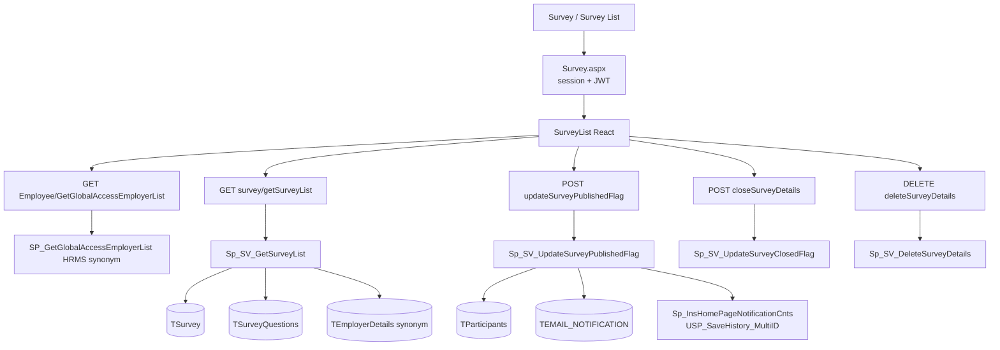
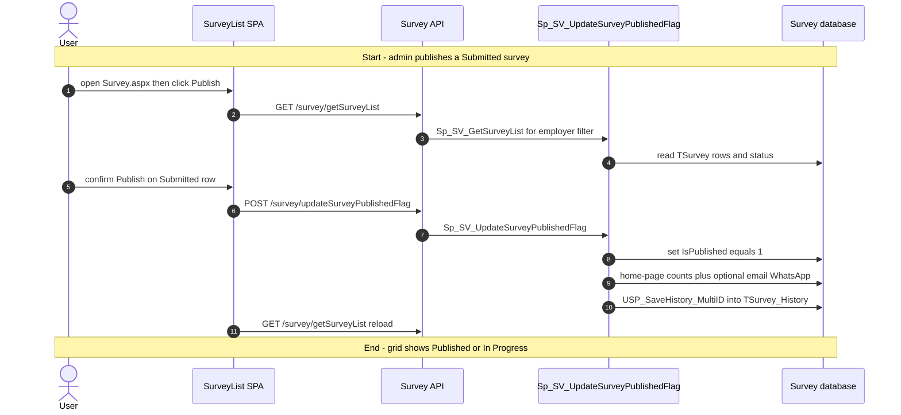
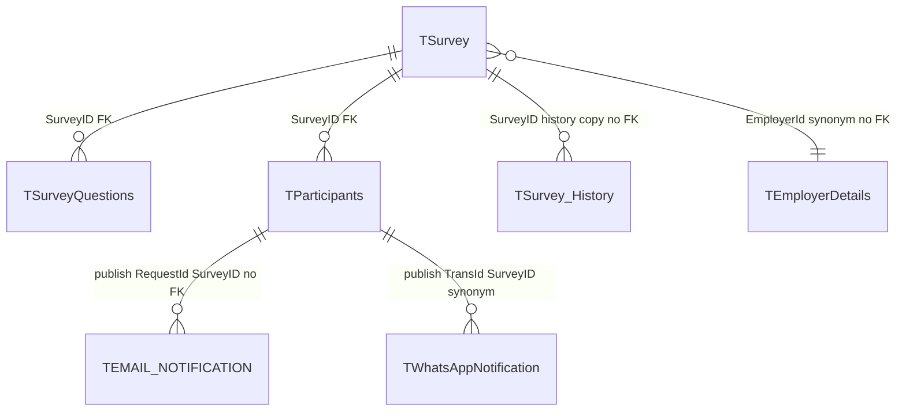

# Survey List

## Overview

An HR administrator (or any role with Survey module access) opens **Survey → Survey List** at `~/HRM/Survey/Survey.aspx`. The WebForms host stamps session identity into hidden fields, seeds the JWT into `localStorage['Authorization']`, logs activity type `SurveyList` (433), and loads the Survey React bundle into `#root`. There is no WebForms postback DAL for grid data.

The SPA default route is `SurveyList`, which shows a multi-organisation filter and an `HrmsDataGrid` of surveys for the selected employer ids. From each row the admin can preview, clone, publish (when status is Submitted), edit, soft-delete (Submitted / Saved as Draft), or force-close. **Create Survey** navigates to the setup wizard (`ManageSurvey`); that create flow is out of scope for this list page.

Live list and action APIs go through the Survey Node API (`HRMS.Survey.WebAPI.Node`) unversioned `/survey/*` routes and the Survey database (`HRMS-SURVEY`). Organisation filter uses `/Employee/GetGlobalAccessEmployerList` on the same API host (synonym to HRMS `SP_GetGlobalAccessEmployerList`). SystemModel-2 and llm-wiki have no dedicated Survey List page; table relationships below are derived from Survey DDL and the procedures this screen calls.

## Workflow

## Request journey

Default mount loads the grid. The journey below is **Publish** from a Submitted row (the write that flips `IsPublished` and notifies participants).

Force close posts `closeSurveyDetails` → `Sp_SV_UpdateSurveyClosedFlag` (`IsClosed = 1`). Delete uses `DELETE deleteSurveyDetails` → `Sp_SV_DeleteSurveyDetails` (soft `IsDeleted = 1`). Clone and Create only navigate client-side to setup; preview navigates to confidential feedback with `isPreviewMode`.

## Entry points

> Live UI is the Survey React module hosted by `Survey.aspx`. `Survey.aspx.cs` only logs activity and stamps hidden fields; it does not call Survey SPs.

| UI page / route | Purpose |
|---|---|
| `~/HRM/Survey/Survey.aspx` | Left-nav **Survey → Survey List**. Stamps `hdnEmpId`, `hdnEmployerId`, role, JWT; hosts `#root`. |
| React route `RouteConstants.SURVEY` (`/HRM/Survey/Survey.aspx`) | Renders `SurveyList` (`Areas/routes.js`). |
| `SurveySetup` / `ViewSurveyDetails` / preview feedback | Navigations from row actions; separate screens. |
| Activity `SurveyList` = 433 | Logged on page load via `CommonUtil.LogActivity`. |

## Code → database call chain

SPA talks to Survey API (`apiURLConstants.js` unversioned `/survey/...` and `/Employee/...`). `Survey.aspx.cs` does not call SPs.

| Entry point | App method (`file:line`) | Stored procedure |
|---|---|---|
| Page load | `Survey.aspx.cs` `Page_Load` (`35`) → `CommonUtil.LogActivity` | Activity helpers / `Sp_InsertActivityLog` (HRMS; not Survey) |
| Org multi-select mount | `organizationMultiSelectDropDown.js` `fetchOrganizationList` (`42`) → `GET /Employee/GetGlobalAccessEmployerList` → `employeeController.js` `GetGlobalAccessEmployerList` (`38`) → `employeeDAL.js` (`69`) | `SP_GetGlobalAccessEmployerList` (Survey synonym → HRMS) |
| Grid mount / org change | `SurveyList.js` `loadSurveyList` (`81`) → `GET /survey/getSurveyList` → `surveyController.js` `GetAllSurveyList` (`8`) → `surveyDAL.js` `GetSurveyList` (`16`) | `Sp_SV_GetSurveyList` |
| Publish | `SurveyList.js` `publishHandler` (`98`) → `POST /survey/updateSurveyPublishedFlag` → `UpdateSurveyPublishedFlag` (`131`) → DAL (`264`) | `Sp_SV_UpdateSurveyPublishedFlag` (+ nested home-page / history) |
| Force close | `SurveyList.js` `handleDialogClose` (`120`) → `POST /survey/closeSurveyDetails` → `CloseSurveyDetails` (`121`) → DAL (`234`) | `Sp_SV_UpdateSurveyClosedFlag` |
| Delete | `SurveyList.js` `handleDialogClick` (`196`) → `DELETE /survey/deleteSurveyDetails` → `DeleteSurveyDetails` (`111`) → DAL (`249`) | `Sp_SV_DeleteSurveyDetails` |

`employeeId` / `viewType` are computed in `loadSurveyList` but not sent on the live URL, and the DAL inputs for them are commented out — the list is filtered only by `EmployerId` (comma-separated).

## API endpoints

Not a WebForms postback for list data. The host is ASP.NET; the SPA calls the Survey WebAPI with the JWT from `localStorage`.

| Method | Path | Parameters | Purpose | Source |
|---|---|---|---|---|
| GET | `/Employee/GetGlobalAccessEmployerList` | `employeeId` (query, required for list) | Org filter options | `employeeRoutes.js:10`, `employeeController.js:38` |
| GET | `/survey/getSurveyList` | `EmployerId` (query, varchar list) | Grid rows | `surveyRoutes.js:7`, `surveyController.js:8` |
| POST | `/survey/updateSurveyPublishedFlag` | body `SurveyId`, `UpdatedBy` | Publish | `surveyRoutes.js:18`, `surveyController.js:131` |
| POST | `/survey/closeSurveyDetails` | body `SurveyId`, `EmployeeId` | Force close | `surveyRoutes.js:33`, `surveyController.js:121` |
| DELETE | `/survey/deleteSurveyDetails` | `SurveyId` (query) | Soft delete | `surveyRoutes.js:17`, `surveyController.js:111` |

V2/V3 `/V2/survey` and `/V3/survey` routers exist but the active `apiURLConstants` block uses unversioned `/survey/...`.

## Stored procedures & tables involved

Direct procedures are the Survey DAL / employee DAL strings this screen executes. Nested objects are one level deep. Database slug for Survey is `hrms-survey` unless noted.

| Object | File | Purpose | Notes |
|---|---|---|---|
| [Sp_SV_GetSurveyList](/docs/database/hrms-survey/Sp_SV_GetSurveyList) | `HRMS-SURVEY/STOREPROCEDURE/Sp_SV_GetSurveyList.sql` | List + derived Status | reads `TSurvey`, `TEmployerDetails`, `TSurveyQuestions` |
| [Sp_SV_UpdateSurveyPublishedFlag](/docs/database/hrms-survey/Sp_SV_UpdateSurveyPublishedFlag) | `…/Sp_SV_UpdateSurveyPublishedFlag.sql` | Publish + notify | writes `TSurvey`, `TEMAIL_NOTIFICATION`, WhatsApp |
| [Sp_SV_UpdateSurveyClosedFlag](/docs/database/hrms-survey/Sp_SV_UpdateSurveyClosedFlag) | `…/Sp_SV_UpdateSurveyClosedFlag.sql` | Force close | writes `TSurvey` |
| [Sp_SV_DeleteSurveyDetails](/docs/database/hrms-survey/Sp_SV_DeleteSurveyDetails) | `…/Sp_SV_DeleteSurveyDetails.sql` | Soft delete | `IsDeleted = 1` |
| [SP_GetGlobalAccessEmployerList](/docs/database/hrms/SP_GetGlobalAccessEmployerList) | HRMS (Survey synonym) | Org dropdown | — |
| [Sp_InsHomePageNotificationCnts](/docs/database/hrms/Sp_InsHomePageNotificationCnts) | HRMS (Survey synonym) | Nested on publish/close | — |
| [USP_SaveHistory_MultiID](/docs/database/hrms/USP_SaveHistory_MultiID) | HRMS (Survey synonym) | Nested history | `TSurvey_History` |
| [Fn_GetHomePageNotificationIdByRequestType](/docs/database/hrms/Fn_GetHomePageNotificationIdByRequestType) | HRMS | Nested notification id | No Survey synonym script found |
| `TSurvey` | header | — | Survey TABLES |
| `TSurveyQuestions` | EXISTS for preview flag | — | FK to `TSurvey` |
| `TParticipants` | publish notification targets | — | FK to `TSurvey` |
| `TSurvey_History` | history copy | — | `Survey_History.sql` |
| `TEmployerDetails` | org name | — | synonym → HRMS |
| `TEMAIL_NOTIFICATION` | publish-day email queue | — | Survey table |
| `TWhatsAppNotification` | optional WhatsApp | — | synonym → HRMS |

## Table relationships

Edges follow joins and FKs used by the list and publish/close/delete procedures. `TEmployerDetails` and WhatsApp are synonyms; no FK scripts link them to `TSurvey.EmployerId`.

## Known gaps

- `loadSurveyList` computes `employeeId` and `viewType` but the live GET only passes `EmployerId`; DAL `@pCreatedBy` / `@pViewType` inputs are commented out, so manager vs admin view filtering is not applied.
- `Fn_GetHomePageNotificationIdByRequestType` is invoked as `dbo` from Survey publish/close scripts, but `HRMS-SURVEY/SYNONYMS` has no inventoried synonym for it (unlike `Sp_InsHomePageNotificationCnts` / `USP_SaveHistory_MultiID`).
- Publish email/WhatsApp runs only when survey start date equals today; later start dates rely on other jobs/reminders not called from this page.
- Force-close email insert block in `Sp_SV_UpdateSurveyClosedFlag` is commented out — close still bumps home-page counts and history only.
- Create / edit / clone / preview leave this page; their SPs are not listed here.
- No SystemModel-2 or llm-wiki domain page for Survey List; ER derived from DDL + SP bodies.
- Import path `surveyList` vs file `SurveyList.js` relies on case-insensitive filesystem.

## Reference

Confidence is high for the list host, React grid, Survey API routes, and the four Survey procedures verified in SourceCode and `HRMS-DATABASE/HRMS-SURVEY`. Nested HRMS objects were linked to existing database pages, not re-derived.

### SourceCode

- `HRMS.Web/HRMS.Web/HRM/Survey/Survey.aspx` (+ `.cs`)
- `HRMS.Web/HRMS.Web/HRM/Survey/Areas/SurveySetup/Container/SurveyList.js`
- `HRMS.Web/HRMS.Web/HRM/Survey/Areas/routes.js`
- `HRMS.Web/HRMS.Web/HRM/Survey/Common/apiURLConstants.js`
- `HRMS.Web/HRMS.Web/HRM/Survey/SharedComponent/UI/OrganizationMultiSelectDropDown/organizationMultiSelectDropDown.js`
- `HRMS.Survey/HRMS.Survey.WebAPI.Node/Routes/surveyRoutes.js`, `employeeRoutes.js`, `routeIndex.js`
- `HRMS.Survey/HRMS.Survey.WebAPI.Node/Controllers/surveyController.js`, `employeeController.js`
- `HRMS.Survey/HRMS.Survey.WebAPI.Node/Core/DataAccessLayer/surveyDAL.js`, `employeeDAL.js`
- `HRMS.Shared/HRMS.DataContract/Common/Enums.cs` (`SurveyList = 433`)

### TDG HRMS DB

- `HRMS-DATABASE/HRMS-SURVEY/STOREPROCEDURE/Sp_SV_GetSurveyList.sql`
- `HRMS-DATABASE/HRMS-SURVEY/STOREPROCEDURE/Sp_SV_UpdateSurveyPublishedFlag.sql`
- `HRMS-DATABASE/HRMS-SURVEY/STOREPROCEDURE/Sp_SV_UpdateSurveyClosedFlag.sql`
- `HRMS-DATABASE/HRMS-SURVEY/STOREPROCEDURE/Sp_SV_DeleteSurveyDetails.sql`
- `HRMS-DATABASE/HRMS-SURVEY/TABLES/TSurvey.sql`, `TParticipants.sql`, `TSurveyQuestions.sql`, `TEMAIL_NOTIFICATION.sql`, `Survey_History.sql`
- `HRMS-DATABASE/HRMS-SURVEY/SYNONYMS/TEmployerDetails.sql`, `SP_GetGlobalAccessEmployerList.sql`, `Sp_InsHomePageNotificationCnts.sql`, `USP_SaveHistory_MultiID.sql`, `TWhatsAppNotification.sql`
