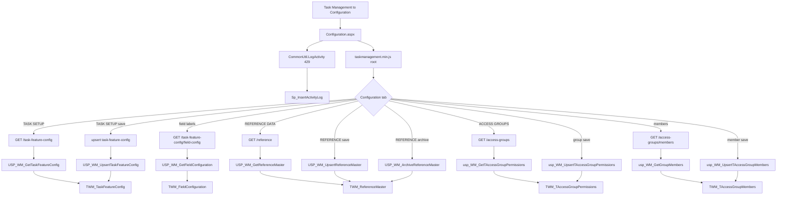
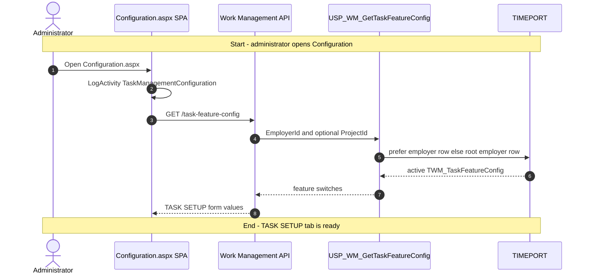
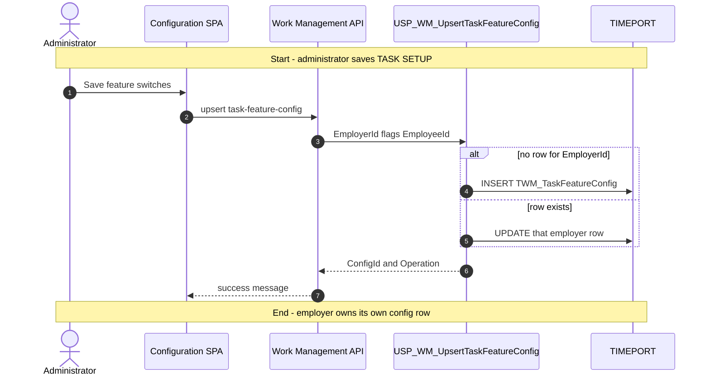
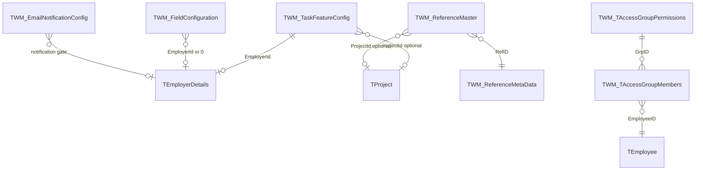

# Configuration

## Overview

An administrator opens **Task Management → Configuration** (`~/HRM/TaskManagement/Configuration.aspx`, menu id `1266`) to set how Work Management behaves for their organisation. The WebForms host only logs page-visit activity `TaskManagementConfiguration` (429), stamps session identity into hidden fields, and mounts the Vite SPA at `#root` via `BuildJS/taskmanagement.min.js`. All configuration reads and saves go through the Work Management API against TIMEPORT (`HRM_CL_TIMEPORT`) tables.

`TDataCatalog` maps three Configuration tabs:

- **TASK SETUP** — per-employer feature switches on `TWM_TaskFeatureConfig` (who may create tasks, subtasks, multiple assignees, TimePort connectivity, defaults, multi-project selection, batch handoff, notification flags).
- **REFERENCE DATA** — statuses, priorities, and related lookup rows on `TWM_ReferenceMaster` (with archive when a value is no longer needed).
- **ACCESS GROUPS** — permission groups on `TWM_TAccessGroupPermissions` and membership on `TWM_TAccessGroupMembers` (task bits, stage-handoff bits, report-manager membership).

Field labels for the SPA also load from `TWM_FieldConfiguration` via `GET /task-feature-config/field-config`.

**Who's involved:**

- **Administrator / config role** — opens Configuration, edits TASK SETUP / REFERENCE DATA / ACCESS GROUPS, saves.
- **Downstream Task Management screens** — My Work, Tasks, Stage Approvals, and notification producers consume these settings (for example handoff via `UFN_WM_IsHandoffEnabled` and email gates via `UFN_WM_IsNotificationEnabled`).

No SystemModel-2 workflow page covers this screen. Catalog depth is `llm-wiki/reference/tables/timeport.md` for related TIMEPORT tables; Configuration-specific `TWM_*` rows live in `TDataCatalog_DML.sql`.

## Workflow

## Request journey

### Administrator — open Configuration and load TASK SETUP

### Administrator — save TASK SETUP

## Entry points

Live left-nav host is `~/HRM/TaskManagement/Configuration.aspx` (`TMenuDetails` menu id `1266`, employer `0`). The SPA route is selected from the aspx path by the Vite bundle (source not in this SourceCode checkout). Legacy webpack `Areas/MasterPages/Components/Configurations.js` is an empty stub and is not the live UI.

| Entry | Purpose |
|---|---|
| `HRM/TaskManagement/Configuration.aspx` | Left-nav host; session stamp; activity log; mounts SPA |
| `GET /task-feature-config` | Load TASK SETUP (`TDataCatalog`) |
| upsert `/task-feature-config` | Save TASK SETUP (`USP_WM_UpsertTaskFeatureConfig`) |
| `GET /task-feature-config/field-config` | Field labels for Configuration forms |
| `GET /reference` | Load REFERENCE DATA |
| upsert / archive reference | Save or archive `TWM_ReferenceMaster` |
| `GET /access-groups` | Load ACCESS GROUPS permissions |
| `GET /access-groups/members` | Load group membership |

## Code → database call chain

| UI / action | App layer (`file:line`) | Stored procedure / function |
|---|---|---|
| Page open | `Configuration.aspx.cs:25` → `CommonUtil.LogActivity` → `ActivityHelper` (`ActivityHelper.cs:13`) | [Sp_InsertActivityLog](/docs/database/hrms/Sp_InsertActivityLog) |
| TASK SETUP load | Work Management API `GET /task-feature-config` (SPA not in checkout) | [USP_WM_GetTaskFeatureConfig](/docs/database/hrm-timeport/USP_WM_GetTaskFeatureConfig) |
| TASK SETUP save | Work Management API upsert (SPA not in checkout) | [USP_WM_UpsertTaskFeatureConfig](/docs/database/hrm-timeport/USP_WM_UpsertTaskFeatureConfig) |
| Field labels | `GET /task-feature-config/field-config` | [USP_WM_GetFieldConfiguration](/docs/database/hrm-timeport/USP_WM_GetFieldConfiguration) |
| REFERENCE DATA load | `GET /reference` | [USP_WM_GetReferenceMaster](/docs/database/hrm-timeport/USP_WM_GetReferenceMaster) |
| REFERENCE DATA save | Work Management API | [USP_WM_UpsertReferenceMaster](/docs/database/hrm-timeport/USP_WM_UpsertReferenceMaster) |
| REFERENCE DATA archive | Work Management API | [USP_WM_ArchiveReferenceMaster](/docs/database/hrm-timeport/USP_WM_ArchiveReferenceMaster) |
| ACCESS GROUPS load | `GET /access-groups` | [usp_WM_GetTAccessGroupPermissions](/docs/database/hrm-timeport/usp_WM_GetTAccessGroupPermissions) |
| ACCESS GROUPS save | Work Management API | [usp_WM_UpsertTAccessGroupPermissions](/docs/database/hrm-timeport/usp_WM_UpsertTAccessGroupPermissions) |
| Members load | `GET /access-groups/members` | [usp_WM_GetGroupMembers](/docs/database/hrm-timeport/usp_WM_GetGroupMembers) → [Fn_GetEmployeeName](/docs/database/hrms/Fn_GetEmployeeName) |
| Members save | Work Management API | [usp_WM_UpsertTAccessGroupMembers](/docs/database/hrm-timeport/usp_WM_UpsertTAccessGroupMembers) |

Related consumers (not Configuration UI calls): [UFN_WM_IsHandoffEnabled](/docs/database/hrm-timeport/UFN_WM_IsHandoffEnabled) reads `AllowTaskBatchHandoff`; [UFN_WM_IsNotificationEnabled](/docs/database/hrm-timeport/UFN_WM_IsNotificationEnabled) now gates on `TWM_EmailNotificationConfig` (fail-open).

HRMS also has parallel `USP_TSM_GetTaskFeatureConfig` / `USP_TSM_UpsertTaskFeatureConfig` against `dbo.TTaskFeatureConfig` — not the catalogued Configuration path.

## API endpoints

No WebForms postback for configuration data. The host is a shell; HTTP calls are Work Management API routes recorded in `TDataCatalog` (exact controller classes are not in this SourceCode tree).

| Verb | Route (catalog) | Parameters (from SP) | Purpose |
|---|---|---|---|
| GET | `/task-feature-config` | `EmployerId` required; `ProjectId` optional | Load TASK SETUP |
| (upsert) | `/task-feature-config` | Feature flags + `EmployeeId` | Insert or update TASK SETUP |
| GET | `/task-feature-config/field-config` | `EmployerId` optional; `PageTitle` required | Field metadata |
| GET | `/reference` | `EmployerId`; `ProjectId` optional | Load reference values |
| (upsert) | `/reference` | Reference fields + `EmployeeId` | Insert or update reference |
| (archive) | `/reference` archive | `ReferenceID`, `Employeeid` | Soft-archive when not in use |
| GET | `/access-groups` | Optional group / employer / project / BU filters | List permission groups |
| GET | `/access-groups/members` | Optional `GroupName`, `EmployeeName` | List members |
| (upsert) | access-groups / members | Group bits or `UDT_WM_TAccessGroupMembersType` | Save groups or members |

Old `HRMS.TaskManagement.WebAPI.Node` routes under `/taskmanagement/*` serve the legacy webpack Task Management pages, not this Configuration SPA.

## Stored procedures & tables involved

| Object | Location | Purpose |
|---|---|---|
| [USP_WM_GetTaskFeatureConfig](/docs/database/hrm-timeport/USP_WM_GetTaskFeatureConfig) | live `HRM_CL_TIMEPORT` | Read employer or root feature config |
| [USP_WM_UpsertTaskFeatureConfig](/docs/database/hrm-timeport/USP_WM_UpsertTaskFeatureConfig) | live `HRM_CL_TIMEPORT` | Insert or update employer feature config |
| [USP_WM_GetFieldConfiguration](/docs/database/hrm-timeport/USP_WM_GetFieldConfiguration) | live `HRM_CL_TIMEPORT` | Active field labels for a page title |
| [USP_WM_GetReferenceMaster](/docs/database/hrm-timeport/USP_WM_GetReferenceMaster) | live `HRM_CL_TIMEPORT` | Active reference rows for employer (plus defaults) |
| [USP_WM_UpsertReferenceMaster](/docs/database/hrm-timeport/USP_WM_UpsertReferenceMaster) | live `HRM_CL_TIMEPORT` | Insert or update reference row |
| [USP_WM_ArchiveReferenceMaster](/docs/database/hrm-timeport/USP_WM_ArchiveReferenceMaster) | live `HRM_CL_TIMEPORT` | Archive reference when scoped tasks allow |
| [usp_WM_GetTAccessGroupPermissions](/docs/database/hrm-timeport/usp_WM_GetTAccessGroupPermissions) | live `HRM_CL_TIMEPORT` | List active access groups |
| [usp_WM_UpsertTAccessGroupPermissions](/docs/database/hrm-timeport/usp_WM_UpsertTAccessGroupPermissions) | live `HRM_CL_TIMEPORT` | Insert or update access group bits |
| [usp_WM_GetGroupMembers](/docs/database/hrm-timeport/usp_WM_GetGroupMembers) | live `HRM_CL_TIMEPORT` | List active members with employee names |
| [usp_WM_UpsertTAccessGroupMembers](/docs/database/hrm-timeport/usp_WM_UpsertTAccessGroupMembers) | live `HRM_CL_TIMEPORT` | Insert or reactivate members from TVP |
| [Sp_InsertActivityLog](/docs/database/hrms/Sp_InsertActivityLog) | `HRMS-DATABASE/HRMS` | Page-visit activity on open |
| `TWM_TaskFeatureConfig` | TIMEPORT | TASK SETUP row |
| `TWM_FieldConfiguration` | TIMEPORT | Field label metadata |
| `TWM_ReferenceMaster` / `TWM_ReferenceMetaData` | TIMEPORT | Reference values and types |
| `TWM_TAccessGroupPermissions` / `TWM_TAccessGroupMembers` | TIMEPORT | Groups and membership |
| `TEmployerDetails` / `TProject` / `TEmployee` | HRMS (via TIMEPORT synonyms where needed) | Root employer, project scope, names |

These `USP_WM_*` objects are **not** present as inventoried scripts under `HRMS-DATABASE/HRM-TIMEPORT` in this checkout; definitions were read from the live DEV TIMEPORT catalog.

## Table relationships

Logical relationships from catalog and procedure bodies; many TIMEPORT tables have no declared FK.

## Known gaps

- Vite SPA source for `BuildJS/taskmanagement.min.js` is not in the SourceCode tree (only aspx hosts and an empty legacy `Configurations.js`). Call-chain UI `file:line` for HTTP clients cannot be cited.
- Work Management API controllers that expose `/task-feature-config`, `/reference`, and `/access-groups` are not in this workspace; routes and table ownership come from `TDataCatalog_DML.sql` plus live TIMEPORT procedures.
- `USP_WM_*` / `usp_WM_*` scripts are missing from `HRMS-DATABASE/HRM-TIMEPORT` Liquibase inventory; pages document live DEV definitions.
- Parallel HRMS `USP_TSM_*` / `TTaskFeatureConfig` path exists but is not the catalogued Configuration UI path.
- Exact HTTP verbs for upsert/archive reference and access-group saves are inferred from procedure names; confirm against the WM API when that repo is available.
- `UFN_WM_IsNotificationEnabled` no longer reads `TWM_TaskFeatureConfig.NotificationFlags` (reads `TWM_EmailNotificationConfig`); catalog still lists it next to FeatureConfig.

## Reference

Confidence is **medium** because the SPA and WM API source are outside this checkout; host page, menu, activity log, catalog routes, and live TIMEPORT procedures were verified.

### SourceCode

- `HRMS.Web/HRMS.Web/HRM/TaskManagement/Configuration.aspx`
- `HRMS.Web/HRMS.Web/HRM/TaskManagement/Configuration.aspx.cs`
- `HRMS.Shared/HRMS.DataContract/Common/Enums.cs` (`TaskManagementConfiguration = 429`)
- `HRMS.Shared/TDG.ActivityAuditLog/DAL/ActivityHelper.cs`
- `HRMS.Web/HRMS.Web/HRM/TaskManagement/Areas/MasterPages/Components/Configurations.js` (empty legacy stub)
- `HRMS.TaskManagement/HRMS.TaskManagement.WebAPI.Node` (legacy task API — not Configuration)

### TDG HRMS DB

- `HRMS-DATABASE/HRMS/DML/TDataCatalog_DML.sql` (`TWM_TaskFeatureConfig`, `TWM_FieldConfiguration`, `TWM_ReferenceMaster`, `TWM_TAccessGroupPermissions`, `TWM_TAccessGroupMembers`)
- Live DEV `HRM_CL_TIMEPORT` procedure definitions for `USP_WM_*` / `usp_WM_*`
- `HRMS-DATABASE/HRMS/SYNONYMS/Synonym_TaskNotifications.sql` (`UFN_WM_IsNotificationEnabled`)
- `llm-wiki/reference/tables/timeport.md` (broader TIMEPORT table catalog)
