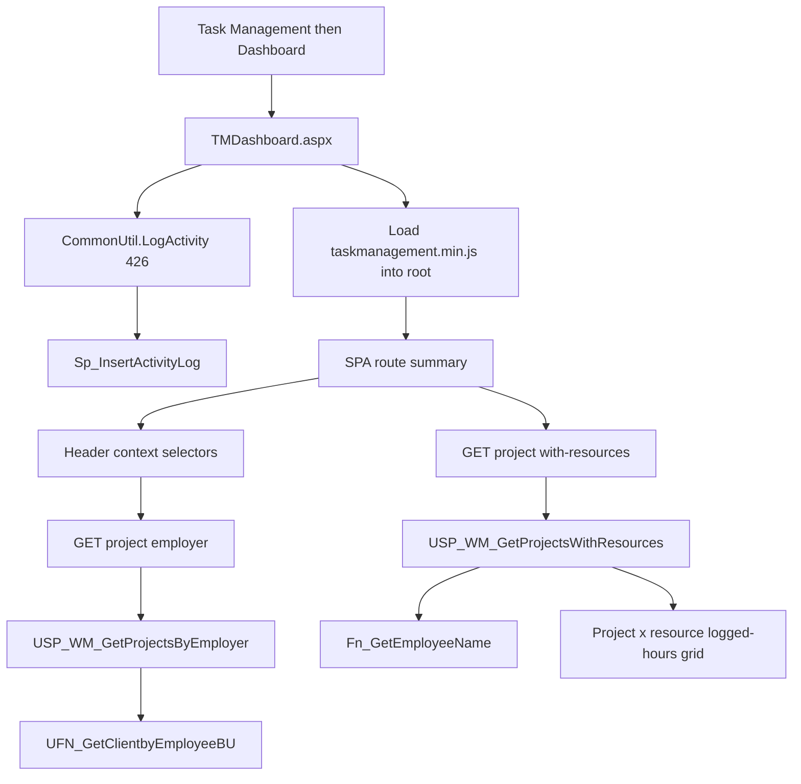
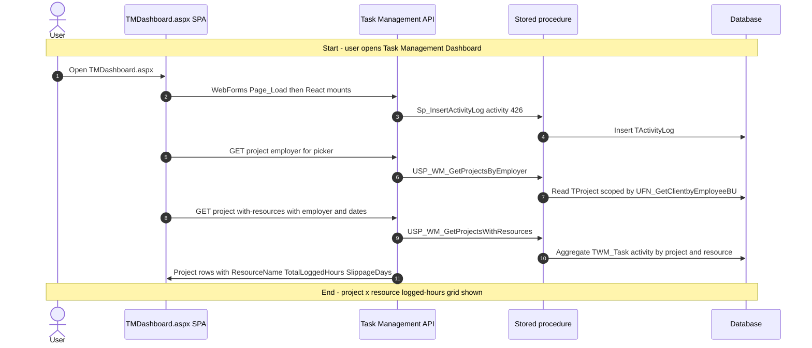
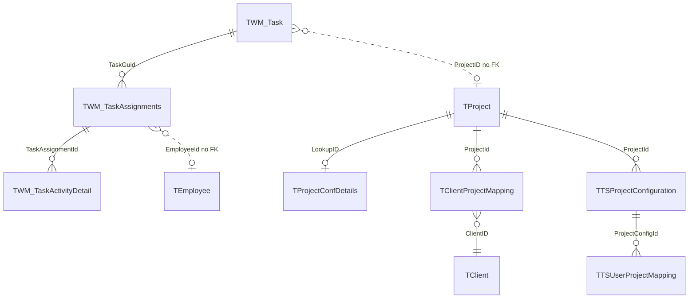

# Dashboard

## Overview

A Task Management user opens **Task Management → Dashboard** to see a **project × resource logged-hours** grid for a chosen organisation and date window: each row is a project paired with an assigned resource, with timeline, slippage against the project plan end, and total logged hours from work-log activity. The left-nav leaf is MenuId **1263** (`TMenuDetails`), NavigateURL `/HRM/TaskManagement/TMDashboard.aspx`. Standalone SPA route is `/summary`; the integrated host is `TMDashboard.aspx`.

The WebForms shell only stamps session identity into hidden fields, logs activity `TaskManagerDashboard` (**426**), and mounts the Vite bundle `BuildJS/taskmanagement.min.js` into `#root`. Chart/grid traffic is JWT Bearer to the Task Management Nest API (port **3004**, Timeport pool `HRM_CL_TIMEPORT`). The grid procedure is `USP_WM_GetProjectsWithResources` (confirmed in that procedure’s sibling `USP_WM_GetEmployeeResourceAllocationSummary` comments as “the Dashboard”). Context selectors (employer → BU → client → project) are shared Header chrome used on every TM surface.

There is no SystemModel-2 page under SourceCode for this leaf; the Task Management product’s SystemModel-2 (`experience/surfaces/ui-surfaces.md`) is the canonical surface map. The Nest frontend/backend repos are **not** in this workspace — only the ASPX host and live TIMEPORT procedures were verified here.

## Workflow

This page is a React SPA hosted in WebForms. No WebForms postback binds the grid. Report/analytics tabs live on **Reports** (`Reports.aspx`), not here.

## Request journey

Reads only. Opening the leaf loads filters, then the project × resource grid for the selected employer and date range. There is no save path on this leaf.

## Entry points

| Entry | Purpose |
|---|---|
| `/HRM/TaskManagement/TMDashboard.aspx` | Left-nav **Dashboard** (MenuId 1263). Vite host; logs activity 426. |
| Standalone route `/summary` | Same SPA surface outside HRMS shell (SystemModel-2 ui-surfaces). |
| Legacy `TaskManagement.aspx` | Older webpack Notification / Create Task / Task Report tabs. **Not** this menu leaf. |
| WebForms postback on this page | None — code-behind only logs activity and stamps hidden fields. |

## Code → database call chain

| Entry | Method | Database |
|---|---|---|
| Page load, `TMDashboard.aspx.cs:25` | `CommonUtil.LogActivity` (`Common.cs:52`) → `ActivityHelper.LogActivity` (`ActivityHelper.cs:32`) | `Sp_InsertActivityLog`. Activity type `TaskManagerDashboard` = 426 (`Enums.cs:369`). HRMS DB. |
| Project picker (shared Header), Nest `GET project/employer` | SystemModel rest-endpoint-catalog → project repository | `USP_WM_GetProjectsByEmployer` (live `HRM_CL_TIMEPORT`). Nested `UFN_GetClientbyEmployeeBU`. |
| Dashboard grid, Nest `GET project/with-resources` | SystemModel rest-endpoint-catalog; SP comments name this proc “the Dashboard” | `USP_WM_GetProjectsWithResources` (live `HRM_CL_TIMEPORT`). Nested `Fn_GetEmployeeName` (synonym to HRMS). |

Nest controller/repository `file:line` citations are unavailable in this workspace (Task Management frontend/backend live in a separate product repo). The ASPX host and live TIMEPORT definitions were verified directly.

## API endpoints

No WebForms postback binds report data. Dashboard data uses the Task Management Nest API (Authorize / JWT). UI constants and controllers are in that product repo, not `HRMS.Core.WebAPI.Node`.

| Verb | Route | Parameters | Purpose | Source |
|---|---|---|---|---|
| GET | `project/with-resources` | `EmployerId`, optional date range | Project × resource logged-hours grid. | SystemModel `rest-endpoint-catalog.md`; SP `@EmployerId`, `@StartDate`, `@EndDate` |
| GET | `project/employer` | `EmployerId`, `EmployeeId` | Project dropdown for Header chrome. | SystemModel catalog; SP also takes `@EmployeeId` |
| (middleware) | `*` | JWT employer scope | `SP_GetAccessibleEmployerIds` via `EmployerAccessMiddleware`. | SystemModel backend-modules |

Related but **not** this leaf: `GET tasks/allocation-summary` → `USP_WM_GetEmployeeResourceAllocationSummary` (Resource / allocation reporting; comments contrast it with the Dashboard proc).

## Stored procedures & tables involved

| Object | File | Purpose | Wiki |
|---|---|---|---|
| `Sp_InsertActivityLog` | `HRMS/STOREPROCEDURE/Sp_InsertActivityLog.sql` | Page-access log. | [Sp_InsertActivityLog](/docs/database/hrms/Sp_InsertActivityLog) |
| `USP_WM_GetProjectsWithResources` | Live `HRM_CL_TIMEPORT` (not in Liquibase `HRM-TIMEPORT` inventory) | Dashboard project × resource grid. | [USP_WM_GetProjectsWithResources](/docs/database/hrm-timeport/USP_WM_GetProjectsWithResources) |
| `USP_WM_GetProjectsByEmployer` | Live `HRM_CL_TIMEPORT` | Project picker rows. | [USP_WM_GetProjectsByEmployer](/docs/database/hrm-timeport/USP_WM_GetProjectsByEmployer) |
| `Fn_GetEmployeeName` | HRMS FUNCTIONS (synonym on TIMEPORT) | Created-by and resource display names. | [Fn_GetEmployeeName](/docs/database/hrms/Fn_GetEmployeeName) |
| `UFN_GetClientbyEmployeeBU` | HRMS FUNCTIONS (synonym on TIMEPORT) | Client scope for project picker. | [UFN_GetClientbyEmployeeBU](/docs/database/hrms/UFN_GetClientbyEmployeeBU) |
| `TWM_Task`, `TWM_TaskAssignments`, `TWM_TaskActivityDetail` | Task Management tables on TIMEPORT | Tasks, assignees, work-log durations. | SystemModel data/ownership |
| `TProject`, `TProjectConfDetails`, `TClient`, `TClientProjectMapping`, `TEmployee` | Core HRMS (three-part / synonym) | Project plan dates, client, employee employer filter. | — |
| `TTSProjectConfiguration`, `TTSUserProjectMapping` | Timeport | Active project config and resource mapping JSON. | — |

## Table relationships

Declared FKs from Task Management tables to core HRMS are sparse (split-database ADR). Diagram shows joins `USP_WM_GetProjectsWithResources` actually uses; cross-database links are dotted.

## Known gaps

- **Nest frontend/backend source not in this workspace** — Vite SPA and controllers live in the separate Task Management product repo; `BuildJS/taskmanagement.min.js` is also missing from the checked-in Web tree (only legacy webpack `TaskManagement.min.js` is present). Call-chain API `file:line` cites SystemModel + live SQL.
- **`USP_WM_*` scripts are not in Liquibase `HRMS-DATABASE/HRM-TIMEPORT`** — pages document the live `HRM_CL_TIMEPORT` definition.
- **Legacy `TaskManagement.aspx`** (Notification / Create Task / Task Report) remains a different product surface; do not confuse with MenuId 1263 Dashboard.
- **MenuId drift** — DynamicMenuXML templates sometimes show Dashboard as Value `1291`; live `TMenuDetails` for this leaf is **1263** → `TMDashboard.aspx`.
- **`GET tasks/allocation-summary`** is a sibling analytics path, not the Dashboard grid procedure.
- **No llm-wiki domain page** dedicated to Task Management Dashboard tables.

## Reference

Confidence is **medium**: ASPX host, menu row, activity enum, and live TIMEPORT `USP_WM_GetProjectsWithResources` / `USP_WM_GetProjectsByEmployer` bodies were verified. Nest React/API `file:line` depends on SystemModel-2 for the Task Management product (not checked into SourceCode).

### SourceCode

- `HRMS.Web/HRMS.Web/HRM/TaskManagement/TMDashboard.aspx`
- `HRMS.Web/HRMS.Web/HRM/TaskManagement/TMDashboard.aspx.cs`
- `HRMS.Web/HRMS.Web/HRM/TaskManagement/TaskManagement.aspx` (legacy sibling)
- `HRMS.Shared/HRMS.DataContract/Common/Enums.cs`
- `HRMS.Shared/HRMS.Common/Common.cs`
- `HRMS.Shared/TDG.ActivityAuditLog/DAL/ActivityHelper.cs`

### TDG HRMS DB / live TIMEPORT

- Live `HRM_CL_TIMEPORT.dbo.USP_WM_GetProjectsWithResources`
- Live `HRM_CL_TIMEPORT.dbo.USP_WM_GetProjectsByEmployer`
- `HRMS-DATABASE/HRMS/STOREPROCEDURE/Sp_InsertActivityLog.sql`
- `HRMS-DATABASE/HRMS/FUNCTIONS/Fn_GetEmployeeName.sql`
- `HRMS-DATABASE/HRMS/FUNCTIONS/UFN_GetClientbyEmployeeBU.sql`

### SystemModel-2 (Task Management product cache)

- `experience/surfaces/ui-surfaces.md` — Dashboard `/summary` → `TMDashboard.aspx`
- `interface/apis/rest-endpoint-catalog.md` — `project/with-resources`, `project/employer`
- `architecture/adr/0001-split-database-with-synonyms.md`
