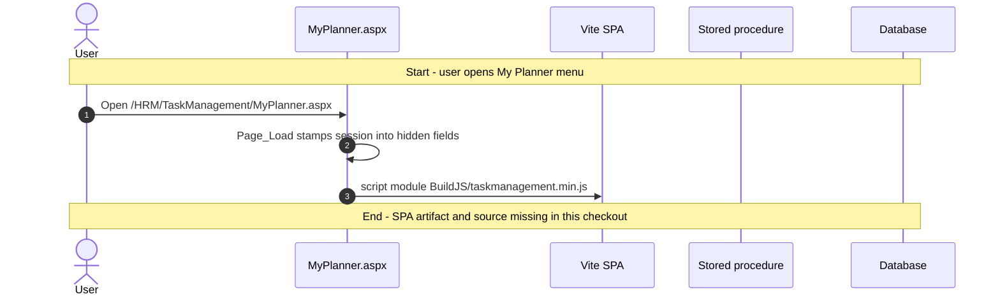
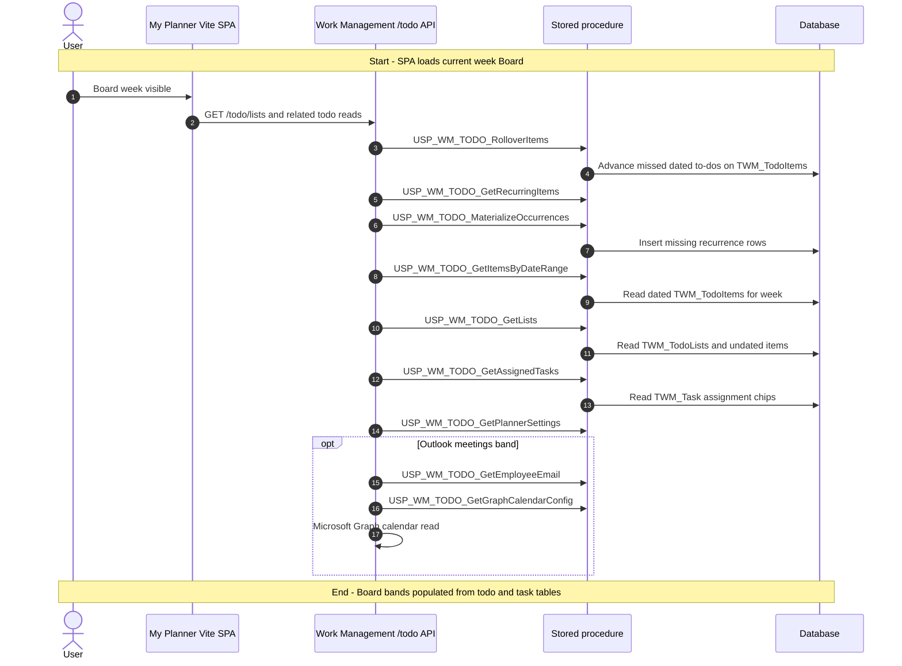
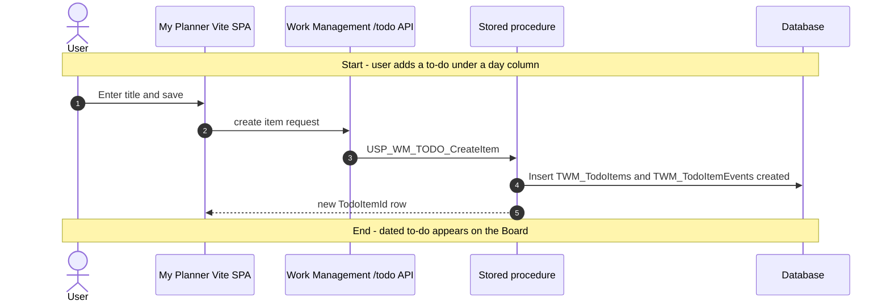
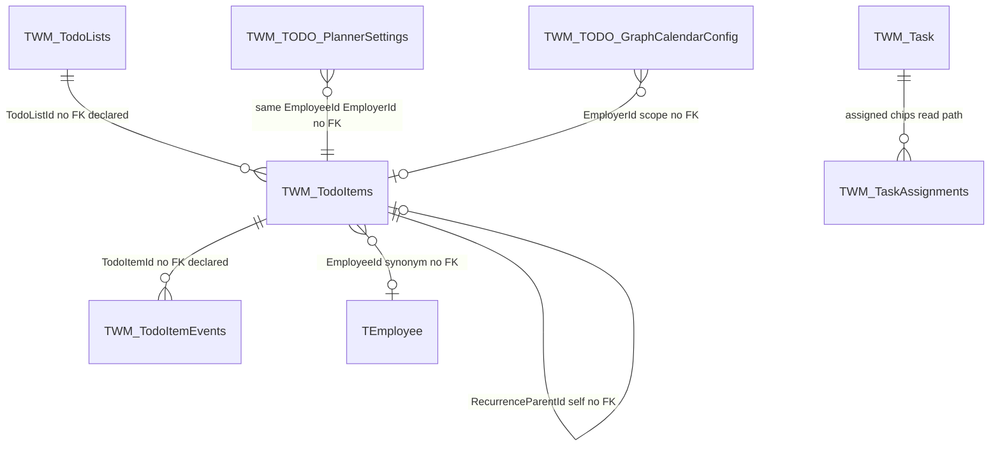

# My Planner

## Overview

**Task Management → My Planner** is the personal weekly planner for dated to-dos, Future/Planned lists, read-only Outlook meetings, and read-only assigned Work Management task chips. Left-nav rows named **My Planner** (base `MenuId` **1315** / **1364** / **1365** depending on employer copy; license catalog node value **1319**) navigate to `/HRM/TaskManagement/MyPlanner.aspx`.

The WebForms host stamps session identity into hidden fields and loads the Vite-style module bundle `BuildJS/taskmanagement.min.js` into `#root`. `Page_Load` does not call stored procedures and does not log activity. In this SourceCode checkout the Vite SPA source and the Work Management `/todo` API (Controller → DAL) are **not** present; `BuildJS/` only holds the classic webpack `TaskManagement.min.js` artifacts used by other Task Management shells.

`TDataCatalog` associates **Task Management > My Planner** (BOARD / UNFINISHED) with `TWM_TodoLists`, `TWM_TodoItems`, and `TWM_TodoItemEvents` in **HRM_CL_TIMEPORT** (docs slug **hrm-timeport**) and REST-shaped paths `GET /todo/lists` and `GET /todo/items`. Live DEV holds the full `USP_WM_TODO_*` family (plus planner-settings and Graph calendar helpers). Those scripts are **not** checked into `HRMS-DATABASE/HRM-TIMEPORT/STOREPROCEDURE` in this Liquibase tree. Product intent is captured in ADO PBI **155292**.

**Who's involved:**

- **Employee** — plans personal to-dos on the Board, reviews Unfinished, optionally connects Outlook meetings, sees assigned WM task chips.
- **No WebForms postback** — planner data is expected as HTTP JSON from the missing Vite SPA to a Work Management `/todo` API against TimePort, not the classic `/taskmanagement/*` `USP_TM_*` path.

There is no SystemModel-2 page for My Planner in this checkout.

## Workflow

```mermaid
flowchart TD
  Nav["Task Management menu"] --> Leaf["My Planner MenuId 1315/1365"]
  Leaf --> Host["MyPlanner.aspx"]
  Host --> Vite["Expect BuildJS/taskmanagement.min.js"]
  Vite --> Gap{"Vite SPA in checkout?"}
  Gap -->|missing| Empty["Shell only - SPA artifact/source missing"]
  Catalog["TDataCatalog My Planner"] --> Lists["USP_WM_TODO_GetLists"]
  Catalog --> Range["USP_WM_TODO_GetItemsByDateRange"]
  Catalog --> Unfin["USP_WM_TODO_GetUnfinishedItems"]
  Catalog --> Roll["USP_WM_TODO_RolloverItems"]
  Catalog --> Recur["USP_WM_TODO_GetRecurringItems"]
  Catalog --> Mat["USP_WM_TODO_MaterializeOccurrences"]
  Catalog --> Create["USP_WM_TODO_CreateItem"]
  Catalog --> Update["USP_WM_TODO_UpdateItem"]
  Catalog --> Delete["USP_WM_TODO_DeleteItem"]
  Catalog --> Reorder["USP_WM_TODO_ReorderItems"]
  Catalog --> UpsertList["USP_WM_TODO_UpsertList"]
  Catalog --> DelList["USP_WM_TODO_DeleteList"]
  Board["Board bands"] --> Assign["USP_WM_TODO_GetAssignedTasks"]
  Board --> Settings["USP_WM_TODO_GetPlannerSettings"]
  Board --> SettingsSave["USP_WM_TODO_UpsertPlannerSettings"]
  Meet["Meetings band"] --> Email["USP_WM_TODO_GetEmployeeEmail"]
  Meet --> Graph["USP_WM_TODO_GetGraphCalendarConfig"]
  Meet --> GraphExt["Microsoft Graph calendar read"]
```

Planner list/save traffic is expected as HTTP JSON. `MyPlanner.aspx` has no `[WebMethod]` / PageMethods.

## Request journey

### Open My Planner (menu leaf)

### Load Board week (catalog / live SP)

### Create a dated to-do

## Entry points

| UI page / API endpoint | Purpose |
|---|---|
| `HRM/TaskManagement/MyPlanner.aspx` | Left-nav shell. `Page_Load` stamps employee/employer/customer/role/email into hidden fields; references `BuildJS/taskmanagement.min.js` |
| Left-nav `TMenuDetails` **My Planner** | `NavigateURL` `/HRM/TaskManagement/MyPlanner.aspx` (`MenuId` 1315 / 1364 / 1365; license node **1319**) |
| Vite SPA Board / Unfinished | Expected UI for bands, week toolbar, lists (source missing in checkout) |
| Work Management `/todo/*` | Catalog paths `GET /todo/lists`, `GET /todo/items`; mutating routes not inventoriable without API source |
| Activity type **525** (`TActivityLogTypes` DML) | Named **My Planner** page-visit type; **not** called from `MyPlanner.aspx.cs` |

## Code → database call chain

ASPX host only. SPA → API → DAL file:line chains are **not available** in this checkout. Mapping below is host truth + live `USP_WM_TODO_*` objects in `HRM_CL_TIMEPORT` + `TDataCatalog` / PBI **155292**.

| Entry point | App code (`file:line`) | Stored procedure |
|---|---|---|
| Open page | `MyPlanner.aspx` loads module script (`MyPlanner.aspx:7-12`); `Page_Load` session stamp (`MyPlanner.aspx.cs:19-37`) | none |
| Board dated items | Vite SPA / `/todo` API (missing) | `USP_WM_TODO_GetItemsByDateRange` |
| Band 3 lists | Vite SPA / `/todo` API (missing); catalog `GET /todo/lists` | `USP_WM_TODO_GetLists` |
| Unfinished tab | Vite SPA / `/todo` API (missing) | `USP_WM_TODO_GetUnfinishedItems` |
| Rollover on load | Vite SPA / `/todo` API (missing) | `USP_WM_TODO_RolloverItems` |
| Recurrence fill | Vite SPA / `/todo` API (missing) | `USP_WM_TODO_GetRecurringItems` → `USP_WM_TODO_MaterializeOccurrences` |
| Add / edit / delete / DnD | Vite SPA / `/todo` API (missing) | `USP_WM_TODO_CreateItem`, `USP_WM_TODO_UpdateItem`, `USP_WM_TODO_DeleteItem`, `USP_WM_TODO_ReorderItems` |
| List CRUD | Vite SPA / `/todo` API (missing) | `USP_WM_TODO_UpsertList`, `USP_WM_TODO_DeleteList` |
| Assigned WM chips | Vite SPA / `/todo` API (missing) | `USP_WM_TODO_GetAssignedTasks` |
| Planner day bitmask | Vite SPA / `/todo` API (missing) | `USP_WM_TODO_GetPlannerSettings`, `USP_WM_TODO_UpsertPlannerSettings` |
| Outlook meetings | Vite SPA / Graph (missing) | `USP_WM_TODO_GetEmployeeEmail`, `USP_WM_TODO_GetGraphCalendarConfig` (+ external Graph; admin upsert `USP_WM_TODO_UpsertGraphCalendarConfig`) |

## API endpoints

No WebForms postback data access on `MyPlanner.aspx`. Catalog documents REST-shaped todo reads against TimePort Work Management APIs. Exact route table, verbs, and handlers are **not** in `HRMS.TaskManagement.WebAPI.Node` in this checkout (no `todo` routes under `/api/taskmanagement`).

| Method | Path (catalog / inferred) | Purpose | Caller | Handler |
|---|---|---|---|---|
| GET | `/todo/lists` | Band 3 lists + undated items | My Planner SPA (missing) | missing `/todo` API |
| GET | `/todo/items` | Dated items (date range) | My Planner SPA (missing) | missing `/todo` API |
| _(other /todo mutations)_ | not inventoriable here | create/update/delete/reorder/rollover/settings/meetings | My Planner SPA (missing) | missing `/todo` API |
| External | Microsoft Graph calendar | Band 2 meetings (read-only) | API after Graph config + email | not a SQL Server procedure |

## Stored procedures & tables involved

Inventory scripts for these objects are **absent** from `HRMS-DATABASE/HRM-TIMEPORT/`. Procedure pages use live DEV definitions under `/docs/database/hrm-timeport/`.

| Object | File | Purpose | Database page |
|---|---|---|---|
| `USP_WM_TODO_GetItemsByDateRange` | live DEV only | Week dated to-dos | [USP_WM_TODO_GetItemsByDateRange](/docs/database/hrm-timeport/USP_WM_TODO_GetItemsByDateRange) |
| `USP_WM_TODO_GetLists` | live DEV only | Lists + undated items | [USP_WM_TODO_GetLists](/docs/database/hrm-timeport/USP_WM_TODO_GetLists) |
| `USP_WM_TODO_GetUnfinishedItems` | live DEV only | Unfinished tab | [USP_WM_TODO_GetUnfinishedItems](/docs/database/hrm-timeport/USP_WM_TODO_GetUnfinishedItems) |
| `USP_WM_TODO_RolloverItems` | live DEV only | Auto-advance missed dated to-dos | [USP_WM_TODO_RolloverItems](/docs/database/hrm-timeport/USP_WM_TODO_RolloverItems) |
| `USP_WM_TODO_GetRecurringItems` | live DEV only | Series parents | [USP_WM_TODO_GetRecurringItems](/docs/database/hrm-timeport/USP_WM_TODO_GetRecurringItems) |
| `USP_WM_TODO_MaterializeOccurrences` | live DEV only | Create/prune recurrence rows | [USP_WM_TODO_MaterializeOccurrences](/docs/database/hrm-timeport/USP_WM_TODO_MaterializeOccurrences) |
| `USP_WM_TODO_CreateItem` | live DEV only | Add to-do | [USP_WM_TODO_CreateItem](/docs/database/hrm-timeport/USP_WM_TODO_CreateItem) |
| `USP_WM_TODO_UpdateItem` | live DEV only | Edit / complete / move / repeat | [USP_WM_TODO_UpdateItem](/docs/database/hrm-timeport/USP_WM_TODO_UpdateItem) |
| `USP_WM_TODO_DeleteItem` | live DEV only | Soft-delete (scope one/following/series) | [USP_WM_TODO_DeleteItem](/docs/database/hrm-timeport/USP_WM_TODO_DeleteItem) |
| `USP_WM_TODO_ReorderItems` | live DEV only | DnD reorder TVP | [USP_WM_TODO_ReorderItems](/docs/database/hrm-timeport/USP_WM_TODO_ReorderItems) |
| `USP_WM_TODO_UpsertList` | live DEV only | Create/rename list | [USP_WM_TODO_UpsertList](/docs/database/hrm-timeport/USP_WM_TODO_UpsertList) |
| `USP_WM_TODO_DeleteList` | live DEV only | Soft-delete list + items | [USP_WM_TODO_DeleteList](/docs/database/hrm-timeport/USP_WM_TODO_DeleteList) |
| `USP_WM_TODO_GetAssignedTasks` | live DEV only | WM task chips | [USP_WM_TODO_GetAssignedTasks](/docs/database/hrm-timeport/USP_WM_TODO_GetAssignedTasks) |
| `USP_WM_TODO_GetPlannerSettings` | live DEV only | Weekday bitmask | [USP_WM_TODO_GetPlannerSettings](/docs/database/hrm-timeport/USP_WM_TODO_GetPlannerSettings) |
| `USP_WM_TODO_UpsertPlannerSettings` | live DEV only | Save weekday bitmask | [USP_WM_TODO_UpsertPlannerSettings](/docs/database/hrm-timeport/USP_WM_TODO_UpsertPlannerSettings) |
| `USP_WM_TODO_GetEmployeeEmail` | live DEV only | Unique mailbox for Graph | [USP_WM_TODO_GetEmployeeEmail](/docs/database/hrm-timeport/USP_WM_TODO_GetEmployeeEmail) |
| `USP_WM_TODO_GetGraphCalendarConfig` | live DEV only | Employer Graph app settings | [USP_WM_TODO_GetGraphCalendarConfig](/docs/database/hrm-timeport/USP_WM_TODO_GetGraphCalendarConfig) |
| `USP_WM_TODO_UpsertGraphCalendarConfig` | live DEV only | Onboard/rotate Graph settings | [USP_WM_TODO_UpsertGraphCalendarConfig](/docs/database/hrm-timeport/USP_WM_TODO_UpsertGraphCalendarConfig) |

Tables: `TWM_TodoLists`, `TWM_TodoItems`, `TWM_TodoItemEvents`, `TWM_TODO_PlannerSettings`, `TWM_TODO_GraphCalendarConfig`; assigned chips also read `TWM_Task`, `TWM_TaskAssignments`, `TWM_ReferenceMaster`, `TProject`, client/BU mapping tables; email helper reads HRMS synonyms `TEmployee` / `TEmployeeInfo`.

**Nested level:** none of these procedures `EXEC` another procedure. No nested SP pages required.

## Table relationships

No foreign keys were verified from Liquibase table scripts (objects are live-only). Columns the procedures join without a checked-in FK are labeled **no FK declared**.

## Known gaps

- Vite SPA source for `BuildJS/taskmanagement.min.js` is not in this SourceCode checkout; checked-in `BuildJS/` lacks `taskmanagement.min.js` / `vendor.bundle.js`.
- Work Management `/todo` Controller → DAL → execute strings are not in `HRMS.TaskManagement.WebAPI.Node` here, so SPA→API file:line and exact HTTP verbs beyond catalog GET paths are unknown.
- `USP_WM_TODO_*` scripts are live in `HRM_CL_TIMEPORT` but not registered under `HRMS-DATABASE/HRM-TIMEPORT` Liquibase inventory.
- `MyPlanner.aspx.cs` does not call `LogActivity` even though activity type **525** exists for My Planner.
- License XML uses node value **1319** while `TMenuDetails` base rows use MenuId **1315** / **1364** / **1365**.
- Outlook Band 2 depends on Graph config + unique EmailID + external Graph API; failures are product-handled outside SQL.
- `USP_WM_TODO_UpsertGraphCalendarConfig` is an onboarding/ops write, not a typical employee Board action.
- No SystemModel-2 domain page for My Planner.

## Reference

Medium confidence on ASPX host, menu URLs, live TimePort `USP_WM_TODO_*` definitions, and catalog/PBI feature mapping. Low confidence on exact SPA routes and call order until the Vite app and `/todo` API are in the workspace.

### SourceCode

- `HRMS.Web/HRMS.Web/HRM/TaskManagement/MyPlanner.aspx`
- `HRMS.Web/HRMS.Web/HRM/TaskManagement/MyPlanner.aspx.cs` (`Page_Load` `:19-37`)
- Classic webpack Task Management SPA under `HRM/TaskManagement/` does **not** route My Planner (only `TaskManagement.aspx` → `MasterPages`)
- `HRMS.TaskManagement.WebAPI.Node` — no `/todo` routes in this checkout

### TDG HRMS DB / live DEV

- Live `HRM_CL_TIMEPORT` procedures `USP_WM_TODO_*` and tables `TWM_Todo*`, `TWM_TODO_PlannerSettings`, `TWM_TODO_GraphCalendarConfig`
- `HRMS-DATABASE/HRMS/DML/TDataCatalog_DML.sql` (My Planner → todo tables / `GET /todo/*`)
- `HRMS-DATABASE/HRMS/DML/PageVisitTracking/001_DML_TActivityLogTypes_PageVisits.sql` (activity **525**)
- `HRMS-DATABASE/HRMS/DML/Customer License Dashboard/TMenuDetails DML.sql` (node **1319**)

### ADO

- PBI [155292](https://tdgteams-tdgproject.visualstudio.com//_workitems/edit/155292) My Planner
- PR 25295 / 25848 — ASPX host only (`MyPlanner.aspx*`)
