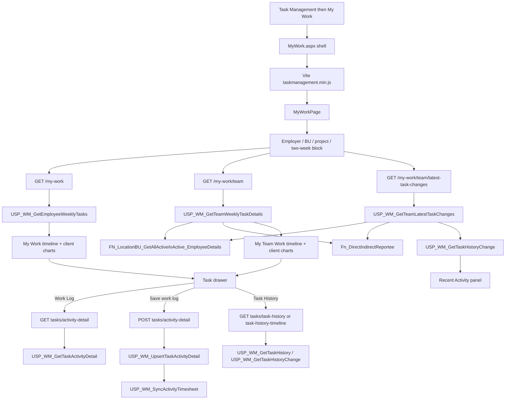
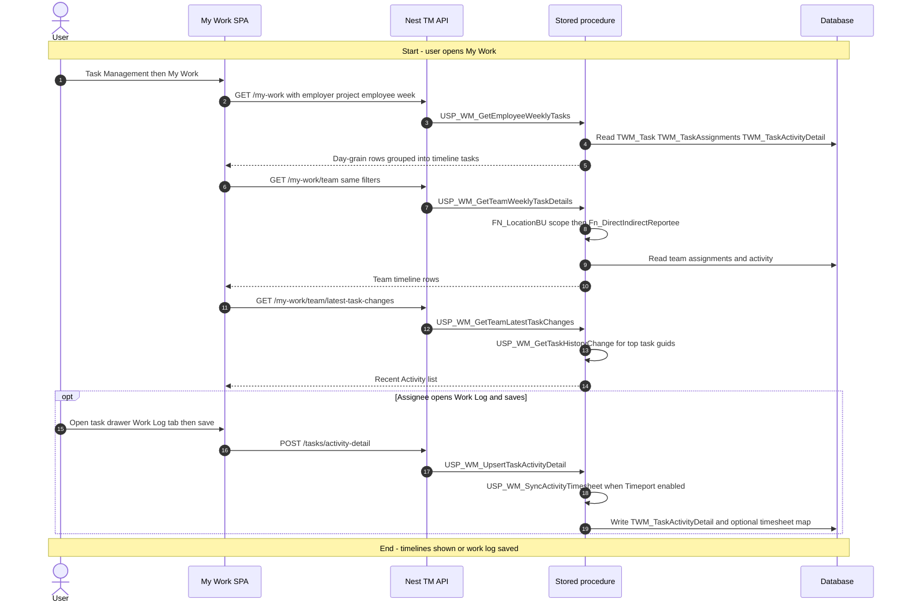
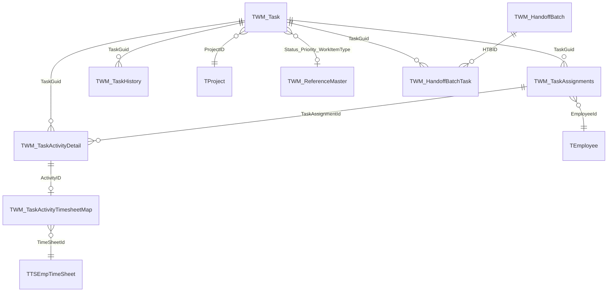

# My Work

## Overview

A logged-in employee opens **Task Management → My Work** to see their assigned work for a two-week date block: a timeline grid of their own tasks, a matching **My Team Work** grid for direct/indirect reportees, priority and work-item-type insight charts derived client-side from those rows, and a recent-activity list of the team's latest task history. Clicking a task opens a right-hand drawer with Edit (view-mode from this page), Work Log, Chatbot, and Task History tabs.

The left-nav leaf (live MenuId **1301**) navigates to `/HRM/TaskManagement/MyWork.aspx`. That WebForms shell stamps session identity into hidden fields and loads the Vite Task Management SPA (`BuildJS/taskmanagement.min.js`) into `#root`. The SPA route for this path mounts `MyWorkPage`. Page load fires three Nest TM API GETs under `/my-work`; the drawer reuses `/tasks/*` for history and work-log. Charts on this page are computed in the browser from the weekly task payloads (not `USP_WM_CardView_GetKpis`).

There is no SystemModel-2 or llm-wiki domain page for Work Management / TWM. Product intent for the dashboard is ADO PBI [140811](https://tdgteams-tdgproject.visualstudio.com/_workitems/edit/140811) (Dashboard-My Work Tab).

## Workflow

## Request journey

My Work does not create tasks on open. The primary journey is a filtered personal/team load that ends when timeline rows (and optional recent history) are shown. Work-log save is a separate mutating branch from the drawer.

## Entry points

> Live SPA source and Nest TM API live in the ADO `TaskManagement` repo (not under classic `HRMS.Web` webpack). The WebForms host and menu URL are in SourceCode / live `TMenuDetails`.

| Entry point | Purpose | Live? |
|---|---|---|
| `HRM/TaskManagement/MyWork.aspx` (+ `.cs`) | WebForms shell; session → hidden fields; Vite bundle | Yes — MenuId 1301 NavigateURL |
| React `MyWorkPage` (`frontend/src/pages/MyWorkPage.tsx`) | My Work / My Team Work / charts / drawer | Yes — routed from `MyWork.aspx` path |
| Nest `@Controller('my-work')` | Weekly self/team + recent activity | Yes — TM API host `hrm-*-tmapi` |
| Nest `tasks` activity-detail / task-history | Drawer Work Log and History | Yes — shared with Tasks page |
| Classic webpack `TaskManagement` under `HRM/TaskManagement` | Legacy TM admin pages only | Not this leaf — routes `TaskManagement.aspx` only |
| `USP_WM_CardView_GetKpis` | Catalog-tagged for My Work | No checked-in API caller for this page |

## Code → database call chain

Paths under `TaskManagement/` refer to the ADO Task Management Vite/Nest repo. ASPX paths are under SourceCode `HRMS.Web`.

| Step | Entry point | App code | Stored procedure |
|---|---|---|---|
| Page load | `MyWork.aspx` | `Page_Load` (`MyWork.aspx.cs:19-36`) — session → hidden fields | none |
| Mount SPA | Vite bundle | `appRoutesHRMS` maps `/HRM/TaskManagement/MyWork.aspx` → `MyWorkPage` | none |
| Load My Work | `useMyWorkData` | `GET_My_WORK` → `MyWorkController.getMyWork` (`my-work.controller.ts:11-28`) → `MyWorkRepository.getTasks` (`my-work.repository.ts:46`) | `USP_WM_GetEmployeeWeeklyTasks` |
| Load My Team Work | `useMyWorkData` | `GET_MY_TEAM_WORK` → `getMyTeamWork` (`my-work.controller.ts:33-50`) → `getTeamTasks` (`my-work.repository.ts:83`) | `USP_WM_GetTeamWeeklyTaskDetails` → `FN_LocationBU_GetAllActiveInActive_EmployeeDetails`, `Fn_DirectIndirectReportee` |
| Load Recent Activity | `useMyWorkData` | `GET_MY_TEAM_LATEST_TASK_CHANGES` → `getMyTeamLatestTaskChanges` (`my-work.controller.ts:56-64`) → `getTeamLatestTaskChanges` (`my-work.repository.ts:113`) | `USP_WM_GetTeamLatestTaskChanges` → `USP_WM_GetTaskHistoryChange` |
| Work Log read | drawer | `GET tasks/activity-detail` → `tasks.repository` execute | `USP_WM_GetTaskActivityDetail` |
| Work Log save | drawer | `POST tasks/activity-detail` → `tasks.repository` execute | `USP_WM_UpsertTaskActivityDetail` → `USP_WM_SyncActivityTimesheet` (and `UFN_WM_IsTaskStageLocked` guard) |
| Task History | drawer | `GET tasks/task-history` / `task-history-timeline` | `USP_WM_GetTaskHistory` / `USP_WM_GetTaskHistoryChange` |

## API endpoints

No WebForms postback binds My Work data. Traffic is JWT Axios to the Nest TM API.

| Verb | Route | Parameters | Purpose | Source |
|---|---|---|---|---|
| GET | `/my-work` | `EmployerId`, `ProjectId` (csv), `EmployeeId`, `WeekStart`, `WeekEnd` (query; optional) | Personal weekly timeline grain | `my-work.controller.ts:11-28` |
| GET | `/my-work/team` | same as `/my-work` | Team weekly timeline grain | `my-work.controller.ts:33-50` |
| GET | `/my-work/team/latest-task-changes` | `EmployerId`, `EmployeeId` | Top recent team history rows | `my-work.controller.ts:56-64` |
| GET | `/tasks/activity-detail` | `TaskGuid`, assignment id (query DTO) | Work Log rows | `tasks.controller.ts` activity-detail GET |
| POST | `/tasks/activity-detail` | body UDT-shaped activities | Upsert Work Log | `tasks.controller.ts` activity-detail POST |
| GET | `/tasks/task-history` | `TaskGuids` | History tab snapshots | `tasks.controller.ts:211-213` |
| GET | `/tasks/task-history-timeline` | `TaskGuids` | Timeline-shaped history | `tasks.controller.ts:216-218` |

## Stored procedures & tables involved

Procedures live in **TimePort** (`HRM_CL_TIMEPORT`). Several weekly/history procs are present live but not yet inventoried under deployable `HRMS-DATABASE/HRM-TIMEPORT` Liquibase; scripts used for analysis are live `sys.sql_modules` (and QA copies where present). Scope helpers are HRMS functions (synonymed into TimePort).

| Object | Location | Purpose | Docs |
|---|---|---|---|
| `USP_WM_GetEmployeeWeeklyTasks` | TimePort | Day-grain personal task timeline for date range | [page](/docs/database/hrm-timeport/USP_WM_GetEmployeeWeeklyTasks) |
| `USP_WM_GetTeamWeeklyTaskDetails` | TimePort | Same shape for reportees in location/BU scope | [page](/docs/database/hrm-timeport/USP_WM_GetTeamWeeklyTaskDetails) |
| `USP_WM_GetTeamLatestTaskChanges` | TimePort | Top recent team task guids → history change JSON | [page](/docs/database/hrm-timeport/USP_WM_GetTeamLatestTaskChanges) |
| `USP_WM_GetTaskHistoryChange` | TimePort | Nested from latest-changes; also history timeline | [page](/docs/database/hrm-timeport/USP_WM_GetTaskHistoryChange) |
| `USP_WM_GetTaskHistory` | TimePort | Drawer Task History snapshots | [page](/docs/database/hrm-timeport/USP_WM_GetTaskHistory) |
| `USP_WM_GetTaskActivityDetail` | TimePort | Drawer Work Log read | [page](/docs/database/hrm-timeport/USP_WM_GetTaskActivityDetail) |
| `USP_WM_UpsertTaskActivityDetail` | TimePort | Drawer Work Log write | [page](/docs/database/hrm-timeport/USP_WM_UpsertTaskActivityDetail) |
| `USP_WM_SyncActivityTimesheet` | TimePort | Nested timesheet sync after work-log upsert | [page](/docs/database/hrm-timeport/USP_WM_SyncActivityTimesheet) |
| `UFN_WM_IsTaskStageLocked` | TimePort | Stage-lock guard on work-log mutate | [page](/docs/database/hrm-timeport/UFN_WM_IsTaskStageLocked) |
| `FN_LocationBU_GetAllActiveInActive_EmployeeDetails` | HRMS (synonym) | Employer/location/BU employee scope | [page](/docs/database/hrms/FN_LocationBU_GetAllActiveInActive_EmployeeDetails) |
| `Fn_DirectIndirectReportee` | HRMS (synonym) | Reporting tree for My Team | [page](/docs/database/hrms/Fn_DirectIndirectReportee) |
| `Fn_GetEmployeeName` | HRMS | Display names on result sets | [page](/docs/database/hrms/Fn_GetEmployeeName) |

Primary tables: `TWM_Task`, `TWM_TaskAssignments`, `TWM_TaskActivityDetail`, `TWM_TaskHistory`, `TWM_ReferenceMaster`, `TProject`, `TWM_TaskActivityTimesheetMap`, `TTSEmpTimeSheet`, `TEmployee`, `TWM_HandoffBatch`, `TWM_HandoffBatchTask`.

## Table relationships

FK declarations are sparse on TWM tables; relationships above follow join columns used by the My Work procedures (logical, not necessarily declared FKs).

## Known gaps

- Vite SPA + Nest TM API source is **not** checked into the classic `d:\TDG HRMS\SourceCode` tree; analysis used the ADO `TaskManagement` checkout (also absent from durable workspace paths after analysis). Re-clone that repo to re-verify file:line citations.
- `BuildJS/taskmanagement.min.js` is referenced by `MyWork.aspx` but is not present in the SourceCode BuildJS folder checked here (only legacy webpack `TaskManagement.min.js`).
- Weekly My Work procs (`USP_WM_GetEmployeeWeeklyTasks`, team variants) exist live in `HRM_CL_TIMEPORT` but are **not** in deployable Liquibase under `HRMS-DATABASE/HRM-TIMEPORT` in the primary DB repo.
- Priority / work-item charts on My Work are **client-side** from weekly payloads; catalog still tags `USP_WM_CardView_GetKpis` to My Work, but no API caller was found for that SP on this page.
- Chatbot drawer tab uses the separate chat stack (`USP_WM_Chat_*` / chatbot GN procs); not expanded in this guide.
- Customer License Dashboard seed XML still shows My Work Value `1302`; live DEV menu uses MenuId **1301**.

## Reference

Confidence is **medium**: ASPX host, Nest `/my-work` → SP mapping, and live procedure bodies were verified; SPA/API line citations depend on an external ADO repo not durable in this workspace.

### SourceCode

- `HRMS.Web/HRMS.Web/HRM/TaskManagement/MyWork.aspx`
- `HRMS.Web/HRMS.Web/HRM/TaskManagement/MyWork.aspx.cs`
- Classic webpack `HRM/TaskManagement/Areas/routes.js` (not this leaf)

### TaskManagement (ADO)

- `frontend/src/pages/MyWorkPage.tsx`
- `frontend/src/hooks/useMyWorkData.ts`
- `frontend/src/common/apiURLConstants.ts` (`GET_My_WORK`, team endpoints)
- `backend/src/my-work/controller/my-work.controller.ts`
- `backend/src/my-work/repository/my-work.repository.ts`
- `backend/src/tasks/controller/tasks.controller.ts`
- `backend/src/tasks/repository/tasks.repository.ts`

### TDG HRMS DB

- Live `HRM_CL_TIMEPORT` definitions for `USP_WM_GetEmployeeWeeklyTasks`, team procs, activity/history/sync (via `sys.sql_modules`)
- QA copies where present: `HRMS-DATABASE/HRM-TIMEPORT/StoredProcedures/USP_WM_GetTaskHistory.sql`, `USP_WM_GetTaskHistoryChange.sql`, `USP_WM_GetTaskActivityDetail.sql`, `USP_WM_UpsertTaskActivityDetail.sql`
- `HRMS-DATABASE/HRMS/FUNCTIONS/FN_LocationBU_GetAllActiveInActive_EmployeeDetails.sql`
- `HRMS-DATABASE/HRMS/DML/PageVisitTracking/001_DML_TActivityLogTypes_PageVisits.sql` (activity 526 My Work)
- Catalog tags in `HRMS-DATABASE/HRMS/DML/TDataCatalog_DML.sql` (`TWM_*` → Task Management > My Work)

### Product

- ADO PBI 140811 Dashboard-My Work Tab
