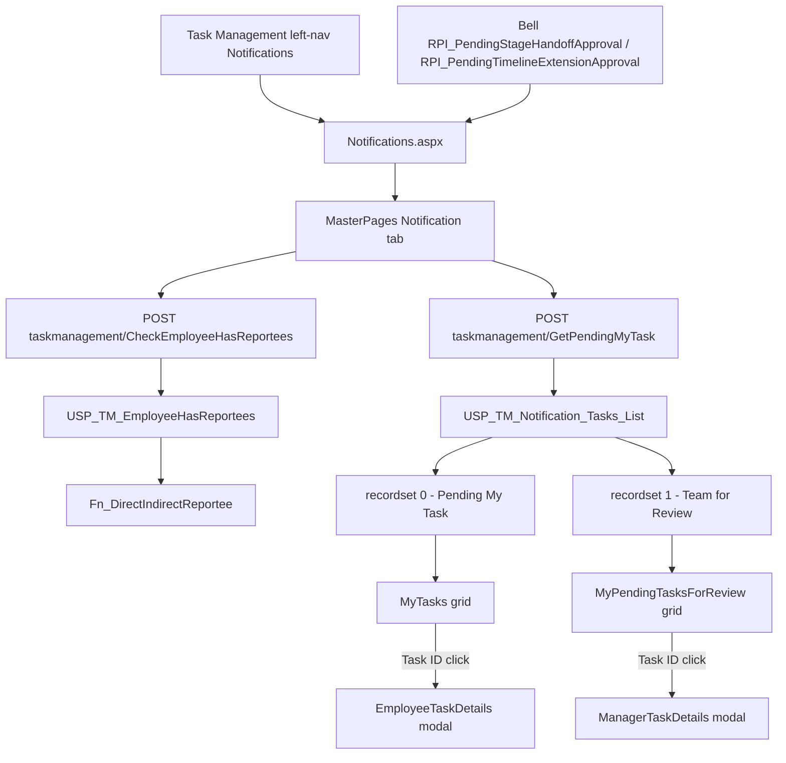
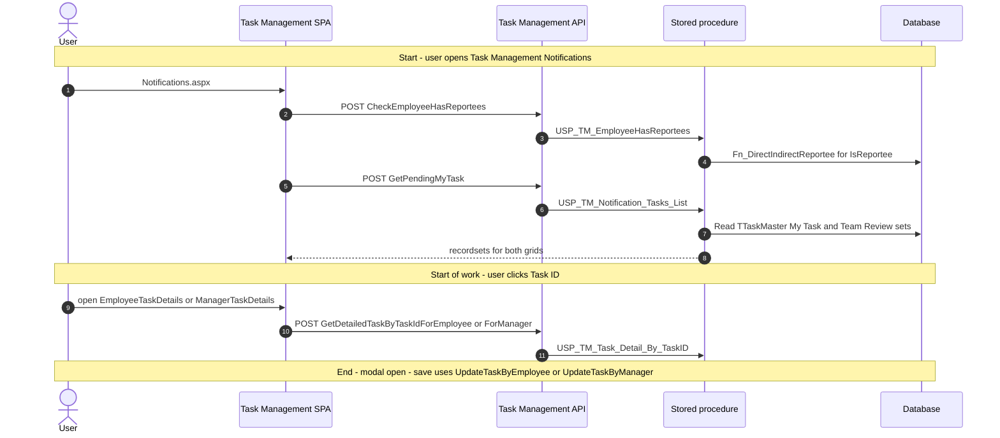
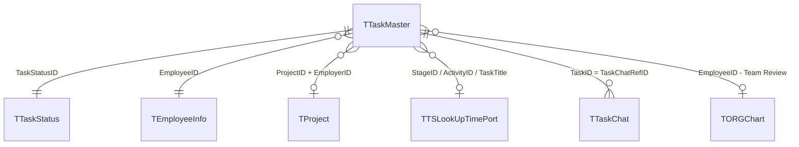

# Notifications

## Overview

**Task Management → Notifications** is the pending-task inbox for the classic Task Management SPA. The left-nav / home-bell target is `HRM/TaskManagement/Notifications.aspx`. That shell stamps session identity into hidden fields and loads the Task Management React bundle into `#root`. The SPA (`MasterPages`) opens on the **Notification** tab and shows two accordion grids: **Pending My Task(s)** (tasks assigned to the logged-in employee in Reopen / WIP / Assigned) and, when the employee has reportees, **Pending Team's Task(s) for Review** (tasks the manager created, including Completed).

Clicking a Task ID opens an in-page modal (`EmployeeTaskDetails` or `ManagerTaskDetails`) for progress update or manager review. Create Task and Task Report are sibling tabs on the same shell, not this submenu.

**Who's involved:**

- **Assignee** — sees own pending tasks; can open the employee detail modal and post progress.
- **Manager with reportees** — `USP_TM_EmployeeHasReportees` returns `IsReportee = 1`; Team Review accordion and Create Task tab appear.
- **Task Management Node API** — separate from Core API; routes under `/api/taskmanagement`.

## Workflow

## Request journey

This page does not create tasks. Opening the inbox loads reportee flag + pending lists; working a row continues in the detail modal.

## Entry points

| UI page / API endpoint | Purpose |
|---|---|
| `HRM/TaskManagement/Notifications.aspx` | Left-nav / bell shell. `Page_Load` stamps employee/employer/role into hidden fields; loads `BuildJS/taskmanagement.min.js` |
| `HRM/TaskManagement/TaskManagement.aspx` | Sibling webpack shell. React `routeConstants.MASTER_TP` still points here (`/HRM/TaskManagement/TaskManagement.aspx`) |
| `Areas/MasterPages/Containers/MasterPages.js` | Tabs: Notification (default), Create Task (if reportee), Task Report |
| `Areas/TaskNotificationDashboard/Containers/TaskNotificationDashboard.js` | Pending My Task + Team Review grids |
| `?` bell `RPI_PendingStageHandoffApproval` / `RPI_PendingTimelineExtensionApproval` | `NotificationList.js` sets iframe to `/HRM/TaskManagement/Notifications.aspx` |

## Code → database call chain

Active inbox constants are the non-`/v2` paths in `apiURLConstants.js` (v2 block is commented out). Team Review is filled from **recordset 1** of `GetPendingMyTask`; the separate `GetPendingTeamTaskSForReview` call in `TaskNotificationDashboard` is commented out on mount/refresh.

| Entry point | DAL/BLL method (`file:line`) | Stored procedure |
|---|---|---|
| Page load | `Notifications.aspx.cs` `Page_Load` (`Notifications.aspx.cs:23-41`) | none |
| Has reportees | `MasterPages.checkEmployeeHasReportees` (`MasterPages.js:34-49`); `employeeController.CheckEmployeeHasReportees` (`employeeController.js:115-122`); `employeeDAL.CheckEmployeeHasReportees` (`employeeDAL.js:155-165`) | `USP_TM_EmployeeHasReportees` → `Fn_DirectIndirectReportee` |
| Pending grids | `TaskNotificationDashboard.getPendingMyTaskForMe` (`TaskNotificationDashboard.js:43-60`); `taskNotificationController.GetPendingMyTask` (`taskNotificationController.js:6-13`); `taskNotificationDAL.GetPendingMyTask` (`taskNotificationDAL.js:16-26`); BLL returns `data.recordsets` (`taskNotificationBLL.js:10-14`) | `USP_TM_Notification_Tasks_List` |
| Employee modal load | `EmployeeTaskDetails` → `Get_DETAILED_TASKDBY_TASKID_FOREMPLOYEE` (`EmployeeTaskDetails.js:728-729`); `employeeDAL.GetDetailedTaskByTaskIdForEmployee` (`employeeDAL.js:103-113`) | `USP_TM_Task_Detail_By_TaskID` |
| Manager modal load | `ManagerTaskDetails` → `Get_DETAILED_TASKDBY_TASKID_FORMANAGER` (`ManagerTaskDetails.js:437-438`); `employeeDAL.GetDetailedTaskByTaskIdForManager` (`employeeDAL.js:116-126`) | `USP_TM_Task_Detail_By_TaskID` |
| Employee save | `UPDATE_TASK_BY_EMPLOYEE` (`EmployeeTaskDetails.js:404`); `taskController.UpdateTaskByEmployee` (`taskController.js:70-75`); `taskDAL.UpdateTaskByEmployee` (`taskDAL.js:111-120`) | `USP_Task_TaskUpdateByEmployee` (+ related progress save path) |
| Manager save | `UPDATE_TASK_BY_MANAGER` (`ManagerTaskDetails.js:225+`); `taskController.UpdateTaskByManager` (`taskController.js:60-63`); `taskDAL.UpdateTaskByManager` (`taskDAL.js:79-88`) | `USP_TM_TaskUpdateByManager` |
| Documents | `Get_TASKDOCUMENTS_BY_TASKID` (`EmployeeTaskDetails.js:795`, `ManagerTaskDetails.js:484`); `employeeDAL.GetTaskDocumentsByTaskID` (`employeeDAL.js:168-180`) | `SP_TaskDocument` |
| Locations (employee modal) | `GET_ALL_LOCATIONS` (`EmployeeTaskDetails.js:707`); `employeeDAL.GetAllLocations` (`employeeDAL.js:183-188`) | `Sp_TS_GetAllLocation` (TimePort connection) |

## API endpoints

No WebForms postback data access on `Notifications.aspx`. Reads and writes go to the **Task Management** Node API (`HRMS.TaskManagement.WebAPI.Node`), mounted as `/api/taskmanagement` (see Swagger). Active UI uses the non-v2 route table; `TaskManagementRoutes_v2.js` exists but the live `apiURLConstants` export is the `/taskmanagement/...` set.

### Inbox (this submenu)

| Verb | Route | Parameters | Purpose | Source |
|---|---|---|---|---|
| `POST` | `taskmanagement/CheckEmployeeHasReportees` | body `ReportsTo` (int, employee id) | `IsReportee` flag for Team Review / Create Task tabs | `TaskManagementRoutes.js:60`, `employeeController.js:115` |
| `POST` | `taskmanagement/GetPendingMyTask` | body `employerId`, `employeeId` | Both pending grids (`recordsets[0]` My Task, `[1]` Team Review) | `TaskManagementRoutes.js:41`, `taskNotificationController.js:6` |
| `POST` | `taskmanagement/GetPendingTeamTaskSForReview` | body `employerId`, `employeeId` | Same SP; **not called** on current mount/refresh (commented in `TaskNotificationDashboard.js`) | `TaskManagementRoutes.js:42` |

### Detail modal (from a Notification row)

| Verb | Route | Parameters | Purpose | Source |
|---|---|---|---|---|
| `POST` | `taskmanagement/GetDetailedTaskByTaskIdForEmployee` | body `TaskID` | Employee modal header / progress | `TaskManagementRoutes.js:58` |
| `POST` | `taskmanagement/GetDetailedTaskByTaskIdForManager` | body `TaskID` | Manager review modal | `TaskManagementRoutes.js:59` |
| `POST` | `taskmanagement/UpdateTaskByEmployee` | multipart task + progress | Assignee save | `TaskManagementRoutes.js:35` |
| `POST` | `taskmanagement/UpdateTaskByManager` | body review fields | Manager approve / comments | `TaskManagementRoutes.js:36` |
| `POST` | `taskmanagement/GetTaskDocumentsByTaskID` | Flag / TaskID / DocumentID / LoginEmpID | Attachments list | `TaskManagementRoutes.js:61` |
| `POST` | `taskmanagement/FetchDocument` | document id | Download blob | `TaskManagementRoutes.js:66` |
| `GET` | `taskmanagement/GetAllLocations` | query `employerId` | Location dropdown (TimePort) | `employeeController.js:125` |

## Stored procedures & tables involved

> No `llm-wiki/domain` page for Task Management was found in this checkout. Objects below are from the live Task Management DAL and `HRMS-DATABASE/HRMS` scripts.

| Object | Path | Role |
|---|---|---|
| `USP_TM_EmployeeHasReportees` | `HRMS-DATABASE/HRMS/STOREPROCEDURE/USP_TM_EmployeeHasReportees.sql` | Returns `IsReportee` 0/1 |
| `Fn_DirectIndirectReportee` | `HRMS-DATABASE/HRMS/FUNCTIONS/Fn_DirectIndirectReportee.sql` | Org-chart reportee set for the flag |
| `USP_TM_Notification_Tasks_List` | `HRMS-DATABASE/HRMS/STOREPROCEDURE/USP_TM_Notification_Tasks_List.sql` | Two result sets: My Task + Team Review |
| `Fn_GetEmployeeName` | `…/FUNCTIONS/Fn_GetEmployeeName.sql` | Display names on list rows |
| `FN_GetDateFormatForPlaceholder` | `…/FUNCTIONS/FN_GetDateFormatForPlaceholder.sql` | Date-only formatting on list columns |
| `UFN_GetDateTimeFormatForPlaceholder` | `…/FUNCTIONS/UFN_GetDateTimeFormatForPlaceholder.sql` | Created/Updated timestamps |
| `USP_TM_Task_Detail_By_TaskID` | `…/STOREPROCEDURE/` | Detail modal load |
| `USP_Task_TaskUpdateByEmployee` / `USP_TM_TaskUpdateByManager` | `…/STOREPROCEDURE/` | Modal saves |
| `SP_TaskDocument` | `…/STOREPROCEDURE/` | Task attachments |
| `Sp_TS_GetAllLocation` | TimePort | Locations for employee modal |
| `TTaskMaster` | task header | Pending filters join status / project / chat |
| `TTaskStatus` | status lookup | Status name filter (Assigned / WIP / Reopen / Completed) |
| `TEmployeeInfo` | employment number on display name |
| `TProject` | project name |
| `TTSLookUpTimePort` | stage / activity / task-title labels |
| `TTaskChat` | unread chat indicator (`ChatNotification`) |
| `TORGChart` | Team Review reporting join |

## Table relationships

Edges below are logical joins used by `USP_TM_Notification_Tasks_List` (declared FKs are sparse in the SQL scripts).

My Task set: `TTaskMaster` for `@EmployeeID` / `@EmployerID`, `IsActive = 1`, status in Reopen / WIP / Assigned. Team Review set: creator is `@EmployeeID`, org-chart join to reportees, status also includes Completed; unread chat when `TTaskChat.CreatedBy <> @EmployeeID` and `IsRead = 0`.

## Known gaps

- **React route vs Notifications shell.** `routeConstants.MASTER_TP` is still `/HRM/TaskManagement/TaskManagement.aspx` while left-nav/bell use `Notifications.aspx`. Both shells mount the same SPA source; exact path matching depends on the deployed bundle.
- **`GetPendingTeamTaskSForReview` is dead on this page.** Mount and refresh only call `GetPendingMyTask`; Team grid uses the second recordset of that one SP call.
- **Bell notification ids** (`RPI_PendingStageHandoffApproval`, `RPI_PendingTimelineExtensionApproval`) navigate here but the SPA does not read a notification query panel the way Confirmation/L&A inboxes do — it always shows the Notification tab grids.
- **Menu id 1244** appears under Task Management in `TDynamicMenuHierarchy` / `Tmenudetails` DML XML; NavigateURL was not re-read live from DEV in this pass (ChatBot and ASPX path agree on `Notifications.aspx`).
- **Modal / chat / document SPs** are used after row click; database pages for this regen cover inbox direct SPs + one nested level only.
- Nested pages already present (`Fn_GetEmployeeName`, `UFN_GetDateTimeFormatForPlaceholder`, `Fn_DirectIndirectReportee`) were skipped; their Callers tables may still omit these TM procedures until a later refresh.

## Reference

Confidence is **high** for Notifications.aspx → MasterPages Notification tab → Task Management API → `USP_TM_Notification_Tasks_List` / `USP_TM_EmployeeHasReportees`. Create Task and Task Report tabs are out of scope.

### SourceCode

- `HRMS.Web/HRMS.Web/HRM/TaskManagement/Notifications.aspx` (+ `.cs`)
- `HRMS.Web/HRMS.Web/HRM/TaskManagement/TaskManagement.aspx` (sibling shell)
- `HRMS.Web/HRMS.Web/HRM/TaskManagement/Areas/MasterPages/Containers/MasterPages.js`
- `HRMS.Web/HRMS.Web/HRM/TaskManagement/Areas/TaskNotificationDashboard/Containers/TaskNotificationDashboard.js`
- `HRMS.Web/HRMS.Web/HRM/TaskManagement/Areas/TaskNotificationDashboard/Components/MyTasks.js`
- `HRMS.Web/HRMS.Web/HRM/TaskManagement/Areas/TaskNotificationDashboard/Components/MyPendingTasksForReview.js`
- `HRMS.Web/HRMS.Web/HRM/TaskManagement/Areas/TaskNotificationDashboard/Components/EmployeeTaskDetails.js`
- `HRMS.Web/HRMS.Web/HRM/TaskManagement/Areas/TaskNotificationDashboard/Components/ManagerTaskDetails.js`
- `HRMS.Web/HRMS.Web/HRM/TaskManagement/Common/apiURLConstants.js`
- `HRMS.Web/HRMS.Web/HRM/TaskManagement/Common/routeConstants.js`
- `HRMS.Web/HRMS.Web/HRM/ChatBot/Areas/Notification/Components/NotificationList.js`
- `HRMS.TaskManagement/HRMS.TaskManagement.WebAPI.Node/Routes/TaskManagementRoutes.js`
- `HRMS.TaskManagement/HRMS.TaskManagement.WebAPI.Node/Controllers/taskNotificationController.js`
- `HRMS.TaskManagement/HRMS.TaskManagement.WebAPI.Node/Controllers/employeeController.js`
- `HRMS.TaskManagement/HRMS.TaskManagement.WebAPI.Node/Core/DataAccessLayer/taskNotificationDAL.js`
- `HRMS.TaskManagement/HRMS.TaskManagement.WebAPI.Node/Core/DataAccessLayer/employeeDAL.js`

### TDG HRMS DB

- `HRMS-DATABASE/HRMS/STOREPROCEDURE/USP_TM_Notification_Tasks_List.sql`
- `HRMS-DATABASE/HRMS/STOREPROCEDURE/USP_TM_EmployeeHasReportees.sql`
- `HRMS-DATABASE/HRMS/FUNCTIONS/Fn_DirectIndirectReportee.sql`
- `HRMS-DATABASE/HRMS/FUNCTIONS/Fn_GetEmployeeName.sql`
- `HRMS-DATABASE/HRMS/FUNCTIONS/FN_GetDateFormatForPlaceholder.sql`
- `HRMS-DATABASE/HRMS/FUNCTIONS/UFN_GetDateTimeFormatForPlaceholder.sql`
- `HRMS-DATABASE/HRMS/DML/Tmenudetails DML.sql` (Task Management → Notifications value `1244`)
