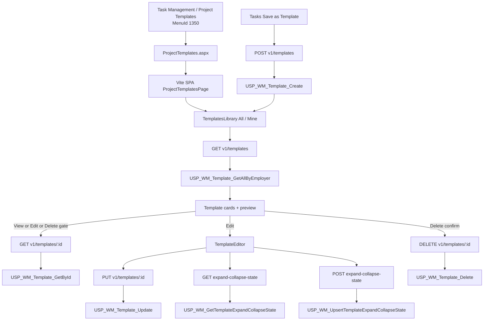
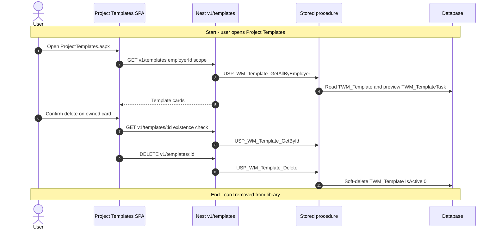
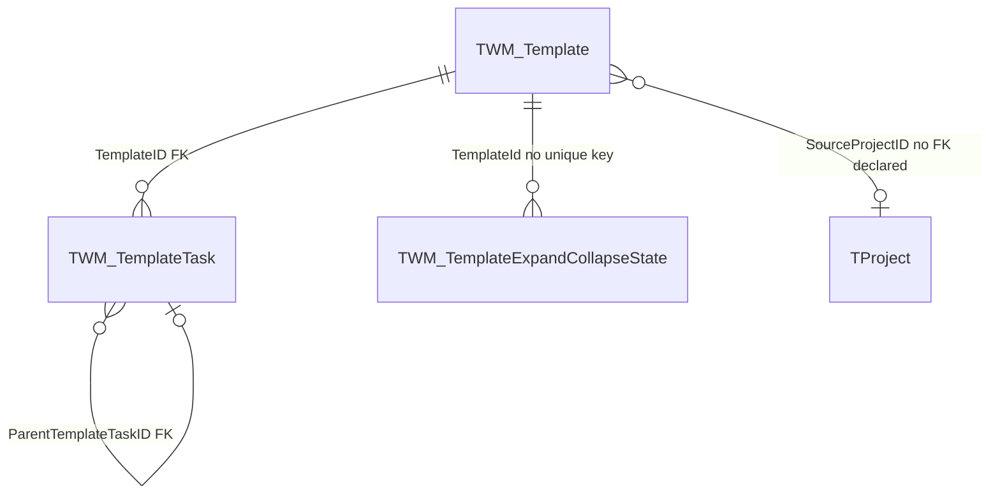

# Project Templates

## Overview

**Task Management → Project Templates** is left-nav `MenuId` **1350** / **1351**. Navigation targets `/HRM/TaskManagement/ProjectTemplates.aspx`. The WebForms host stamps session identity into hidden fields and loads the Task Management Vite SPA (`BuildJS/taskmanagement.min.js`) into `#root`. There is no WebForms postback for template data.

The SPA route `ProjectTemplatesPage` (`/project-templates` standalone, or `ProjectTemplates.aspx` when HRMS-hosted) renders an organization-scoped **TemplatesLibrary** (All / Mine tabs, search, view / edit / delete). Templates are detached snapshots of a project’s column layout and optional sample tasks, stored in `HRM_CL_TIMEPORT` as `TWM_Template` / `TWM_TemplateTask`. Create (“Save as Template”) runs from the Tasks grid (`SaveAsTemplateDialog`), not from this library page. Apply runs only from TimePort project setup (`POST v1/templates/:id/apply`) and is out of scope for this screen’s traffic.

API traffic goes to the Nest Task Management backend (`TaskManagement` repo) on `v1/templates`, which executes `USP_WM_Template_*` / expand-collapse procedures on TIMEPORT (Backstage slug **hrm-timeport**).

**Who's involved:**

- **Any employee in the org** — browses All / Mine, views a template read-only.
- **Template owner (`CreatedBy`)** — edits or soft-deletes; ownership enforced in `USP_WM_Template_Update` / `_Delete`.
- **Project member (Tasks)** — can Save as Template into the shared library.
- **TimePort admin** — applies a template to a new empty project (separate screen / API).

## Workflow

## Request journey

### Browse library then delete a template

## Entry points

| Entry point | Purpose | Live? |
|---|---|---|
| `~/HRM/TaskManagement/ProjectTemplates.aspx` (MenuId **1350** / **1351**) | HRMS left-nav host; session → hidden fields; loads Vite bundle | Yes |
| SPA `ProjectTemplatesPage` via `appRoutesHRMS.tsx` path `/HRM/TaskManagement/ProjectTemplates.aspx` | Library + editor | Yes (TaskManagement frontend) |
| SPA route `/project-templates` (`appRoutes.tsx`, sidebar `sidebarItems.ts`) | Standalone host | Yes |
| Tasks `SaveAsTemplateDialog` | Create template into library | Yes (Tasks screen, not this ASPX) |
| `POST v1/templates/:id/apply` | Apply to empty TimePort project | Yes (TPRT only; not called from this page) |

## Code → database call chain

Host ASPX lives in HRMS.Web; React / Nest sources live in ADO repo **TaskManagement**. Paths below are from that repo unless noted.

| Step | Entry point | App code | Stored procedure |
|---|---|---|---|
| Page open | `ProjectTemplates.aspx.cs:22` | Session stamp only (HRMS.Web) | none |
| Library load | `TemplatesLibrary.tsx:57` | `fetchTemplates` (`templatesThunk.ts:41`) → `TemplatesService.list` (`templatesService.ts:64`) → `TemplatesController.list` (`templates.controller.ts:42`) → `TemplatesRepository.list` (`templates.repository.ts:42`) | `USP_WM_Template_GetAllByEmployer` (`templates.repository.ts:48`). Nested `Fn_GetEmployeeName`. TIMEPORT. |
| View / Edit / Delete gate | `TemplatesLibrary.tsx:66` | `fetchTemplateDetail` (`templatesThunk.ts:64`) → `TemplatesService.getById` (`templatesService.ts:78`) → `TemplatesController.getById` (`templates.controller.ts:51`) → `TemplatesRepository.getById` (`templates.repository.ts:59`) | `USP_WM_Template_GetById` (`templates.repository.ts:64`). Nested `Fn_GetEmployeeName`. |
| Save edit | `TemplateEditor` → `updateTemplate` | `templatesThunk.ts:118` → `TemplatesService.update` (`templatesService.ts:88`) → `TemplatesController.update` (`templates.controller.ts:68`) → `TemplatesRepository.update` (`templates.repository.ts:96`) | `USP_WM_Template_Update` (`templates.repository.ts:116`) |
| Delete | `TemplatesLibrary.tsx:97` | `deleteTemplate` (`templatesThunk.ts:148`) → `TemplatesService.remove` (`templatesService.ts:93`) → `TemplatesController.remove` (`templates.controller.ts:79`) → `TemplatesRepository.remove` (`templates.repository.ts:121`) | `USP_WM_Template_Delete` (`templates.repository.ts:128`) |
| Expand/collapse load | Template editor | `TemplatesService.getExpandCollapseState` (`templatesService.ts:105`) → `TemplatesController.getExpandCollapseState` (`templates.controller.ts:103`) → `TemplatesRepository.getExpandCollapseState` (`templates.repository.ts:159`) | `USP_WM_GetTemplateExpandCollapseState` (`templates.repository.ts:165`) |
| Expand/collapse save | Template editor | `TemplatesService.saveExpandCollapseState` (`templatesService.ts:118`) → `TemplatesController.saveExpandCollapseState` (`templates.controller.ts:117`) → `TemplatesRepository.saveExpandCollapseState` (`templates.repository.ts:170`) | `USP_WM_UpsertTemplateExpandCollapseState` (`templates.repository.ts:182`) |
| Save as Template (Tasks) | `SaveAsTemplateDialog` | `saveAsTemplate` (`templatesThunk.ts:98`) → `TemplatesService.create` (`templatesService.ts:83`) → `TemplatesController.create` (`templates.controller.ts:61`) → `TemplatesRepository.create` (`templates.repository.ts:75`) | `USP_WM_Template_Create` (`templates.repository.ts:91`) |

## API endpoints

No WebForms postback for template CRUD. Active routes are Nest `@Controller('v1/templates')` with JWT `CustomColumnsAuthGuard`. Base port in SystemModel notes is **3004** (no global `/api` prefix).

| Method | Path | Purpose | Caller | Handler |
|---|---|---|---|---|
| GET | `/v1/templates?employerId=&scope=` | Library list (`scope` `all` \| `mine`; `-1` = all accessible orgs) | `TemplatesLibrary` / `fetchTemplates` | `TemplatesController.list` |
| GET | `/v1/templates/:id?employerId=` | Detail for view / edit / stale check | `fetchTemplateDetail` | `TemplatesController.getById` |
| POST | `/v1/templates` | Save as Template | `SaveAsTemplateDialog` | `TemplatesController.create` |
| PUT | `/v1/templates/:id?employerId=` | Edit template | `TemplateEditor` / `updateTemplate` | `TemplatesController.update` |
| DELETE | `/v1/templates/:id?employerId=` | Soft delete | `deleteTemplate` | `TemplatesController.remove` |
| GET | `/v1/templates/:id/expand-collapse-state?employerId=` | Editor tree state | editor | `getExpandCollapseState` |
| POST | `/v1/templates/:id/expand-collapse-state` | Persist tree state | editor | `saveExpandCollapseState` |
| POST | `/v1/templates/:id/apply` | Apply to empty project | **TPRT only** | `TemplatesController.apply` → `USP_WM_Template_Apply` |

## Stored procedures & tables involved

Procedures live in `HRM_CL_TIMEPORT` (slug **hrm-timeport**). Scripts are maintained in the TaskManagement repo `Database/` tree (not under `HRMS-DATABASE/HRM-TIMEPORT` in this DB checkout). Nested `Fn_GetEmployeeName` is HRMS (slug **hrms**).

| Object | Purpose | Database page |
|---|---|---|
| `USP_WM_Template_GetAllByEmployer` | Library cards + 5 preview tasks | [USP_WM_Template_GetAllByEmployer](/docs/database/hrm-timeport/USP_WM_Template_GetAllByEmployer) |
| `USP_WM_Template_GetById` | Header + all sample tasks | [USP_WM_Template_GetById](/docs/database/hrm-timeport/USP_WM_Template_GetById) |
| `USP_WM_Template_Create` | Atomic create from Save as Template | [USP_WM_Template_Create](/docs/database/hrm-timeport/USP_WM_Template_Create) |
| `USP_WM_Template_Update` | Owner edit + optional sample replace | [USP_WM_Template_Update](/docs/database/hrm-timeport/USP_WM_Template_Update) |
| `USP_WM_Template_Delete` | Owner soft delete | [USP_WM_Template_Delete](/docs/database/hrm-timeport/USP_WM_Template_Delete) |
| `USP_WM_GetTemplateExpandCollapseState` | Per-viewer expand ids | [USP_WM_GetTemplateExpandCollapseState](/docs/database/hrm-timeport/USP_WM_GetTemplateExpandCollapseState) |
| `USP_WM_UpsertTemplateExpandCollapseState` | Upsert expand ids | [USP_WM_UpsertTemplateExpandCollapseState](/docs/database/hrm-timeport/USP_WM_UpsertTemplateExpandCollapseState) |
| `Fn_GetEmployeeName` | Creator display name on list/detail | [Fn_GetEmployeeName](/docs/database/hrms/Fn_GetEmployeeName) |
| `USP_WM_Template_Apply` | Materialize onto empty project | Not called by this page (TPRT) |

Tables: `TWM_Template`, `TWM_TemplateTask`, `TWM_TemplateExpandCollapseState`. Apply (elsewhere) also writes `TWM_ColumnOrder`, `TWM_CustomColumn`, `TWM_Task`, and related custom-field tables.

## Table relationships

`SourceProjectID` is informational only (no FK). Sample tasks store title / description / custom-fields JSON / tree only — no status, priority, schedule, or assignee columns.

## Known gaps

- HRMS.Web `BuildJS/` in this checkout still has webpack `TaskManagement.min.js` only; the ASPX expects Vite `taskmanagement.min.js` / `vendor.bundle.js` / `assets/index.css` produced from the TaskManagement frontend build.
- `ProjectTemplates.aspx.cs` does not call `LogActivity`; activity type **527** (“Project Templates”) exists in page-visit DML but is not wired from this code-behind.
- Create is not invoked from `ProjectTemplatesPage`; templates appear after Save as Template on Tasks.
- Apply (`USP_WM_Template_Apply` / nested `USP_WM_CustomColumn_Create`, `UFN_GetClientbyEmployeeBU`, …) is TimePort-only and not documented as this page’s call chain.
- TaskManagement `Database/` scripts for these objects are not mirrored into `HRMS-DATABASE/HRM-TIMEPORT` in the DB repo checkout used here; pages were verified from live DEV `HRM_CL_TIMEPORT` definitions.
- No audit trail beyond `CreatedBy` / `UpdatedBy` / `RowVersion` for create/update/delete/apply.

## Reference

High confidence on HRMS host → TaskManagement SPA → Nest `v1/templates` → TIMEPORT `USP_WM_Template_*` for library browse / view / edit / delete / expand-collapse, verified against ADO `TaskManagement` `dev` and live DEV procedures.

### SourceCode / TaskManagement

- `HRMS.Web/HRMS.Web/HRM/TaskManagement/ProjectTemplates.aspx` (+ `.cs`)
- TaskManagement `frontend/src/pages/ProjectTemplatesPage.tsx`
- TaskManagement `frontend/src/components/Templates/*`, `frontend/src/store/templates/*`
- TaskManagement `frontend/src/configs/appRoutesHRMS.tsx`, `sidebarItems.ts`
- TaskManagement `backend/src/templates/controller/templates.controller.ts`
- TaskManagement `backend/src/templates/service/templates.service.ts`
- TaskManagement `backend/src/templates/repository/templates.repository.ts`
- TaskManagement SystemModel-2 `behavior/workflows/project-templates.md`, `data/entities/template-entities.md`

### Database

- Live `HRM_CL_TIMEPORT` procedures listed above
- Tables `TWM_Template`, `TWM_TemplateTask`, `TWM_TemplateExpandCollapseState`
- `HRMS-DATABASE/HRMS/DML/PageVisitTracking/001_DML_TActivityLogTypes_PageVisits.sql` (activity **527**)
- DEV `TMenuDetails` MenuId **1350** / **1351** → `HRM\TaskManagement\ProjectTemplates.aspx`
