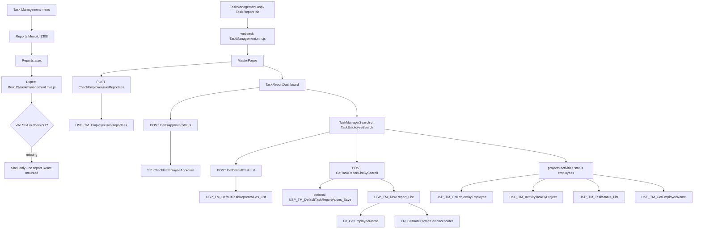
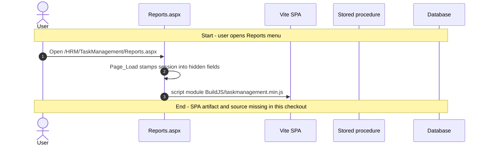
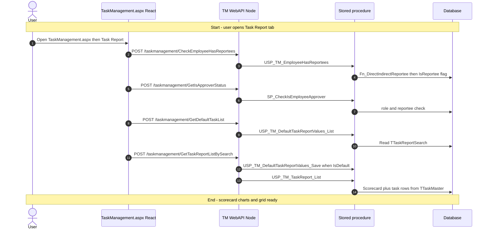
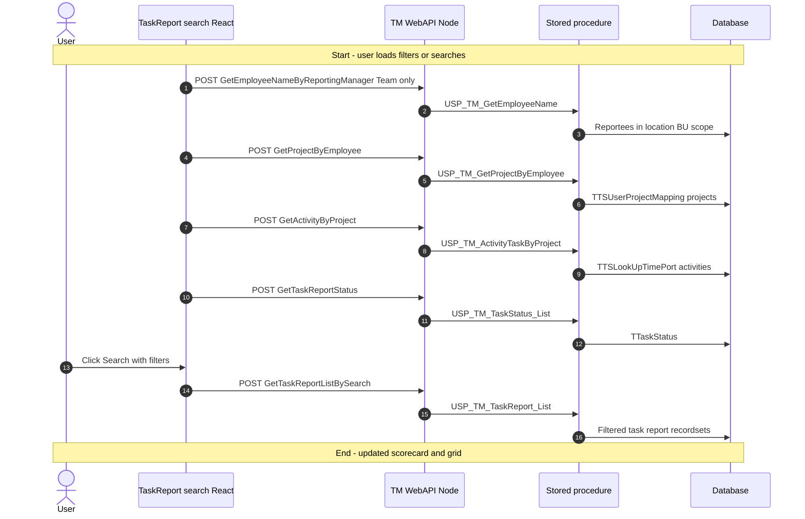
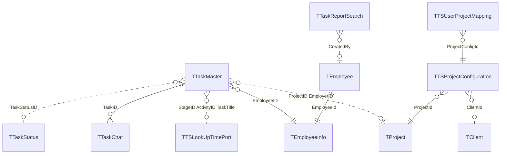

# Reports

## Overview

**Task Management → Reports** is left-nav `MenuId` **1308**. Navigation targets `/HRM/TaskManagement/Reports.aspx`. The WebForms host stamps session identity into hidden fields and references a Vite-style module bundle `BuildJS/taskmanagement.min.js` into `#root`. The code-behind does not bind grids or call stored procedures.

In this SourceCode checkout the Vite SPA source for that bundle is not present, and `BuildJS/` only contains the webpack artifacts `TaskManagement.min.js` / `1.TaskManagement.min.js`. Webpack React Router (`Areas/routes.js`) only mounts `MasterPages` on `TaskManagement.aspx` (`RouteConstants.MASTER_TP`), not on `Reports.aspx`.

The only code-verified Task Report UI in this folder is the **Task Report** tab on `TaskManagement.aspx` (`TaskReportDashboard` → `TaskManagerSearch` / `TaskEmployeeSearch`). That surface posts to Task Management Node `/taskmanagement/...` (active constants are unversioned V1; a commented V2 block exists) and runs `USP_TM_*` procedures on the HRMS database (slug **hrms**). This guide documents that call chain as the working report path for the module; the dedicated Reports.aspx leaf is the menu target whose SPA is not checked in here.

**Who's involved:**

- **Manager / approver** — Team report filters (reportees, projects, dates, status); Team/Self toggle when `SP_CheckIsEmployeeApprover` returns IsApprover.
- **Individual contributor** — Self report of own tasks when not a reportee-manager or when viewing Self.
- **No WebForms postback** — report traffic is JWT/`Authorization` JSON to the Task Management API.

There is no SystemModel-2 page for this menu item in this checkout.

## Workflow

Report reads/writes use HTTP JSON to Task Management Node. `Reports.aspx` has no `[WebMethod]` / PageMethods.

## Request journey

### Open Reports.aspx (menu leaf)

### Load Task Report tab (verified webpack path)

### Filter dropdowns and search

## Entry points

| Entry | Purpose |
|---|---|
| `/HRM/TaskManagement/Reports.aspx` (`MenuId` 1308) | Left-nav **Reports**. Vite host; SPA not in this checkout. |
| `Reports.aspx.cs` `Page_Load` | Session → hidden fields only. |
| `~/HRM/TaskManagement/TaskManagement.aspx` | Legacy host; webpack React mounts `MasterPages` with **Task Report** tab. |
| React `RouteConstants.MASTER_TP` | Only registered route; does not match `Reports.aspx`. |

## Code → database call chain

| Entry | Method | Database |
|---|---|---|
| `Reports.aspx.cs:22` | `Page_Load` session stamp | none |
| Mount, `MasterPages.js:34-38` | `checkEmployeeHasReportees` → `POST CHECK_EMPLOYEE_HAS_REPORTEES` → `employeeController.CheckEmployeeHasReportees:115` → `employeeDAL.CheckEmployeeHasReportees:155` | `USP_TM_EmployeeHasReportees` (`employeeDAL.js:160`). Nested `Fn_DirectIndirectReportee`. HRMS. |
| Mount, `TaskReportDashboard.js:43` | `confirmIsApprover` → `POST GET_IS_APPROVER_STATUS` → `taskReportController.GetIsApproverStatus:138` → `taskReportDAL.GetIsApproverStatus:212` | `SP_CheckIsEmployeeApprover` (`taskReportDAL.js:219`). Nested `USP_TFN_TUserEmployeeRole`, `Fn_DirectIndirectReportee`. HRMS. |
| Mount, `TaskManagerSearch.js:90` / `TaskEmployeeSearch.js:125` | `getDefaultTaskList` → `POST GET_DEFAULT_TASKREPORTLIST` → `taskReportController.GetDefaultTaskList:6` → `taskReportDAL.GetDefaultTaskList:15` | `USP_TM_DefaultTaskReportValues_List` (`taskReportDAL.js:21`). HRMS. |
| Search, `TaskManagerSearch.js:180` / `TaskEmployeeSearch.js:98` | `SearchTaskList` → `POST GET_TASKREPORTLIST_BY_SEARCH` → `taskReportController.GetTaskReportListBySearch:17` → `taskReportBLL.GetTaskReportListBySearch:26` → `taskReportDAL.SaveTaskReportListBySearch:29` (when `IsDefault`) + `GetTaskReportListBySearch:49` | `USP_TM_DefaultTaskReportValues_Save` (`taskReportDAL.js:41`); `USP_TM_TaskReport_List` (`taskReportDAL.js:61`). Nested `Fn_GetEmployeeName`, `FN_GetDateFormatForPlaceholder`, `UFN_GetDateTimeFormatForPlaceholder`. HRMS. |
| Team filters, `TaskManagerSearch.js:206` | `getEmployeesByReportingManager` → `POST GET_EMPLOYEENAME_BY_REPORTINGMANAGER` → `employeeController.GetEmployeeNameByReportingManager:7` → `employeeDAL.GetEmployeeNameByReportingManager:20` | `USP_TM_GetEmployeeName` (`employeeDAL.js:26`). Nested `Fn_DirectIndirectReportee`, `Fn_GetEmployeeName`, `FN_LocationBU_GetEmployeeDetails`. HRMS. |
| Filters, `TaskEmployeeSearch.js:213` / `TaskManagerSearch.js:230` | `GetProjectByEmployee` → `POST GET_PROJECS_BY_EMPLOYEE` → `employeeController.GetProjectByEmployee:17` → `employeeDAL.GetProjectByEmployee:34` | `USP_TM_GetProjectByEmployee` (`employeeDAL.js:40`). HRMS. |
| Filters, `TaskEmployeeSearch.js:236` / `TaskManagerSearch.js:256` | `GetActivityByProject` → `POST GET_ACTIVITY_BY_PROJECT` → `employeeController.GetActivityByProject:37` → `employeeDAL.GetActivityByProject:61` | `USP_TM_ActivityTaskByProject` (`employeeDAL.js:68`). HRMS. |
| Filters, `TaskEmployeeSearch.js:258` / `TaskManagerSearch.js:287` | `getReportStatus` → `POST GET_TASKREPORT_STATUS` → `taskReportController.GetTaskReportStatus:54` → `taskReportDAL.GetTaskReportStatus:127` | `USP_TM_TaskStatus_List` (`taskReportDAL.js:131`). HRMS. |

## API endpoints

No WebForms postback binds report data on `Reports.aspx`. Active UI constants export unversioned `/taskmanagement/...` paths (`apiURLConstants.js`); a commented `/v2/taskmanagement/...` block exists. Routes are registered on both `TaskManagementRoutes.js` and `TaskManagementRoutes_v2.js`.

| Verb | Route | Parameters | Purpose | Source |
|---|---|---|---|---|
| POST | `/taskmanagement/CheckEmployeeHasReportees` | body `ReportsTo` | Show Create Task / Team search when user has reportees. | `TaskManagementRoutes.js:60` |
| POST | `/taskmanagement/GetIsApproverStatus` | body `pEmployeeId`, `pEmployerId` | Team/Self toggle. **No `Authorize` middleware on this route.** | `TaskManagementRoutes.js:83` |
| POST | `/taskmanagement/GetDefaultTaskList` | body `CreatedBy`, `searchSource` | Saved default filters (`TEAM` / `SELF`). | `TaskManagementRoutes.js:68` |
| POST | `/taskmanagement/GetTaskReportListBySearch` | filter body incl. dates, EmployeeIDs, ProjectIDs, ActivityIDs, StatusIDs, `IsDefault` | Scorecard + task grid; may persist defaults. | `TaskManagementRoutes.js:69` |
| POST | `/taskmanagement/GetEmployeeNameByReportingManager` | body `ManagerId`, `EmployerId` | Team employee multi-select. | `TaskManagementRoutes.js:50` |
| POST | `/taskmanagement/GetProjectByEmployee` | body `EmployeeId`, `Employerid` | Project filter. | `TaskManagementRoutes.js:51` |
| POST | `/taskmanagement/GetActivityByProject` | body `EmployeeID`, `EmployerID`, `ProjectID` | Activity filter. | `TaskManagementRoutes.js:53` |
| POST | `/taskmanagement/GetTaskReportStatus` | body unused by DAL | Status filter list. | `TaskManagementRoutes.js:74` |

API also exposes `GetTaskReportForManager`, `GetTaskReportForEmployee`, `GetActivityByReportingManager`, and `GetProjectByReportingManager`; the Task Report search components do not call those constants.

## Stored procedures & tables involved

| Object | File | Purpose | Wiki |
|---|---|---|---|
| `USP_TM_EmployeeHasReportees` | `HRMS/STOREPROCEDURE/USP_TM_EmployeeHasReportees.sql` | Whether login has reportees. | [USP_TM_EmployeeHasReportees](/docs/database/hrms/USP_TM_EmployeeHasReportees) |
| `SP_CheckIsEmployeeApprover` | `HRMS/STOREPROCEDURE/SP_CheckIsEmployeeApprover.sql` | Approver / Team toggle. | [SP_CheckIsEmployeeApprover](/docs/database/hrms/SP_CheckIsEmployeeApprover) |
| `USP_TM_DefaultTaskReportValues_List` | `HRMS/STOREPROCEDURE/USP_TM_DefaultTaskReportValues_List.sql` | Load saved report filters. | [USP_TM_DefaultTaskReportValues_List](/docs/database/hrms/USP_TM_DefaultTaskReportValues_List) |
| `USP_TM_DefaultTaskReportValues_Save` | `HRMS/STOREPROCEDURE/USP_TM_DefaultTaskReportValues_Save.sql` | Upsert saved filters when `IsDefault`. | [USP_TM_DefaultTaskReportValues_Save](/docs/database/hrms/USP_TM_DefaultTaskReportValues_Save) |
| `USP_TM_TaskReport_List` | `HRMS/STOREPROCEDURE/USP_TM_TaskReport_List.sql` | Scorecard + task report rows. | [USP_TM_TaskReport_List](/docs/database/hrms/USP_TM_TaskReport_List) |
| `USP_TM_GetEmployeeName` | `HRMS/STOREPROCEDURE/USP_TM_GetEmployeeName.sql` | Team employee list. | [USP_TM_GetEmployeeName](/docs/database/hrms/USP_TM_GetEmployeeName) |
| `USP_TM_GetProjectByEmployee` | `HRMS/STOREPROCEDURE/USP_TM_GetProjectByEmployee.sql` | Project filter options. | [USP_TM_GetProjectByEmployee](/docs/database/hrms/USP_TM_GetProjectByEmployee) |
| `USP_TM_ActivityTaskByProject` | `HRMS/STOREPROCEDURE/USP_TM_ActivityTaskByProject.sql` | Activity filter options. | [USP_TM_ActivityTaskByProject](/docs/database/hrms/USP_TM_ActivityTaskByProject) |
| `USP_TM_TaskStatus_List` | `HRMS/STOREPROCEDURE/USP_TM_TaskStatus_List.sql` | Status filter options. | [USP_TM_TaskStatus_List](/docs/database/hrms/USP_TM_TaskStatus_List) |
| `Fn_DirectIndirectReportee` / `Fn_GetEmployeeName` / `FN_LocationBU_GetEmployeeDetails` / `FN_GetDateFormatForPlaceholder` / `UFN_GetDateTimeFormatForPlaceholder` | FUNCTIONS | Nested helpers for reportees, names, scope, date display. | existing / new pages |
| `TTaskMaster`, `TTaskReportSearch`, `TTaskStatus`, `TTaskChat`, `TEmployee` / `TEmployeeInfo`, `TProject`, `TTSProjectConfiguration`, `TTSUserProjectMapping`, `TTSLookUpTimePort`, `TClient`, `TEmployerDetails` | TABLES | Tasks, saved filters, status, chat counts, people, projects, lookups. | HRMS catalog |

## Table relationships

Declared FKs from CREATE TABLE scripts are sparse. The diagram shows joins the report procedures actually use; undeclared links are dotted.

## Known gaps

- **`Reports.aspx` Vite SPA is missing** — no `taskmanagement.min.js` under `BuildJS/`, no Vite `src/` in this checkout; menu 1308 loads a shell without a verified React report page.
- **Webpack router only registers `TaskManagement.aspx`** — opening `Reports.aspx` with the webpack bundle would not match `MASTER_TP`.
- **Verified report UI is the Task Report tab**, not the Reports left-nav leaf.
- **`GetIsApproverStatus` is unauthenticated** on both V1 and V2 route files (no `Authorize`).
- **`USP_TM_GetTaskReportForEmployee` / `USP_TM_GetActivityByReportingManager` / `USP_TM_GetProjectByReportingManager` are stub/hard-coded** in inventory SQL; UI does not call those endpoints for the search path.
- **`getReportStatus` posts a hard-coded `ManagerId: "1257"`** though the DAL ignores inputs for `USP_TM_TaskStatus_List`.
- **No SystemModel-2 page** for Task Management Reports.
- **DEV `TMenuDetails` has MenuId 1308** for Reports; Liquibase DML for that row was not found under `HRMS-DATABASE/HRMS/DML` in this pass.

## Reference

Confidence is **medium** for the ASPX host and MenuId, **high** for the webpack Task Report → Node → `USP_TM_*` hops with `file:line` citations. The dedicated Reports SPA remains unresolved in this checkout.

### SourceCode

- `HRMS.Web/HRMS.Web/HRM/TaskManagement/Reports.aspx`
- `HRMS.Web/HRMS.Web/HRM/TaskManagement/Reports.aspx.cs`
- `HRMS.Web/HRMS.Web/HRM/TaskManagement/TaskManagement.aspx`
- `HRMS.Web/HRMS.Web/HRM/TaskManagement/Areas/routes.js`
- `HRMS.Web/HRMS.Web/HRM/TaskManagement/Areas/MasterPages/Containers/MasterPages.js`
- `HRMS.Web/HRMS.Web/HRM/TaskManagement/Areas/TaskReportDashboard/Containers/TaskReportDashboard.js`
- `HRMS.Web/HRMS.Web/HRM/TaskManagement/Areas/TaskReportDashboard/Components/TaskManagerSearch.js`
- `HRMS.Web/HRMS.Web/HRM/TaskManagement/Areas/TaskReportDashboard/Components/TaskEmployeeSearch.js`
- `HRMS.Web/HRMS.Web/HRM/TaskManagement/Common/apiURLConstants.js`
- `HRMS.Web/HRMS.Web/HRM/TaskManagement/Common/routeConstants.js`
- `HRMS.TaskManagement/HRMS.TaskManagement.WebAPI.Node/Routes/TaskManagementRoutes.js`
- `HRMS.TaskManagement/HRMS.TaskManagement.WebAPI.Node/Controllers/taskReportController.js`
- `HRMS.TaskManagement/HRMS.TaskManagement.WebAPI.Node/Controllers/employeeController.js`
- `HRMS.TaskManagement/HRMS.TaskManagement.WebAPI.Node/Core/DataAccessLayer/taskReportDAL.js`
- `HRMS.TaskManagement/HRMS.TaskManagement.WebAPI.Node/Core/DataAccessLayer/employeeDAL.js`
- `HRMS.TaskManagement/HRMS.TaskManagement.WebAPI.Node/Core/BusinessLogicLayer/taskReportBLL.js`

### TDG HRMS DB

- `HRMS-DATABASE/HRMS/STOREPROCEDURE/USP_TM_EmployeeHasReportees.sql`
- `HRMS-DATABASE/HRMS/STOREPROCEDURE/USP_TM_DefaultTaskReportValues_List.sql`
- `HRMS-DATABASE/HRMS/STOREPROCEDURE/USP_TM_DefaultTaskReportValues_Save.sql`
- `HRMS-DATABASE/HRMS/STOREPROCEDURE/USP_TM_TaskReport_List.sql`
- `HRMS-DATABASE/HRMS/STOREPROCEDURE/USP_TM_GetEmployeeName.sql`
- `HRMS-DATABASE/HRMS/STOREPROCEDURE/USP_TM_GetProjectByEmployee.sql`
- `HRMS-DATABASE/HRMS/STOREPROCEDURE/USP_TM_ActivityTaskByProject.sql`
- `HRMS-DATABASE/HRMS/STOREPROCEDURE/USP_TM_TaskStatus_List.sql`
- `HRMS-DATABASE/HRMS/STOREPROCEDURE/SP_CheckIsEmployeeApprover.sql`
- `HRMS-DATABASE/HRMS/FUNCTIONS/FN_GetDateFormatForPlaceholder.sql`
- `HRMS-DATABASE/HRMS/FUNCTIONS/Fn_GetEmployeeName.sql`
- `HRMS-DATABASE/HRMS/FUNCTIONS/Fn_DirectIndirectReportee.sql`
- `HRMS-DATABASE/HRMS/FUNCTIONS/FN_LocationBU_GetEmployeeDetails.sql`
