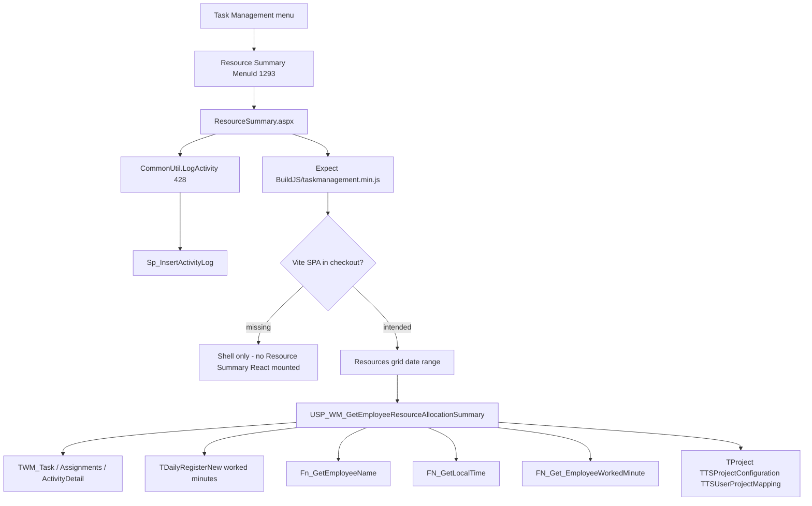
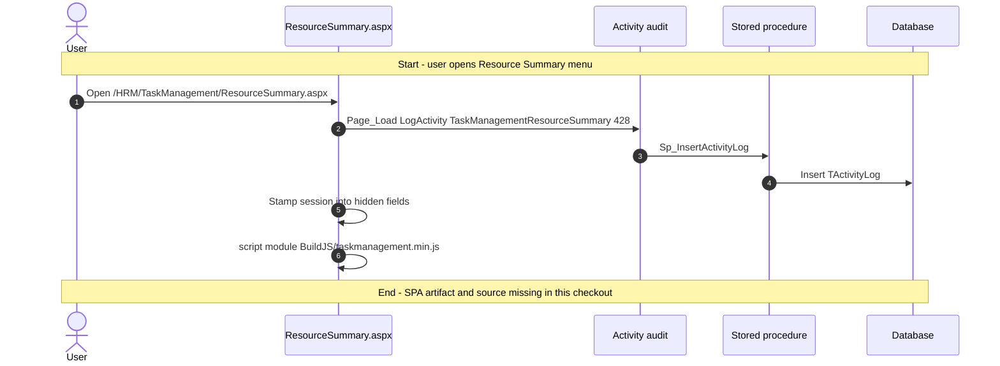
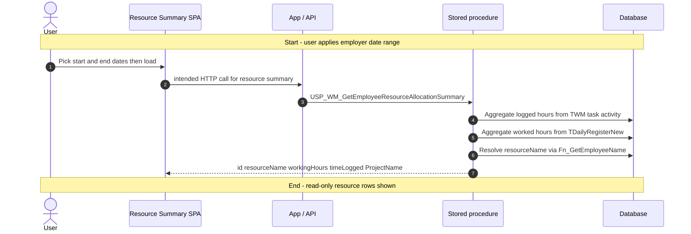
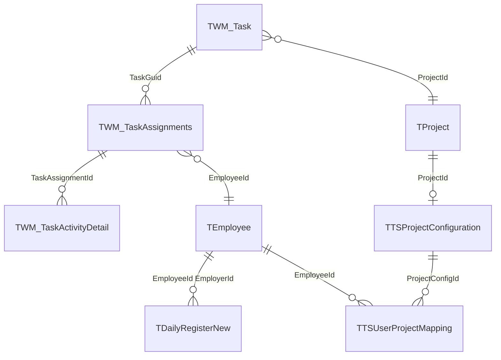

# Resource Summary

## Overview

A manager or HR user opens **Task Management → Resource Summary** to see people who logged task time in a date range, with **worked hours**, **logged hours**, and **project mappings** per resource. Left-nav `MenuId` **1293** targets `/HRM/TaskManagement/ResourceSummary.aspx`. The WebForms host stamps session identity into hidden fields, logs activity `TaskManagementResourceSummary` (**428**), and references a Vite-style module bundle `BuildJS/taskmanagement.min.js` into `#root`. The code-behind does not bind grids or call report stored procedures.

In this SourceCode checkout the Vite SPA source for that bundle is not present, and `BuildJS/` only contains the webpack artifacts `TaskManagement.min.js` / `1.TaskManagement.min.js`. Webpack React Router (`Areas/routes.js`) only mounts `MasterPages` on `TaskManagement.aspx`, not on `ResourceSummary.aspx`. Product backlog **123227** describes the intended Resources page (worked hours, logged hours, project mappings). `TDataCatalog` associates those columns with TimePort Work Management procedure `USP_WM_GetEmployeeResourceAllocationSummary` on `HRM_CL_TIMEPORT` tables (`TWM_Task*`, `TDailyRegisterNew`, projects / resource mapping).

**Who's involved:**

- **Manager / HR viewer** — opens Resource Summary for an employer date window; read-only summary (test cases state no task/work-log edit from this screen).
- **Assigned resources** — appear as rows when they have active task activity and attendance in range; they do not act on this leaf.
- **No WebForms postback** — intended report traffic is a JWT SPA → API → TimePort SP path; that SPA/API wiring is not in this checkout.

There is no SystemModel-2 page for this menu item in this checkout.

## Workflow

`ResourceSummary.aspx` has no `[WebMethod]` / PageMethods. The only code-verified database hop from this leaf is the activity log.

## Request journey

### Open Resource Summary (menu leaf — verified)

### Load resource grid (catalog / PBI-intended — API not in checkout)

## Entry points

> Live host is `ResourceSummary.aspx`. The Vite SPA that should mount on `#root` for this path is not checked into SourceCode; webpack `Areas/routes.js` does not register this aspx.

| Entry point | Purpose | Live? |
|---|---|---|
| `HRM/TaskManagement/ResourceSummary.aspx` (+ `.cs`) | WebForms shell; activity 428; session → hidden fields; Vite script tags | Yes (shell) |
| `BuildJS/taskmanagement.min.js` (+ vendor/excel/xlsx bundles, `assets/index.css`) | Intended React host for Resource Summary | No — Vite artifacts not in `BuildJS/` (webpack `TaskManagement.min.js` only) |
| `Areas/routes.js` / `RouteConstants.MASTER_TP` | Webpack SPA routes | Yes — only `TaskManagement.aspx` → `MasterPages` |
| Left-nav `MenuId` 1293 / `TMenuDetails` “Resource Summary” | Sidebar leaf under Task Management | Yes (menu catalog) |
| ADO PBI 123227 | Spec intent for Resources page columns | Backlog (no API/SPA link in checkout) |

## Code → database call chain

Verified from aspx → activity helper only. Summary procedure is catalog/PBI-linked; no Controller/DAL `file:line` exists in this SourceCode tree.

| Step | Entry point | App code | Stored procedure |
|---|---|---|---|
| Page load | `ResourceSummary.aspx` | `Page_Load` (`ResourceSummary.aspx.cs:23-39`) — `LogActivity(TaskManagementResourceSummary)`; session → properties for hidden fields | none on page itself |
| Activity log | `CommonUtil.LogActivity` | `Common.cs:52-74` → `LogUserActivity` → `ActivityHelper.LogActivity` (`ActivityHelper.cs:32-66`) | `Sp_InsertActivityLog` |
| Resource grid (intended) | Vite SPA / API (not in checkout) | No matching route/DAL under `HRMS.TaskManagement` or Core API | `USP_WM_GetEmployeeResourceAllocationSummary` (script in TDG HRMS DB QA `HRM-TIMEPORT/StoredProcedures/`; not inventoried under Liquibase `TDG HRMS DB` `STOREPROCEDURE/`) |
| Nested (from summary SP) | — | — | `Fn_GetEmployeeName`, `FN_GetLocalTime`, `FN_Get_EmployeeWorkedMinute` |

## API endpoints

No WebForms postback and no `[WebMethod]` on `ResourceSummary.aspx`.

Task Management Node (`HRMS.TaskManagement.WebAPI.Node` `TaskManagementRoutes.js` / `_v2.js`) has **no** route whose name or DAL executes `USP_WM_GetEmployeeResourceAllocationSummary` or `USP_WM_GetProjectsWithResources`. Core API and TimePort WebAPI greps in this checkout also return no callers.

Intended contract (from SP signature + PBI columns only — **not** verified in app code):

| Verb / route | Parameters | Purpose | Source |
|---|---|---|---|
| unknown (missing SPA/API) | `@EmployerId` int, `@StartDate` date, `@EndDate` date | Return resource rows with worked/logged hours and project name | `USP_WM_GetEmployeeResourceAllocationSummary.sql` |

## Stored procedures & tables involved

| Object | File path | Purpose | llm-wiki / notes |
|---|---|---|---|
| `Sp_InsertActivityLog` | `HRMS-DATABASE/HRMS/STOREPROCEDURE/Sp_InsertActivityLog.sql` | Insert page-visit activity | [Sp_InsertActivityLog](/docs/database/hrms/Sp_InsertActivityLog) |
| `USP_WM_GetEmployeeResourceAllocationSummary` | `TDG HRMS DB QA/.../HRM-TIMEPORT/StoredProcedures/USP_WM_GetEmployeeResourceAllocationSummary.sql` | Per-employee/project logged hours + attendance worked hours for date range | [USP_WM_GetEmployeeResourceAllocationSummary](/docs/database/hrm-timeport/USP_WM_GetEmployeeResourceAllocationSummary) — not in Liquibase `TDG HRMS DB` inventory |
| `Fn_GetEmployeeName` | `HRMS-DATABASE/HRMS/FUNCTIONS/Fn_GetEmployeeName.sql` | Display name for `resourceName` | [Fn_GetEmployeeName](/docs/database/hrms/Fn_GetEmployeeName) |
| `FN_GetLocalTime` | `HRMS-DATABASE/HRMS/FUNCTIONS/...` | Local “today” for live attendance minutes | [FN_GetLocalTime](/docs/database/hrms/FN_GetLocalTime) |
| `FN_Get_EmployeeWorkedMinute` | `HRMS-DATABASE/HRMS/FUNCTIONS/...` | In-progress worked minutes | [FN_Get_EmployeeWorkedMinute](/docs/database/hrms/FN_Get_EmployeeWorkedMinute) |
| `USP_WM_GetProjectsWithResources` | QA `StoredProcedures/` | Project-centric resource listing | Catalog-adjacent; not proven as this leaf’s caller — see Known gaps |

**Tables (from summary SP joins):** `TWM_Task`, `TWM_TaskAssignments`, `TWM_TaskActivityDetail`, `TEmployee`, `TDailyRegisterNew`, `TProject`, `TTSProjectConfiguration`, `TTSUserProjectMapping`.

## Table relationships

Relationships below are join paths from `USP_WM_GetEmployeeResourceAllocationSummary`, not declared FK inventory.

## Known gaps

- Vite SPA source and `BuildJS/taskmanagement.min.js` / vendor bundles for `ResourceSummary.aspx` are missing; webpack bundle does not route this aspx.
- No application Controller/DAL/route in SourceCode executes `USP_WM_GetEmployeeResourceAllocationSummary`; call chain after the SPA is catalog/PBI inference only.
- Procedure script lives under **TDG HRMS DB QA** `StoredProcedures/`; it is **not** present in Liquibase `TDG HRMS DB` `HRM-TIMEPORT/STOREPROCEDURE/`.
- `USP_WM_GetProjectsWithResources` and `USP_TSM_GetEmployeeResourceAllocationSummary` / `*_Test` variants appear in catalog or QA folders; not tied to this aspx by code.
- DEV `TMenuDetails.NavigateURL` for MenuId 1293 was not re-queried here (DB explorer sequelize resolve failed from the skill script path); menu text/id come from Customer License DML + aspx naming.
- No `docs/SystemModels/SystemModel-2` or `llm-wiki/domain` page for Resource Summary.

## Reference

Confidence is **medium**: the aspx host, activity **428**, and TimePort summary procedure body are verified; the React → API hop is not present in this checkout.

### SourceCode

- `HRMS.Web/HRMS.Web/HRM/TaskManagement/ResourceSummary.aspx`
- `HRMS.Web/HRMS.Web/HRM/TaskManagement/ResourceSummary.aspx.cs`
- `HRMS.Web/HRMS.Web/HRM/TaskManagement/Areas/routes.js`
- `HRMS.Web/HRMS.Web/HRM/TaskManagement/Common/routeConstants.js`
- `HRMS.Web/HRMS.Web/HRM/TaskManagement/BuildJS/` (webpack only)
- `HRMS.Shared/HRMS.DataContract/Common/Enums.cs` (`TaskManagementResourceSummary = 428`)
- `HRMS.Shared/HRMS.Common/Common.cs` (`LogActivity`)
- `HRMS.Shared/TDG.ActivityAuditLog/DAL/ActivityHelper.cs`
- `HRMS.TaskManagement/HRMS.TaskManagement.WebAPI.Node/Routes/TaskManagementRoutes.js` (no Resource Summary routes)

### TDG HRMS DB

- `HRMS-DATABASE/HRMS/DML/Customer License Dashboard/TMenuDetails DML.sql` (MenuId 1293 “Resource Summary”)
- `HRMS-DATABASE/HRMS/DML/TDataCatalog_DML.sql` (catalog links to `USP_WM_GetEmployeeResourceAllocationSummary`)
- `HRMS-DATABASE/HRMS/STOREPROCEDURE/Sp_InsertActivityLog.sql`
- QA checkout: `HRMS-DATABASE/HRM-TIMEPORT/StoredProcedures/USP_WM_GetEmployeeResourceAllocationSummary.sql`
- ADO PBI [123227](https://tdgteams-tdgproject.visualstudio.com/_workitems/edit/123227) (column intent)
