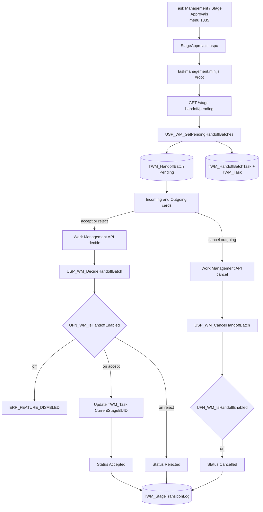
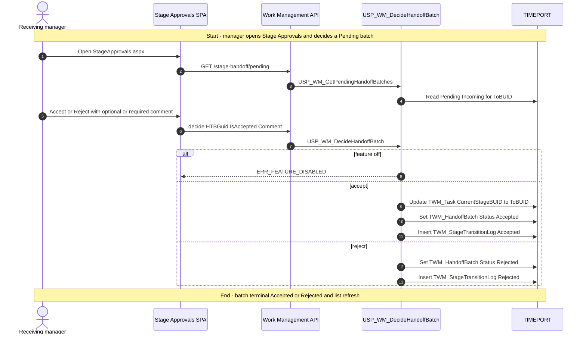
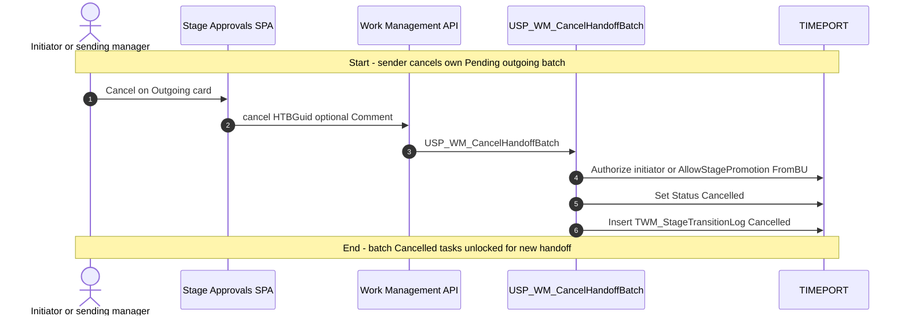
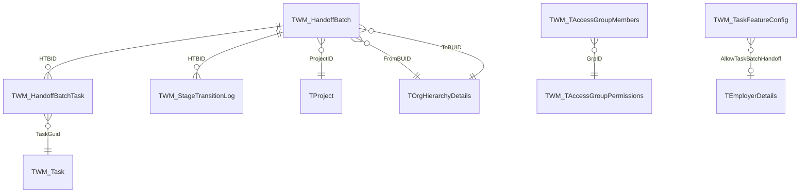

# Stage Approvals

## Overview

A receiving-BU manager with **Receive Stage Promotions** opens **Task Management → Stage Approvals** to decide pending Task Batch Handoff (HTB) requests. The left-nav leaf is menu id **1335** → `HRM/TaskManagement/StageApprovals.aspx`. The WebForms host stamps session identity into hidden fields and mounts the Vite Task Management SPA (`BuildJS/taskmanagement.min.js`) into `#root`. There is no WebForms postback for handoff data.

On this surface the caller sees:

- **Incoming** — Pending batches where the caller’s org BU is `ToBUID` and they hold `ReceiveStagePromotions` (accept / reject).
- **Outgoing** — Pending batches they initiated, or that their sending BU can promote (`AllowStagePromotion`), with **Cancel** (no mandatory reason).

Accept moves every batch task’s `CurrentStageBUID` to the destination BU and writes `TWM_StageTransitionLog`. Reject or Cancel leave task stages unchanged and mark the batch terminal. Initiation itself happens on Tasks / My Work (`USP_WM_InitiateHandoffBatch`), not on this page. Home-bell `RPI_PendingStageHandoffApproval` currently deep-links to **Notifications.aspx**, not Stage Approvals.

**Who's involved:**

- **Receiving-BU manager** (`ReceiveStagePromotions`) — Incoming list; accept or reject.
- **Initiator / sending-BU manager** (`AllowStagePromotion`) — Outgoing list; cancel a still-Pending batch.
- **Administrator** — turns handoff on via Configuration → TASK SETUP (`AllowTaskBatchHandoff` / `UFN_WM_IsHandoffEnabled`).

No SystemModel-2 workflow page covers this screen. Procedure headers cite `RAD-TaskBatchHandOff.md` (not in this checkout).

## Workflow

## Request journey

### Receiving manager — accept or reject a pending handoff

### Sender — cancel an outgoing Pending handoff

## Entry points

> Live host is `~/HRM/TaskManagement/StageApprovals.aspx` (`TMenuDetails` menu **1335**). The Vite SPA route is chosen from the aspx path; SPA source is not in this SourceCode checkout. Classic webpack `HRMS.TaskManagement.WebAPI.Node` `/taskmanagement/*` routes do **not** implement HTB Stage Approvals.

| Entry | Purpose | Live? |
|---|---|---|
| `HRM/TaskManagement/StageApprovals.aspx` | Left-nav host; session stamp; mounts SPA | Yes |
| `GET /stage-handoff/pending` | Load Incoming + Outgoing Pending cards (SP header) | Yes (WM API) |
| Decide path → `USP_WM_DecideHandoffBatch` | Accept / reject Incoming | Yes (WM API; exact route not in SourceCode) |
| Cancel path → `USP_WM_CancelHandoffBatch` | Withdraw Outgoing Pending | Yes (WM API; exact route not in SourceCode) |
| `RPI_PendingStageHandoffApproval` bell | ChatBot iframe → `Notifications.aspx` | Yes (sibling inbox, not this aspx) |
| Tasks / My Work initiate | `USP_WM_InitiateHandoffBatch` | Yes (upstream of this page) |
| Stage Audit | `USP_WM_GetStageAuditTrail` | Sibling submenu |

## Code → database call chain

| UI / action | App layer (`file:line`) | Stored procedure / function |
|---|---|---|
| Page open | `StageApprovals.aspx.cs:23-40` session → hidden fields; markup loads `BuildJS/taskmanagement.min.js` (`StageApprovals.aspx:7`) | none on host (activity type **528** seeded for page visits; this code-behind does not call `LogActivity`) |
| Load pending cards | Work Management API `GET /stage-handoff/pending` (SPA / controller not in checkout) | [USP_WM_GetPendingHandoffBatches](/docs/database/hrm-timeport/USP_WM_GetPendingHandoffBatches) → [Fn_GetEmployeeName](/docs/database/hrms/Fn_GetEmployeeName) |
| Accept / reject | Work Management API decide (not in checkout) | [USP_WM_DecideHandoffBatch](/docs/database/hrm-timeport/USP_WM_DecideHandoffBatch) → [UFN_WM_IsHandoffEnabled](/docs/database/hrm-timeport/UFN_WM_IsHandoffEnabled) |
| Cancel outgoing | Work Management API cancel (not in checkout) | [USP_WM_CancelHandoffBatch](/docs/database/hrm-timeport/USP_WM_CancelHandoffBatch) → [UFN_WM_IsHandoffEnabled](/docs/database/hrm-timeport/UFN_WM_IsHandoffEnabled) |

Upstream initiate / notify (not this page’s primary calls): `USP_WM_InitiateHandoffBatch`, `USP_WM_HTB_EnqueueStageNotifications`, email placeholders `usp_vw_StageHandoff*`.

## API endpoints

No WebForms postback for Stage Approvals data. HTTP is the Work Management API against TIMEPORT. Controllers are not in this SourceCode tree; the pending route is named in the procedure header.

| Verb | Route | Parameters (from SP) | Purpose |
|---|---|---|---|
| GET | `/stage-handoff/pending` | `@EmployeeID`, `@ActorBUID`, `@EmployerID` (JWT/service-derived) | Incoming + Outgoing Pending HTBs |
| (decide) | WM API → `USP_WM_DecideHandoffBatch` | `@HTBGuid`, `@IsAccepted`, `@Comment`, `@ActorEmployeeID`, `@ActorBUID`, `@EmployerID` | Accept or reject |
| (cancel) | WM API → `USP_WM_CancelHandoffBatch` | `@HTBGuid`, `@Comment` optional, `@ActorEmployeeID`, `@ActorBUID`, `@EmployerID` | Cancel outgoing Pending |

Legacy `HRMS.TaskManagement.WebAPI.Node` `/taskmanagement/*` serves classic Notification / Create Task / Report pages, not HTB Stage Approvals.

## Stored procedures & tables involved

| Object | Location | Purpose |
|---|---|---|
| [USP_WM_GetPendingHandoffBatches](/docs/database/hrm-timeport/USP_WM_GetPendingHandoffBatches) | live `HRM_CL_TIMEPORT` | Stage Approvals list |
| [USP_WM_DecideHandoffBatch](/docs/database/hrm-timeport/USP_WM_DecideHandoffBatch) | live `HRM_CL_TIMEPORT` | Accept / reject |
| [USP_WM_CancelHandoffBatch](/docs/database/hrm-timeport/USP_WM_CancelHandoffBatch) | live `HRM_CL_TIMEPORT` | Cancel outgoing |
| [UFN_WM_IsHandoffEnabled](/docs/database/hrm-timeport/UFN_WM_IsHandoffEnabled) | live `HRM_CL_TIMEPORT` | Write guard |
| [Fn_GetEmployeeName](/docs/database/hrms/Fn_GetEmployeeName) | `HRMS-DATABASE/HRMS` | Initiator display name on cards |
| `TWM_HandoffBatch` | TIMEPORT (HRMS synonym) | Batch header / status |
| `TWM_HandoffBatchTask` | TIMEPORT | Tasks in the batch |
| `TWM_StageTransitionLog` | TIMEPORT | Audit events |
| `TWM_Task` | TIMEPORT | `CurrentStageBUID` on accept |
| `TWM_TAccessGroupMembers` / `TWM_TAccessGroupPermissions` | TIMEPORT | Receive / Allow stage bits |
| `TWM_TaskFeatureConfig` | TIMEPORT | `AllowTaskBatchHandoff` |
| `TOrgHierarchyDetails` / `TProject` | HRMS (via synonym where used) | BU and project labels |

These HTB `USP_WM_*` objects are **not** inventoried under `HRMS-DATABASE/HRM-TIMEPORT` in this checkout; definitions were read from live DEV TIMEPORT.

## Table relationships

## Known gaps

- Vite SPA (`taskmanagement.min.js`) and Work Management API controllers for `/stage-handoff/*` are **not** in the SourceCode workspace; call-chain file:line stops at the aspx host, then SP headers / live TIMEPORT definitions.
- Exact HTTP paths for decide and cancel beyond `GET /stage-handoff/pending` are not verified from controller source.
- `StageApprovals.aspx.cs` does not call `CommonUtil.LogActivity`; activity type **528** exists in page-visit DML but is not wired in this code-behind.
- Home-bell `RPI_PendingStageHandoffApproval` opens **Notifications.aspx**, not Stage Approvals.
- HTB procedures are missing from Liquibase `HRM-TIMEPORT` inventory in this checkout.
- Timeline-extension approvals (`USP_WM_ReviewTaskTimeline` / `TWM_TaskTimelineUpdateRequests`) are related Task Management work but are not the Stage Approvals HTB surface documented here.

## Reference

Confidence is medium: host aspx, menu **1335**, and TIMEPORT HTB procedures are verified; SPA and WM API controllers are not in checkout.

### SourceCode

- `HRMS.Web/HRMS.Web/HRM/TaskManagement/StageApprovals.aspx`
- `HRMS.Web/HRMS.Web/HRM/TaskManagement/StageApprovals.aspx.cs`
- `HRMS.Web/HRMS.Web/HRM/ChatBot/Areas/Notification/Components/NotificationList.js` (bell → Notifications.aspx)
- `HRMS.TaskManagement/HRMS.TaskManagement.WebAPI.Node` (legacy TM API; no HTB routes)

### TDG HRMS DB

- Live DEV `HRM_CL_TIMEPORT` definitions for `USP_WM_GetPendingHandoffBatches`, `USP_WM_DecideHandoffBatch`, `USP_WM_CancelHandoffBatch`, `UFN_WM_IsHandoffEnabled`
- `HRMS-DATABASE/HRMS/SYNONYMS/CreateSynonym_StageHandoff_HRM_CL_PROD.sql`
- `HRMS-DATABASE/HRMS/DML/StageHandoff_TModulePages_DML.sql`
- `HRMS-DATABASE/HRMS/DML/176538/TaskManagement_BellNotifications_DML.sql`
- `HRMS-DATABASE/HRMS/DML/PageVisitTracking/001_DML_TActivityLogTypes_PageVisits.sql` (activity **528**)
- `HRMS-DATABASE/HRMS/DML/TDataCatalog_DML.sql` (`TWM_Task` screen path includes Stage Approvals)
