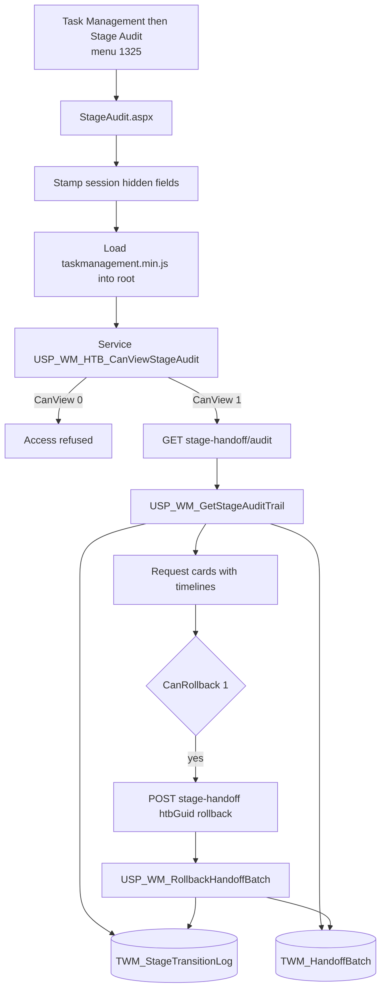
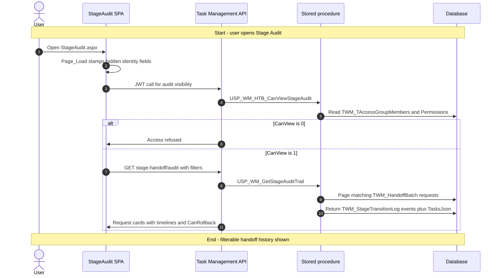
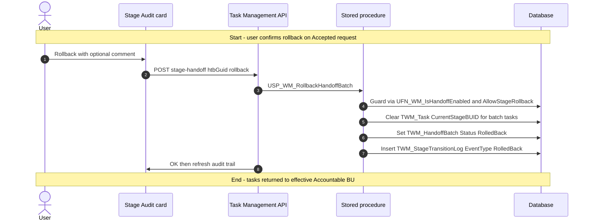
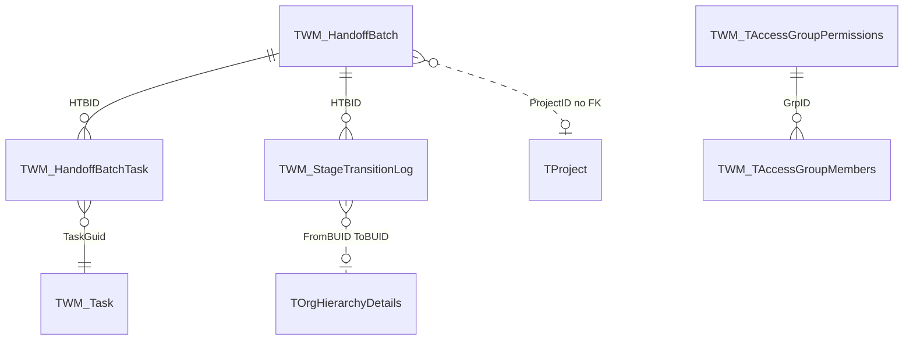

# Stage Audit

## Overview

A Task Batch Handoff participant opens **Task Management → Stage Audit** to review the **complete, filterable history** of stage promotions and rollbacks (every Initiated / Accepted / Rejected / Cancelled / RolledBack event), not only the batches still awaiting their decision. The left-nav leaf is MenuId **1325** (`TMenuDetails`), NavigateURL `/HRM/TaskManagement/StageAudit.aspx`. Sibling **Stage Approvals** (`StageApprovals.aspx`) shows only pending handoffs that need Accept/Reject.

`StageAudit.aspx` is a thin WebForms host. `Page_Load` stamps session identity into hidden fields and mounts the Vite bundle `BuildJS/taskmanagement.min.js` into `#root`. Feature traffic is JWT Bearer to the Task Management Nest API (`stage-handoff` module, Timeport pool `HRM_CL_TIMEPORT`). Visibility is gated by `USP_WM_HTB_CanViewStageAudit` (Batch Handoff System group membership; Administrator waiver only for cross-employer re-check). The page query is `USP_WM_GetStageAuditTrail` (request-centric pagination over `TWM_HandoffBatch` + `TWM_StageTransitionLog`). Cards that return `CanRollback = 1` can call `POST /stage-handoff/:htbGuid/rollback` → `USP_WM_RollbackHandoffBatch`.

Canonical product docs live in the Task Management SystemModel-2 cache (`behavior/workflows/stage-handoff-batch.md`, `experience/surfaces/ui-surfaces.md`). Nest frontend/backend source is **not** in this SourceCode workspace.

**Who's involved:**

- **Handoff group member** (FeatureCategory `TaskHandoff`) — opens Stage Audit, filters history, may roll back when `AllowStageRollback` and current-stage BU match.
- **Core Administrator** (configured Admin RoleID) — waived from needing membership on a *selected* (non-home) employer only; home-employer page visibility still requires group membership.
- **Receiving / sending managers** — create the events elsewhere (initiate / decide / cancel); this page is the read + optional rollback surface.

## Workflow

## Request journey

### Open Stage Audit and load history

### Roll back an accepted handoff from an audit card

## Entry points

| Entry | Purpose |
|---|---|
| `/HRM/TaskManagement/StageAudit.aspx` | Left-nav **Stage Audit** (MenuId **1325**). Vite host; session hidden fields only. |
| SPA component `StageAudit` under `frontend/src/components/StageHandoff/` | Filterable request-centric audit UI (SystemModel). |
| Sibling `/HRM/TaskManagement/StageApprovals.aspx` | Pending accept/reject only — not this leaf. |
| WebForms postback on this page | None — code-behind does not post audit or rollback data. |

## Code → database call chain

| Entry | Method | Database |
|---|---|---|
| Page load, `StageAudit.aspx.cs:23` | Session → protected fields only (`EmployeeId`, `EmployerId`, role, email). **No** `CommonUtil.LogActivity` on this host. | None from code-behind |
| Audit visibility (Nest service before list) | SystemModel `stage-handoff` → `stage-handoff.repository.ts` (named in SP header) | `USP_WM_HTB_CanViewStageAudit` (live `HRM_CL_TIMEPORT`) |
| Audit list, Nest `GET stage-handoff/audit` | `stage-handoff.controller.ts` → service → repository | `USP_WM_GetStageAuditTrail`. Nested `UFN_WM_GetEffectiveAccountableBU`, `Fn_GetEmployeeName` |
| Rollback, Nest `POST stage-handoff/:htbGuid/rollback` | Same controller module | `USP_WM_RollbackHandoffBatch`. Nested `UFN_WM_IsHandoffEnabled`, `UFN_WM_GetEffectiveAccountableBU`, `Fn_GetEmployeeName` |

Nest controller/repository `file:line` citations are unavailable in this workspace (Task Management product repo). Routes and SP names are taken from SystemModel-2 + live TIMEPORT procedure headers.

## API endpoints

No WebForms postback binds Stage Audit data. Feature calls use the Task Management Nest API (Authorize / JWT), not `HRMS.Core.WebAPI.Node` or the legacy `HRMS.TaskManagement.WebAPI.Node` v1/v2 routes.

| Verb | Route | Parameters | Purpose | Source |
|---|---|---|---|---|
| GET | `stage-handoff/audit` | Employer, project / ProjectIDs, FromBUID / ToBUID, EventType, date range, page, actor identity | Request-centric audit trail. | SystemModel catalog; `USP_WM_GetStageAuditTrail` |
| POST | `stage-handoff/:htbGuid/rollback` | Comment, actor employee/BU, employer | Full return of an Accepted batch. | SystemModel catalog; `USP_WM_RollbackHandoffBatch` |
| (service) | visibility gate | EmployeeID, EmployerID, IsHomeEmployerCheck, AdminRoleID | Page / fetch CanView. | `USP_WM_HTB_CanViewStageAudit` header |

Related but **not** this leaf’s primary path: `GET stage-handoff/pending` (Stage Approvals), initiate/accept/reject/cancel (write journey elsewhere).

## Stored procedures & tables involved

| Object | File | Purpose | Wiki |
|---|---|---|---|
| `USP_WM_HTB_CanViewStageAudit` | Live `HRM_CL_TIMEPORT` (not in Liquibase `HRM-TIMEPORT`) | Audit page visibility gate. | [USP_WM_HTB_CanViewStageAudit](/docs/database/hrm-timeport/USP_WM_HTB_CanViewStageAudit) |
| `USP_WM_GetStageAuditTrail` | Live `HRM_CL_TIMEPORT` | Filterable request-centric audit query + `CanRollback`. | [USP_WM_GetStageAuditTrail](/docs/database/hrm-timeport/USP_WM_GetStageAuditTrail) |
| `USP_WM_RollbackHandoffBatch` | Live `HRM_CL_TIMEPORT` | Rollback action from audit card. | [USP_WM_RollbackHandoffBatch](/docs/database/hrm-timeport/USP_WM_RollbackHandoffBatch) |
| `UFN_WM_GetEffectiveAccountableBU` | Live `HRM_CL_TIMEPORT` | Nested Accountable BU resolution for CanRollback / restore. | [UFN_WM_GetEffectiveAccountableBU](/docs/database/hrm-timeport/UFN_WM_GetEffectiveAccountableBU) |
| `UFN_WM_IsHandoffEnabled` | Live `HRM_CL_TIMEPORT` | Nested employer feature flag on rollback. | [UFN_WM_IsHandoffEnabled](/docs/database/hrm-timeport/UFN_WM_IsHandoffEnabled) |
| `Fn_GetEmployeeName` | HRMS FUNCTIONS (synonym on TIMEPORT) | Actor display names. | [Fn_GetEmployeeName](/docs/database/hrms/Fn_GetEmployeeName) |
| `TWM_HandoffBatch`, `TWM_HandoffBatchTask`, `TWM_StageTransitionLog` | TIMEPORT | Batch, task membership, immutable event log. | SystemModel stage-handoff-entities |
| `TWM_Task`, `TWM_TAccessGroupMembers`, `TWM_TAccessGroupPermissions` | TIMEPORT | Current stage, handoff group bits. | Data catalog |
| `TProject`, `TOrgHierarchyDetails`, `TUsers` / `TUserEmployee` | Core HRMS (synonym / three-part) | Project name, BU names, admin waiver. | — |

Activity type **529** (`Stage Audit`) is seeded in `PageVisitTracking` DML, but this aspx host does **not** call `Sp_InsertActivityLog`.

## Table relationships

`TWM_StageTransitionLog` deliberately has no FK to the batch so audit rows survive independently (SystemModel FK graph).

## Known gaps

- **Nest frontend/backend source not in this workspace** — Vite SPA (`StageAudit` component) and `stage-handoff` Nest module live in the separate Task Management product repo; checked-in `BuildJS/` only has legacy webpack bundles, not `taskmanagement.min.js`.
- **`USP_WM_*` scripts are not in Liquibase `HRMS-DATABASE/HRM-TIMEPORT`** — database pages document the live `HRM_CL_TIMEPORT` definition.
- **Activity 529 unused by host** — `StageAudit.aspx.cs` does not call `CommonUtil.LogActivity` (unlike Dashboard’s 426).
- **SystemModel vs live gate drift** — older FR-AUD-03 / SystemModel prose still mention functional/reporting-manager viewers; live `USP_WM_HTB_CanViewStageAudit` (2026-08-27) is membership of FeatureCategory `TaskHandoff` only (plus narrow admin cross-employer waiver).
- **PBI 163563 / 165155 filters** — Accountable Employee / destination-BU UX enhancements may not all be reflected in SP params yet; live trail filters are project, From/To BU, EventType, dates.
- **No llm-wiki domain page** dedicated to Stage Audit tables in Backstage’s mirrored wiki.

## Reference

Confidence is **medium**: ASPX host, menu row 1325, live TIMEPORT procedures, and Task Management SystemModel-2 were verified. Nest React/API `file:line` depends on the product repo (docs cache only here).

### SourceCode

- `HRMS.Web/HRMS.Web/HRM/TaskManagement/StageAudit.aspx`
- `HRMS.Web/HRMS.Web/HRM/TaskManagement/StageAudit.aspx.cs`
- `HRMS.Web/HRMS.Web/HRM/TaskManagement/StageApprovals.aspx` (sibling)
- `HRMS-DATABASE/HRMS/DML/PageVisitTracking/001_DML_TActivityLogTypes_PageVisits.sql` (activity 529)
- `HRMS-DATABASE/HRMS/SYNONYMS/CreateSynonym_StageHandoff_HRM_CL_PROD.sql`
- `HRMS-DATABASE/HRMS/DML/StageHandoff_TModulePages_DML.sql`

### Live TIMEPORT / SystemModel-2 (Task Management product cache)

- Live `HRM_CL_TIMEPORT.dbo.USP_WM_GetStageAuditTrail`
- Live `HRM_CL_TIMEPORT.dbo.USP_WM_HTB_CanViewStageAudit`
- Live `HRM_CL_TIMEPORT.dbo.USP_WM_RollbackHandoffBatch`
- `behavior/workflows/stage-handoff-batch.md`
- `experience/surfaces/ui-surfaces.md`
- `interface/apis/rest-endpoint-catalog.md`
- Azure PBI 162164 (Notifications & Audit Trail), 163563 (Stage Audit filters)
