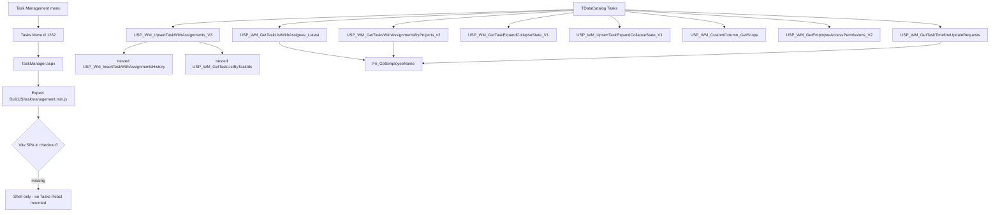
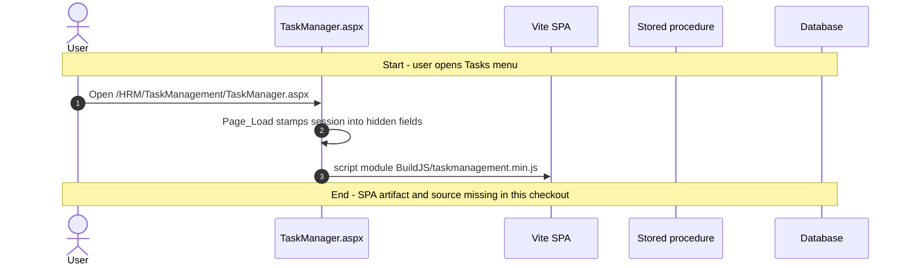
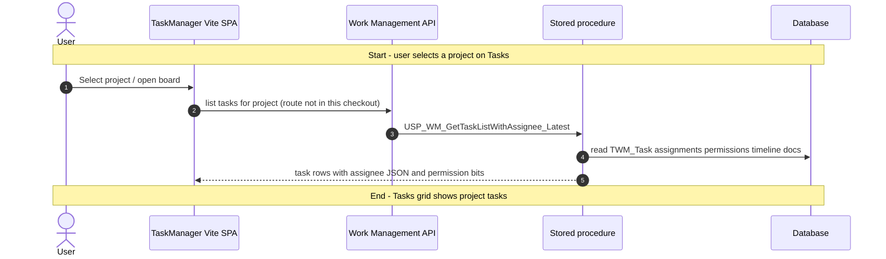
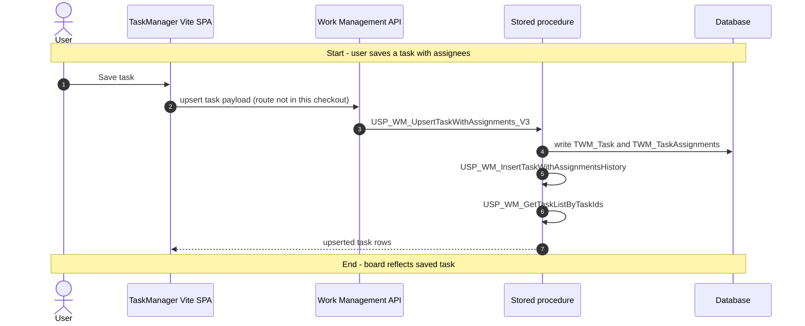
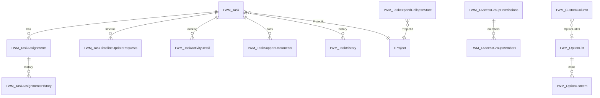

# Tasks

## Overview

**Task Management → Tasks** is the primary Work Management task board/list. Left-nav `MenuId` **1262** (`Employerid = 0`) navigates to `/HRM/TaskManagement/TaskManager.aspx` (`PageName` `TaskManager.aspx`). The WebForms host stamps session identity into hidden fields, logs activity type `TaskManager`, and references a Vite-style module bundle `BuildJS/taskmanagement.min.js` into `#root`. The code-behind does not bind grids or call stored procedures.

In this SourceCode checkout the Vite SPA source for that bundle is not present, and `BuildJS/` only contains the webpack artifacts `TaskManagement.min.js` / `1.TaskManagement.min.js` used by the classic `TaskManagement.aspx` shell (Notifications / Create Task / Task Report). Webpack React Router only mounts `MasterPages` on `TaskManagement.aspx`, not on `TaskManager.aspx`.

`TDataCatalog` associates **Task Management > Tasks** with Work Management tables `TWM_*` in database **HRM_CL_TIMEPORT** (docs slug **hrm-timeport**) and REST-shaped paths such as `GET /tasks/expand-collapse-state`, `GET /tasks/timeline-update-requests`, and `GET /v1/custom-columns`. Live DEV holds `USP_WM_*` procedures (including `…_Latest` / `…_V2` / `…_V3` variants). Those scripts are **not** checked into `HRMS-DATABASE/HRM-TIMEPORT/STOREPROCEDURE` in this Liquibase tree.

**Who's involved:**

- **Task creator / assignee** — views and edits tasks for a selected project under access-group bits (`CreateTask`, `UpdateTask`, `ViewTask`, …).
- **Access-group member** — employer/project permissions from `TWM_TAccessGroupPermissions` / members.
- **No WebForms postback** — list/save traffic is expected to be HTTP JSON from the missing Vite SPA to a Work Management API (not the classic Task Management Node `/taskmanagement/*` `USP_TM_*` path).

There is no SystemModel-2 page for this menu item in this checkout.

## Workflow

List/save/expand/custom-column traffic is expected as HTTP JSON. `TaskManager.aspx` has no `[WebMethod]` / PageMethods for the board.

## Request journey

### Open Tasks (menu leaf)

### Load project task list (catalog / live SP)

### Save or upsert a task (catalog / live SP)

## Entry points

| UI / API | Purpose |
|---|---|
| `/HRM/TaskManagement/TaskManager.aspx` | Live left-nav host for Tasks (`MenuId` 1262). |
| `BuildJS/taskmanagement.min.js` | Expected Vite SPA; **missing** from this checkout’s `BuildJS/`. |
| Catalog `GET /tasks/expand-collapse-state` | Tree expand/collapse persistence for Tasks. |
| Catalog `GET /tasks/timeline-update-requests` | Pending timeline extension requests. |
| Catalog `GET /v1/custom-columns` / option-lists | Custom column scope for the Tasks grid. |
| `HRM/TaskManagement/TaskManagement.aspx` | Classic webpack shell (Notifications / Create / Report) — **not** this submenu. |

No ASPX `__doPostBack` drives the Tasks board.

## Code → database call chain

| Entry point | DAL / BLL method | Stored procedure |
|---|---|---|
| `TaskManager.aspx.cs` `Page_Load` (`TaskManager.aspx.cs:25`) | `CommonUtil.LogActivity(TaskManager)` — no task list read | — |
| Vite SPA (missing) → Work Management API (missing in SourceCode) | unknown controller/DAL in this checkout | catalog / live **Latest** list [`USP_WM_GetTaskListWithAssignee_Latest`](/docs/database/hrm-timeport/USP_WM_GetTaskListWithAssignee_Latest) |
| same | unknown | multi-project [`USP_WM_GetTasksWithAssignmentsByProjects_v2`](/docs/database/hrm-timeport/USP_WM_GetTasksWithAssignmentsByProjects_v2) |
| same | unknown | save [`USP_WM_UpsertTaskWithAssignments_V3`](/docs/database/hrm-timeport/USP_WM_UpsertTaskWithAssignments_V3) → nested [`USP_WM_InsertTaskWithAssignmentsHistory`](/docs/database/hrm-timeport/USP_WM_InsertTaskWithAssignmentsHistory), [`USP_WM_GetTaskListByTaskIds`](/docs/database/hrm-timeport/USP_WM_GetTaskListByTaskIds) |
| same | unknown | expand get/upsert [`USP_WM_GetTaskExpandCollapseState_V1`](/docs/database/hrm-timeport/USP_WM_GetTaskExpandCollapseState_V1) / [`USP_WM_UpsertTaskExpandCollapseState_V1`](/docs/database/hrm-timeport/USP_WM_UpsertTaskExpandCollapseState_V1) |
| same | unknown | custom columns [`USP_WM_CustomColumn_GetScope`](/docs/database/hrm-timeport/USP_WM_CustomColumn_GetScope) |
| same | unknown | permissions [`USP_WM_GetEmployeeAccessPermissions_V2`](/docs/database/hrm-timeport/USP_WM_GetEmployeeAccessPermissions_V2) |
| same | unknown | timeline [`USP_WM_GetTaskTimelineUpdateRequests`](/docs/database/hrm-timeport/USP_WM_GetTaskTimelineUpdateRequests) |

List/timeline SPs call [`Fn_GetEmployeeName`](/docs/database/hrms/Fn_GetEmployeeName) (HRMS DB) for display labels. Sibling `_Latest` / `_V1`–`_V5` procedure names exist in DEV; which exact variant the missing API executes is not proven from SourceCode.

## API endpoints

Expected Work Management HTTP surface (from `TDataCatalog` API path fields). Base host and route registration are **not** in this SourceCode checkout.

| Method | Path (catalog) | Role on this page |
|---|---|---|
| GET | `/tasks/expand-collapse-state` | Persisted expand/collapse for Tasks |
| (write) | expand-collapse upsert (paired SP) | Save expanded task ids |
| GET | `/tasks/timeline-update-requests` | Pending timeline requests |
| GET | `/v1/custom-columns` | Custom column scope |
| GET | `/v1/option-lists` / `…/:id/items` | Option lists for custom columns |
| (list/save) | task list / upsert routes not named in catalog rows sampled | Board load and save |

Classic Task Management Node `/taskmanagement/*` (`USP_TM_*`) serves `TaskManagement.aspx`, not this Tasks leaf.

No ASPX postback list binding.

## Stored procedures & tables involved

| Procedure | Role | Database docs |
|---|---|---|
| [`USP_WM_GetTaskListWithAssignee_Latest`](/docs/database/hrm-timeport/USP_WM_GetTaskListWithAssignee_Latest) | Per-project task list with assignees and permission bits | written (live DEV) |
| [`USP_WM_GetTasksWithAssignmentsByProjects_v2`](/docs/database/hrm-timeport/USP_WM_GetTasksWithAssignmentsByProjects_v2) | Multi-project task/assignment projection | written (live DEV) |
| [`USP_WM_UpsertTaskWithAssignments_V3`](/docs/database/hrm-timeport/USP_WM_UpsertTaskWithAssignments_V3) | Create/update tasks and assignees | written (live DEV) |
| [`USP_WM_InsertTaskWithAssignmentsHistory`](/docs/database/hrm-timeport/USP_WM_InsertTaskWithAssignmentsHistory) | Nested history write from upsert | written (live DEV) |
| [`USP_WM_GetTaskListByTaskIds`](/docs/database/hrm-timeport/USP_WM_GetTaskListByTaskIds) | Nested refresh of upserted tasks | written (live DEV) |
| [`USP_WM_GetTaskExpandCollapseState_V1`](/docs/database/hrm-timeport/USP_WM_GetTaskExpandCollapseState_V1) | Read expand/collapse state | written (live DEV) |
| [`USP_WM_UpsertTaskExpandCollapseState_V1`](/docs/database/hrm-timeport/USP_WM_UpsertTaskExpandCollapseState_V1) | Persist expand/collapse state | written (live DEV) |
| [`USP_WM_CustomColumn_GetScope`](/docs/database/hrm-timeport/USP_WM_CustomColumn_GetScope) | Custom column + order + option scope | written (live DEV) |
| [`USP_WM_GetEmployeeAccessPermissions_V2`](/docs/database/hrm-timeport/USP_WM_GetEmployeeAccessPermissions_V2) | Aggregated access-group bits | written (live DEV) |
| [`USP_WM_GetTaskTimelineUpdateRequests`](/docs/database/hrm-timeport/USP_WM_GetTaskTimelineUpdateRequests) | Timeline update request rows | written (live DEV) |
| [`Fn_GetEmployeeName`](/docs/database/hrms/Fn_GetEmployeeName) | Nested display name (HRMS) | existing |

Primary tables: `TWM_Task`, `TWM_TaskAssignments`, `TWM_TaskTimelineUpdateRequests`, `TWM_TaskActivityDetail`, `TWM_TaskSupportDocuments`, `TWM_TaskExpandCollapseState`, `TWM_TAccessGroupPermissions`, `TWM_TAccessGroupMembers`, `TWM_CustomColumn`, `TWM_ColumnOrder`, `TWM_ScopeVersion`, `TWM_OptionList`, `TWM_OptionListItem`, `TWM_TaskHistory`, `TWM_TaskAssignmentsHistory`, plus `TProject` / `TEmployee` where multi-project list resolves names and BUs.

## Table relationships

## Known gaps

- Vite SPA source and `BuildJS/taskmanagement.min.js` are **not** in this SourceCode checkout; SPA→controller→DAL file:line cannot be cited.
- Work Management API project/routes that call `USP_WM_*` are not present under `HRMS.TaskManagement.WebAPI.Node` (that Node app is the classic `USP_TM_*` surface).
- `USP_WM_*` bodies analyzed from live **DEV** `HRM_CL_TIMEPORT`; they are not inventoried under `HRMS-DATABASE/HRM-TIMEPORT/STOREPROCEDURE` here — multiple `_Latest` / `_Vn` siblings exist; live API variant selection is unproven.
- Classic `TaskManagement.aspx` + `USP_TM_*` is a different product generation; do not treat it as this Tasks leaf.
- Menu XML templates still show Value `1295` for Tasks in some DML snapshots; live `Employerid = 0` row is **1262**.

## Reference

- `HRMS.Web/HRMS.Web/HRM/TaskManagement/TaskManager.aspx` (+ `.cs`)
- `HRMS.Web/HRMS.Web/HRM/TaskManagement/BuildJS/` (webpack only in this checkout)
- `HRMS.Web/HRMS.Web/HRM/TaskManagement/Areas/routes.js` / `Common/routeConstants.js` (classic shell only)
- `HRMS-DATABASE/HRMS/DML/TDataCatalog_DML.sql` (Tasks → `TWM_*` / API path fields)
- Live DEV `HRM_CL_TIMEPORT.dbo.USP_WM_*` (definitions read 2026-11-16)
- `dbo.TMenuDetails` DEV (`MenuId` 1262 Tasks → `TaskManager.aspx`)
