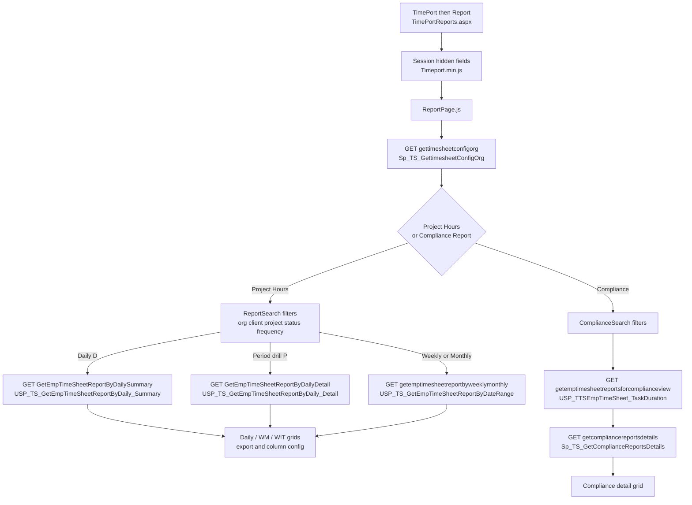
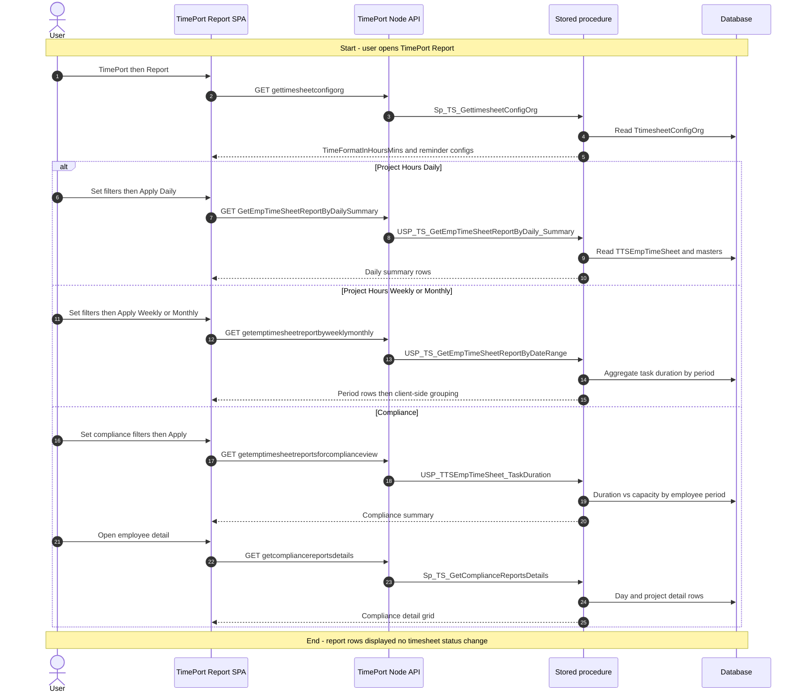
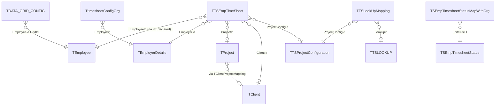

# Report

## Overview

A TimePort user opens **TimePort → Report** (`TimePortReports.aspx`) to run **read-only** timesheet reports — not to enter or approve time. The WebForms shell stamps session into hidden fields and loads the TimePort React bundle; React Router mounts `ReportPage` with two tabs:

- **Project Hours** — filter by organization, client, project, status, and frequency (**Daily** / **Weekly** / **Monthly**), then render summary or period grids with Excel export and saved column layouts.
- **Compliance Report** — compare logged task duration to ideal / allocated capacity for a date range, then drill into day-level compliance rows for one employee.

**Who's involved:**

- **Reporter (employee / manager / admin with TimePort Report access)** — chooses filters and reads grids.
- **Timesheet owner** — appears as rows; does not act on this page.
- **Approver** — named on some columns; approval itself stays on Time Approval / timesheet flows.

This page is a **reporting shelf**. Entry and approval live elsewhere under TimePort. Live shell: `HRM/TimePort/TimePortReports.aspx`. API surface is TimePort Node (`/v2/timeport/...`), not CoreAPI WebMethods on the aspx.

## Workflow

## Request journey

Report does not create or approve timesheets. The journey that starts here is a **filtered report run** that ends when grids (or an empty result) are shown.

## Entry points

> Live entry: WebForms shell stamps session into hidden fields and loads `BuildJS/Timeport.min.js`. React Router maps `TimePortReports.aspx` to `ReportPage`.

| Entry point | Purpose | Live? |
|---|---|---|
| `HRM/TimePort/TimePortReports.aspx` (+ `.cs`) | WebForms shell; session → hidden fields; React bundles | Yes |
| `Areas/routes.js` path `REPORTS_TP` | Mounts `ReportPage` | Yes — `routeConstants.js` `REPORTS_TP` |
| `Areas/Reports/Containers/ReportPage.js` | Tabs Project Hours / Compliance; loads org time format | Yes |
| `ReportSection.js` + `ReportSearch.js` | Project Hours filters and grid host | Yes |
| `weeklyMonthly.js` / `WeeklyMonthlyWithTask.js` / `Dailygrid.js` | Period and daily detail grids | Yes |
| `Compliance.js` + `ComplianceSearch.js` + `ComplianceDetails.js` | Compliance summary and drill-down | Yes |
| TimePort Node `/v2/timeport/*` (`TimeportRoutes_v2.js`) | All report GETs / grid config | Yes |
| Legacy `/timeport/*` (`TimeportRoutes.js`) | Same controllers; older client constants still list both | Yes (secondary) |

## Code → database call chain

JWT `req.EID` overwrites employee id on several GETs (employer list, multi-org employees, weekly/monthly EmpId). Filter org/client/project lists come from query parameters built in the React search components.

| Step | Entry point | App code | Stored procedure |
|---|---|---|---|
| Page load | `TimePortReports.aspx` | `Page_Load` (`TimePortReports.aspx.cs:20-33`) — session → hidden fields; activity `TimePortReports` | none |
| Mount SPA | `Areas/routes.js:57-65` | `ReportPage` | none |
| Org time format | `ReportPage.js:27-38` | `timeportController_V2.GetTimesheetConfigOrg` (`:939`) → `timeportDAL_v2.GetTimesheetConfigOrg` (`:3750-3756`) | `Sp_TS_GettimesheetConfigOrg` |
| Employer multi-select | `ReportSearch.js:1110` | `GetEmployerlistByEmployee` (`controller:217`) → DAL `:623-628` | `USP_GetEmployerListByEmployeeId` |
| Client filter | `ReportSearch.js:672` | `GetMultiOrgClientDetails` (`controller:984`) → DAL `:3831-3840` | `Sp_TS_GetMultiOrgClientDetails` |
| Project filter | `ReportSearch.js:714` | `GetMultiOrgProjectDetails` (`controller:993`) → DAL `:3848-3859` | `Sp_TS_GetMultiOrgProjectDetails` |
| Status filter | `ReportSearch.js:1201` | `GetAllTsStatus` (`controller:571`) → DAL `:1954-1961` | `SP_TS_GetAllTsStatus` |
| Lookup labels | `ReportSearch.js:1122` / `ReportSection.js:188` | `GetLookupDetailsReports` / `LookupOrgwiseDisplayName` → DAL `:3867-3874`, `:1907-1914` | `Sp_TS_GetLookupDetailsReports` / `SP_Get_Lookup_OrgwiseDisplayName` |
| Daily summary | `ReportSearch.js:218` | `GetEmpTimeSheetReportByDailySummary` (`controller:636`) → DAL `:3156-3175` | `USP_TS_GetEmpTimeSheetReportByDaily_Summary` |
| Daily / period detail | `ReportSearch.js:287`, `:597` | `GetEmpTimeSheetReportByDailyDetail` (`controller:645`) → DAL `:3216-3235` | `USP_TS_GetEmpTimeSheetReportByDaily_Detail` |
| Weekly / Monthly | `ReportSearch.js:360` | `GetEmpTimeSheetReportByWeeklyMonthly` (`controller:656`) → DAL `:2160-2185` | `USP_TS_GetEmpTimeSheetReportByDateRange` |
| Compliance summary | `ComplianceSearch.js:212` | `GetEmpTimeSheetReportsForComplianceView` (`controller:870`) → DAL `:3455-3475` | `USP_TTSEmpTimeSheet_TaskDuration` |
| Compliance detail | `Compliance.js:174`, `:222` | `GetComplianceReportsDetails` (`controller:879`) → DAL `:3566-3578` | `Sp_TS_GetComplianceReportsDetails` |
| Compliance daily helper | `ComplianceSearch.js:420` | `GetEmpTimeSheetReportByDaily` (`controller:627`) → DAL `:3099-3118` | `Sp_TS_GetEmpTimeSheetReportByDaily` |
| Compliance project list | `ComplianceSearch.js:345` | `GetProjectDetails` (`controller:200`) → DAL `:595-604` | `Sp_TS_GetProjectDetails` |
| Compliance employees | `ComplianceSearch.js:983` | `GetEmployeeListByMultiOrg` (`controller:234`) → DAL `:649-658` (`CreateConnection("core")`) | `USP_EmployeeListByEmployers` (HRMS) |
| Grid layout get/set | grids / search defaults | `GetGridConfig` / `setGridConfig` (`controller:721`, `:709`) → DAL `:2813-2820`, `:2795-2804` | `Sp_TS_GetGridConfig` / `Sp_TS_SetGridConfig` |

## API endpoints

This submenu is a React SPA over **TimePort Node**. There are no `[WebMethod]` / PageMethods on `TimePortReports.aspx`. Primary routes are on `TimeportRoutes_v2.js` (lowercase / mixed); legacy `TimeportRoutes.js` mirrors the same controller methods.

### Report reads

| Verb | Route | Parameters | Purpose | Source |
|---|---|---|---|---|
| `GET` | `v2/timeport/gettimesheetconfigorg` | `pEmployerId` | Org time format + reminder configs | `timeportController_V2.js:939` |
| `GET` | `v2/timeport/GetEmpTimeSheetReportByDailySummary` | `PFromDate`, `PTodate`, `ProjectId`, `EmpId`, `EmployerId`, `employerIds`, `ClientId`, `ReportType`, `ApprovalStatus`, `InActiveEmployee`, paging/filters, org id CSVs | Daily Project Hours summary | `:636` |
| `GET` | `v2/timeport/GetEmpTimeSheetReportByDailyDetail` | same family + `BusinessUnit` | Daily detail / period drill (`ReportType` often `P`) | `:645` |
| `GET` | `v2/timeport/getemptimesheetreportbyweeklymonthly` | employer/date/project/client/`ReportType`/`TsStatus`/`includesStatus`/`zeroHrsTimesheet`/WIT flags | Weekly / Monthly Project Hours | `:656` |
| `GET` | `v2/timeport/getemptimesheetreportsforcomplianceview` | employer, dates, employees, report type, client/project, `allocatedHoursCheck` | Compliance summary | `:870` |
| `GET` | `v2/timeport/getcompliancereportsdetails` | `pEmployeeId`, `pEmployerId`, dates, `ClientId`, `selectedBUs`, `LoginEmpID` | Compliance drill-down | `:879` |
| `GET` | `v2/timeport/getemptimesheetreportbydaily` | daily filter family | Still used from ComplianceSearch | `:627` |

### Filter / layout helpers

| Verb | Route | Purpose | Source |
|---|---|---|---|
| `GET` | `v2/timeport/GetEmployerlistByEmployee` | Org multi-select (`req.EID`) | `:217` |
| `GET` | `v2/timeport/getmultiorgclientdetails` | Client picker | `:984` |
| `GET` | `v2/timeport/getmultiorgprojectdetails` | Project picker | `:993` |
| `GET` | `v2/timeport/getprojectdetails` | Single-org project list (Compliance) | `:200` |
| `GET` | `v2/timeport/GetEmployeeListByMultiOrg` | Employee picker (core DB) | `:234` |
| `GET` | `v2/timeport/getalltsstatus` | Status multi-select | `:571` |
| `GET` | `v2/timeport/getLookupDetailsReports` | Lookup labels by project config ids | `:1003` |
| `GET` | `v2/timeport/lookuporgwisedisplayname` | Org-wise lookup display names | `:553` |
| `GET` / `POST` | `v2/timeport/getgridconfig` / `setgridconfig` | Saved column / default search JSON | `:721`, `:709` |

There is **no** timesheet submit / approve POST from this page.

## Stored procedures & tables involved

| Object | Path | Role | llm-wiki |
|---|---|---|---|
| `Sp_TS_GettimesheetConfigOrg` | `HRMS-DATABASE/HRM-TIMEPORT/STOREPROCEDURE/` | Org display format for hour columns | — |
| `USP_TS_GetEmpTimeSheetReportByDaily_Summary` | same | Daily Project Hours summary | — |
| `USP_TS_GetEmpTimeSheetReportByDaily_Detail` | same | Daily / period detail rows + capacity helpers | — |
| `USP_TS_GetEmpTimeSheetReportByDateRange` | same | Weekly / Monthly Project Hours (DAL no longer calls `Sp_TS_GetEmpTimeSheetReportByWeeklyMonthly`) | — |
| `Sp_TS_GetEmpTimeSheetReportByDaily` | same | ComplianceSearch daily helper | — |
| `USP_TTSEmpTimeSheet_TaskDuration` | same | Compliance summary durations vs ideal hours | — |
| `Sp_TS_GetComplianceReportsDetails` | same | Compliance day/project detail | — |
| `Sp_TS_GetMultiOrgClientDetails` / `Sp_TS_GetMultiOrgProjectDetails` / `Sp_TS_GetProjectDetails` | same | Client / project filter lists | — |
| `USP_GetEmployerListByEmployeeId` | same | Employer picker for the logged-in user | — |
| `SP_TS_GetAllTsStatus` | same | Status filter values | — |
| `Sp_TS_GetLookupDetailsReports` / `SP_Get_Lookup_OrgwiseDisplayName` | same | Lookup labels | — |
| `Sp_TS_GetGridConfig` / `Sp_TS_SetGridConfig` | same | `TDATA_GRID_CONFIG` layouts | — |
| `USP_EmployeeListByEmployers` | `HRMS-DATABASE/HRMS/STOREPROCEDURE/` | Compliance employee picker (core connection) | — |
| Nested (one level) | `USP_TS_UpdateTimeSheetConfigByQueue`, `USP_TimesheetTaskDurationSummaryHistoryReport`, `USP_TimesheetTaskDurationSummaryWITHistoryReport`, `USP_Employee_ActualWorkedLeaveHours`, `USP_EmployeeTotalCapacity`, `USP_EmployeeTotalCapacityByProject`, `USP_EmployeeIdealHourDetail`, `SP_AdminWM_GetBusinessUnitByOrgEmployeeId`, `Sp_OpenEncryptionKeys` / `SP_CloseEncryptionKey` | Called from the report SPs above | — |
| `TTSEmpTimeSheet` | `HRM-TIMEPORT/TABLES/` | Timesheet fact rows | — |
| `TProject`, `TClient`, `TTSProjectConfiguration`, `TTSLOOKUP`, `TTSLookUpMapping` | same | Project / client / lookup masters | — |
| `TtimesheetConfigOrg` (+ reminder config tables) | same | Org time format | — |
| `TSEmpTimesheetStatus` / `TSEmpTimesheetStatusMapWithOrg` | same | Status filter | — |
| `TDATA_GRID_CONFIG` | same | Saved grid JSON | — |
| `TEmployee` / `TEmployerDetails` (often via synonym) | HRMS / TIMEPORT | Employee and org names | — |

## Table relationships

Report SPs read `TTSEmpTimeSheet` keyed to employee, employer, project config, client, and lookup ids. Most joins are application-enforced (no declared FKs on every edge). Capacity helpers take a `UDT_EmployeeTotalCapacity` TVP built inside the detail / compliance SPs.

## Known gaps

- **Legacy WeeklyMonthly SP name drift.** Inventory still has `Sp_TS_GetEmpTimeSheetReportByWeeklyMonthly.sql`, but live DAL executes `USP_TS_GetEmpTimeSheetReportByDateRange`.
- **Frequency `P`.** ReportSearch treats `P` as the daily-detail API path; the visible radios are Daily / Weekly / Monthly (`D` / `W` / `M`). `P` is mainly the drill / detail path after a daily row.
- **Heavy client-side post-processing.** Weekly/Monthly and Compliance summarize/group/filter edited vs non-edited durations in `timeportDAL_v2.js` after the SP returns — empty SP result vs empty UI can diverge.
- **Hard-coded employee id in multi-org client DAL.** `GetMultiOrgClientDetails` passes `pEmployeeId` `1431` instead of the method argument (`timeportDAL_v2.js:3838`).
- **`Sp_TS_GetEmpTimeSheetReportByDaily` still wired** from ComplianceSearch even though Project Hours Daily uses Summary/Detail USPs.
- **Encryption key open/close** and optional `SP_AdminWM_GetBusinessUnitByOrgEmployeeId` blocks appear in several SPs; some BU EXEC blocks are commented in place.
- **No mutations of timesheet status** from this page; grid config POST only writes `TDATA_GRID_CONFIG`.

## Reference

Confidence is **high** for the React shell → TimePort Node DAL → `HRM-TIMEPORT` report SP chain (file:line on Summary / Detail / DateRange / Compliance). Nested capacity and history helpers were inventoried one level from those SPs; deeper capacity calendars were not fully expanded.

### SourceCode

- `HRMS.Web/HRMS.Web/HRM/TimePort/TimePortReports.aspx` (+ `.cs`)
- `HRMS.Web/HRMS.Web/HRM/TimePort/Areas/routes.js`, `Common/routeConstants.js`, `Common/apiURLConstants.js`
- `HRMS.Web/HRMS.Web/HRM/TimePort/Areas/Reports/` (`Containers/ReportPage.js`, `Components/ReportSearch.js`, `ReportSection.js`, `Compliance*.js`, `weeklyMonthly*.js`, `Dailygrid.js`)
- `HRMS.TimePort/HRMS.TimePort.WebAPI.Node/Routes/TimeportRoutes_v2.js`, `TimeportRoutes.js`
- `HRMS.TimePort/HRMS.TimePort.WebAPI.Node/Controllers/timeportController_V2.js`
- `HRMS.TimePort/HRMS.TimePort.WebAPI.Node/Core/DataAccessLayer/timeportDAL_v2.js`

### TDG HRMS DB

- `HRMS-DATABASE/HRM-TIMEPORT/STOREPROCEDURE/USP_TS_GetEmpTimeSheetReportByDateRange.sql`
- `HRMS-DATABASE/HRM-TIMEPORT/STOREPROCEDURE/USP_TS_GetEmpTimeSheetReportByDaily_Summary.sql`
- `HRMS-DATABASE/HRM-TIMEPORT/STOREPROCEDURE/USP_TS_GetEmpTimeSheetReportByDaily_Detail.sql`
- `HRMS-DATABASE/HRM-TIMEPORT/STOREPROCEDURE/USP_TTSEmpTimeSheet_TaskDuration.sql`
- `HRMS-DATABASE/HRM-TIMEPORT/STOREPROCEDURE/Sp_TS_GetComplianceReportsDetails.sql`
- `HRMS-DATABASE/HRM-TIMEPORT/STOREPROCEDURE/Sp_TS_GettimesheetConfigOrg.sql` and filter / grid helpers listed above
- `HRMS-DATABASE/HRMS/STOREPROCEDURE/USP_EmployeeListByEmployers.sql`, `SP_AdminWM_GetBusinessUnitByOrgEmployeeId.sql`
