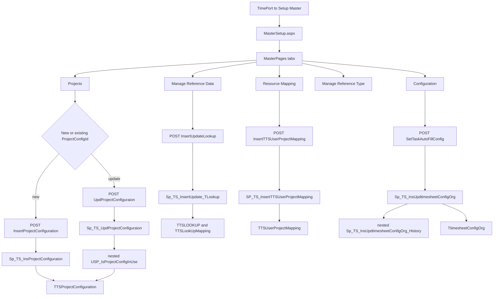
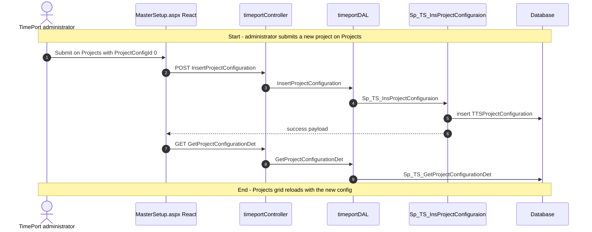
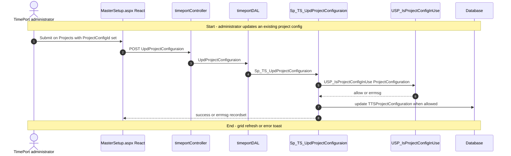
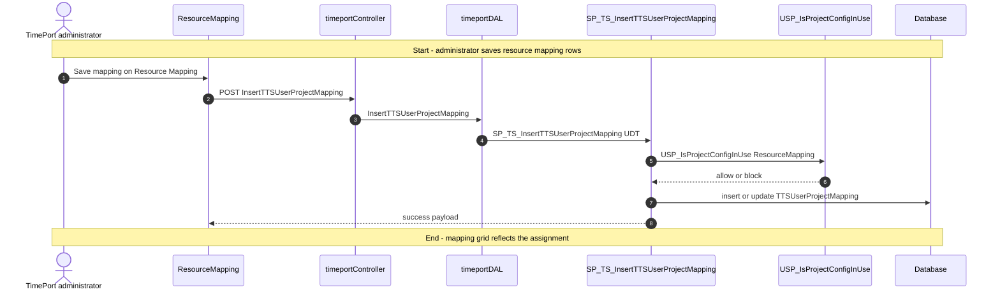
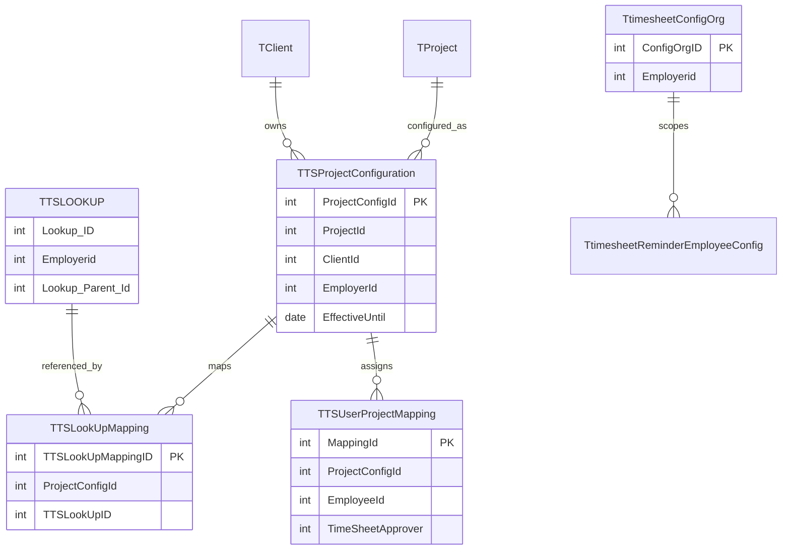

# Setup Master

## Overview

A TimePort administrator opens **TimePort → Setup Master**. The left-nav item loads `HRM/TimePort/MasterSetup.aspx`, which stamps session employee, employer, customer, and role into hidden fields, logs activity `TimeportMasterSetup`, and mounts the TimePort webpack bundle into `#root`. There is no WebForms postback for masters. The live UI is the React SPA routed at `MASTER_TP` (`/HRM/TimePort/MasterSetup.aspx`) to `MasterPages`.

`MasterPages` opens five tabs:

- **Projects** — create or update a project configuration (`TTSProjectConfiguration`).
- **Manage Reference Data** — insert/update reference lookup rows and project mappings (`TTSLOOKUP` / `TTSLookUpMapping`).
- **Resource Mapping** — assign employees to project configs with allocation dates and timesheet approvers (`TTSUserProjectMapping`).
- **Manage Reference Type** — rename org-level reference type labels and related org timesheet config flags.
- **Configuration** — org autofill, reminder, and auto-save behaviour (`TtimesheetConfigOrg`), plus designation/BU pickers from Core HRMS master data.

This guide follows the Projects save path as the primary journey, then the Resource Mapping insert and Configuration save paths. Employees do not open this screen; timesheet entry and approval later use the project configs and mappings created here.

**Who's involved:**

- **TimePort administrator** — maintains project configs, reference data, resource mappings, and org timesheet configuration for the selected organisation.
- **Employee / approver** — does not open Setup Master. Later TimePort entry and approval screens consume the configs and mappings created here.

## Workflow

All master writes are HTTP calls to the TimePort Node service (`/timeport/...`). The ASPX host does not bind grids or post back master data.

## Request journey

### Administrator — save a new project configuration

### Administrator — update an existing project configuration

### Administrator — map an employee to a project

## Entry points

| Entry | What it opens |
|---|---|
| Left-nav **TimePort → Setup Master** (menu value `137` in `TDynamicMenuHierarchy` DML; display text often **Setup Masters**) | `~/HRM/TimePort/MasterSetup.aspx` |
| Direct URL `/HRM/TimePort/MasterSetup.aspx` | Same host; React route `MASTER_TP` |
| `MasterPages` default tab | **Projects** (`eventKey={1}`) |

`Page_Load` only sets hidden identity fields and logs activity. Tab content mounts lazily when selected.

## Code → database call chain

Paths under `HRMS.Web/HRMS.Web/HRM/TimePort` unless noted. TimePort API under `HRMS.TimePort/HRMS.TimePort.WebAPI.Node`. Procedure links are database pages.

| What the page does | UI | API constant | Controller | DAL execute |
|---|---|---|---|---|
| Organisation list | `Projects.js` 178 | `apiURLConstants.js` 137 `GET_EMPLOYER_DETAILS_BY_EMPLOYEE` | `timeportController.js` via `GetEmployerlistByEmployee` | `timeportDAL.js` 628 `USP_GetEmployerListByEmployeeId` |
| Approver list | `Projects.js` 196 | 161 `GET_APPROVER_LIST_ORG` | `GetAproverListByOrg` | `timeportDAL.js` 1792 `SP_TS_GetAproverListByOrg` |
| Business units | `Projects.js` 231 | 150 `GET_BUSINESS_UNITS` | `GetTSBusinessUnitdet` | `timeportDAL.js` 1023 `SP_TS_GetAllBusinessUnit` |
| Client list | `Projects.js` 293 | 162 `GET_CLIENT_DETAILS` | `GetClientDetails` | `timeportDAL.js` 1807 `Sp_TS_GetClientDetails` |
| Project list for client | `Projects.js` 245 | 134 `GET_PROJECT_DETAILS` | `GetProjectDetails` | `timeportDAL.js` 604 `Sp_TS_GetProjectDetails` |
| Cost center / LOB lookups | `Projects.js` 305 | 142 `GET_ALL_LOOKUPITEMS` | `GetAllLookupDetails` | `timeportDAL.js` 551 `Sp_TS_GetAllLookupDetails` |
| Projects grid | `Projects.js` 330 | 141 `GET_PROJECT_GRID_DATA` | `GetProjectConfigurationDet` 322 | `timeportDAL.js` 973 `Sp_TS_GetProjectConfigurationDet` |
| Insert project config | `Projects.js` 803 | 144 `SAVE_PROJECT_CONFIGURATION` | `InsertProjectConfiguration` 172 | `timeportDAL.js` 529 `Sp_TS_InsProjectConfiguraion` |
| Update project config | `Projects.js` 792 | 145 `UPDATE_PROJECT_CONFIGURATION` | `UpdProjectConfiguraion` 369 | `timeportDAL.js` 1089 `Sp_TS_UpdProjectConfiguraion` |
| Reference search grid | `ManageReferenceData.js` 201 | 210 `GET_LOOKUP_DETAILS_SEARCH` | `GetLookupDetailsSearch` 890 | `timeportDAL.js` 3639 `USP_TS_TTSLookup_Select` |
| Save reference row | `ManageReferenceData.js` 427 | 143 `SAVE_LOOKUP_DATA` | `InsertUpdateLookup` 191 | `timeportDAL.js` 583 `Sp_TS_InsertUpdate_TLookup` |
| Delete reference mapping | `ManageReferenceData.js` 344 | 184 `DELETE_LOOKUP_MAPPING` | `DeleteLookupMapping` | `timeportDAL.js` 1902 `Usp_TS_DeleteLookupMapping` |
| Mapping list | `ResourceMapping.js` 177 | 200 `GET_PROJECT_USERMAPPING` | `GetAllUserProjectMapping` 772 | `timeportDAL.js` 2966 `SP_TS_GetAllUserProjectMapping` |
| Save mapping | `ResourceMapping.js` 434 | 199 `INS_PROJECT_USERMAPPING` | `InsertTTSUserProjectMapping` 761 | `timeportDAL.js` 2939 `SP_TS_InsertTTSUserProjectMapping` |
| Delete / remap | `ResourceMappingGrid.js` 387 | 204 `USER_PROJECT_MAPPING_DELETE_REMAPP` | `DeleteTTSUserProjectMapping` | `timeportDAL.js` 3351 `SP_TS_DeleteTTSUserProjectMapping` |
| Org timesheet config load | `Configuration.js` 81 | 213 `GET_TS_TIMECONFIG_ATORG` | `GetTimesheetConfigOrg` 939 | `timeportDAL.js` 3761 `Sp_TS_GettimesheetConfigOrg` |
| Rename reference type | `ManageReferenceType.js` 220 | 255 `UPDATE_REFERENCE_TYPE` | `UpdateReferenceType` 966 | `timeportDAL.js` 3809 `USP_UpdateReferenceType` |
| Save org config | `Configuration.js` 284 | 218 `SET_AUTOFILL_TASK_CONFIG` | `SetTaskAutoFillConfig` 1035 | `timeportDAL.js` 3953 `Sp_TS_InsUpdtimesheetConfigOrg` |
| Duration master | `Configuration.js` 157 | 259 `GET_DURATION_MASTER_DATA` | `GetDurationMasterData` 1080 | `timeportDAL.js` 4031 `Sp_TS_GetReminderNotificationDuration` |
| Designation / BU / grade pickers | `Configuration.js` 176 | 258 `GET_MASTERDATA_FOR_CONFIG` | `GetMasterDataForConfig` 1071 | `timeportDAL.js` 4020 `USP_AttendanceOverTimeRule_MasterData` on Core |

Active client routes are the Version 1.0 block in `apiURLConstants.js` (`/timeport/...`). The commented Version 2.0 `/v2/timeport` block is not what the bundled UI uses. `routeIndex.js` line 10 mounts `/timeport`; line 12 also mounts `/v2/timeport` for alternate clients.

`GetProjectConfigurationDet` joins `UFN_GetClientbyEmployeeBU`. Update project, insert lookup, and insert mapping call nested `USP_IsProjectConfigInUse`. Org config save calls nested `Sp_TS_InsUpdtimesheetConfigOrg_History`. Approver and mapping list procedures open encryption keys via synonyms.

## API endpoints

No ASPX postback for masters. Routes below are TimePort Node `/timeport` unless noted. Query and body names match the client constants.

| Verb | Route | Params / body | Required | Where |
|---|---|---|---|---|
| GET | `/timeport/GetEmployerlistByEmployee` | `employeeId` | Sent | `TimeportRoutes.js` 32 |
| GET | `/timeport/GetAproverListByOrg` | `employerId` | Sent | `TimeportRoutes.js` 57 |
| GET | `/timeport/GetTSBusinessUnitdet` | `pEmployerId` | Sent | `TimeportRoutes.js` (business-unit route), `apiURLConstants.js` 150 |
| GET | `/timeport/GetClientDetails` | `employerId`, `employeeId` | Both sent | `TimeportRoutes.js` 58 |
| GET | `/timeport/GetProjectDetails` | `employerId`, `employeeId`, `clientId` | All sent | `TimeportRoutes.js` 30 |
| GET | `/timeport/GetAllLookupDetails` | `employerId` | Sent | `TimeportRoutes.js` 28 |
| GET | `/timeport/GetProjectConfigurationDet` | `pEmployerId`, `pEmployeeID` | Both sent | `TimeportRoutes.js` 40 |
| POST | `/timeport/InsertProjectConfiguration` | project config JSON | Sent when `ProjectConfigId` is 0 | `TimeportRoutes.js` 27 |
| POST | `/timeport/UpdProjectConfiguraion` | project config JSON including `ProjectConfigId` | Sent when updating | `TimeportRoutes.js` 45 |
| GET | `/timeport/GetLookupDetailsSearch` | `pEmployerId`, client/project/type filters, `employeeId` | Employer and employee sent | `TimeportRoutes.js` 100 |
| POST | `/timeport/InsertUpdateLookup` | lookup JSON | Sent on save | `TimeportRoutes.js` 29 |
| POST | `/timeport/DeleteLookupMapping` | mapping ids | Sent on delete | `TimeportRoutes.js` 66 |
| GET | `/timeport/GetAllUserProjectMapping` | employer, employee, filter lists, dates | Employer and employee sent | `TimeportRoutes.js` 88 |
| POST | `/timeport/InsertTTSUserProjectMapping` | `taskData` UDT rows | Sent on save | `TimeportRoutes.js` 87 |
| POST | `/timeport/DeleteTTSUserProjectMapping` | mapping payload | Sent on delete/remap | `TimeportRoutes.js` 92 |
| GET | `/timeport/GetTimesheetConfigOrg` | `pEmployerId` | Sent | `TimeportRoutes.js` 105 |
| POST | `/timeport/UpdateReferenceType` | `Employerid`, `ReferenceTypeId`, `ReferenceTypeText` | All sent | `TimeportRoutes.js` 108 |
| POST | `/timeport/SetTaskAutoFillConfig` | autofill / reminder / auto-save fields | Sent on Configuration save | `TimeportRoutes.js` 116 |
| GET | `/timeport/getDurationMasterData` | none | — | `TimeportRoutes.js` 121 |
| GET | `/timeport/getMasterDateForConfig` | `employerId` | Sent; DAL uses Core connection | `TimeportRoutes.js` 120 |

ClickTime token/job/user/task map routes under `/ClickTime` are used by optional child components (`ClickTimeSetup`, `MappingToClickTime`) that are not tabs on `MasterPages`. Grid personalisation uses `/timeport/setGridConfig` and `/timeport/getGridConfig`.

## Stored procedures & tables involved

| Procedure | Database | Page | Role on this screen |
|---|---|---|---|
| `Sp_TS_InsProjectConfiguraion` | hrm-timeport | [Sp_TS_InsProjectConfiguraion](/docs/database/hrm-timeport/Sp_TS_InsProjectConfiguraion) | Insert project configuration |
| `Sp_TS_UpdProjectConfiguraion` | hrm-timeport | [Sp_TS_UpdProjectConfiguraion](/docs/database/hrm-timeport/Sp_TS_UpdProjectConfiguraion) | Update project configuration |
| `USP_IsProjectConfigInUse` | hrm-timeport | [USP_IsProjectConfigInUse](/docs/database/hrm-timeport/USP_IsProjectConfigInUse) | Nested guard for update/lookup/mapping |
| `Sp_TS_GetProjectConfigurationDet` | hrm-timeport | [Sp_TS_GetProjectConfigurationDet](/docs/database/hrm-timeport/Sp_TS_GetProjectConfigurationDet) | Projects grid |
| `Sp_TS_GetProjectDetails` | hrm-timeport | [Sp_TS_GetProjectDetails](/docs/database/hrm-timeport/Sp_TS_GetProjectDetails) | Project dropdown by client |
| `Sp_TS_GetClientDetails` | hrm-timeport | [Sp_TS_GetClientDetails](/docs/database/hrm-timeport/Sp_TS_GetClientDetails) | Client dropdown |
| `Sp_TS_GetAllLookupDetails` | hrm-timeport | [Sp_TS_GetAllLookupDetails](/docs/database/hrm-timeport/Sp_TS_GetAllLookupDetails) | Cost center / LOB lookups |
| `SP_TS_GetAproverListByOrg` | hrm-timeport | [SP_TS_GetAproverListByOrg](/docs/database/hrm-timeport/SP_TS_GetAproverListByOrg) | Approver dropdown |
| `SP_TS_GetAllBusinessUnit` | hrm-timeport | [SP_TS_GetAllBusinessUnit](/docs/database/hrm-timeport/SP_TS_GetAllBusinessUnit) | Business-unit dropdown |
| `USP_GetEmployerListByEmployeeId` | hrm-timeport | [USP_GetEmployerListByEmployeeId](/docs/database/hrm-timeport/USP_GetEmployerListByEmployeeId) | Organisation switcher |
| `SP_Get_Lookup_OrgwiseDisplayName` | hrm-timeport | [SP_Get_Lookup_OrgwiseDisplayName](/docs/database/hrm-timeport/SP_Get_Lookup_OrgwiseDisplayName) | Org-wise reference labels |
| `USP_TS_TTSLookup_Select` | hrm-timeport | [USP_TS_TTSLookup_Select](/docs/database/hrm-timeport/USP_TS_TTSLookup_Select) | Manage Reference Data search |
| `Sp_TS_InsertUpdate_TLookup` | hrm-timeport | [Sp_TS_InsertUpdate_TLookup](/docs/database/hrm-timeport/Sp_TS_InsertUpdate_TLookup) | Save reference data |
| `Usp_TS_DeleteLookupMapping` | hrm-timeport | [Usp_TS_DeleteLookupMapping](/docs/database/hrm-timeport/Usp_TS_DeleteLookupMapping) | Delete reference mapping |
| `SP_TS_InsertTTSUserProjectMapping` | hrm-timeport | [SP_TS_InsertTTSUserProjectMapping](/docs/database/hrm-timeport/SP_TS_InsertTTSUserProjectMapping) | Save resource mapping |
| `SP_TS_GetAllUserProjectMapping` | hrm-timeport | [SP_TS_GetAllUserProjectMapping](/docs/database/hrm-timeport/SP_TS_GetAllUserProjectMapping) | Resource mapping list |
| `SP_TS_DeleteTTSUserProjectMapping` | hrm-timeport | [SP_TS_DeleteTTSUserProjectMapping](/docs/database/hrm-timeport/SP_TS_DeleteTTSUserProjectMapping) | Delete / remap |
| `Sp_TS_GettimesheetConfigOrg` | hrm-timeport | [Sp_TS_GettimesheetConfigOrg](/docs/database/hrm-timeport/Sp_TS_GettimesheetConfigOrg) | Load org config |
| `Sp_TS_InsUpdtimesheetConfigOrg` | hrm-timeport | [Sp_TS_InsUpdtimesheetConfigOrg](/docs/database/hrm-timeport/Sp_TS_InsUpdtimesheetConfigOrg) | Save org config |
| `Sp_TS_InsUpdtimesheetConfigOrg_History` | hrm-timeport | [Sp_TS_InsUpdtimesheetConfigOrg_History](/docs/database/hrm-timeport/Sp_TS_InsUpdtimesheetConfigOrg_History) | Nested history write |
| `USP_UpdateReferenceType` | hrm-timeport | [USP_UpdateReferenceType](/docs/database/hrm-timeport/USP_UpdateReferenceType) | Rename reference type |
| `Sp_TS_GetReminderNotificationDuration` | hrm-timeport | [Sp_TS_GetReminderNotificationDuration](/docs/database/hrm-timeport/Sp_TS_GetReminderNotificationDuration) | Reminder duration list |
| `USP_AttendanceOverTimeRule_MasterData` | hrms | [USP_AttendanceOverTimeRule_MasterData](/docs/database/hrms/USP_AttendanceOverTimeRule_MasterData) | Configuration pickers via Core |
| `Sp_OpenEncryptionKeys` | hrms (synonym in timeport) | [Sp_OpenEncryptionKeys](/docs/database/hrms/Sp_OpenEncryptionKeys) | Nested from approver/mapping reads |
| `SP_CloseEncryptionKey` | hrms (synonym in timeport) | [SP_CloseEncryptionKey](/docs/database/hrms/SP_CloseEncryptionKey) | Nested close after encrypted reads |

Primary tables: `TTSProjectConfiguration`, `TTSLOOKUP`, `TTSLookUpMapping`, `TTSUserProjectMapping`, `TtimesheetConfigOrg`, `TtimesheetReminderEmployeeConfig`, `TTSReminderNotificationDuration`, `TProject`, `TClient`, plus Core `TTitle` / `TGrade` / `TOrgHierarchyDetails` / `TSHIFTMASTER` for Configuration pickers.

## Table relationships

## Known gaps

- Left-nav DML historically labels the item **Setup Masters** (menu value `137`). This guide’s frontmatter uses **Setup Master** as requested for the TimePort submenu key.
- ClickTime setup/mapping components exist under `Areas/MasterPages/Components` but are not tabs on `MasterPages.js`; their `/ClickTime` APIs are out of scope for the primary call chain.
- `apiURLConstants.js` still contains a large commented `/v2/timeport` block; the live TimePort UI uses `/timeport`.
- `GetMasterDataForConfig` runs `USP_AttendanceOverTimeRule_MasterData` on the Core HRMS connection, not HRM-TIMEPORT.
- Grid personalisation (`Sp_TS_SetGridConfig` / `Sp_TS_GetGridConfig`) and project/resource history SPs are used by child dialogs and are not fully expanded here.
- SystemModel-2 does not document this TimePort Setup Master screen.

## Reference

- `HRMS.Web/HRMS.Web/HRM/TimePort/MasterSetup.aspx`
- `HRMS.Web/HRMS.Web/HRM/TimePort/MasterSetup.aspx.cs`
- `HRMS.Web/HRMS.Web/HRM/TimePort/Areas/routes.js`
- `HRMS.Web/HRMS.Web/HRM/TimePort/Areas/MasterPages/Containers/MasterPages.js`
- `HRMS.Web/HRMS.Web/HRM/TimePort/Areas/MasterPages/Components/Projects.js`
- `HRMS.Web/HRMS.Web/HRM/TimePort/Areas/MasterPages/Components/ManageReferenceData.js`
- `HRMS.Web/HRMS.Web/HRM/TimePort/Areas/MasterPages/Components/ResourceMapping.js`
- `HRMS.Web/HRMS.Web/HRM/TimePort/Areas/MasterPages/Components/ResourceMappingGrid.js`
- `HRMS.Web/HRMS.Web/HRM/TimePort/Areas/MasterPages/Components/ManageReferenceType.js`
- `HRMS.Web/HRMS.Web/HRM/TimePort/Areas/MasterPages/Components/Configuration.js`
- `HRMS.Web/HRMS.Web/HRM/TimePort/Common/apiURLConstants.js`
- `HRMS.Web/HRMS.Web/HRM/TimePort/Common/routeConstants.js`
- `HRMS.TimePort/HRMS.TimePort.WebAPI.Node/Routes/routeIndex.js`
- `HRMS.TimePort/HRMS.TimePort.WebAPI.Node/Routes/TimeportRoutes.js`
- `HRMS.TimePort/HRMS.TimePort.WebAPI.Node/Controllers/timeportController.js`
- `HRMS.TimePort/HRMS.TimePort.WebAPI.Node/Core/DataAccessLayer/timeportDAL.js`
- `HRMS-DATABASE/HRM-TIMEPORT/STOREPROCEDURE/Sp_TS_InsProjectConfiguraion.sql`
- `HRMS-DATABASE/HRM-TIMEPORT/STOREPROCEDURE/Sp_TS_UpdProjectConfiguraion.sql`
- `HRMS-DATABASE/HRM-TIMEPORT/STOREPROCEDURE/USP_IsProjectConfigInUse.sql`
- `HRMS-DATABASE/HRMS/DML/Tmenudetails DML.sql` (TimePort menu value `137`)
