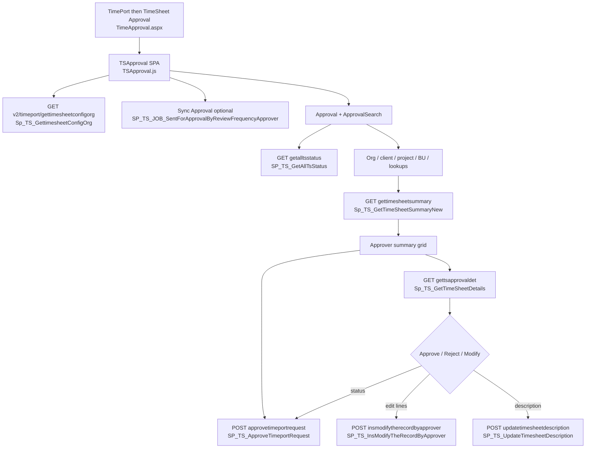
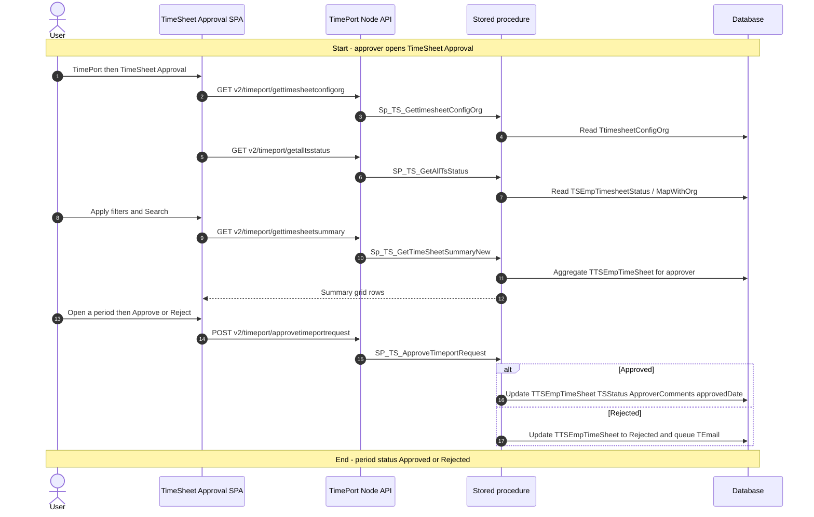
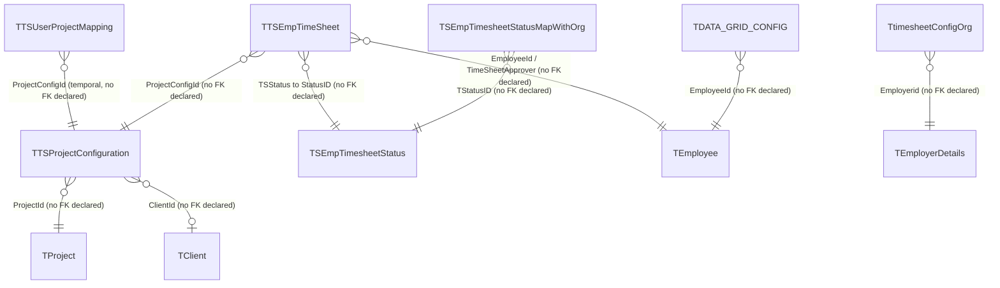

# TimeSheet Approval

## Overview

A project timesheet approver opens **TimePort → TimeSheet Approval** to review employee timesheets that are waiting on them, then approve or reject (optionally after editing lines). The WebForms shell `TimeApproval.aspx` only stamps the logged-in session into hidden fields and loads the TimePort React SPA. React Router maps that URL to `TSApproval`, which mounts the live **TimeSheet Approval** tab (`Approval` + `ApprovalSearch`). Other tabs (ClickTime Status, Bulk Report) are commented out in source.

Typical path: the approver filters by organization / client / project / status / date range, loads a summary grid of periods they are mapped as `TimeSheetApprover` for, opens a period into a detail modal, then Approves or Rejects. Bulk approve from the grid posts the same approve API for selected rows where the row’s approver id matches the logged-in user. A top-level **Sync Approval** button runs a job-style SP that flips eligible rows to Sent for Approval for that approver.

**Who's involved:**

- **Approver** — decides Submitted / Sent for Approval rows for projects they are mapped to.
- **Employee** — submitted the timesheet earlier (TimePort entry / status screens); they are notified on reject via email queue.
- **Org admin (indirect)** — org-level time format and status mapping affect display and status ids.

Timesheet row truth lives in `HRM-TIMEPORT` (`TTSEmpTimeSheet`, status masters, project/user mapping). There is no dedicated llm-wiki TimePort lifecycle page in this workspace; relationships below are derived from the live scripts and DAL.

## Workflow

## Request journey

## Entry points

> Live entry is the WebForms shell plus the TimePort SPA route `APPROVAL_TP`. ClickTime Status / Bulk Report tabs and several ClickTime helpers remain in the folder but are commented out or secondary to the approve path.

| Entry point | Purpose | Live? |
|---|---|---|
| `HRM/TimePort/TimeApproval.aspx` (+ `.cs`) | WebForms shell; session → hidden fields; loads `Timeport.min.js` | Yes |
| `Areas/routes.js` path `RouteConstants.APPROVAL_TP` | React Router host → `TSApproval` | Yes |
| `TSApproval/Containers/TSApproval.js` | Org time-format load, Sync Approval, TimeSheet Approval tab | Yes |
| `TSApproval/Components/Approval.js` | Summary grid, bulk approve, detail modal host | Yes |
| `TSApproval/Components/ApprovalSearch.js` | Filters + `gettimesheetsummary` | Yes |
| `TSApproval/Components/TSDetails.js` / `ToBeSubmitted.js` | Detail approve/reject/modify/description | Yes (modal) |
| Node `HRMS.TimePort.WebAPI.Node` `/v2/timeport/*` | TimePort API used by this SPA | Yes |
| ClickTime routes (`/ClickTime/...`) | Publish / multi-user date range when ClickTime enabled | Secondary / often gated |

## Code → database call chain

`GetTimeSheetSummary` overwrites the summary employee scope with JWT `req.EID` (logged-in approver), not the query string employee id from the client URL builder.

| Step | Entry point | App code | Stored procedure |
|---|---|---|---|
| Page load | `TimeApproval.aspx` | `Page_Load` (`TimeApproval.aspx.cs:20-33`) — session → hidden fields; activity `TimeSheetApproval` | none |
| Mount SPA | `Areas/routes.js:66` | `TSApproval` with `StartDayOfWeek` | none (parent Routes also hits month-wise timesheet for week start) |
| Org time format | `TSApproval.js:37` | `TimePortController` gettimesheetconfigorg → `GetTimesheetConfigOrg` (`timeportDAL_v2.js:3750-3756`) | `Sp_TS_GettimesheetConfigOrg` |
| Sync Approval | `TSApproval.js:70` | `SentForApprovalByReviewFrequencyApprover` (`timeportDAL_v2.js:3424-3431`) | `SP_TS_JOB_SentForApprovalByReviewFrequencyApprover` |
| Grid layout | `Approval.js:332`, `:379`, `:418` | `GetGridConfig` / `setGridConfig` (`timeportDAL_v2.js:2813-2820`, `:2795-2804`) | `Sp_TS_GetGridConfig` / `Sp_TS_SetGridConfig` |
| Status list | `ApprovalSearch.js:168` | `GetAllTsStatus` (`timeportDAL_v2.js:1954-1961`) | `SP_TS_GetAllTsStatus` |
| Organizations | `ApprovalSearch.js:536` | `GetEmployerList` (`timeportDAL_v2.js:612-617`) | `SP_GetEmployerList` |
| Clients for approver | `ApprovalSearch.js:1004` | `GetClientDetailsforApprover` (`timeportDAL_v2.js:3408-3416`) | `Sp_TS_GetClientDetailsforApprover` |
| Projects for approver | `ApprovalSearch.js:476` | `GetProjectDetailsforApprover` (`timeportDAL_v2.js:1987-1998`) | `Sp_TS_GetProjectDetailsforApprover` |
| Business units | `ApprovalSearch.js:486` | `GetTSBusinessUnitdet` (`timeportDAL_v2.js:1017-1022`, connection `core`) | `SP_TS_GetAllBusinessUnit` (HRMS) |
| Lookups | `ApprovalSearch.js:496` | `GetAllLookupDetails` (`timeportDAL_v2.js:544-551`) | `Sp_TS_GetAllLookupDetails` |
| Summary grid | `ApprovalSearch.js:255`, `:364` | `GetTimeSheetSummary` (`timeportDAL_v2.js:1102-1121`; controller uses `req.EID`) | `Sp_TS_GetTimeSheetSummaryNew` |
| Detail lines | `TSDetails.js:177` | `GetTSApprovalDet` (`timeportDAL_v2.js:981-993`) | `Sp_TS_GetTimeSheetDetails` |
| Modified check | `TSDetails.js:297` | `GetTSModifedApprovalDet` (`timeportDAL_v2.js:2098-2110`) | `Sp_TS_GetModifiedTimeSheetByApprover` |
| Org lookup labels | `TSDetails.js:228` | `LookupOrgwiseDisplayName` (`timeportDAL_v2.js:1907-1914`) | `SP_Get_Lookup_OrgwiseDisplayName` |
| Approve / reject | `Approval.js:210`, `TSDetails.js:444` | `ApproveTimeportRequest` (`timeportDAL_v2.js:1576-1595`) | `SP_TS_ApproveTimeportRequest` |
| Approver edit lines | `ToBeSubmitted.js` POST | `InsModifyTheRecordByApprover` (`timeportDAL_v2.js:2006-2085`) | `SP_TS_InsModifyTheRecordByApprover` |
| Description edit | `TSDetails.js:728` | `UpdateTimesheetDescription` (`timeportDAL_v2.js:1865-1878`) | `SP_TS_UpdateTimesheetDescription` |

Nested from summary (one level): `Sp_OpenEncryptionKeys`, optional `USP_TS_UpdateTimeSheetConfigByQueue`, `USP_EmployeeTotalCapacity`, `USP_EmployeeTotalCapacityByProject`, `SP_CloseEncryptionKey`. Nested from approve-on-reject: encryption open/close, `Fn_GetEmployeeName`, `FN_JobSchedulerConfigValue`. Nested from detail: `FN_TS_NoOfDaysCnt`. Nested from modify: `TFN_LatestUserProjectMapping_new`, `TFN_LatestProjectConfiguration`, `TFN_TsLookupInfo`. Nested from project/client filters: `TFN_LookupInfo`.

## API endpoints

This submenu is a React SPA over the TimePort Node API (`/v2/timeport/...`). There are no `[WebMethod]` / PageMethods on `TimeApproval.aspx`. ClickTime helpers are separate routes under `/ClickTime/`.

### Shell / filters

| Verb | Route | Parameters | Purpose | Source |
|---|---|---|---|---|
| `GET` | `/v2/timeport/gettimesheetconfigorg` | `pEmployerId` | Org time-format / reminder config | `timeportController_V2` + `timeportDAL_v2.js:3750` |
| `GET` | `/v2/timeport/getalltsstatus` | `employerId` | Status dropdown / id map | `timeportDAL_v2.js:1954` |
| `GET` | `/v2/timeport/getemployerlist` | (JWT / session) | Organization multi-select | `timeportDAL_v2.js:612` |
| `GET` | `/v2/timeport/getclientdetailsforapprover` | `employerId`, employee from JWT path | Client filter | `timeportDAL_v2.js:3408` |
| `GET` | `/v2/timeport/getprojectdetailsforapprover` | `employerId`, `clientId`, `ClientOrgIds` | Project filter | `timeportDAL_v2.js:1987` |
| `GET` | `/v2/timeport/gettsbusinessunitdet` | `pEmployerId` | BU filter (HRMS connection) | `timeportDAL_v2.js:1017` |
| `GET` | `/v2/timeport/getalllookupdetails` | `employerId` | SDLC / work-product lookups | `timeportDAL_v2.js:544` |
| `GET` | `/v2/timeport/getgridconfig` | `gridId` (`TimeSheetApproverSummery_Grid` / `TimeSheetApproverDefault_Search`) | Saved columns / default search | `timeportDAL_v2.js:2813` |
| `POST` | `/v2/timeport/setgridconfig` | body EmployeeId, GridId, ConfigType, Config | Persist grid/search layout | `timeportDAL_v2.js:2795` |
| `GET` | `/v2/timeport/sentforapprovalbyreviewfrequencyapprover` | `employeeId` | Sync Approval button | `timeportDAL_v2.js:3424` |

### Summary / detail / decide

| Verb | Route | Parameters | Purpose | Source |
|---|---|---|---|---|
| `GET` | `/v2/timeport/gettimesheetsummary` | `EmployerId`, `EmployerIds`, filters, dates, `TsStatus`, org ids, paging/filters (EmployeeId in URL ignored; JWT `EID` used) | Approver summary grid | `timeportController_V2.js:379-384` |
| `GET` | `/v2/timeport/gettsapprovaldet` | `pEmployerId`, `pEmployeeId`, `pProjectID`, dates, `loggedInUser`, `pStatus`, `pReviewFreq` | Detail modal lines | `timeportDAL_v2.js:981` |
| `GET` | `/v2/timeport/gettsmodifedapprovaldet` | same shape as detail | Detect prior approver edits | `timeportDAL_v2.js:2098` |
| `GET` | `/v2/timeport/lookuporgwisedisplayname` | `employerId` | Org-specific lookup labels | `timeportDAL_v2.js:1907` |
| `POST` | `/v2/timeport/approvetimeportrequest` | body `approvalDetails[]` (`pEmployerId`, dates, `EmployeeId`, `ApprovedBy`, `AppStatus`, `comments`, `ProjectID`, optional `oldTsStatus`) | Approve or reject | `timeportController_V2.js:439` |
| `POST` | `/v2/timeport/insmodifytherecordbyapprover` | TVP-shaped timesheet lines + admin flags | Approver modifies lines | `timeportDAL_v2.js:2006` |
| `POST` | `/v2/timeport/updatetimesheetdescription` | `TimeSheetId`, description, modifiedBy | Edit description only | `timeportDAL_v2.js:1865` |

## Stored procedures & tables involved

| Object | Path | Role | llm-wiki |
|---|---|---|---|
| `Sp_TS_GetTimeSheetSummaryNew` | `HRMS-DATABASE/HRM-TIMEPORT/STOREPROCEDURE/Sp_TS_GetTimeSheetSummaryNew.sql` | Approver summary; capacity via nested USPs | — |
| `SP_TS_ApproveTimeportRequest` | `…/SP_TS_ApproveTimeportRequest.sql` | Approve/reject updates + reject email | — |
| `Sp_TS_GetTimeSheetDetails` | `…/Sp_TS_GetTimeSheetDetails.sql` | Detail line list for a period | — |
| `Sp_TS_GetModifiedTimeSheetByApprover` | `…/Sp_TS_GetModifiedTimeSheetByApprover.sql` | Rows previously modified by approver | — |
| `SP_TS_InsModifyTheRecordByApprover` | `…/SP_TS_InsModifyTheRecordByApprover.sql` | Update/insert lines from approver edit | — |
| `SP_TS_GetAllTsStatus` | `…/SP_TS_GetAllTsStatus.sql` | Status dropdown | — |
| `Sp_TS_GetProjectDetailsforApprover` | `…/Sp_TS_GetProjectDetailsforApprover.sql` | Projects where user is TimeSheetApprover | — |
| `Sp_TS_GetClientDetailsforApprover` | `…/Sp_TS_GetClientDetailsforApprover.sql` | Clients for those projects | — |
| `Sp_TS_GetAllLookupDetails` | `…/Sp_TS_GetAllLookupDetails.sql` | Lookup tree for filters | — |
| `Sp_TS_GettimesheetConfigOrg` | `…/Sp_TS_GettimesheetConfigOrg.sql` | Org time-format flags | — |
| `Sp_TS_GetGridConfig` / `Sp_TS_SetGridConfig` | `…/Sp_TS_GetGridConfig.sql`, `Sp_TS_SetGridConfig.sql` | Saved grid/search config | — |
| `SP_TS_UpdateTimesheetDescription` | `…/SP_TS_UpdateTimesheetDescription.sql` | Description + history | — |
| `SP_TS_JOB_SentForApprovalByReviewFrequencyApprover` | `…/SP_TS_JOB_SentForApprovalByReviewFrequencyApprover.sql` | Sync Approval | — |
| `SP_Get_Lookup_OrgwiseDisplayName` | `…/SP_Get_Lookup_OrgwiseDisplayName.sql` | Top-level lookup labels | — |
| `USP_EmployeeTotalCapacity` / `USP_EmployeeTotalCapacityByProject` | `…/USP_EmployeeTotalCapacity*.sql` | Nested capacity for summary | — |
| `USP_TS_UpdateTimeSheetConfigByQueue` | `…/USP_TS_UpdateTimeSheetConfigByQueue.sql` | Nested queue drain before summary | — |
| `SP_TS_GetAllBusinessUnit` | HRMS `STOREPROCEDURE` (core connection) | BU filter | — |
| `SP_GetEmployerList` | TimePort + HRMS copies | Org list | — |
| `TTSEmpTimeSheet` | `HRM-TIMEPORT/TABLES/` | Timesheet lines / status | — |
| `TTSUserProjectMapping` / `TTSProjectConfiguration` | `…/TABLES/` | Approver mapping & project config (temporal) | — |
| `TSEmpTimesheetStatus` / `TSEmpTimesheetStatusMapWithOrg` | `…/TABLES/` | Status ids / org overrides | — |
| `TDATA_GRID_CONFIG` | `…/TABLES/` | Grid layouts | — |
| `TEmail` | via synonym / shared | Reject notification queue | — |

## Table relationships

Approver visibility is driven by `TTSUserProjectMapping.TimeSheetApprover` against project configuration, not a classic `TRequestWorkflows` leave-style engine. Status is an integer FK-style column to `TSEmpTimesheetStatus` (often without a declared FK).

## Known gaps

- **ClickTime tab commented out** in `TSApproval.js`; ClickTime publish / notify / status endpoints remain in components but are not the primary live tab.
- **Summary EmployeeId** in the client URL is ignored; controller passes JWT `req.EID` into `Sp_TS_GetTimeSheetSummaryNew`.
- **BU filter** uses `CreateConnection("core")` → HRMS `SP_TS_GetAllBusinessUnit`, while the rest of the page hits TimePort.
- **`SP_GetEmployerList`** exists in both HRMS and HRM-TIMEPORT; the TimePort DAL default connection is TimePort.
- **Reject email** path opens encryption keys and inserts `TEmail`; Approve path does not send that reject mail block.
- **No llm-wiki TimePort domain page** was available in this workspace to reuse for ER prose.
- **Legacy / alternate summary scripts** (`Sp_TS_GetTimeSheetSummary`, `*_DP`, `*_HT`) sit beside `Sp_TS_GetTimeSheetSummaryNew`; live DAL executes the `New` name only.
- **Routes shell** also calls month-wise timesheet for `StartDayOfWeek` for every TimePort page, not Approval-specific.

## Reference

Confidence is **high** for the live WebForms → `TSApproval` → `/v2/timeport` → `timeportDAL_v2` → `HRM-TIMEPORT` chain (file:line on summary, approve, detail, filters). Nested capacity/queue and reject-mail helpers are inventoried from the SQL scripts.

### SourceCode

- `HRMS.Web/HRMS.Web/HRM/TimePort/TimeApproval.aspx` (+ `.cs`)
- `HRMS.Web/HRMS.Web/HRM/TimePort/Areas/routes.js`, `Common/routeConstants.js`, `Common/apiURLConstants.js`
- `HRMS.Web/HRMS.Web/HRM/TimePort/Areas/TSApproval/` (`Containers/TSApproval.js`, `Components/Approval.js`, `ApprovalSearch.js`, `TSDetails.js`, `ToBeSubmitted.js`)
- `HRMS.TimePort/HRMS.TimePort.WebAPI.Node/Routes/TimeportRoutes_v2.js`
- `HRMS.TimePort/HRMS.TimePort.WebAPI.Node/Controllers/timeportController_V2.js`
- `HRMS.TimePort/HRMS.TimePort.WebAPI.Node/Core/DataAccessLayer/timeportDAL_v2.js`

### TDG HRMS DB

- `HRMS-DATABASE/HRM-TIMEPORT/STOREPROCEDURE/Sp_TS_GetTimeSheetSummaryNew.sql`
- `HRMS-DATABASE/HRM-TIMEPORT/STOREPROCEDURE/SP_TS_ApproveTimeportRequest.sql`
- `HRMS-DATABASE/HRM-TIMEPORT/STOREPROCEDURE/Sp_TS_GetTimeSheetDetails.sql`
- `HRMS-DATABASE/HRM-TIMEPORT/STOREPROCEDURE/SP_TS_InsModifyTheRecordByApprover.sql`
- Related filter/status/grid/config SPs listed above under Stored procedures & tables
