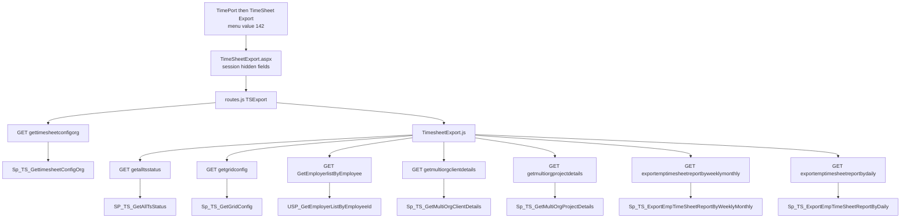
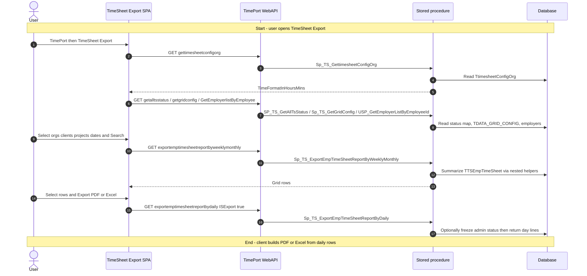
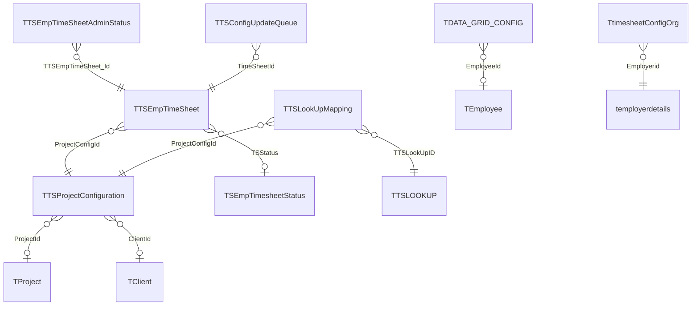

# TimeSheet Export

## Overview

An approver, timeport admin, or multi-org user opens **TimePort → TimeSheet Export** to filter submitted/approved timesheets by organization, client, project, date range, and report frequency (Weekly / Bi-Weekly), then export selected rows to PDF or Excel. The left-nav leaf (menu value **142**) loads `HRM/TimePort/TimeSheetExport.aspx`, which only stamps session identity into hidden fields and logs activity `TimeSheetExport`. The live UI is the React SPA (`Areas/routes.js` → `TSExport` → `TimesheetExport`) served from `BuildJS/Timeport.min.js`.

On mount, the container loads org-level time-format config; the export screen then loads status filters, saved grid/search config, lookup items, employer list, and (after org selection) multi-org clients and projects. Searching the grid calls the weekly/monthly export procedure; PDF/Excel generation and drill-down call the daily export procedure (with `ISExport=true` when freezing rows for export).

**Who's involved:**

- **Signed-in employee** — must have access to the TimePort Export menu; identity comes from session hidden fields / Redux `ActiveUsersReducer`.
- **Approver / non-reporting role** — weekly export resolves `@ApproverId` from role `ReportingType` so the summary SP filters by timesheet approver or reportee view.
- **Multi-org / global-access user** — `USP_GetEmployerListByEmployeeId` expands employer pickers from `TUsers.EmployerIds` when `IsGlobalAccess = 'Y'`.

Runtime truth is TimePort WebAPI Node (`/v2/timeport/...`) against database slug **hrm-timeport**. There is no SystemModel-2 workflow page for this leaf in the SourceCode checkout.

## Workflow

## Request journey

Primary journey: open the page → load filters → search the summary grid → optionally export selected rows (daily SP with freeze).

## Entry points

| Entry point | Purpose | Live? |
|---|---|---|
| `HRM/TimePort/TimeSheetExport.aspx` (+ `.cs`) | WebForms shell; session → hidden fields; logs `ActivityDescription.TimeSheetExport`; loads TimePort webpack bundles | Yes |
| `Areas/routes.js` → `RouteConstants.EXPORT_TS` (`/HRM/TimePort/TimeSheetExport.aspx`) | Mounts `TSExport` container | Yes |
| `TSExport.js` | Loads org time-format config; renders `TimesheetExport` | Yes |
| `TimesheetExport.js` | Filters, summary grid, PDF/Excel export, grid config persistence | Yes |
| TimePort WebAPI Node `/v2/timeport/*` (`TimeportRoutes_v2.js`) | Authorized JSON APIs for all data calls | Yes |
| Menu hierarchy value **142** under TimePort | Left-nav leaf (DML/XML text `TimeSheet Export` / `Timesheet Export`) | Yes |

## Code → database call chain

| Step | Entry point | App code | Stored procedure |
|---|---|---|---|
| Page load | `TimeSheetExport.aspx` | `Page_Load` (`TimeSheetExport.aspx.cs:20-34`) — session → hidden fields; activity log | none |
| Mount container | `routes.js:70` | `TSExport.getTimeFormatConfigOrglvl` (`TSExport.js:27-38`) → `GET_TS_TIMECONFIG_ATORG` → `GetTimesheetConfigOrg` (`timeportController_V2.js:939-941`) → `timeportDAL_v2.js:3750-3756` | `Sp_TS_GettimesheetConfigOrg` |
| Status filter | `TimesheetExport.js:166-186` `getTsStatusType` | `GET_TsStatus_Type` → `GetAllTsStatus` (`timeportController_V2.js:571-573`) → `timeportDAL_v2.js:1954-1961` | `SP_TS_GetAllTsStatus` |
| Default search / grid format | `getDefaultSeacrch` / `getGridFormat` / `getGridConfig` | `GET_GRID_CONFIG` → `GetGridConfig` (`timeportController_V2.js:721-725`) → `timeportDAL_v2.js:2813-2820` | `Sp_TS_GetGridConfig` |
| Save column config | `TimesheetExport.js` save handlers | `SET_GRID_CONFIG` → `setGridConfig` (`timeportController_V2.js:709-712`) → `timeportDAL_v2.js:2795-2804` | `Sp_TS_SetGridConfig` |
| Lookups | `GetAllLookUpitems` | `GET_ALL_LOOKUPITEMS` → `GetAllLookupDetails` → `timeportDAL_v2.js:544-551` | `Sp_TS_GetAllLookupDetails` |
| Org picker | `populateOrganization` (`TimesheetExport.js:1998-2014`) | `GET_EMPLOYER_DETAILS_BY_EMPLOYEE` → `GetEmployerlistByEmployee` (`timeportController_V2.js:217-219`) → `timeportDAL_v2.js:623-628` | `USP_GetEmployerListByEmployeeId` |
| Clients | `getClientList` (`TimesheetExport.js:610`) | `GET_MULTIORG_CLIENT_DETAILS` → `GetMultiOrgClientDetails` (`timeportController_V2.js:984-986`) → `timeportDAL_v2.js:3831-3840` | `Sp_TS_GetMultiOrgClientDetails` |
| Projects | `getProjectList` (`TimesheetExport.js:654-655`) | `GET_MUTIORG_PROJECT_DETAILS` → `GetMultiOrgProjectDetails` (`timeportController_V2.js:993-995`) → `timeportDAL_v2.js:3848-3859` | `Sp_TS_GetMultiOrgProjectDetails` |
| Summary search | `getTimePortReportGridData` (`TimesheetExport.js:199-251`) | `GET_TIMESHEETEXPORT_REPORTSBYDWM` → `ExportEmpTimeSheetReportByWeeklyMonthly` (`timeportController_V2.js:784-787`) → `timeportDAL_v2.js:2971-2991` | `Sp_TS_ExportEmpTimeSheetReportByWeeklyMonthly` |
| Detail / export | PDF/Excel handlers (`TimesheetExport.js:1125-1135`, `:1234`, `:2118`) | `GET_TIMESHEETEXPORT_REPORTSFORDAILY` → `ExportEmpTimeSheetReportByDaily` (`timeportController_V2.js:793-796`) → `timeportDAL_v2.js:3275-3290` | `Sp_TS_ExportEmpTimeSheetReportByDaily` |

## API endpoints

There are no `[WebMethod]` / PageMethods on `TimeSheetExport.aspx`. All data goes through TimePort WebAPI (v2 routes used by the React `apiURLConstants` primary block).

| Verb | Route | Parameters | Purpose | Source |
|---|---|---|---|---|
| `GET` | `/v2/timeport/gettimesheetconfigorg` | `pEmployerId` | Org time-format / reminder / autosave flags | `TimeportRoutes_v2.js:105` |
| `GET` | `/v2/timeport/getalltsstatus` | `employerId` | Timesheet status filter list | `TimeportRoutes_v2.js:69` |
| `GET` | `/v2/timeport/getgridconfig` | `gridId` (employee from JWT/`req.EID`) | Saved grid / search config (`TimeSheetExport_Grid`, `TimeSheetExportDefault_Search`) | `TimeportRoutes_v2.js:84` |
| `POST` | `/v2/timeport/setgridconfig` | body `EmployeeId`, `GridId`, `ConfigType`, `Config` | Persist selectable columns / grid format | `TimeportRoutes_v2.js:83` |
| `GET` | `/v2/timeport/getalllookupdetails` | `employerId` | TTS lookup / project mapping rows | `TimeportRoutes_v2.js:28` |
| `GET` | `/v2/timeport/GetEmployerlistByEmployee` | employee from auth | Org multi-select | `TimeportRoutes_v2.js:32` |
| `GET` | `/v2/timeport/getmultiorgclientdetails` | `employerId`, `BUs` | Client filter | `TimeportRoutes_v2.js:110` |
| `GET` | `/v2/timeport/getmultiorgprojectdetails` | `employerId`, `clientId`, `ClientOrgIds`, `selectedBUs` | Project filter | `TimeportRoutes_v2.js:111` |
| `GET` | `/v2/timeport/exportemptimesheetreportbyweeklymonthly` | `employerId`, `employerIds`, dates, `ProjectId`, `ClientId`, `ReportType`, org id strings, paging/filters | Summary export grid | `TimeportRoutes_v2.js:89` |
| `GET` | `/v2/timeport/exportemptimesheetreportbydaily` | `EmployerId`, dates, `ProjectId`, `EmpId`, `ClientId`, `ReportType`, `ISExport`, `ApprovalStatus` | Day-level rows; freeze when `ISExport=true` | `TimeportRoutes_v2.js:90` |

Legacy non-v2 `/timeport/...` aliases exist in the same constants file for older builds.

## Stored procedures & tables involved

| Object | Path | Role | Page |
|---|---|---|---|
| `Sp_TS_GettimesheetConfigOrg` | `HRM-TIMEPORT/STOREPROCEDURE/` | Org time display format for UI | [Sp_TS_GettimesheetConfigOrg](/docs/database/hrm-timeport/Sp_TS_GettimesheetConfigOrg) |
| `SP_TS_GetAllTsStatus` | same | Status filter options (org map or global) | [SP_TS_GetAllTsStatus](/docs/database/hrm-timeport/SP_TS_GetAllTsStatus) |
| `Sp_TS_GetGridConfig` / `Sp_TS_SetGridConfig` | same | Per-user grid JSON in `TDATA_GRID_CONFIG` | [Sp_TS_GetGridConfig](/docs/database/hrm-timeport/Sp_TS_GetGridConfig) · [Sp_TS_SetGridConfig](/docs/database/hrm-timeport/Sp_TS_SetGridConfig) |
| `Sp_TS_GetAllLookupDetails` | same | Lookup / project config mapping | [Sp_TS_GetAllLookupDetails](/docs/database/hrm-timeport/Sp_TS_GetAllLookupDetails) |
| `USP_GetEmployerListByEmployeeId` | same | Employer picker | [USP_GetEmployerListByEmployeeId](/docs/database/hrm-timeport/USP_GetEmployerListByEmployeeId) |
| `Sp_TS_GetMultiOrgClientDetails` | same | Clients scoped by BU access | [Sp_TS_GetMultiOrgClientDetails](/docs/database/hrm-timeport/Sp_TS_GetMultiOrgClientDetails) |
| `Sp_TS_GetMultiOrgProjectDetails` | same | Projects scoped by client / BU / RA | [Sp_TS_GetMultiOrgProjectDetails](/docs/database/hrm-timeport/Sp_TS_GetMultiOrgProjectDetails) |
| `Sp_TS_ExportEmpTimeSheetReportByWeeklyMonthly` | same | Summary grid | [Sp_TS_ExportEmpTimeSheetReportByWeeklyMonthly](/docs/database/hrm-timeport/Sp_TS_ExportEmpTimeSheetReportByWeeklyMonthly) |
| `Sp_TS_ExportEmpTimeSheetReportByDaily` | same | Detail lines + optional freeze | [Sp_TS_ExportEmpTimeSheetReportByDaily](/docs/database/hrm-timeport/Sp_TS_ExportEmpTimeSheetReportByDaily) |
| `TTSEmpTimeSheet`, `TTSProjectConfiguration`, `TSEmpTimesheetStatus`, `TTSEmpTimeSheetAdminStatus` | TimePort tables | Timesheet facts, config, status, admin freeze | — |
| `TClient`, `TProject`, `TEmployeeInfo`, `temployerdetails` | shared / TimePort | Filters and display names | — |
| `TDATA_GRID_CONFIG`, `TtimesheetConfigOrg` | TimePort | UI persistence / org settings | — |

Nested helpers used by the export SPs (one level): `USP_TFN_TimesheetTaskDurationSummaryHistory`, `USP_Employee_ActualWorkedLeaveHours`, `USP_TS_UpdateTimeSheetConfigByQueue`, `TFN_TimesheetTaskDuration`, `TFN_DateRangeByReportType`, `TFN_LookupInfo`, `TFN_TsLookupInfo`, `TFN_TsLookupInfoPlain`, `TFN_LatestProjectConfiguration`, plus existing shared pages for `Sp_OpenEncryptionKeys`, `SP_CloseEncryptionKey`, `UFN_GetClientbyEmployeeBU`, `Fn_GetEmployeeName`, `FN_ConvertMinutesToHHMM`, `Fn_DirectIndirectReportee`, `UFN_CalCulateEmployeeTotalCapacityProject`.

## Table relationships

## Known gaps

- **Daily export mutates when `ISExport=true`.** `Sp_TS_ExportEmpTimeSheetReportByDaily` updates/inserts `TTSEmpTimeSheetAdminStatus` to Freeze for matching approved/submitted rows before returning data — PDF/Excel paths pass `ISExport: true`.
- **Hardcoded database names** in `Sp_TS_GetMultiOrgClientDetails.sql` / `Sp_TS_GetMultiOrgProjectDetails.sql` headers (`USE [HRM_CL_TIMEPORT]`) and optional cross-db reads of `RESOURCEALLOCATION` / `ResourceAllocation`.
- **Commented pagination** in `Sp_TS_ExportEmpTimeSheetReportByWeeklyMonthly` — `@PageNumber` / `@PageSize` / `@FilterJson` are accepted but the `TFN_FormattedPaginationParameters` path is commented out; DAL still groups/aggregates in Node.
- **Menu label casing** varies (`TimeSheet Export` vs `Timesheet Export`) across DML XML dumps; NavigateURL is the `.aspx` path via TimePort routing, not verified from a single live `TMenuDetails` row in this pass.
- **No llm-wiki / SystemModel-2** domain page dedicated to TimeSheet Export was found in the workspace checkouts used for this analysis.
- Nested capacity procs inside `USP_TFN_TimesheetTaskDurationSummaryHistory` (`USP_EmployeeTotalCapacity*`) are beyond the one-level DB page depth for this run.

## Reference

Confidence is **high**: WebForms shell → React → TimePort WebAPI v2 → named TimePort procedures are verified with file:line citations; SQL nesting for the two export procedures was read from `HRM-TIMEPORT` scripts (not executed).

### SourceCode

- `HRMS.Web/HRMS.Web/HRM/TimePort/TimeSheetExport.aspx` (+ `.cs`, `.designer.cs`)
- `HRMS.Web/HRMS.Web/HRM/TimePort/Areas/routes.js`, `Common/routeConstants.js`, `Common/apiURLConstants.js`, `Common/apiHelper.js`
- `HRMS.Web/HRMS.Web/HRM/TimePort/Areas/TSExport/Containers/TSExport.js`
- `HRMS.Web/HRMS.Web/HRM/TimePort/Areas/TSExport/Components/TimesheetExport.js` (+ PDF/Excel helpers under `TSExport/Components/`)
- `HRMS.TimePort/HRMS.TimePort.WebAPI.Node/Routes/TimeportRoutes_v2.js`
- `HRMS.TimePort/HRMS.TimePort.WebAPI.Node/Controllers/timeportController_V2.js`
- `HRMS.TimePort/HRMS.TimePort.WebAPI.Node/Core/DataAccessLayer/timeportDAL_v2.js`

### TDG HRMS DB

- `HRMS-DATABASE/HRM-TIMEPORT/STOREPROCEDURE/Sp_TS_ExportEmpTimeSheetReportByWeeklyMonthly.sql`
- `HRMS-DATABASE/HRM-TIMEPORT/STOREPROCEDURE/Sp_TS_ExportEmpTimeSheetReportByDaily.sql`
- `HRMS-DATABASE/HRM-TIMEPORT/STOREPROCEDURE/Sp_TS_GettimesheetConfigOrg.sql`
- `HRMS-DATABASE/HRM-TIMEPORT/STOREPROCEDURE/SP_TS_GetAllTsStatus.sql`
- `HRMS-DATABASE/HRM-TIMEPORT/STOREPROCEDURE/Sp_TS_GetGridConfig.sql`, `Sp_TS_SetGridConfig.sql`
- `HRMS-DATABASE/HRM-TIMEPORT/STOREPROCEDURE/Sp_TS_GetAllLookupDetails.sql`
- `HRMS-DATABASE/HRM-TIMEPORT/STOREPROCEDURE/USP_GetEmployerListByEmployeeId.sql`
- `HRMS-DATABASE/HRM-TIMEPORT/STOREPROCEDURE/Sp_TS_GetMultiOrgClientDetails.sql`, `Sp_TS_GetMultiOrgProjectDetails.sql`
- Nested: `USP_TFN_TimesheetTaskDurationSummaryHistory.sql`, `USP_Employee_ActualWorkedLeaveHours.sql`, `USP_TS_UpdateTimeSheetConfigByQueue.sql`, `FUNCTIONS/TFN_*.sql`
