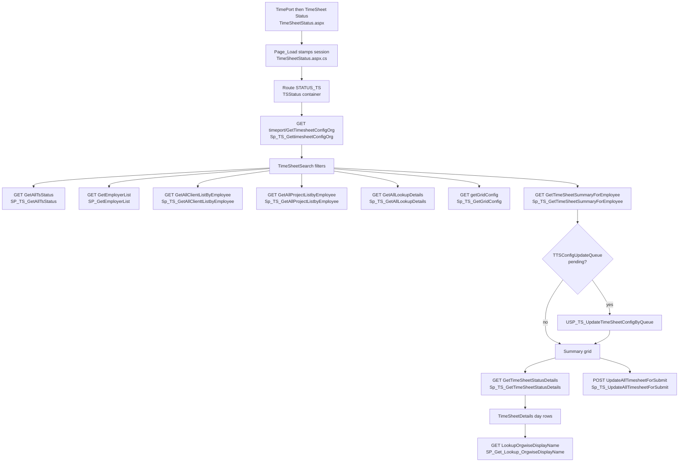
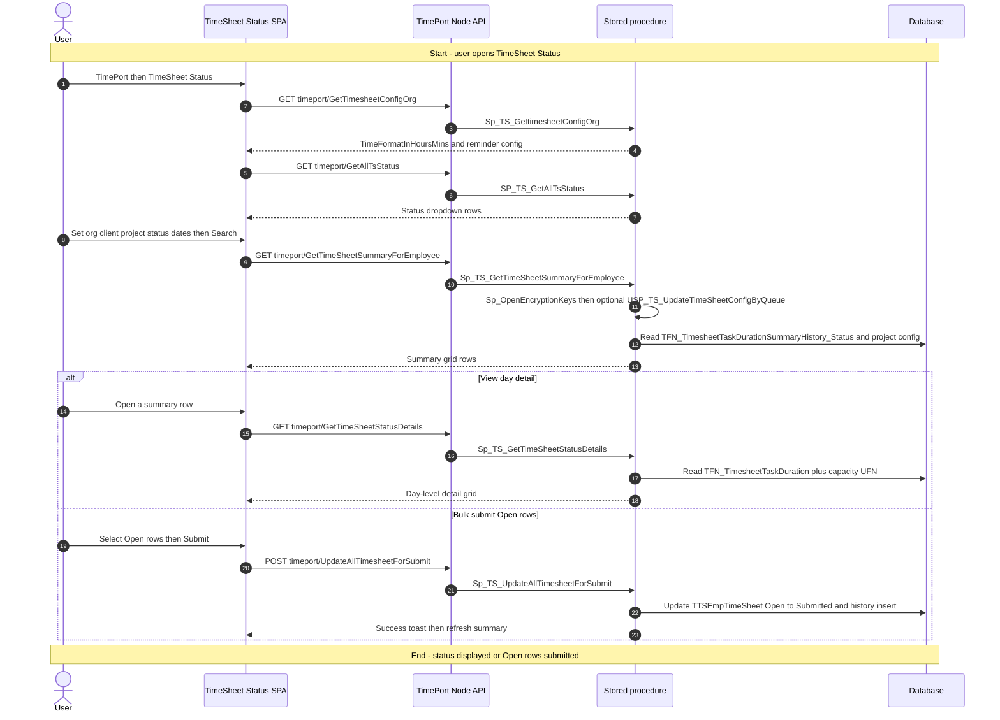
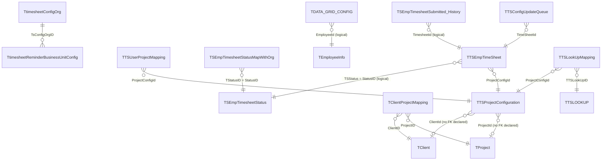

# TimeSheet Status

## Overview

A TimePort user opens **TimePort → TimeSheet Status** to search and review timesheet rows by organisation, client, project, status, and date range — and optionally submit Open rows in bulk or drill into day-level detail. The left-nav item loads `HRM/TimePort/TimeSheetStatus.aspx`, which only stamps session identity into hidden fields, logs activity `TimeSheetStatus`, and mounts the TimePort React SPA. React Router maps `TimeSheetStatus.aspx` to `TSStatus` → `TimeSheetStatus` + `TimeSheetSearch`.

This page is a **status shelf and submit helper**, not the daily entry grid. Creating or editing hours still lives on **TimeSheet** (`TimeSheet.aspx`). Approval decisions live on **TS Approval**.

**Who's involved:**

- **Employee** — searches own (and mapped) timesheet summary rows; can bulk-submit Open → Submitted.
- **Manager / approver** — filters by project and status (including Sent for Approval / Approved / Rejected) to audit status without deciding here.
- **Org with custom status map** — status dropdown comes from `TSEmpTimesheetStatusMapWithOrg` when present; otherwise global `TSEmpTimesheetStatus`.

Runtime truth is the TimePort WebForms shell plus `HRMS.TimePort.WebAPI.Node` against database slug **hrm-timeport** (employer list SP lives in **hrms**).

## Workflow

## Request journey

TimeSheet Status does not create timesheet hours. The journey that starts here is a **filtered status lookup** that can end in a read-only detail view or a bulk Open→Submitted update.

## Entry points

> Live entry point: WebForms shell stamps session into hidden fields and loads TimePort `BuildJS` bundles. React Router maps `TimeSheetStatus.aspx` to `TSStatus`.

| Entry point | Purpose | Live? |
|---|---|---|
| `HRM/TimePort/TimeSheetStatus.aspx` (+ `.cs`) | WebForms shell; session → hidden fields; React bundles | Yes |
| React `TSStatus` (`Areas/TSStatus/Containers/TSStatus.Js`) | Tab host; loads org time-format config | Yes — `Areas/routes.js` path `STATUS_TS` |
| `TimesheetStatus.js` | Summary grid, view-detail, bulk submit, grid column config | Yes |
| `TimeSheetSearch.js` | Filters, status/org/client/project loads, summary GET | Yes |
| `TimeSheetDetails.js` | Day detail UI; org-wise lookup labels | Yes |
| ChatBot / old dashboard deep link to `/HRM/TimePort/TimeSheetStatus.aspx` | Notification bell / legacy dashboard redirect | Yes (secondary) |
| Node TimePort `/timeport/*` routes | All data reads/writes for this page | Yes — `TimeportRoutes.js` |

## Code → database call chain

Live `apiURLConstants.js` uses **v1** `/timeport/...` paths (v2 block is commented). Controllers cited from `timeportController.js`; DAL from `timeportDAL.js`.

| Step | Entry point | App code | Stored procedure |
|---|---|---|---|
| Page load | `TimeSheetStatus.aspx` | `Page_Load` (`TimeSheetStatus.aspx.cs:20-34`) — session → hidden fields; `LogActivity(TimeSheetStatus)` | none |
| Mount SPA | `Areas/routes.js:61` / `:69` | `TSStatus` → `TimeSheetStatus` | none |
| Time format / reminder config | `TSStatus.Js:29` | `GetTimesheetConfigOrg` (`timeportController.js:939`) → DAL `:3755` | `Sp_TS_GettimesheetConfigOrg` |
| Status dropdown | `TimeSheetSearch.js:123` | `GetAllTsStatus` (`:572`) → DAL `:1956` | `SP_TS_GetAllTsStatus` |
| Organisation multi-select | `TimeSheetSearch.js:457` / `:521` | `GetEmployerList` (`:209`) → DAL `:612` | `SP_GetEmployerList` (HRMS) |
| Client filter | `TimeSheetSearch.js:436` | `GetAllClientListByEmployee` (`:831`) → DAL `:3398` | `Sp_TS_GetAllClienttListbyEmployee` |
| Project filter | `TimeSheetSearch.js:413` | `GetAllProjectListbyEmployee` (`:700`) → DAL `:2779` | `Sp_TS_GetAllProjectListbyEmployee` |
| Lookup catalogue | `TimeSheetSearch.js:479` | `GetAllLookupDetails` (`:181`) → DAL `:544` | `Sp_TS_GetAllLookupDetails` |
| Summary grid | `TimeSheetSearch.js:201` / `:297` | `GetTimeSheetSummaryForEmployee` (`:678`) → DAL `:2515` | `Sp_TS_GetTimeSheetSummaryForEmployee` → optional `USP_TS_UpdateTimeSheetConfigByQueue` |
| Day detail | `TimesheetStatus.js:265` | `GetTimeSheetStatusDetails` (`:822`) → DAL `:3360` | `Sp_TS_GetTimeSheetStatusDetails` |
| Org-wise labels on detail | `TimeSheetDetails.js:81` | `LookupOrgwiseDisplayName` (`:554`) → DAL `:1909` | `SP_Get_Lookup_OrgwiseDisplayName` |
| Bulk submit | `TimesheetStatus.js:212` | `UpdateAllTimesheetForSubmit` (`:689`) → BLL → DAL `:2760` | `Sp_TS_UpdateAllTimesheetForSubmit` |
| Grid column layout | `TimesheetStatus.js:364` / `:443`; search default `:645` / `:982` | `GetGridConfig` / `setGridConfig` (`:722` / `:710`) → DAL `:2814` / `:2796` | `Sp_TS_GetGridConfig` / `Sp_TS_SetGridConfig` |

## API endpoints

This submenu is a React SPA over TimePort Node API. There are no `[WebMethod]` / PageMethods on `TimeSheetStatus.aspx`.

### Reads

| Verb | Route | Parameters | Purpose | Source |
|---|---|---|---|---|
| `GET` | `timeport/GetTimesheetConfigOrg` | `pEmployerId` | Decimal vs HH:mm display; reminder / autosave org settings | `timeportController.js:939` |
| `GET` | `timeport/GetAllTsStatus` | `employerId` | Status filter labels (org map or global) | `:572` |
| `GET` | `timeport/GetEmployerList` | `employeeId` | Organisation picker | `:209` |
| `GET` | `timeport/GetAllClientListByEmployee` | `employerId`, `employeeId` | Client filter | `:831` |
| `GET` | `timeport/GetAllProjectListbyEmployee` | `employerId`, `employeeId`, `clientId`, `ClientOrgIds` | Project filter | `:700` |
| `GET` | `timeport/GetAllLookupDetails` | `employerId` | TTS lookup catalogue for filters | `:181` |
| `GET` | `timeport/GetTimeSheetSummaryForEmployee` | `EmployeeId`, `employerId`, `employerIds`, `ProjectId`, dates, `TsStatus`, `BusinessUnit`, `ProjectOrgIds`, `ClientOrgIds` (+ paging/filter via DAL) | Summary grid | `:678` |
| `GET` | `timeport/GetTimeSheetStatusDetails` | `pEmployeeId`, `pEmployerId`, `pProjectID`, `PFromDate`, `PTodate`, `pStatus`, `TimeSheetApprover` | Day-level detail | `:822` |
| `GET` | `timeport/LookupOrgwiseDisplayName` | `employerId` | Root TTSLookup display names | `:554` |
| `GET` | `timeport/getGridConfig` | `employeeId`, `gridId` (`TimeSheetStatus_Grid` / `TimeSheetStatusDefault_Search`) | Saved columns / default search | `:722` |

### Writes

| Verb | Route | Parameters | Purpose | Source |
|---|---|---|---|---|
| `POST` | `timeport/UpdateAllTimesheetForSubmit` | Body `approvalDetails[]` (`FromDate`, `ToDate`, `EmployeeId`, `ProjectID`, `LoginUserID`) | Bulk Open → Submitted | `:689` |
| `POST` | `timeport/setGridConfig` | Body employee/grid/config JSON | Persist column or default-search layout | `:710` |

Optional ClickTime helper `POST /ClickTime/ManualTimeEntriesDateRange` appears in `TimeSheetSearch.js` for multi-user date-range sync — not a TimePort `Sp_TS_*` procedure.

## Stored procedures & tables involved

| Object | Path | Role | llm-wiki |
|---|---|---|---|
| `Sp_TS_GettimesheetConfigOrg` | `HRMS-DATABASE/HRM-TIMEPORT/STOREPROCEDURE/` | Org time-format and reminder config result sets | — |
| `SP_TS_GetAllTsStatus` | same | Status dropdown from org map or `TSEmpTimesheetStatus` | — |
| `Sp_TS_GetTimeSheetSummaryForEmployee` | same | Paged summary; may EXEC `USP_TS_UpdateTimeSheetConfigByQueue` | — |
| `USP_TS_UpdateTimeSheetConfigByQueue` | same | Nested — flush pending config queue onto `TTSEmpTimeSheet` | — |
| `Sp_TS_GetTimeSheetStatusDetails` | same | Day detail via `TFN_TimesheetTaskDuration` + capacity UFN | — |
| `Sp_TS_GetAllProjectListbyEmployee` | same | Project filter from timesheet / mapping | — |
| `Sp_TS_GetAllClienttListbyEmployee` | same | Client filter (note spelling `Clientt`) | — |
| `Sp_TS_GetAllLookupDetails` | same | `TTSLOOKUP` + project mapping catalogue | — |
| `SP_Get_Lookup_OrgwiseDisplayName` | same | Root parent lookup labels | — |
| `Sp_TS_UpdateAllTimesheetForSubmit` | same | Open → Submitted + history | — |
| `Sp_TS_GetGridConfig` / `Sp_TS_SetGridConfig` | same | `TDATA_GRID_CONFIG` read/upsert | — |
| `SP_GetEmployerList` | `HRMS-DATABASE/HRMS/STOREPROCEDURE/` | Employer picker (HRMS DB) | — |
| `Sp_OpenEncryptionKeys` / `SP_CloseEncryptionKey` | HRMS crypto helpers | Nested open/close around summary/detail | — |
| `UFN_CalCulateEmployeeTotalCapacityProject` | `HRM-TIMEPORT/FUNCTIONS/` | Nested capacity on detail | existing DB page |
| `TTSEmpTimeSheet` | `HRM-TIMEPORT/TABLES/` | Core timesheet rows and status | — |
| `TTSProjectConfiguration` / `TTSUserProjectMapping` | same | Project config and resource mapping | — |
| `TSEmpTimesheetStatus` / `TSEmpTimesheetStatusMapWithOrg` | same | Status catalogue / org overrides | — |
| `TtimesheetConfigOrg` (+ reminder child tables) | same | Org display/reminder settings | — |
| `TDATA_GRID_CONFIG` | same | Per-user grid JSON | — |
| `TTSConfigUpdateQueue` | same | Deferred config apply queue | — |
| `TSEmpTimesheetSubmitted_History` | same | Submit audit rows | — |
| `TProject` / `TClient` / `TClientProjectMapping` / `TEmployerdetails` | HRMS / TimePort shared | Filter lists | — |
| `TTSLOOKUP` / `TTSLookUpMapping` | same | TimePort lookup tree | — |

## Table relationships

Summary and detail both hang off `TTSEmpTimeSheet` joined to `TTSProjectConfiguration`. Status labels come from the status catalogue (optionally org-mapped). Filter dropdowns resolve projects/clients the employee has timesheet or mapping history for.

## Known gaps

- **v1 vs v2 routes.** `apiURLConstants.js` ships live v1 `/timeport/...`; the `/v2/timeport/...` block is commented. Docs and ops should not assume v2 URLs.
- **Hardcoded Resource Allocation DB names** in `Sp_TS_GetAllProjectListbyEmployee` / `Sp_TS_GetAllClienttListbyEmployee` (`HRMS_RESOURCEALLOCATION_UAT` / `HRMS_RESOURCEALLOCATION`). Branching depends on whether that database exists on the server.
- **`USP_TS_UpdateTimeSheetConfigByQueue` script header** still contains `USE [HRM_CL_TIMEPORT]` in source; deploy context should not rely on that name.
- **ClickTime date-range POST** is optional integration, not covered by TimePort baseline `Sp_TS_*` pages.
- **Bulk submit only moves Open → Submitted.** It does not send for approval or approve; those flows are elsewhere.
- **Detail filtering is complex** for synced/editable-by-approver Approved rows (`TSStatus = 4`) inside `Sp_TS_GetTimeSheetStatusDetails` — UI may show a subset after DAL post-filters editable clones.
- **No SystemModel-2 workflow page** for this menu item in the SourceCode checkout; behaviour is code + SQL only.

## Reference

Confidence is **high** for the ASPX → React TSStatus/Search → TimePort Node DAL → `Sp_TS_*` chain (file:line on controllers/DAL). Nested queue/crypto/capacity objects verified from SQL text without executing.

### SourceCode

- `HRMS.Web/HRMS.Web/HRM/TimePort/TimeSheetStatus.aspx` (+ `.cs`)
- `HRMS.Web/HRMS.Web/HRM/TimePort/Areas/TSStatus/` (`Containers/TSStatus.Js`, `Components/TimesheetStatus.js`, `TimeSheetSearch.js`, `TimeSheetDetails.js`)
- `HRMS.Web/HRMS.Web/HRM/TimePort/Areas/routes.js`, `Common/routeConstants.js`, `Common/apiURLConstants.js`
- `HRMS.TimePort/HRMS.TimePort.WebAPI.Node/Routes/TimeportRoutes.js`
- `HRMS.TimePort/HRMS.TimePort.WebAPI.Node/Controllers/timeportController.js`
- `HRMS.TimePort/HRMS.TimePort.WebAPI.Node/Core/DataAccessLayer/timeportDAL.js`

### TDG HRMS DB

- `HRMS-DATABASE/HRM-TIMEPORT/STOREPROCEDURE/Sp_TS_GetTimeSheetSummaryForEmployee.sql`, `Sp_TS_GetTimeSheetStatusDetails.sql`, `SP_TS_GetAllTsStatus.sql`, `Sp_TS_GettimesheetConfigOrg.sql`, `Sp_TS_GetAllProjectListbyEmployee.sql`, `Sp_TS_GetAllClienttListbyEmployee.sql`, `Sp_TS_GetAllLookupDetails.sql`, `SP_Get_Lookup_OrgwiseDisplayName.sql`, `Sp_TS_UpdateAllTimesheetForSubmit.sql`, `Sp_TS_GetGridConfig.sql`, `Sp_TS_SetGridConfig.sql`, `USP_TS_UpdateTimeSheetConfigByQueue.sql`
- `HRMS-DATABASE/HRMS/STOREPROCEDURE/SP_GetEmployerList.sql`
- Database pages under `/docs/database/hrm-timeport/` for the objects listed above
