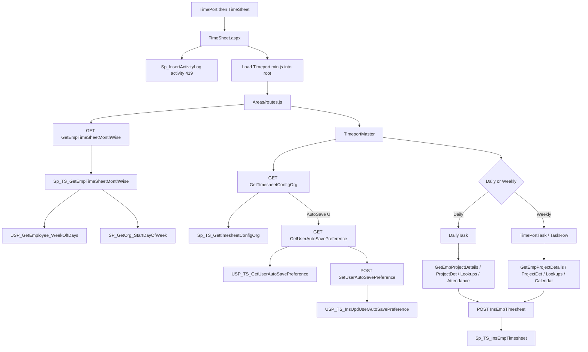
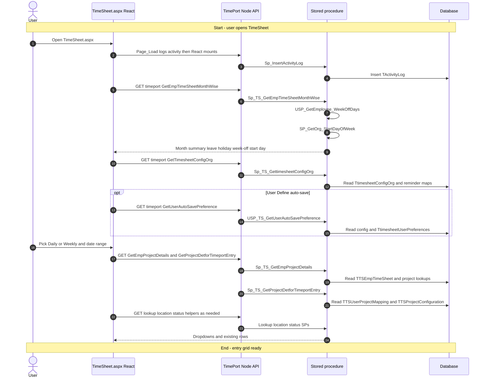
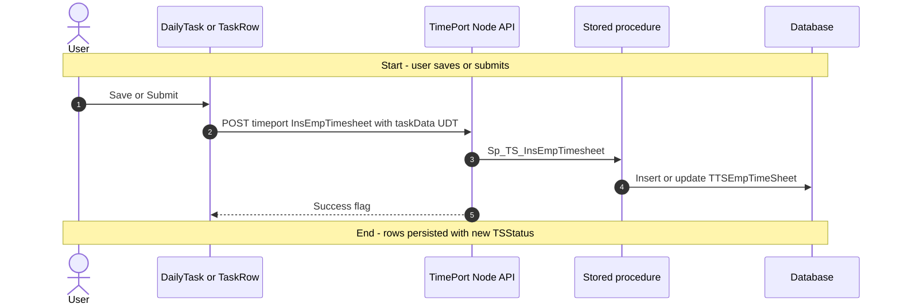
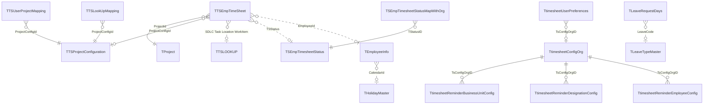

# TimeSheet

## Overview

An employee opens **TimePort → TimeSheet** to enter daily or weekly time against assigned projects. The left-nav leaf maps to `~/HRM/TimePort/TimeSheet.aspx` (`RouteConstants.TIMESHEET`). The WebForms shell stamps session identity into hidden fields, logs activity `TimeSheet` (419), and loads the TimePort webpack bundles into `#root`.

The live UI is `TimeportMaster` with two tabs:

- **Daily** — `DailyTask` for one calendar day (optional attendance strip when the project config shows attendance).
- **Weekly** — `TimePortTask` / `TaskRow` for a week grid.

Org-level `Sp_TS_GettimesheetConfigOrg` drives time format, autofill flags, and auto-save behaviour (`Y` / `N` / `U`). When behaviour is user-defined, the page reads and writes `USP_TS_GetUserAutoSavePreference` / `USP_TS_InsUpdUserAutoSavePreference`. Save and submit both POST `InsEmpTimesheet` → `Sp_TS_InsEmpTimesheet` with a `t_EmpTimesheet` UDT.

**Who's involved:**

- **Employee** — enters, saves, submits, or withdraws their own timesheet rows.
- **Approver** — does not act on this leaf; approval lives under Time Approval / related screens.
- **Org admin** — configures format and auto-save on Master Setup (not this page).

The **Recurring** tab is commented out in `TimeportMaster.js`, so recurring-entry APIs are not live from this menu leaf. There is no SystemModel-2 page for this screen in the SourceCode checkout. Runtime truth is the TimePort React host plus `HRMS.TimePort.WebAPI.Node` against database slug **hrm-timeport** (with a few HRMS / synonym calls).

## Workflow

This page is a React SPA hosted in WebForms. Timesheet traffic uses the TimePort Node API (`API_URL` → `/api/timeport/...`). No WebForms postback binds grid rows.

## Request journey

### Open page and load Daily or Weekly entry

### Save or submit timesheet rows

## Entry points

| Entry | Purpose |
|---|---|
| `~/HRM/TimePort/TimeSheet.aspx` (+ `.cs`) | Menu leaf **TimeSheet**. Session → hidden fields; activity 419; loads `BuildJS/Timeport.min.js`. |
| React `RouteConstants.TIMESHEET` | `/HRM/TimePort/TimeSheet.aspx` → `TimeportMaster` (`Areas/routes.js`). |
| `TimeportMaster.js` | Daily / Weekly tabs, org time-format config, optional auto-save toggle. |
| `DailyTask.js` / `TimePortTask.js` / `TaskRow.js` | Entry grids, save/submit, lookups. |
| `HRMS.TimePort.WebAPI.Node` `/api/timeport/*` | Authorised TimePort routes (`TimeportRoutes.js`). |

## Code → database call chain

`APIHelper` posts to `process.env.API_URL` (TimePort Node). `GetPendingTask` opens the **core** connection pool; other TimeSheet procedures use the TimePort pool.

| Step | Entry point | App code | Stored procedure |
|---|---|---|---|
| Page load | `TimeSheet.aspx.cs:22` | `CommonUtil.LogActivity(ActivityDescription.TimeSheet)` — enum 419 | `Sp_InsertActivityLog` (HRMS) |
| Router mount | `Areas/routes.js:32-36` | `GET_EMP_TIMESHEET` for `StartDayOfWeek` | `Sp_TS_GetEmpTimeSheetMonthWise` → `USP_GetEmployee_WeekOffDays`, `SP_GetOrg_StartDayOfWeek` |
| Org config | `TimeportMaster.js:38` | `GetTimesheetConfigOrg` (`timeportController.js:939`) → `GetTimesheetConfigOrg` (`timeportDAL.js:3755`) | `Sp_TS_GettimesheetConfigOrg` |
| Auto-save get | `TimeportMaster.js:81` | `GetUserAutoSavePreference` (`timeportController.js:1053`) → DAL `:3979` | `USP_TS_GetUserAutoSavePreference` |
| Auto-save set | `TimeportMaster.js:119` | `SetUserAutoSavePreference` (`timeportController.js:1062`) → DAL `:3993` | `USP_TS_InsUpdUserAutoSavePreference` |
| Existing rows | `DailyTask.js` / `TaskRow.js` / `TPGrid.js` | `GetEmpProjectDetails` (`timeportController.js:271`) → DAL `:718` | `Sp_TS_GetEmpProjectDetails` (nested `UFN_CalCulateEmployeeTotalCapacityProject`) |
| Assigned projects | `DailyTask.js:836` / `TaskRow.js:146` / `DailyDrpDwn.js:101` | `GetProjectDetforTimeportEntry` (`timeportController.js:280`) → DAL `:798` | `Sp_TS_GetProjectDetforTimeportEntry` |
| Recent project seed | `DailyTask.js:696` / `TaskRow.js:273` | `GetEmpRecentProjectDetails` (`timeportController.js:1026`) → DAL `:3914` | `Usp_TS_GetEmpRecentProjectDetails` |
| Org lookup labels | `DailyTask.js:308` / `TaskRow.js:95` | `LookupOrgwiseDisplayName` (`timeportController.js:554`) → DAL `:1909` | `SP_Get_Lookup_OrgwiseDisplayName` |
| Project-wise lookups | `DailyDrpDwn.js:136` / `TaskIteam.js:1397` | `GetAllLookupDetailsbyuser` (`timeportController.js:527`) → DAL `:1851` | `Sp_TS_GetAllLookupDetailsbyuser` |
| Locations | `DailyTask.js:335` / `TaskRow.js:154` / `location.js` | `GetAllLocation` (`timeportController.js:862`) → DAL `:3444` | `Sp_TS_GetAllLocation` |
| Default RAS location | `DailyTask.js:347` / `TaskRow.js:244` | `GetLocationame` (`timeportController.js:518`) → DAL `:1835` | `Sp_TS_GetLocationame` |
| Month calendar | `DailyTask.js:925` / `TaskRow.js:174` / `AttendanceCalender.js:72` | `GetEmpTimeSheetMonthWise` (`timeportController.js:401`) → DAL `:1470` | `Sp_TS_GetEmpTimeSheetMonthWise` |
| Attendance strip | `DailyTask.js:956` | `GetEmpTimeSeetAttendanceDetails` (`timeportController.js:460`) → DAL `:1625` | `Sp_TS_GetEmpTimeSeetAttendanceDetails` → week-off / start-day |
| Status list | `DailyTask.js:2710` / `TaskRow.js:2239` | `GetAllTsStatus` (`timeportController.js:572`) → DAL `:1956` | `SP_TS_GetAllTsStatus` |
| Submit message flag | `DailyTask.js:2700` / `TaskRow.js:554` | `GetEmployerSubmitMSGStatus` (`timeportController.js:803`) → DAL `:3331` | `SP_GetEmployerSubmitMSGStatus` |
| Pending Task Mgmt rows | `DailyTask.js:207` / `TimePortTask.js:115` | `GetPendingTask` (`timeportController.js:1010`) → DAL `:3883` (core pool) | `USP_GetEmpTaskDeatils` (HRMS) |
| Save / submit / withdraw | `DailyTask.js` / `TaskRow.js` POST sites | `InsEmpTimesheet` (`timeportController.js:312`) → DAL `:847` | `Sp_TS_InsEmpTimesheet` |

## API endpoints

No `[WebMethod]` / PageMethods on `TimeSheet.aspx`. Live calls go to TimePort Node under `/api/timeport` (`Authorize`). UI constants in `apiURLConstants.js` use `/timeport/...` relative to `API_URL`.

| Verb | Route | Parameters | Purpose | Source |
|---|---|---|---|---|
| GET | `/api/timeport/GetTimesheetConfigOrg` | `pEmployerId` | Org time format, autofill, auto-save behaviour | `TimeportRoutes.js:105` |
| GET | `/api/timeport/GetUserAutoSavePreference` | `EmployeeId`, `EmployerId` | Per-user auto-save when org is `U` | `TimeportRoutes.js:118` |
| POST | `/api/timeport/SetUserAutoSavePreference` | Body `EmployeeId`, `ConfigOrgID`, `EmployerID`, `IsEnabledAutoSave` | Persist toggle | `TimeportRoutes.js:119` |
| GET | `/api/timeport/GetEmpProjectDetails` | `pEmployerId`, `pEmployeeId`, `PStartDate`, `PEndDate` | Existing timesheet rows for range | `TimeportRoutes.js:38` |
| GET | `/api/timeport/GetProjectDetforTimeportEntry` | `pEmployerId`, `pEmployeeID`, `Startdate`, `EndDate` | Assigned project configs | `TimeportRoutes.js:53` |
| GET | `/api/timeport/GetEmpRecentProjectDetails` | `pEmployerId`, `pEmployeeId`, `PStartDate` | Seed last-used project row | `TimeportRoutes.js:115` |
| GET | `/api/timeport/LookupOrgwiseDisplayName` | `employerId` | Top-level lookup labels | `TimeportRoutes.js:67` |
| GET | `/api/timeport/GetAllLookupDetailsbyuser` | `employerId`, `Projectid`, `EffectiveUntil` | Project-scoped reference values | `TimeportRoutes.js:64` |
| GET | `/api/timeport/GetAllLocation` | `employerId` | Location dropdown (`Lookup_Parent_ID = 5000`) | `TimeportRoutes.js:97` |
| GET | `/api/timeport/GetLocationame` | `employerId`, `employeeId` | Default RAS location | `TimeportRoutes.js:60` |
| GET | `/api/timeport/GetEmpTimeSheetMonthWise` | `EmployerId`, `EmployeeId`, `Month`, `Year`, `ToDate` | Calendar totals, leave, holiday, week-off, start day | `TimeportRoutes.js:48` |
| GET | `/api/timeport/GetEmpTimeSeetAttendanceDetails` | `employerId`, `pEmployeeID`, `PFromDate`, `PTodate` | Attendance / worked hours strip | `TimeportRoutes.js:56` |
| GET | `/api/timeport/GetAllTsStatus` | `employerId` | Status id/name list | `TimeportRoutes.js:69` |
| GET | `/api/timeport/GetEmployerSubmitMSGStatus` | `employerId` | Allocated-hours message flag on submit | `TimeportRoutes.js:91` |
| POST | `/api/timeport/getpendingtask` | Body `employerId`, `employeeId`, `startDate`, `endDate` | Import pending Task Management rows | `TimeportRoutes.js:113` |
| POST | `/api/timeport/InsEmpTimesheet` | Body `Frequency`, employer/employee, date range, `taskData[]` → UDT | Insert/update/deactivate rows | `TimeportRoutes.js:39` |

UI constant paths for auto-save use lowercase (`getuserautosavepreference` / `setuserautosavepreference`); route registration uses PascalCase — see Known gaps.

## Stored procedures & tables involved

| Object | File | Purpose | Wiki |
|---|---|---|---|
| `Sp_InsertActivityLog` | `HRMS/STOREPROCEDURE/Sp_InsertActivityLog.sql` | Page-access log | [Sp_InsertActivityLog](/docs/database/hrms/Sp_InsertActivityLog) |
| `Sp_TS_GettimesheetConfigOrg` | `HRM-TIMEPORT/STOREPROCEDURE/Sp_TS_GettimesheetConfigOrg.sql` | Org timesheet config | [Sp_TS_GettimesheetConfigOrg](/docs/database/hrm-timeport/Sp_TS_GettimesheetConfigOrg) |
| `USP_TS_GetUserAutoSavePreference` | `HRM-TIMEPORT/STOREPROCEDURE/USP_TS_GetUserAutoSavePreference.sql` | Read auto-save preference | [USP_TS_GetUserAutoSavePreference](/docs/database/hrm-timeport/USP_TS_GetUserAutoSavePreference) |
| `USP_TS_InsUpdUserAutoSavePreference` | `HRM-TIMEPORT/STOREPROCEDURE/USP_TS_InsUpdUserAutoSavePreference.sql` | Upsert auto-save preference | [USP_TS_InsUpdUserAutoSavePreference](/docs/database/hrm-timeport/USP_TS_InsUpdUserAutoSavePreference) |
| `Sp_TS_GetEmpProjectDetails` | `HRM-TIMEPORT/STOREPROCEDURE/Sp_TS_GetEmpProjectDetails.sql` | Existing rows for date range | [Sp_TS_GetEmpProjectDetails](/docs/database/hrm-timeport/Sp_TS_GetEmpProjectDetails) |
| `Sp_TS_GetProjectDetforTimeportEntry` | `HRM-TIMEPORT/STOREPROCEDURE/Sp_TS_GetProjectDetforTimeportEntry.sql` | Assigned projects | [Sp_TS_GetProjectDetforTimeportEntry](/docs/database/hrm-timeport/Sp_TS_GetProjectDetforTimeportEntry) |
| `Usp_TS_GetEmpRecentProjectDetails` | `HRM-TIMEPORT/STOREPROCEDURE/Usp_TS_GetEmpRecentProjectDetails.sql` | Most recent project row | [Usp_TS_GetEmpRecentProjectDetails](/docs/database/hrm-timeport/Usp_TS_GetEmpRecentProjectDetails) |
| `SP_Get_Lookup_OrgwiseDisplayName` | `HRM-TIMEPORT/STOREPROCEDURE/SP_Get_Lookup_OrgwiseDisplayName.sql` | Org lookup roots | [SP_Get_Lookup_OrgwiseDisplayName](/docs/database/hrm-timeport/SP_Get_Lookup_OrgwiseDisplayName) |
| `Sp_TS_GetAllLookupDetailsbyuser` | `HRM-TIMEPORT/STOREPROCEDURE/Sp_TS_GetAllLookupDetailsbyuser.sql` | Project reference values | [Sp_TS_GetAllLookupDetailsbyuser](/docs/database/hrm-timeport/Sp_TS_GetAllLookupDetailsbyuser) |
| `Sp_TS_GetAllLocation` | `HRM-TIMEPORT/STOREPROCEDURE/Sp_TS_GetAllLocation.sql` | Location lookups | [Sp_TS_GetAllLocation](/docs/database/hrm-timeport/Sp_TS_GetAllLocation) |
| `Sp_TS_GetLocationame` | `HRM-TIMEPORT/STOREPROCEDURE/Sp_TS_GetLocationame.sql` | RAS default location | [Sp_TS_GetLocationame](/docs/database/hrm-timeport/Sp_TS_GetLocationame) |
| `Sp_TS_GetEmpTimeSheetMonthWise` | `HRM-TIMEPORT/STOREPROCEDURE/Sp_TS_GetEmpTimeSheetMonthWise.sql` | Month calendar + nested week-off / start day | [Sp_TS_GetEmpTimeSheetMonthWise](/docs/database/hrm-timeport/Sp_TS_GetEmpTimeSheetMonthWise) |
| `Sp_TS_GetEmpTimeSeetAttendanceDetails` | `HRM-TIMEPORT/STOREPROCEDURE/Sp_TS_GetEmpTimeSeetAttendanceDetails.sql` | Attendance worked hours | [Sp_TS_GetEmpTimeSeetAttendanceDetails](/docs/database/hrm-timeport/Sp_TS_GetEmpTimeSeetAttendanceDetails) |
| `SP_TS_GetAllTsStatus` | `HRM-TIMEPORT/STOREPROCEDURE/SP_TS_GetAllTsStatus.sql` | Status catalogue | [SP_TS_GetAllTsStatus](/docs/database/hrm-timeport/SP_TS_GetAllTsStatus) |
| `SP_GetEmployerSubmitMSGStatus` | `HRM-TIMEPORT/STOREPROCEDURE/SP_GetEmployerSubmitMSGStatus.sql` | Submit message flag | [SP_GetEmployerSubmitMSGStatus](/docs/database/hrm-timeport/SP_GetEmployerSubmitMSGStatus) |
| `Sp_TS_InsEmpTimesheet` | `HRM-TIMEPORT/STOREPROCEDURE/Sp_TS_InsEmpTimesheet.sql` | Persist timesheet UDT | [Sp_TS_InsEmpTimesheet](/docs/database/hrm-timeport/Sp_TS_InsEmpTimesheet) |
| `USP_GetEmpTaskDeatils` | `HRMS/STOREPROCEDURE/USP_GetEmpTaskDeatils.sql` | Pending Task Mgmt import (core pool) | [USP_GetEmpTaskDeatils](/docs/database/hrms/USP_GetEmpTaskDeatils) |
| `USP_GetEmployee_WeekOffDays` | `HRMS/STOREPROCEDURE/USP_GetEmployee_WeekOffDays.sql` | Nested week-off days (TimePort synonym) | [USP_GetEmployee_WeekOffDays](/docs/database/hrms/USP_GetEmployee_WeekOffDays) |
| `SP_GetOrg_StartDayOfWeek` | `HRMS/STOREPROCEDURE/SP_GetOrg_StartDayOfWeek.sql` | Nested org week start (TimePort synonym) | [SP_GetOrg_StartDayOfWeek](/docs/database/hrms/SP_GetOrg_StartDayOfWeek) |
| `UFN_CalCulateEmployeeTotalCapacityProject` | `HRM-TIMEPORT/FUNCTIONS/...` | Allocated hours on project rows | [UFN_CalCulateEmployeeTotalCapacityProject](/docs/database/hrm-timeport/UFN_CalCulateEmployeeTotalCapacityProject) |
| `TTSEmpTimeSheet`, `TTSProjectConfiguration`, `TTSUserProjectMapping`, `TProject`, `TTSLOOKUP` / `TTSLookUpMapping`, `TSEmpTimesheetStatus` (+ org map), `TtimesheetConfigOrg`, `TtimesheetUserPreferences`, `TTSSubmitMSGConfigStatus`, leave/holiday synonyms | matching TIMEPORT / HRMS scripts | Entry, config, status, calendar | catalog partial |

## Table relationships

Declared FKs from CREATE TABLE scripts are sparse. The diagram shows joins the TimeSheet procedures actually use; undeclared links are dotted.

## Known gaps

- **No SystemModel-2 page** for TimePort TimeSheet.
- **Recurring tab is commented out** in `TimeportMaster.js`; `RecurringTasks` APIs are not reached from this leaf.
- **Auto-save UI paths are lowercase** (`getuserautosavepreference` / `setuserautosavepreference`) while `TimeportRoutes.js` registers PascalCase; behaviour depends on host case-sensitivity.
- **`Sp_TS_GetLocationame` hard-codes `[HRM_ResourceAllocation]`** three-part names; not environment-portable.
- **Several TIMEPORT scripts still contain `USE [HRM_CL_TIMEPORT]`** (e.g. `Sp_TS_InsEmpTimesheet`, `Sp_TS_GetEmpTimeSeetAttendanceDetails`, `Sp_TS_GetEmpProjectDetails`).
- **`USP_GetEmployee_WeekOffDays.sql` still has `USE [HRM-CL-Prod]`** at the top of the script file.
- **`USP_GetEmpTaskDeatils` lives under HRMS STOREPROCEDURE** but joins TimePort-named objects (`ttsprojectconfiguration`, `TTSLookUpTimePort`); DAL uses the core connection — confirm synonyms / deploy map per environment.
- **CoreAPI also has a `timeport` route/DAL mirror**; the TimeSheet SPA `API_URL` targets `HRMS.TimePort.WebAPI.Node` for this analysis.

## Reference

Confidence is **high** for the ASPX host, React Daily/Weekly entry path, TimePort routes/DAL file:line chain, and the TIMEPORT/HRMS STOREPROCEDURE scripts listed above.

### SourceCode

- `HRMS.Web/HRMS.Web/HRM/TimePort/TimeSheet.aspx`
- `HRMS.Web/HRMS.Web/HRM/TimePort/TimeSheet.aspx.cs`
- `HRMS.Web/HRMS.Web/HRM/TimePort/Areas/routes.js`
- `HRMS.Web/HRMS.Web/HRM/TimePort/Areas/TimePortTask/Containers/TimeportMaster.js`
- `HRMS.Web/HRMS.Web/HRM/TimePort/Areas/TimePortTask/Components/DailyTask.js`
- `HRMS.Web/HRMS.Web/HRM/TimePort/Areas/TimePortTask/Components/TimePortTask.js`
- `HRMS.Web/HRMS.Web/HRM/TimePort/Areas/TimePortTask/Components/TaskRow.js`
- `HRMS.Web/HRMS.Web/HRM/TimePort/Common/apiURLConstants.js`
- `HRMS.Web/HRMS.Web/HRM/TimePort/Common/apiHelper.js`
- `HRMS.Web/HRMS.Web/HRM/TimePort/Common/routeConstants.js`
- `HRMS.TimePort/HRMS.TimePort.WebAPI.Node/Routes/TimeportRoutes.js`
- `HRMS.TimePort/HRMS.TimePort.WebAPI.Node/Controllers/timeportController.js`
- `HRMS.TimePort/HRMS.TimePort.WebAPI.Node/Core/DataAccessLayer/timeportDAL.js`
- `HRMS.Shared/HRMS.DataContract/Common/Enums.cs`

### TDG HRMS DB

- `HRMS-DATABASE/HRM-TIMEPORT/STOREPROCEDURE/Sp_TS_GettimesheetConfigOrg.sql`
- `HRMS-DATABASE/HRM-TIMEPORT/STOREPROCEDURE/USP_TS_GetUserAutoSavePreference.sql`
- `HRMS-DATABASE/HRM-TIMEPORT/STOREPROCEDURE/USP_TS_InsUpdUserAutoSavePreference.sql`
- `HRMS-DATABASE/HRM-TIMEPORT/STOREPROCEDURE/Sp_TS_GetEmpProjectDetails.sql`
- `HRMS-DATABASE/HRM-TIMEPORT/STOREPROCEDURE/Sp_TS_GetProjectDetforTimeportEntry.sql`
- `HRMS-DATABASE/HRM-TIMEPORT/STOREPROCEDURE/Usp_TS_GetEmpRecentProjectDetails.sql`
- `HRMS-DATABASE/HRM-TIMEPORT/STOREPROCEDURE/SP_Get_Lookup_OrgwiseDisplayName.sql`
- `HRMS-DATABASE/HRM-TIMEPORT/STOREPROCEDURE/Sp_TS_GetAllLookupDetailsbyuser.sql`
- `HRMS-DATABASE/HRM-TIMEPORT/STOREPROCEDURE/Sp_TS_GetAllLocation.sql`
- `HRMS-DATABASE/HRM-TIMEPORT/STOREPROCEDURE/Sp_TS_GetLocationame.sql`
- `HRMS-DATABASE/HRM-TIMEPORT/STOREPROCEDURE/Sp_TS_GetEmpTimeSheetMonthWise.sql`
- `HRMS-DATABASE/HRM-TIMEPORT/STOREPROCEDURE/Sp_TS_GetEmpTimeSeetAttendanceDetails.sql`
- `HRMS-DATABASE/HRM-TIMEPORT/STOREPROCEDURE/SP_TS_GetAllTsStatus.sql`
- `HRMS-DATABASE/HRM-TIMEPORT/STOREPROCEDURE/SP_GetEmployerSubmitMSGStatus.sql`
- `HRMS-DATABASE/HRM-TIMEPORT/STOREPROCEDURE/Sp_TS_InsEmpTimesheet.sql`
- `HRMS-DATABASE/HRMS/STOREPROCEDURE/USP_GetEmpTaskDeatils.sql`
- `HRMS-DATABASE/HRMS/STOREPROCEDURE/USP_GetEmployee_WeekOffDays.sql`
- `HRMS-DATABASE/HRMS/STOREPROCEDURE/SP_GetOrg_StartDayOfWeek.sql`
- `HRMS-DATABASE/HRMS/STOREPROCEDURE/Sp_InsertActivityLog.sql`
