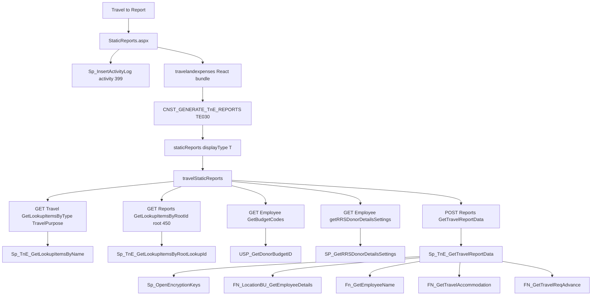
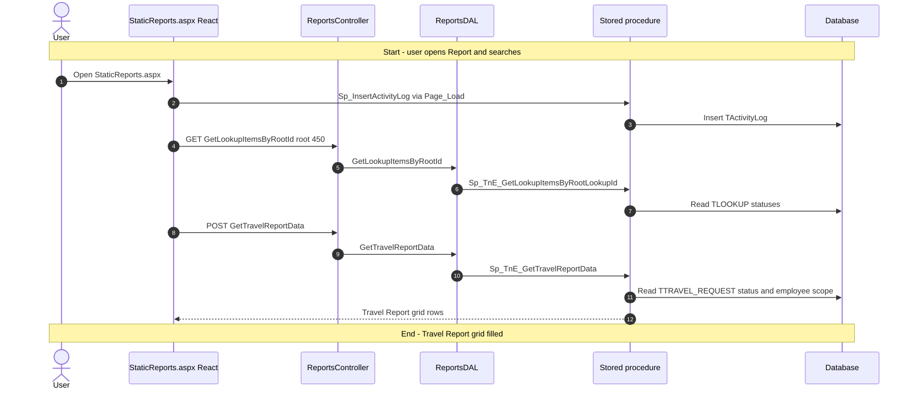
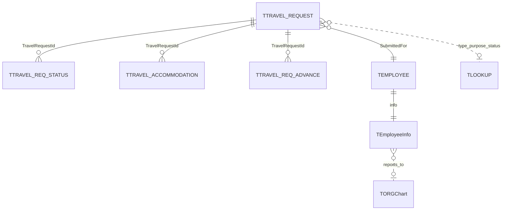

# Report

## Overview

A Travel & Expense user with claim `TE030` (`CNST_GENERATE_TnE_REPORTS`) opens **Travel → Report**. The left-nav leaf loads `~/HRM/TravelAndExpense/StaticReports.aspx` (`RouteConstants.REPORTS`). The host stamps session identity into hidden fields, sets `hdnDisplayType=T`, logs activity `TravelReport` (399), and mounts the webpack Travel & Expense React bundle into `#root`.

The live UI is `staticReports` (imported as `ViewReports`). For `displayType === "T"` it shows a single **Travel Report** panel (`travelStaticReports`) — not the multi-tab Expense Report layout used when `displayType === "ER"`. Filters include organisation (global-access claim), status (root lookup 450), travel purpose, travel type, bill-to, advance/accommodation flags, budget code (when donor-details settings allow), and edited-on date range. Search posts to T&E WebAPI `api/Reports/GetTravelReportData`; filter dropdowns hit Reports / Travel / Employee endpoints. The ASPX code-behind does not bind the report grid.

**Who's involved:**

- **Employee** — self-scoped report when team/all/accountant claims are absent (`EmployeeType` `E`).
- **Manager** — team scope when `CNST_VIEWTEAM_TRAVELREQUEST` (`TE002`) is granted (`M`).
- **Travel desk / admin** — organisation-wide scope when `CNST_VIEWALL_TRAVELREQUEST` (`TE003`) is granted (`A`); wins over manager/accountant in the UI precedence.
- **Accountant** — finance view when `CNST_ACCOUNT_PAID_AMOUNT` (`TE016`) is granted and admin claim is not (`F`).
- **Global-access user** — organisation multi-select when `CNST_TnE_GLOBAL_ACCESS` (`TE032`) is granted.

There is no SystemModel-2 workflow page for this menu item in the SourceCode checkout. Runtime database slug is **hrms-travelnexpense** (plus HRMSCore for budget/donor settings). Table inventory for travel headers is summarised in `llm-wiki/reference/tables/travelnexpense.md`.

## Workflow

No WebForms `__doPostBack` binds the Travel Report grid. Report traffic uses the TravelAndExpense API base (`API_URL`), not Core Node stubs.

## Request journey

### Report user — open Travel Report and run a search

## Entry points

| UI / API | Purpose |
|---|---|
| `HRM/TravelAndExpense/StaticReports.aspx` | Left-nav host; `hdnDisplayType=T`. |
| React route `RouteConstants.REPORTS` | `AuthorizedStaticReport` → `staticReports`. |
| Claim `CNST_GENERATE_TnE_REPORTS` (`TE030`) | Gate to open the page. |
| Claim `CNST_VIEWTEAM_TRAVELREQUEST` (`TE002`) | Manager view type `M`. |
| Claim `CNST_VIEWALL_TRAVELREQUEST` (`TE003`) | Admin view type `A`. |
| Claim `CNST_ACCOUNT_PAID_AMOUNT` (`TE016`) | Accountant view type `F` when not admin. |
| Claim `CNST_TnE_GLOBAL_ACCESS` (`TE032`) | Organisation multi-select. |
| `api/Reports/*` | Status lookup and Travel Report search. |
| `api/Travel/GetLookupItemsByType` | Travel purpose filter. |
| `api/Employee/GetBudgetCodes`, `getRRSDonorDetailsSettings` | Budget code filter and donor-details UI flag. |

## Code → database call chain

| Entry point | DAL / BLL method | Stored procedure |
|---|---|---|
| `StaticReports.aspx.cs:32` `Page_Load` | `CommonUtil.LogActivity(TravelReport)` | `Sp_InsertActivityLog` (HRMS; activity 399) |
| `travelStaticReports.js:217` → `GET GetLookupItemsByRootId` (`ReportsController.cs:61`) | `ReportsDAL.GetLookupItemsByRootId` (`ReportsDAL.cs:22`) | `Sp_TnE_GetLookupItemsByRootLookupId` |
| `travelStaticReports.js:203` → `GET GetLookupItemsByType` (`TravelController.cs:316`) | `TravelDAL.GetLookupItemsByType` → `GetLookupItemsByName` (`TravelDAL.cs:148`, `162`) | `Sp_TnE_GetLookupItemsByName` |
| `travelStaticReports.js:244` → `GET GetBudgetCodes` (`EmployeeController.cs:277`) | `EmployeeDAL.GetBudgetCodes` (`EmployeeDAL.cs:563`) | `USP_GetDonorBudgetID` (HRMS) |
| `travelStaticReports.js:256` → `GET getRRSDonorDetailsSettings` (`EmployeeController.cs:260`) | `EmployeeDAL.getRRSDonorDetailsSettings` (`EmployeeDAL.cs:531`) | `SP_GetRRSDonorDetailsSettings` (HRMS) |
| `travelStaticReports.js:334` → `POST GetTravelReportData` (`ReportsController.cs:74`) | `ReportsBLL.GetTravelReportData` → `ReportsDAL.GetTravelReportData` (`ReportsBLL.cs:17`, `ReportsDAL.cs:50`) | `Sp_TnE_GetTravelReportData` |

Nested from `Sp_TnE_GetTravelReportData`: [`Sp_OpenEncryptionKeys`](/docs/database/hrms/Sp_OpenEncryptionKeys), [`FN_LocationBU_GetEmployeeDetails`](/docs/database/hrms/FN_LocationBU_GetEmployeeDetails), [`Fn_GetEmployeeName`](/docs/database/hrms/Fn_GetEmployeeName), [`FN_GetTravelAccommodation`](/docs/database/hrms-travelnexpense/FN_GetTravelAccommodation), [`FN_GetTravelReqAdvance`](/docs/database/hrms-travelnexpense/FN_GetTravelReqAdvance). The script opens encryption keys but does not call `SP_CloseEncryptionKey`.

## API endpoints

T&E WebAPI route prefixes `api/Reports/{action}`, `api/Travel/{action}`, `api/Employee/{action}`. ClaimsAuthorize `TnE` / `HRMS`. Actor employee id is overwritten from JWT on `GetTravelReportData`.

| Method | Path | Role on this page |
|---|---|---|
| GET | `/Reports/GetLookupItemsByRootId` | Status filter (root `450`) |
| POST | `/Reports/GetTravelReportData` | Travel Report search |
| GET | `/Travel/GetLookupItemsByType` | Travel purpose (`lookupType=TravelPurpose`) |
| GET | `/Employee/GetBudgetCodes` | Budget code dropdown |
| GET | `/Employee/getRRSDonorDetailsSettings` | Show budget-source section |

`GetTravelLifecycleReportData` exists on `ReportsController` / `ReportsDAL` (`Sp_TnE_GetTravelLifecycleReportData`) but is **not** called from `travelStaticReports` or other Travel Report React in this checkout.

No ASPX `__doPostBack` report binding.

## Stored procedures & tables involved

| Procedure | Role | Database docs |
|---|---|---|
| [`Sp_InsertActivityLog`](/docs/database/hrms/Sp_InsertActivityLog) | Page-access log | existing (hrms) |
| [`Sp_TnE_GetLookupItemsByRootLookupId`](/docs/database/hrms-travelnexpense/Sp_TnE_GetLookupItemsByRootLookupId) | Status lookup | existing |
| [`Sp_TnE_GetLookupItemsByName`](/docs/database/hrms-travelnexpense/Sp_TnE_GetLookupItemsByName) | Travel purpose lookup | existing |
| [`USP_GetDonorBudgetID`](/docs/database/hrms/USP_GetDonorBudgetID) | Budget codes | existing |
| [`SP_GetRRSDonorDetailsSettings`](/docs/database/hrms/SP_GetRRSDonorDetailsSettings) | Donor-details flag | existing |
| [`Sp_TnE_GetTravelReportData`](/docs/database/hrms-travelnexpense/Sp_TnE_GetTravelReportData) | Travel Report grid | written |
| [`Sp_OpenEncryptionKeys`](/docs/database/hrms/Sp_OpenEncryptionKeys) | Nested open keys | existing |
| [`FN_LocationBU_GetEmployeeDetails`](/docs/database/hrms/FN_LocationBU_GetEmployeeDetails) | Nested employee scope | existing |
| [`Fn_GetEmployeeName`](/docs/database/hrms/Fn_GetEmployeeName) | Nested display name | existing |
| [`FN_GetTravelAccommodation`](/docs/database/hrms-travelnexpense/FN_GetTravelAccommodation) | Nested accommodation flag | written |
| [`FN_GetTravelReqAdvance`](/docs/database/hrms-travelnexpense/FN_GetTravelReqAdvance) | Nested advance flag | written |

Primary tables: `TTRAVEL_REQUEST`, `TTRAVEL_REQ_STATUS`, `TTRAVEL_ACCOMMODATION`, `TTRAVEL_REQ_ADVANCE`, `TLOOKUP`, `TEMPLOYEE` / `TEmployeeInfo` / `TORGChart`, and HRMS `TDonorBudget` / donor-settings for budget filters. See `llm-wiki/reference/tables/travelnexpense.md` for the travel table catalogue.

## Table relationships

## Known gaps

- **`GetTravelLifecycleReportData` / `Sp_TnE_GetTravelLifecycleReportData`** are exposed on the T&E Reports API/DAL but are not invoked by Travel → Report React (`travelStaticReports`) in this checkout.
- **`Sp_TnE_GetTravelReportData` opens `Sp_OpenEncryptionKeys` but never calls `SP_CloseEncryptionKey`** in the inventoried script.
- **`Sp_TnE_GetTravelReportData.sql` (and nested FN scripts) still carry `USE [TravelNExpense_Prod]`** in the Liquibase source header.
- **View-type precedence** in the UI is admin → accountant → manager → self; the SP treats `M` and `F` with the same reportees/self insert pattern, so accountant vs manager differences are limited to which claim path sets `EmployeeType`.
- **SystemModel-2** has no dedicated Travel Report workflow page in this checkout.
- Breadcrumb label in React is **Travel Report** while left-nav leaf text is **Report**.

## Reference

### SourceCode

- `HRMS.Web/HRMS.Web/HRM/TravelAndExpense/StaticReports.aspx` (+ `.cs`)
- `HRMS.Web/.../Areas/routes.js`
- `HRMS.Web/.../Areas/Reports/Containers/staticReports.js`
- `HRMS.Web/.../Areas/Reports/Components/travelStaticReports.js`
- `HRMS.Web/.../Common/apiURLConstants.js`
- `HRMS.Web/.../Common/ClaimConstants.js`
- `HRMS.Web/.../Common/routeConstants.js`
- `HRMS.Shared/HRMS.DataContract/Common/Enums.cs` (`ActivityDescription.TravelReport = 399`)
- `HRMS.TravelAndExpense.WebAPI/Controllers/ReportsController.cs`
- `HRMS.TravelAndExpense.WebAPI/Controllers/TravelController.cs`
- `HRMS.TravelAndExpense.WebAPI/Controllers/EmployeeController.cs`
- `HRMS.TravelAndExpense.DAL/Reports/ReportsDAL.cs`
- `HRMS.TravelAndExpense.DAL/Travel/TravelDAL.cs`
- `HRMS.TravelAndExpense.DAL/Employee/EmployeeDAL.cs`
- `HRMS.TravelAndExpense.BLL/Reports/ReportsBLL.cs`

### TDG HRMS DB

- `HRMS-DATABASE/HRMS_TRAVELNEXPENSE/STOREPROCEDURE/Sp_TnE_GetTravelReportData.sql`
- `HRMS-DATABASE/HRMS_TRAVELNEXPENSE/FUNCTIONS/FN_GetTravelAccommodation.sql`
- `HRMS-DATABASE/HRMS_TRAVELNEXPENSE/FUNCTIONS/FN_GetTravelReqAdvance.sql`
- `llm-wiki/reference/tables/travelnexpense.md` (travel table catalogue)
