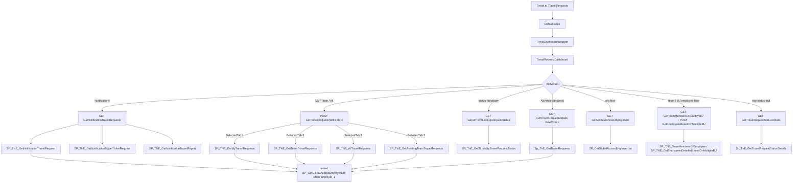
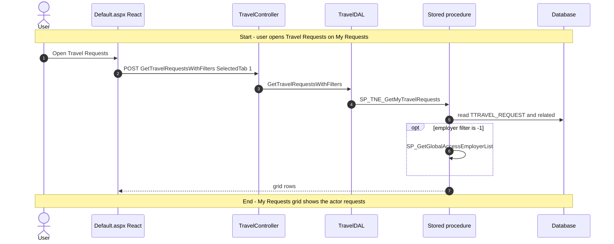
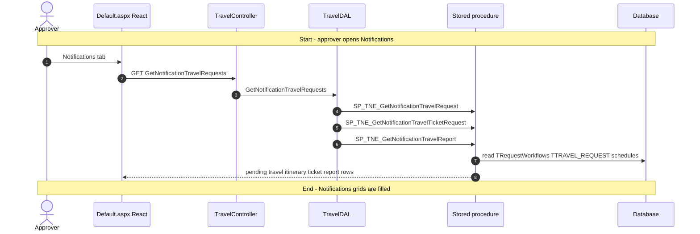
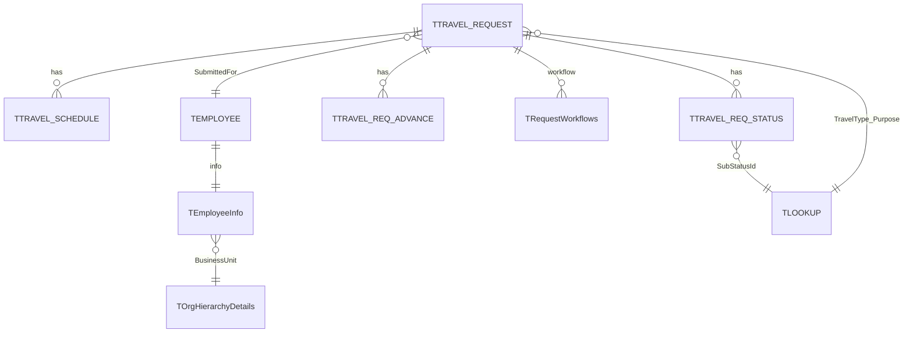

# Travel Requests

## Overview

An employee, manager, travel desk, or accountant opens **Travel → Travel Requests**. The left-nav item loads `HRM/TravelAndExpense/Default.aspx`, which only stamps session identity into hidden fields and logs activity type TravelRequest. The live UI is the React SPA (`TravelDashboardWrapper` → `TravelRequestDashboard`) served from the TravelAndExpense webpack bundles.

The dashboard is a **list and inbox** surface, not the create/edit form. Tabs filter what the signed-in actor can see:

- **Notifications** — pending travel / itinerary / ticket / travel-report items for the actor as approver or travel desk.
- **My Requests** — requests the actor submitted (or drafted).
- **Team Requests** — reportees’ requests (claim-gated); optional “pending for me” mode.
- **All Requests** — organisation-wide list (claim-gated).
- **Advance Requests** — accountant unpaid-advance grid (claim-gated), still on the legacy `GetTravelRequestDetails` path.

**Create New Request** navigates away to create/edit routes; those save/approve procedures are not what this list page executes. Row open navigates to **View Travel Request**.

**Who's involved:**

- **Employee** — My Requests; create when claim allows.
- **Manager / L1+ approver** — Notifications and Team Requests.
- **Travel desk / admin** — All Requests when `CNST_VIEWALL_TRAVELREQUEST` is granted.
- **Accountant** — Advance Requests when `CNST_ACCOUNT_PAID_AMOUNT` is granted.
- **Global-access user** — organisation multi-select; list SPs resolve employers via `SP_GetGlobalAccessEmployerList` when employer filter is `-1`.

There is no SystemModel-2 workflow page for this menu item in the SourceCode checkout. Runtime truth is the React host plus `HRMS.TravelAndExpense` WebAPI against database slug **hrms-travelnexpense**.

## Workflow

List reads are HTTP calls to the T&E WebAPI (`api/Travel/{action}` and related Employee/Expense actions). The ASPX host does not bind grids or post back list data.

## Request journey

### Employee — open My Requests and load the grid

### Approver — open Notifications inbox

## Entry points

| UI / API | Purpose |
|---|---|
| `HRM/TravelAndExpense/Default.aspx` | Live left-nav host for Travel Requests. |
| `TravelDashboardWrapper` / `TravelRequestDashboard` | React tabs and Create New Request navigation. |
| `api/Travel/GetNotificationTravelRequests` | Notifications inbox. |
| `api/Travel/GetTravelRequestsWithFilters` | My / Team / All / pending-team lists. |
| `api/Travel/GetAllTravelLookupRequestStatus` | Status filter options per tab. |
| `api/Travel/GetTravelRequestStatusDetails` | Per-request status trail on the grid. |
| `api/Travel/GetTravelRequestDetails` | Advance Requests tab (legacy viewType `F`). |
| `api/Employee/GetGlobalAccessEmployerList` | Organisation multi-select. |
| `api/Expense/GetTeamMembersOfEmployee` | Team employee filter. |
| `api/Expense/GetEmployeesBasedOnMultipleBU` | All-requests employee filter by BU. |
| Create / View / Edit travel routes | Separate screens; not this list page’s SP set. |

No WebForms postback drives the grids. JWT + FedAuth claims gate T&E API actions (`ClaimsAuthorize("TnE", "HRMS")`).

## Code → database call chain

| Entry point | DAL / BLL method | Stored procedure |
|---|---|---|
| `Default.aspx.cs` `Page_Load` | `CommonUtil.LogActivity(TravelRequest)` — no travel list read | — |
| `TravelRequestDashboard.js` tabs | React containers below | — |
| `GridServices.fetchNotificationTravelRequests` → `GET GetNotificationTravelRequests` (`TravelController.cs:1152`) | `TravelDAL.GetNotificationTravelRequests` (`TravelDAL.cs:2863`) | `SP_TNE_GetNotificationTravelRequest`, `SP_TNE_GetNotificationTravelTicketRequest`, `SP_TNE_GetNotificationTravelReport` |
| `GridServices.fetchTravelRequests` → `POST GetTravelRequestsWithFilters` (`TravelController.cs:1178`) | `TravelBLL` / `TravelDAL.GetTravelRequestsWithFilters` (`TravelDAL.cs:2910`) | `SP_TNE_GetMyTravelRequests` (tab 1), `SP_TNE_GetTeamTravelRequests` (tab 2), `SP_TNE_AllTravelRequests` (tab 3), `SP_TNE_GetPendingTeamTravelRequests` (tab 5) |
| `GET GetAllTravelLookupRequestStatus` (`TravelController.cs:1199`) | `TravelDAL.GetAllTravelLookupRequestStatus` (`TravelDAL.cs:3004`) | `SP_TnE_GetTLookUpTravelRequestStatus` |
| `GET GetTravelRequestStatusDetails` (`TravelController.cs:633`) | `TravelDAL.GetTravelRequestStatusDetails` (`TravelDAL.cs:2086`) | `Sp_TnE_GetTravelRequestStatusDetails` |
| `accountTravelRequest.js` → `GET GetTravelRequestDetails` (`TravelController.cs:346`) | `TravelDAL.GetTravelRequestDetails` (`TravelDAL.cs:971`) | `Sp_TnE_GetTravelRequests` |
| `GET GetGlobalAccessEmployerList` (`EmployeeController.cs:190`) | `EmployeeDAL.GetGlobalAccessEmployerList` (`EmployeeDAL.cs:91`) | `SP_GetGlobalAccessEmployerList` |
| `GET GetTeamMembersOfEmployee` (`ExpenseController.cs:759`) | `ExpenseDAL.GetTeamMembersOfEmployee` (`ExpenseDAL.cs:2425`) | `SP_TNE_TeamMembersOfEmployee` |
| `POST GetEmployeesBasedOnMultipleBU` (`ExpenseController.cs:920`) | `ExpenseDAL.GetEmployeesDetailedBasedOnMultipleBU` (`ExpenseDAL.cs:2795`) | `SP_TNE_GetEmployeesDetailedBasedOnMultipleBU` |

Nested from the list procedures when employer filter is `-1`: [`SP_GetGlobalAccessEmployerList`](/docs/database/hrms/SP_GetGlobalAccessEmployerList). `Sp_TnE_GetTravelRequests` / `Sp_TnE_GetTravelRequestStatusDetails` also open encryption keys via [`Sp_OpenEncryptionKeys`](/docs/database/hrms/Sp_OpenEncryptionKeys).

## API endpoints

T&E WebAPI route prefix `api/Travel/{action}` (and Employee/Expense siblings). Base URL is the TravelAndExpense API (`process.env.API_URL` in the SPA), **not** Core Node `/api/Travel/*` stubs.

| Method | Path | Role on this page |
|---|---|---|
| GET | `/Travel/GetNotificationTravelRequests` | Notifications |
| POST | `/Travel/GetTravelRequestsWithFilters` | My / Team / All / pending team |
| GET | `/Travel/GetAllTravelLookupRequestStatus` | Status dropdown |
| GET | `/Travel/GetTravelRequestStatusDetails` | Status trail |
| GET | `/Travel/GetTravelRequestDetails` | Advance Requests |
| GET | `/Employee/GetGlobalAccessEmployerList` | Org multi-select |
| GET | `/Expense/GetTeamMembersOfEmployee` | Team employee filter |
| POST | `/Expense/GetEmployeesBasedOnMultipleBU` | All-requests BU employee filter |

No ASPX `__doPostBack` list binding.

## Stored procedures & tables involved

| Procedure | Role | Database docs |
|---|---|---|
| [`SP_TNE_GetNotificationTravelRequest`](/docs/database/hrms-travelnexpense/SP_TNE_GetNotificationTravelRequest) | Pending travel / itinerary for approver | written |
| [`SP_TNE_GetNotificationTravelTicketRequest`](/docs/database/hrms-travelnexpense/SP_TNE_GetNotificationTravelTicketRequest) | Pending ticket booking / upload | written |
| [`SP_TNE_GetNotificationTravelReport`](/docs/database/hrms-travelnexpense/SP_TNE_GetNotificationTravelReport) | Pending travel-report approvals | written |
| [`SP_TNE_GetMyTravelRequests`](/docs/database/hrms-travelnexpense/SP_TNE_GetMyTravelRequests) | My Requests grid | written |
| [`SP_TNE_GetTeamTravelRequests`](/docs/database/hrms-travelnexpense/SP_TNE_GetTeamTravelRequests) | Team Requests grid | written |
| [`SP_TNE_AllTravelRequests`](/docs/database/hrms-travelnexpense/SP_TNE_AllTravelRequests) | All Requests grid | written |
| [`SP_TNE_GetPendingTeamTravelRequests`](/docs/database/hrms-travelnexpense/SP_TNE_GetPendingTeamTravelRequests) | Team “pending for me” mode | written |
| [`SP_TnE_GetTLookUpTravelRequestStatus`](/docs/database/hrms-travelnexpense/SP_TnE_GetTLookUpTravelRequestStatus) | Status filter lookup ids | written |
| [`Sp_TnE_GetTravelRequestStatusDetails`](/docs/database/hrms-travelnexpense/Sp_TnE_GetTravelRequestStatusDetails) | Status history rows | written |
| [`Sp_TnE_GetTravelRequests`](/docs/database/hrms-travelnexpense/Sp_TnE_GetTravelRequests) | Advance Requests legacy list | written |
| [`SP_TNE_TeamMembersOfEmployee`](/docs/database/hrms-travelnexpense/SP_TNE_TeamMembersOfEmployee) | Team employee picker | written |
| [`SP_TNE_GetEmployeesDetailedBasedOnMultipleBU`](/docs/database/hrms-travelnexpense/SP_TNE_GetEmployeesDetailedBasedOnMultipleBU) | BU employee filter | existing |
| [`SP_GetGlobalAccessEmployerList`](/docs/database/hrms/SP_GetGlobalAccessEmployerList) | Nested / org list | existing (hrms) |

Primary tables on the list paths: `TTRAVEL_REQUEST`, `TTRAVEL_SCHEDULE`, `TTRAVEL_REQ_STATUS`, `TTRAVEL_REQ_ADVANCE`, `TRequestWorkflows`, `TLOOKUP`, `TEMPLOYEE`, `TEmployeeInfo`, `TOrgHierarchyDetails`, plus report/status helpers (`TTRAVEL_REPORTSAPPROVAL`, `TNE_TravelReportStatus`) where the SP projects flags.

## Table relationships

## Known gaps

- Create / edit / approve / ticket-booking / travel-report submission procedures are **not** called by this list page; they belong to Create/View Travel Request guides.
- Core Node `TravelNExpenseRoutes*` still expose `GetTravelRequestDetails`, but the live SPA uses the .NET T&E WebAPI (`API_URL`), not those Node routes.
- `Sp_TnE_GetTravelRequestStatusDetails` opens encryption keys and never closes them in-script; list SPs that only use global-access nesting do not open keys.
- Notification ticket/report result sets are assembled in DAL as a four-slot array; UI currently maps primarily slots 0–1 for travel/itinerary — confirm ticket/report grids consume slots 2–3 in all builds.
- SystemModel-2 has no dedicated Travel Requests workflow page in this checkout.

## Reference

- `HRMS.Web/HRMS.Web/HRM/TravelAndExpense/Default.aspx` (+ `.cs`)
- `HRMS.Web/.../TravelRefactored/Pages/TravelDashboardWrapper.js`
- `HRMS.Web/.../TravelRefactored/Components/TravelTabs/TravelRequestDashboard/TravelRequestDashboard.js`
- `HRMS.Web/.../TravelRefactored/Services/GridServices.js`
- `HRMS.Web/.../TravelRefactored/Common/APIURLConstants/apiURLConstants.js`
- `HRMS.Web/.../Travel/Components/TravelRequestList/accountTravelRequest.js`
- `HRMS.TravelAndExpense.WebAPI/Controllers/TravelController.cs`
- `HRMS.TravelAndExpense.WebAPI/Controllers/EmployeeController.cs`
- `HRMS.TravelAndExpense.WebAPI/Controllers/ExpenseController.cs`
- `HRMS.TravelAndExpense.DAL/Travel/TravelDAL.cs`
- `HRMS.TravelAndExpense.DAL/Employee/EmployeeDAL.cs`
- `HRMS.TravelAndExpense.DAL/Expense/ExpenseDAL.cs`
- `HRMS-DATABASE/HRMS_TRAVELNEXPENSE/STOREPROCEDURE/SP_TNE_GetMyTravelRequests.sql` (and sibling list/notification procedures)
