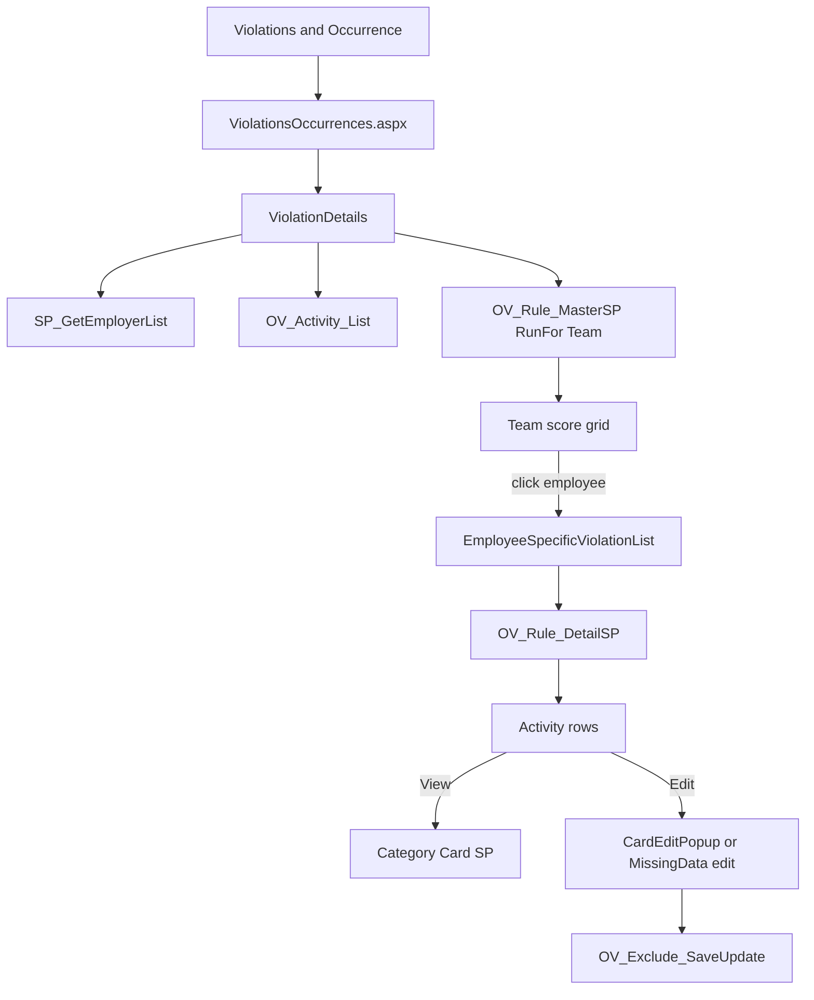
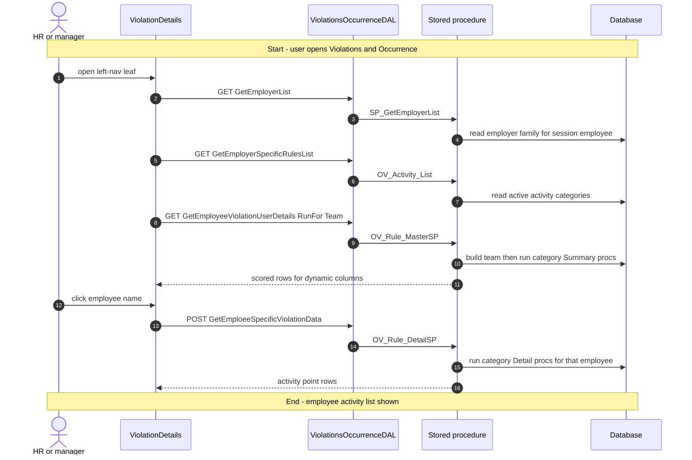
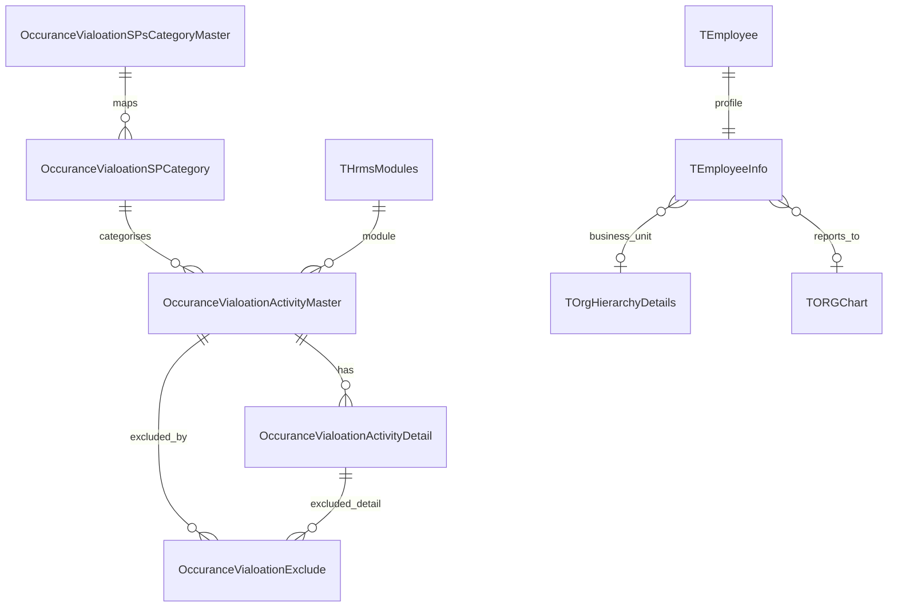

# Violations & Occurrence

## Overview

An HR user or manager with menu access opens **Violations & Occurrence** (`ViolationsOccurrences.aspx`) to see scored violation cards for their **team** (and for HR/Administrator roles, the whole organisation). The WebForms host only logs activity **449** (`ViolationsandOccurrences`), stamps session ids into hidden fields, and loads the Dashboard React bundle. React Router mounts `ViolationDetails`.

On load the screen loads the organisation dropdown, the employer’s active activity categories (to build dynamic grid columns), and `OV_Rule_MasterSP` with `RunFor=Team` to score each in-scope employee. Clicking an employee name opens `EmployeeSpecificViolationList`, which posts to `OV_Rule_DetailSP` for that employee’s activity rows. View opens a category card procedure (name derived from `CategoryName`); Edit can soft-exclude a hit via `OV_Exclude_SaveUpdate`. Admin setup of categories, conditions, and activities lives under **Admin Configuration → Setup Violations & Occurrence** (separate guide). There is no llm-wiki domain page for this menu; table names come from the Core API DAL and `OV_*` scripts under `HRMS-DATABASE/HRMS/STOREPROCEDURE/`.

**Who's involved:**

- **HR / Administrator / manager** — opens the left-nav leaf, picks an organisation, reviews team scores, drills into an employee, views or edits a category card.
- **Employee** — does not use this leaf for self; the Home dashboard card uses the same `OV_Rule_MasterSP` path with `RunFor=Self`.

## Workflow

## Request journey

### HR / manager — open team scores then drill into one employee

## Entry points

`~/HRM/DashBoard_React/ViolationsOccurrences.aspx` is the left-nav host. `Page_Load` logs activity `ViolationsandOccurrences` (449), copies the logged-in user into hidden fields, and resolves `dashboard_react.*.min.js`. There is no WebForms postback business logic on this page.

React route `VIOLATIONS_OCCURRENCES` in `Areas/routes.js` mounts `ViolationDetails`. Sibling admin setup is `SetupViolationsOccurrences.aspx` → `OccurrenceAndViolationSetting` (outside this guide).

| UI page / component | Purpose |
|---|---|
| `HRM/DashBoard_React/ViolationsOccurrences.aspx` | Host, session hidden fields, React shell |
| `ViolationDetails` | Org dropdown, team score grid |
| `EmployeeSpecificViolationList` | Per-employee activity grid |
| `ViolationActivityDetailsPopup` | View modal — category Card SP |
| `CardEditPopup` / `EmployeeMissingDataEditPopup` | Edit modal — Card SP + optional exclude |

## Code → database call chain

| UI action | UI (`file:line`) | DAL (`file:line`) | Stored procedure |
|---|---|---|---|
| Org dropdown | `ViolationDetails.js:85` → `GET_EMPLOYER_DATA` | `ViolationsOccurrenceDAL.js:139` `GetEmployerList` | `SP_GetEmployerList` |
| Dynamic columns | `ViolationDetails.js:99` → `GET_Employer_SPECIFIC_RULES_LIST` | `ViolationsOccurrenceDAL.js:539` `GetEmployerSpecificRulesList` | `OV_Activity_List` |
| Team score grid | `ViolationDetails.js:117` → `GET_EMPLOYEE_VIOLATION_USER_DATA` (`RunFor=Team`) | `ViolationsOccurrenceDAL.js:527` `GetEmployeeViolationUserDetails` | `OV_Rule_MasterSP` |
| Employee activity list | `EmployeeSpecificViolationList.js:85` → `GET_EMPLOYEE_SPECIFIC_VIOLATION_DATA` | `ViolationsOccurrenceDAL.js:554` `GetEmploeeSpecificViolationData` | `OV_Rule_DetailSP` |
| View / Edit card body | `ViolationActivityDetailsPopup.js:71` / `CardEditPopup.js:82` → `APIUrlConstants[spName]` | Card handlers in `ViolationsOccurrenceDAL.js` (e.g. `:232` Missing Data, `:252` Absenteeism) | `OV_Rule_*_Card` (by category) |
| Soft-exclude on Edit | `CardEditPopup.js:147` / `EmployeeMissingDataEditPopup.js:143` → deactivate constants | `ViolationsOccurrenceDAL.js:907` `DeactivateEmployeeMissingDataActivity` | `OV_Exclude_SaveUpdate` |

`spName` is built in `EmployeeSpecificViolationList.js:71` as `GET_` + `CategoryName` with spaces and hyphens turned into underscores (e.g. Employee Missing Data → `GET_EMPLOYEE_MISSING_DATA` → `OV_Rule_Employee_EmployeeMissingData_Card`).

## API endpoints

All routes are under Core API `/violationsOccurrence` (`ViolationsOccurrenceRoutes.js`). Controllers pass query/body through to the DAL. There is no WebForms postback for this feature.

| Verb | Route | Parameters | Purpose | Source |
|---|---|---|---|---|
| GET | `/violationsOccurrence/GetEmployerList` | `employeeId` (query, required) | Org dropdown | `ViolationsOccurrenceController.js:7` |
| GET | `/violationsOccurrence/GetEmployerSpecificRulesList` | `employerId` (query) | Category columns | `:196` |
| GET | `/violationsOccurrence/GetEmployeeViolationUserDetails` | `employerId`, `employeeId`, `RunFor` (query) | Team score rows | `:187` |
| POST | `/violationsOccurrence/GetEmploeeSpecificViolationData` | body: `employerId`, `employeeId` | Employee activity rows | `:208` |
| POST | `/violationsOccurrence/GetEmpMissingData` | body: activity + employee context | Missing Data card | routes `:14` |
| POST | `/violationsOccurrence/GetAbsenteeismData` | same shape | Absenteeism card | `:15` |
| POST | `/violationsOccurrence/GetPaidLeavesData` | same shape | Paid Leaves card | `:16` |
| POST | `/violationsOccurrence/GetLateMarkData` | same shape | Late Mark card | `:17` |
| POST | `/violationsOccurrence/GetSeparationData` | same shape | Separation card | `:18` |
| POST | `/violationsOccurrence/GetConfirmationAssessmentData` | same shape | Confirmation SelfAssessment card | `:19` |
| POST | `/violationsOccurrence/GetPMSSelfAssessmentData` | same shape | PMS SelfAssessment card | `:48` |
| POST | `/violationsOccurrence/GetRAConfirmationSelfAssessment` | same shape | RA confirmation card (DAL still runs PMS Card SP) | `:49` |
| POST | `/violationsOccurrence/DeactivateEmployeeMissingDataActivity` | exclude body fields | Soft-exclude activity hit | `:47` |

## Stored procedures & tables involved

| Object | Path | Purpose |
|---|---|---|
| `SP_GetEmployerList` | `HRMS-DATABASE/HRMS/STOREPROCEDURE/SP_GetEmployerList.sql` | Org family for dropdown |
| `OV_Activity_List` | `…/OV_Activity_List.sql` | Distinct active activities / category names for columns |
| `OV_Rule_MasterSP` | `…/OV_Rule_MasterSP.sql` | Team/self summary scores; dynamic `SPName_Summary` |
| `OV_Rule_DetailSP` | `…/OV_Rule_DetailSP.sql` | Per-employee detail rows; dynamic `SPName_Detail` |
| `OV_Rule_*_Card` | matching `OV_Rule_*_Card.sql` files | Modal card grids |
| `OV_Exclude_SaveUpdate` | `…/OV_Exclude_SaveUpdate.sql` | Insert/update `OccuranceVialoationExclude` |
| `Sp_OpenEncryptionKeysNew` / `SP_CloseEncryptionKeyNew` | STOREPROCEDURE | Nested by Master/Detail |
| `Fn_DirectIndirectReportee` / `Fn_GetEmployeeName` | FUNCTIONS | Nested by Master/Detail |

Primary tables: `OccuranceVialoationActivityMaster`, `OccuranceVialoationActivityDetail`, `OccuranceVialoationSPCategory`, `OccuranceVialoationSPsCategoryMaster`, `OccuranceVialoationExclude`, `THrmsModules`, `TEmployee`, `TEmployeeInfo`, `TOrgHierarchyDetails`, `TORGChart`, plus role/user tables used when expanding the Team set.

## Table relationships

Declared FKs are sparse on these tables; the diagram follows the joins used by `OV_Activity_List`, `OV_Rule_MasterSP`, and `OV_Rule_DetailSP`.

## Known gaps

- No SystemModel-2 or llm-wiki domain page for the Violations & Occurrence left-nav leaf; relationships are derived from SQL joins and the DAL.
- `OV_Rule_MasterSP` / `OV_Rule_DetailSP` build dynamic `EXEC CategoryMaster.SPName + '_Summary'|'_Detail'` strings — concrete Summary/Detail callees are not fixed in the script.
- Category View/Edit depends on `APIUrlConstants[spName]` matching `GET_` + normalised `CategoryName`; a category whose name does not match a constant key fails at the modal.
- `GetRAConfirmationSelfAssessment` executes `OV_Rule_PMS_SelfAssessment_Card` (same as PMS), not a confirmation-specific Card SP.
- `GetMyViolationData` returns in-memory mock data and is not used by `ViolationDetails` (legacy `MyViolationsOccurrenceDetails` path).
- Database explanation pages for category `OV_Rule_*_Card` / Detail / Summary procedures and `OV_Exclude_SaveUpdate` are not written in this pass (only direct load/drill SPs plus existing nested pages).

## Reference

Confidence is medium: the React → Core API → `OV_*` chain is clear in source, but Master/Detail depend on dynamic category SP names and modal keys are string-derived.

### SourceCode

- `HRMS.Web/HRMS.Web/HRM/DashBoard_React/ViolationsOccurrences.aspx`
- `HRMS.Web/HRMS.Web/HRM/DashBoard_React/ViolationsOccurrences.aspx.cs`
- `HRMS.Web/HRMS.Web/HRM/DashBoard_React/Areas/routes.js`
- `HRMS.Web/HRMS.Web/HRM/DashBoard_React/Areas/Violations&Occurrence/ViolationDetails.js`
- `HRMS.Web/HRMS.Web/HRM/DashBoard_React/Areas/Violations&Occurrence/EmployeeSpecificViolationList.js`
- `HRMS.Web/HRMS.Web/HRM/DashBoard_React/Areas/Violations&Occurrence/ViolationActivityDetailsPopup.js`
- `HRMS.Web/HRMS.Web/HRM/DashBoard_React/Areas/Violations&Occurrence/CardEditPopup.js`
- `HRMS.Web/HRMS.Web/HRM/DashBoard_React/Areas/Violations&Occurrence/EmployeeMissingDataEditPopup.js`
- `HRMS.Web/HRMS.Web/HRM/DashBoard_React/Common/apiURLConstants.js`
- `HRMS.CoreAPI/HRMS.Core.WebAPI.Node/Routes/ViolationsOccurrenceRoutes.js`
- `HRMS.CoreAPI/HRMS.Core.WebAPI.Node/Controllers/ViolationsOccurrenceController.js`
- `HRMS.CoreAPI/HRMS.Core.WebAPI.Node/Core/DataAccessLayer/ViolationsOccurrenceDAL.js`

### TDG HRMS DB

- `HRMS-DATABASE/HRMS/STOREPROCEDURE/SP_GetEmployerList.sql`
- `HRMS-DATABASE/HRMS/STOREPROCEDURE/OV_Activity_List.sql`
- `HRMS-DATABASE/HRMS/STOREPROCEDURE/OV_Rule_MasterSP.sql`
- `HRMS-DATABASE/HRMS/STOREPROCEDURE/OV_Rule_DetailSP.sql`
- `HRMS-DATABASE/HRMS/STOREPROCEDURE/OV_Exclude_SaveUpdate.sql`
- Sibling guide: `content/guides/admin-configuration/setup-violations-occurrence.md`
