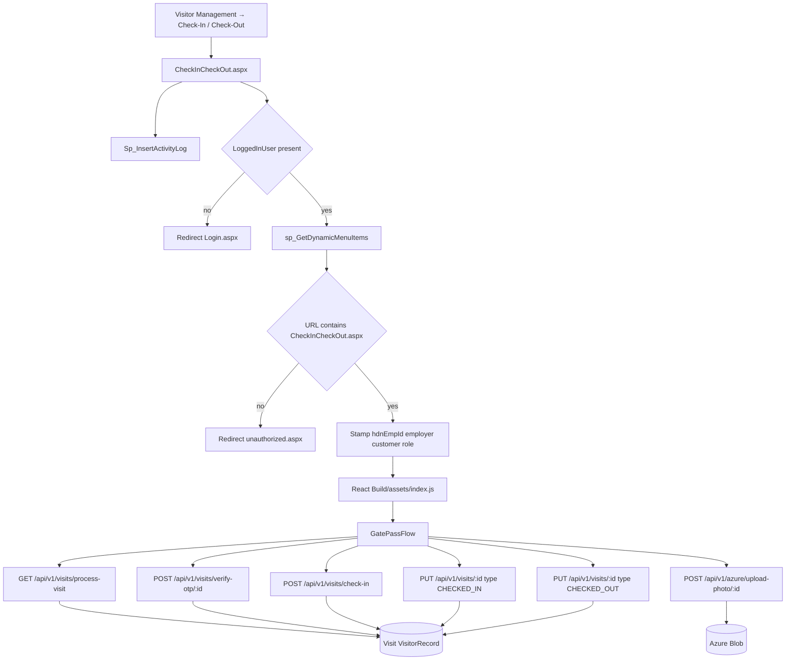
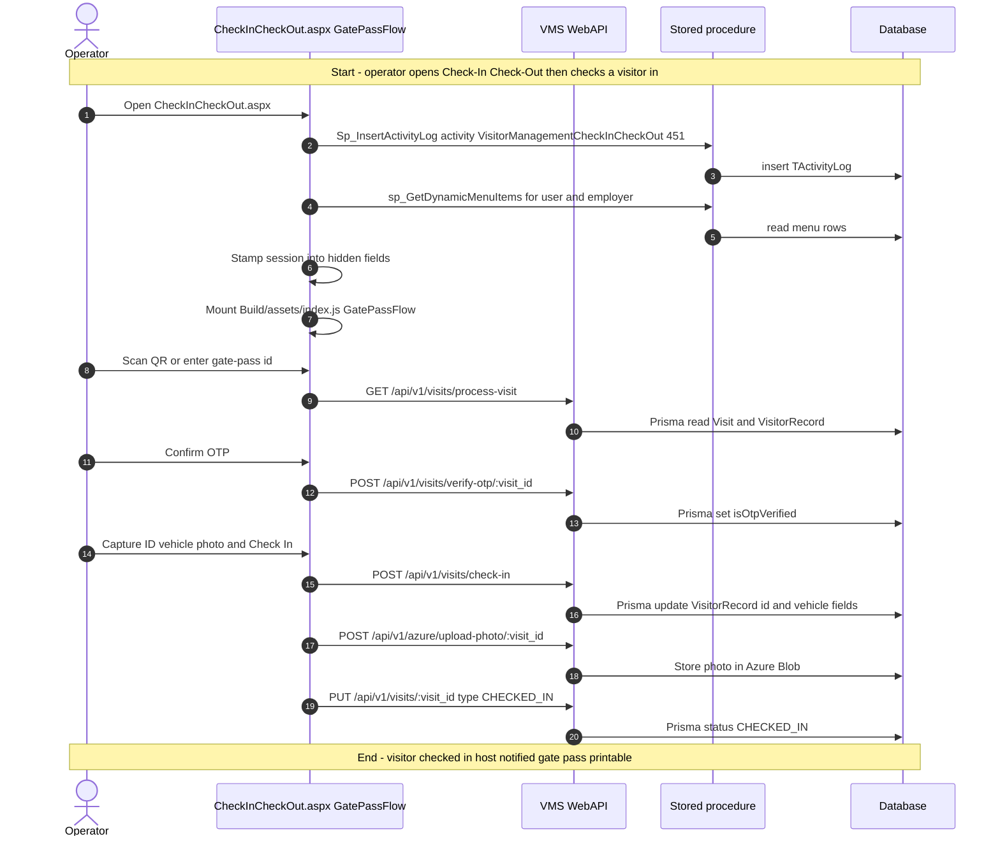
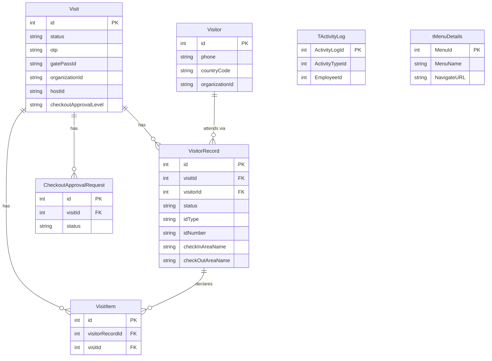

# Check-In / Check-Out

## Overview

An operator opens **Visitor Management → Check-In / Check-Out** (`~/HRM/VMS_React/CheckInCheckOut.aspx`, menu id **1180**, parentseq **2** under **Visitor Management** / **1176**) to run the gate **check-in / check-out** flow for arriving and leaving visitors. The WebForms host logs activity `VisitorManagementCheckInCheckOut` (451), redirects to login when `Session["LoggedInUser"]` is missing, gates access when the user’s dynamic menu does not include `CheckInCheckOut.aspx`, stamps session identity into hidden fields, and mounts the shared VMS React bundle at `#root` (`Build/assets/index.js`).

Inside the SPA the screen is `GatePassFlow` (route `/checkin-checkout`). The same React screen is also hosted by AccessPoint → Visitor (`Visitor.aspx`). The operator finds a visit by scanning a QR code or typing a gate-pass id, verifies a 6-digit OTP, captures government ID / vehicle / photo as the organisation config requires, optionally picks a gate area, then checks the visitor in. Checked-in visitors can be checked out (host approval first when org config requires it). Visit rows and visitor records are persisted by the separate VMS Express API through Prisma. Photos go to Azure Blob. There is **no stored procedure on the visit check-in / check-out write path**.

Canonical behaviour lives in the **VMS** Azure DevOps repo’s SystemModel-2 (`experience/surfaces/operator-surfaces.md`, `behavior/use-cases/check-in-visitor.md`, `behavior/use-cases/check-out-visitor.md`, `behavior/workflows/visitor-check-in.md`, `behavior/workflows/visitor-exit.md`). The VMS frontend/backend source and `Build/` bundle are **not** present in the SourceCode workspace analyzed for this guide. There is no llm-wiki domain page for Check-In / Check-Out.

**Who's involved:**

- **Operator (reception / gate security)** — opens Visitor Management → Check-In / Check-Out when their menu includes `CheckInCheckOut.aspx`. Integrated SPA also expects the `"Validate"` permission tab.
- **Visitor** — presents OTP / QR at the gate; does not open this screen.
- **Host (employee being visited)** — receives check-in / check-out notifications; may approve checkout when org config requires it. Does not operate this screen.

## Workflow

## Request journey

### Operator — check in a visitor

No WebForms postback journey exists. The aspx has no PageMethods. Check-out is the same SPA with `PUT /api/v1/visits/:id` and `type=CHECKED_OUT` (optionally after checkout-approval APIs when org config requires host approval).

## Entry points

`~/HRM/VMS_React/CheckInCheckOut.aspx` is the live Visitor Management → Check-In / Check-Out host (`PageName` `CheckInCheckOut.aspx`, menu id **1180**). `Page_Load` logs `ActivityDescription.VisitorManagementCheckInCheckOut`, requires `Session["LoggedInUser"]`, gates with `DashboardBLL.GetMenuItems` (must contain `CheckInCheckOut.aspx`), and stamps hidden fields (`hdnEmpId`, `hdnEmployerId`, `hdnCustomerId`, and related). The React module mounts at `#root` via `Build/assets/index.js`.

VMS SystemModel-2 maps this aspx and AccessPoint `Visitor.aspx` to the same SPA route/component (`/checkin-checkout`, `GatePassFlow`). Menu DML places it second under Visitor Management (parentseq 2), after Visitor Pass (1177) and ahead of Visitor Dashboard (1178) and Visitors Analytics & Reports (1227). Integrated mode expects the `"Validate"` permission tab for check-in / check-out actions (SystemModel role-permission matrix); no `TTabDetails` insert for menu **1180** was found in the Liquibase DML tree analyzed for this guide.

| UI page | Purpose |
|---|---|
| `HRM/VMS_REACT/CheckInCheckOut.aspx` | Visitor Management Check-In / Check-Out WebForms host, activity log, menu gate, session stamp |
| `HRM/VMS_REACT/Visitor.aspx` | Sibling AccessPoint host for the same `GatePassFlow` (no activity log / menu gate) |
| `HRM/VMS_REACT/Build/assets/index.js` | Deployed VMS SPA bundle (not in SourceCode git tree) |
| VMS repo `frontend/src/pages/GatePassFlow` | Check-in / check-out UI (SystemModel-2) |
| VMS repo `backend` `/api/v1/visits/*` | Visit lookup, OTP, check-in, check-out (SystemModel-2) |

## Code → database call chain

Host-side hops are verified in SourceCode. SPA → API → Prisma / Azure hops are from the VMS SystemModel-2 knowledge base (VMS repo source and Build bundle were not in this workspace).

| Entry | Method | Stored procedure / data access |
|---|---|---|
| Page load (activity) | `Page_Load` (`CheckInCheckOut.aspx.cs:27`) → `CommonUtil.LogActivity` (`Common.cs:52`) → `ActivityHelper.LogActivity` (`ActivityHelper.cs:32`) | `Sp_InsertActivityLog` → `TActivityLog` |
| Page load (access gate) | `Page_Load` (`CheckInCheckOut.aspx.cs:36-44`) → `DashboardBLL.GetMenuItems` (`DashboardBLL.cs:23`) → `DashboardDAL.GetMenuItems` (`DashboardDAL.cs:241`) | `sp_GetDynamicMenuItems` |
| SPA find visit | `GatePassFlow` → `GET /api/v1/visits/process-visit` → `processVisitsService` (VMS repo) | Prisma read `Visit` / `VisitorRecord` (no SP) |
| SPA verify OTP | → `POST /api/v1/visits/verify-otp/:visit_id` → `verifyVisitOtpService` | Prisma update `isOtpVerified` (no SP) |
| SPA save IDs / vehicle | → `POST /api/v1/visits/check-in` → `saveVisitorIdsService` | Prisma update `VisitorRecord` (no SP) |
| SPA photo | → `POST /api/v1/azure/upload-photo/:visit_id` | Azure Blob (not SQL) |
| SPA check-in / check-out | → `PUT /api/v1/visits/:visit_id` (`type` CHECKED_IN / CHECKED_OUT) | Prisma status / times (no SP) |
| SPA share pass (optional) | → `POST /api/v1/visits/share-gate-pass/:visit_id` | Notifications; may queue email via HRMS helpers (see Known gaps) |

## API endpoints

Not WebForms postback for check-in / check-out. The host page has no PageMethods. After mount, the VMS React app calls the VMS Node API under `/api/v1` (base URL is configured in the VMS frontend env, not in the aspx).

| Verb | Route | Parameters | Purpose | Source |
|---|---|---|---|---|
| GET | `/api/v1/visits/process-visit` | query visit id or gatePassId (required); JWT + org-access | Gate lookup | VMS SystemModel-2 `interface/apis/service-apis.md` |
| POST | `/api/v1/visits/verify-otp/:visit_id` | path `visit_id`; OTP body; JWT + org-access | Verify visit OTP | same |
| POST | `/api/v1/visits/check-in` | visitor id/vehicle payload (`saveVisitorIdsSchema`); JWT + org-access | Save IDs / vehicle (does not flip status) | same |
| POST | `/api/v1/azure/upload-photo/:visit_id` | path `visit_id`; header `x-visitor-record-id`; JWT + org-access | Upload visitor photo | same |
| PUT | `/api/v1/visits/:visit_id` | path `visit_id`; body `type` CHECKED_IN / CHECKED_OUT and times; JWT + org-access | Check in or check out | same |
| POST | `/api/v1/visits/share-gate-pass/:visit_id` | path `visit_id`; JWT + org-access | Email / WhatsApp the pass | same |

Host-only side effects use Enterprise Library / ActivityAuditLog against core HRMS procedures (see call chain). No Core `HRMS.Core.WebAPI.Node` controller serves this screen’s check-in / check-out write path. Checkout-approval routes under `/api/v1/checkout-approval/*` apply when org config requires host approval before check-out.

## Stored procedures & tables involved

| Object | File path | Purpose | llm-wiki |
|---|---|---|---|
| [`Sp_InsertActivityLog`](/docs/database/hrms/Sp_InsertActivityLog) | `HRMS-DATABASE/HRMS/STOREPROCEDURE/Sp_InsertActivityLog.sql` | Activity row on every page open | — |
| [`sp_GetDynamicMenuItems`](/docs/database/hrms/sp_GetDynamicMenuItems) | `HRMS-DATABASE/HRMS/STOREPROCEDURE/sp_GetDynamicMenuItems.sql` | Menu rows for the access gate | — |
| `Visit` / `Visitor` / `VisitorRecord` / `VisitItem` / `CheckoutApprovalRequest` (tables) | Live via VMS Prisma; Liquibase `HRM-VMS` has DML only (no `TABLES/` / `STOREPROCEDURE` for these objects) | Check-in / check-out write targets | No llm-wiki page |

Visit check-in / check-out uses Prisma, not a stored procedure. Nested level under the two host SPs: neither calls another procedure or function. Existing Backstage database pages for both host SPs were left unchanged.

VMS backend repositories can call HRMS procedures for employee / org / email (`SP_EMPMD_GetEmpSummaryData`, `SP_EMPMD_GetEmpContactDet`, `SP_Admin_GetAllEmployeeListByOrg`, `SP_GetEmployerList`, `SP_AdminORG_GetEmployerDet`, `SP_CM_GetOrganizationDet`, `SP_CM_GetEmployerEmail`, `SP_VMS_GetEmployeesByGroupName`, `SP_SendEmail`) when resolving hosts or sending notifications. Those are **not** invoked by `CheckInCheckOut.aspx` and are not re-verified as part of this screen’s direct call chain in SourceCode.

## Table relationships

Visit / visitor graphs follow the VMS SystemModel-2 ERD (`data/relationships/erd.md`). Host activity/menu tables are core HRMS.

`hostId` / `organizationId` / `checkedInByEmployeeId` / `checkedOutByEmployeeId` are loose strings with no Prisma FK to HRMS employee or employer tables.

## Known gaps

- VMS React source, Vite `Build/` output, and VMS Express API are **not** in the SourceCode workspace; SPA/API call-chain detail is taken from VMS SystemModel-2 (cached project sync), not re-read file:line from that repo.
- `HRMS-DATABASE/HRM-VMS` Liquibase baseline contains only DML; there are **no** checked-in SP/table scripts for Visit entities, and visit check-in / check-out is Prisma-only.
- Physical database placement for Prisma tables may differ by environment (SystemModel “shared HRMS DB” vs DEV `HRM-VMS` for related config).
- Supporting HRMS SPs used by the VMS Node pool for employee/org/email were not expanded into Backstage database pages here because they are not direct calls from this aspx.
- No Liquibase `TTabDetails` row for `"Validate"` on menu **1180** was found in this workspace; the tab is documented only in VMS SystemModel-2.
- Sibling AccessPoint → Visitor (`Visitor.aspx`) hosts the same SPA without activity logging or menu URL gating — see that guide for the lighter host.
- No llm-wiki domain or table catalogue page for Check-In / Check-Out / `GatePassFlow`.

## Reference

Confidence is medium: the ASP.NET host → `Sp_InsertActivityLog` / `sp_GetDynamicMenuItems` chain is clear in SourceCode. The React → VMS API → Prisma check-in / check-out chain is documented in the VMS SystemModel-2 knowledge base, but the VMS application repo was not present in this workspace for line-level re-verification. Visit persistence has no SP layer.

### SourceCode

- `HRMS.Web/HRMS.Web/HRM/VMS_REACT/CheckInCheckOut.aspx`
- `HRMS.Web/HRMS.Web/HRM/VMS_REACT/CheckInCheckOut.aspx.cs`
- `HRMS.Web/HRMS.Web/HRM/VMS_REACT/Visitor.aspx` / `.aspx.cs` (sibling GatePassFlow host)
- `HRMS.Shared/HRMS.DataContract/Common/Enums.cs` (`VisitorManagementCheckInCheckOut = 451`)
- `HRMS.Shared/HRMS.Common/Common.cs` (`LogActivity`)
- `HRMS.Shared/TDG.ActivityAuditLog/DAL/ActivityHelper.cs`
- `HRMS.Shared/HRMS.BusinessLayer/DashboardBLL.cs`
- `HRMS.Shared/HRMS.DataAccessLayer/DashboardDAL.cs`

### VMS repo (SystemModel-2; not in SourceCode workspace)

- `docs/SystemModels/SystemModel-2/experience/surfaces/operator-surfaces.md`
- `docs/SystemModels/SystemModel-2/behavior/use-cases/check-in-visitor.md`
- `docs/SystemModels/SystemModel-2/behavior/use-cases/check-out-visitor.md`
- `docs/SystemModels/SystemModel-2/behavior/workflows/visitor-check-in.md`
- `docs/SystemModels/SystemModel-2/behavior/workflows/visitor-exit.md`
- `docs/SystemModels/SystemModel-2/behavior/workflows/checkout-approval.md`
- `docs/SystemModels/SystemModel-2/interface/apis/service-apis.md`
- `docs/SystemModels/SystemModel-2/data/relationships/erd.md`
- `docs/SystemModels/SystemModel-2/security/authorization/role-permission-matrix.md`
- `docs/SystemModels/SystemModel-2/operations/integrations/hrms-integrated-db.md`

### TDG HRMS DB

- `HRMS-DATABASE/HRMS/DML/109351_vms/TMenuDetails.sql` (MenuId 1180 → `~/HRM/VMS_React/CheckInCheckOut.aspx`)
- `HRMS-DATABASE/HRMS/DML/VMSMenuIssue.sql` (parentseq 2 for Check-In / Check-Out)
- `HRMS-DATABASE/HRMS/DML/Tmenudetails DML.sql` (Visitor Management XML children)
- `HRMS-DATABASE/HRM-VMS/DML/` (config maintenance only; no Visit TABLE/SP scripts)
- `HRMS-DATABASE/HRMS/STOREPROCEDURE/Sp_InsertActivityLog.sql`
- `HRMS-DATABASE/HRMS/STOREPROCEDURE/sp_GetDynamicMenuItems.sql`
