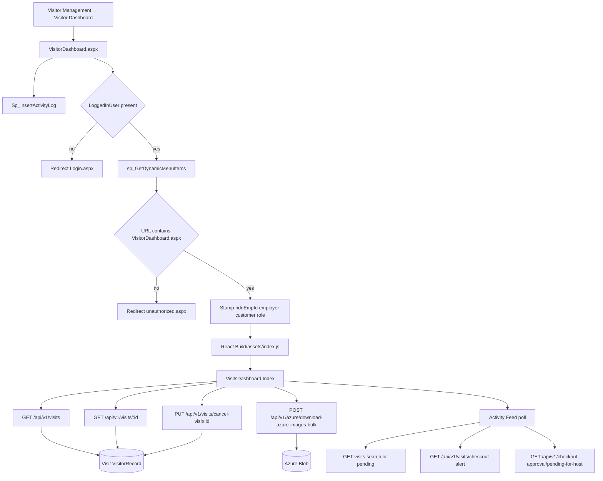
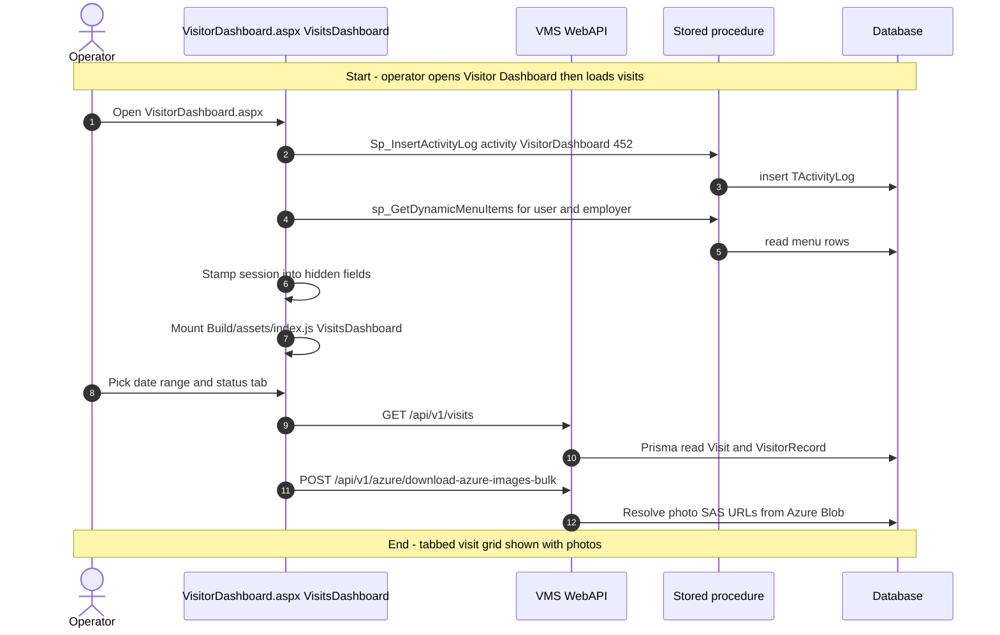
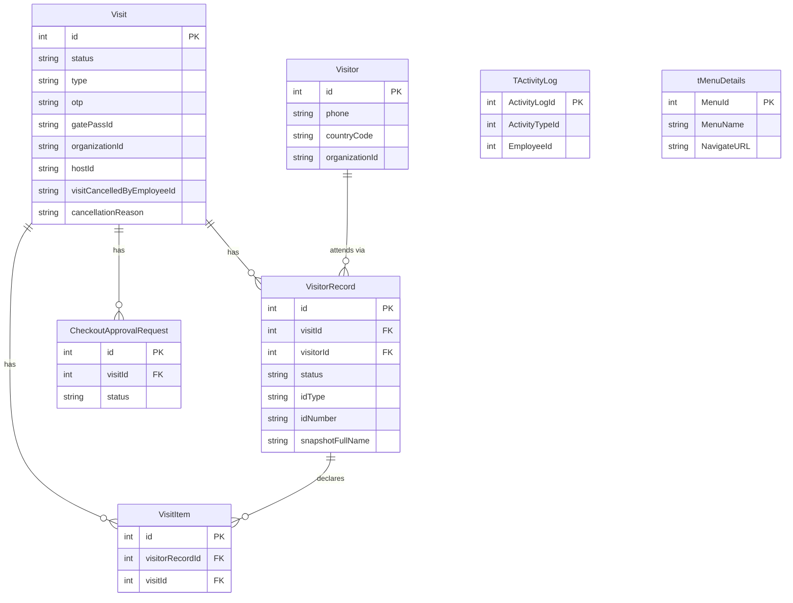

# Visitor Dashboard

## Overview

An operator opens **Visitor Management → Visitor Dashboard** (`~/HRM/VMS_React/VisitorDashboard.aspx`, menu id **1178**, parentseq **3** under **Visitor Management** / **1176**) to monitor visits in a tabbed grid. The WebForms host logs activity `VisitorDashboard` (452), redirects to login when `Session["LoggedInUser"]` is missing, gates access when the user’s dynamic menu does not include `VisitorDashboard.aspx`, stamps session identity into hidden fields, and mounts the shared VMS React bundle at `#root` (`Build/assets/index.js`).

Inside the SPA the screen is `VisitsDashboard/Index` (route `/VisitorDashboard`). The operator filters by date and status tab (`ALL`, `CHECKED_IN`, `CHECKED_OUT`, `CREATED` as **Upcoming**, `EXPIRED`, `CANCELLED`, `NO_SHOW`, `REJECTED`), loads photos in bulk, opens a visit for edit, or cancels a visit. The Activity Feed bell on this header polls Pending (walk-in approvals), Alerts (overdue check-outs), and Approvals (checkout-approval requests). Visit rows are read and updated by the separate VMS Express API through Prisma. There is **no stored procedure on the visit list / cancel write path**.

Canonical behaviour lives in the **VMS** Azure DevOps repo’s SystemModel-2 (`experience/surfaces/operator-surfaces.md`, `behavior/use-cases/view-visitor-reports.md`, `behavior/state-transitions/visit-lifecycle.md`, `behavior/workflows/unplanned-visit-approval.md`, `behavior/workflows/visit-expiration.md`, `behavior/workflows/checkout-approval.md`). The VMS frontend/backend source and `Build/` bundle are **not** present in the SourceCode workspace analyzed for this guide. There is no llm-wiki domain page for Visitor Dashboard.

**Who's involved:**

- **Operator (reception / gate security)** — opens Visitor Management → Visitor Dashboard when their menu includes `VisitorDashboard.aspx`. Integrated SPA scopes the grid by the `"Show All Visits"` permission tab (TabId **434** on menu **1178**).
- **Host (employee being visited)** — uses the Activity Feed on this surface (and Reports) for Pending / Alerts / Approvals; does not need the full grid when `"Show All Visits"` is off.
- **Visitor** — does not open this screen.

## Workflow

## Request journey

### Operator — open the dashboard and load the visit grid

No WebForms postback journey exists. The aspx has no PageMethods. Cancel is the same SPA with `PUT /api/v1/visits/cancel-visit/:id` (visit + records → cancelled, notifications). Walk-in approve/reject and checkout-approval respond from the Activity Feed use `POST /api/v1/visits/unplanned-approval/:id` and `POST /api/v1/checkout-approval/respond/:approvalId`.

## Entry points

`~/HRM/VMS_React/VisitorDashboard.aspx` is the live Visitor Management → Visitor Dashboard host (`PageName` `VisitorDashboard.aspx`, menu id **1178**). `Page_Load` logs `ActivityDescription.VisitorDashboard`, requires `Session["LoggedInUser"]`, gates with `DashboardBLL.GetMenuItems` (must contain `VisitorDashboard.aspx`), and stamps hidden fields (`hdnEmpId`, `hdnEmployerId`, `hdnCustomerId`, and related). The React module mounts at `#root` via `Build/assets/index.js`.

VMS SystemModel-2 maps this aspx to SPA route `/VisitorDashboard` and component `VisitsDashboard/Index`. Menu DML places it third under Visitor Management (parentseq 3), after Visitor Pass (1177) and Check-In / Check-Out (1180), ahead of Visitors Analytics & Reports (1227). Tab DML includes **Show All Visits** (TabId 434 on menu 1178).

| UI page | Purpose |
|---|---|
| `HRM/VMS_REACT/VisitorDashboard.aspx` | Visitor Dashboard WebForms host, activity log, menu gate, session stamp |
| `HRM/VMS_REACT/Build/assets/index.js` | Deployed VMS SPA bundle (not in SourceCode git tree) |
| VMS repo `frontend/src/pages/VisitsDashboard` | Tabbed visit grid, edit/cancel, photos (SystemModel-2) |
| VMS repo `frontend/src/components/Notification` | Activity Feed Pending / Alerts / Approvals (SystemModel-2) |
| VMS repo `backend` `/api/v1/visits` and related | List, detail, cancel, alerts, walk-in approval (SystemModel-2) |

## Code → database call chain

Host-side hops are verified in SourceCode. SPA → API → Prisma / Azure hops are from the VMS SystemModel-2 knowledge base (VMS repo source and Build bundle were not in this workspace).

| Entry | Method | Stored procedure / data access |
|---|---|---|
| Page load (activity) | `Page_Load` (`VisitorDashboard.aspx.cs:28`) → `CommonUtil.LogActivity` (`Common.cs:52`) → `ActivityHelper.LogActivity` (`ActivityHelper.cs:32`) | `Sp_InsertActivityLog` → `TActivityLog` |
| Page load (access gate) | `Page_Load` (`VisitorDashboard.aspx.cs:37-44`) → `DashboardBLL.GetMenuItems` (`DashboardBLL.cs:23`) → `DashboardDAL.GetMenuItems` (`DashboardDAL.cs:241`) | `sp_GetDynamicMenuItems` |
| SPA list visits | `VisitsDashboard` → `GET /api/v1/visits` → `handleGetAllVisits` (VMS repo) | Prisma read `Visit` / `VisitorRecord` (no SP); scoped by `"Show All Visits"` / host |
| SPA photos | → `POST /api/v1/azure/download-azure-images-bulk` | Azure Blob SAS URLs (not SQL) |
| SPA visit detail / edit prep | → `GET /api/v1/visits/:visit_id` | Prisma read one visit (no SP) |
| SPA cancel | → `PUT /api/v1/visits/cancel-visit/:visit_id` → `handleCancelVisit` | Prisma cancel visit + records; notify (no SP) |
| SPA Activity Feed Alerts | → `GET /api/v1/visits/checkout-alert` (polled ~15s) | Prisma overdue `CHECKED_IN` query (no SP) |
| SPA Activity Feed Approvals | → `GET /api/v1/checkout-approval/pending-for-host` | Prisma `CheckoutApprovalRequest` (no SP) |
| SPA Activity Feed Pending | → `getPendingVisitsAsync` (VMS FE; walk-in `PENDING` list) | Prisma pending unplanned visits (no SP) |

## API endpoints

Not WebForms postback for the dashboard grid. The host page has no PageMethods. After mount, the VMS React app calls the VMS Node API under `/api/v1` (base URL is configured in the VMS frontend env, not in the aspx).

| Verb | Route | Parameters | Purpose | Source |
|---|---|---|---|---|
| GET | `/api/v1/visits` | date-range / status filters; JWT + org-access | Tabbed visit list | VMS SystemModel-2 `interface/apis/service-apis.md`, `view-visitor-reports.md` |
| GET | `/api/v1/visits/:visit_id` | path `visit_id` | One visit for detail / edit | same |
| GET | `/api/v1/visits/search` | search query; JWT + org-access | Search visits | same |
| GET | `/api/v1/visits/checkout-alert` | JWT + org-access | Overdue check-out Alerts tab | `visit-expiration.md` |
| PUT | `/api/v1/visits/cancel-visit/:visit_id` | path `visit_id`; cancel body; JWT + org-access | Cancel visit + notify | same |
| POST | `/api/v1/azure/download-azure-images-bulk` | visit/photo payload; JWT + org-access | Bulk photo URLs for the grid | same |
| POST | `/api/v1/visits/unplanned-approval/:id` | path id; approve/reject; JWT + org-access | Activity Feed Pending decide | `unplanned-visit-approval.md` |
| GET | `/api/v1/checkout-approval/pending-for-host` | JWT + org-access | Activity Feed Approvals | `checkout-approval.md` |
| POST | `/api/v1/checkout-approval/respond/:approvalId` | path id; decision; JWT | Host respond on Approvals | same |

Host-only side effects use Enterprise Library / ActivityAuditLog against core HRMS procedures (see call chain). No Core `HRMS.Core.WebAPI.Node` controller serves this screen’s visit list or cancel path. Edit of a planned visit reuses Visitor Pass APIs (`PUT /api/v1/visits/:id`) after `GET /visits/:id`.

## Stored procedures & tables involved

| Object | File path | Purpose | llm-wiki |
|---|---|---|---|
| [`Sp_InsertActivityLog`](/docs/database/hrms/Sp_InsertActivityLog) | `HRMS-DATABASE/HRMS/STOREPROCEDURE/Sp_InsertActivityLog.sql` | Activity row on every page open | — |
| [`sp_GetDynamicMenuItems`](/docs/database/hrms/sp_GetDynamicMenuItems) | `HRMS-DATABASE/HRMS/STOREPROCEDURE/sp_GetDynamicMenuItems.sql` | Menu rows for the access gate | — |
| `Visit` / `Visitor` / `VisitorRecord` / `VisitItem` / `CheckoutApprovalRequest` (tables) | Live via VMS Prisma; Liquibase `HRM-VMS` has DML only (no `TABLES/` / `STOREPROCEDURE` for these objects) | Dashboard list / cancel / feed targets | No llm-wiki page |

Visit list / cancel / Activity Feed reads use Prisma, not a stored procedure. Nested level under the two host SPs: neither calls another procedure or function. Existing Backstage database pages for both host SPs were left unchanged.

VMS backend repositories can call HRMS procedures for employee / org / email (`SP_EMPMD_GetEmpSummaryData`, `SP_EMPMD_GetEmpContactDet`, `SP_Admin_GetAllEmployeeListByOrg`, `SP_GetEmployerList`, `SP_AdminORG_GetEmployerDet`, `SP_CM_GetOrganizationDet`, `SP_CM_GetEmployerEmail`, `SP_VMS_GetEmployeesByGroupName`, `SP_SendEmail`) when resolving hosts or sending cancel / approval notifications. Those are **not** invoked by `VisitorDashboard.aspx` and are not re-verified as part of this screen’s direct call chain in SourceCode.

## Table relationships

Visit / visitor graphs follow the VMS SystemModel-2 ERD (`data/relationships/erd.md`). Host activity/menu tables are core HRMS.

`hostId` / `organizationId` / `visitCancelledByEmployeeId` are loose strings with no Prisma FK to HRMS employee or employer tables. `"Show All Visits"` scopes list queries to all org visits vs `hostId` = logged-in employee.

## Known gaps

- VMS React source, Vite `Build/` output, and VMS Express API are **not** in the SourceCode workspace; SPA/API call-chain detail is taken from VMS SystemModel-2 (cached project sync), not re-read file:line from that repo.
- `HRMS-DATABASE/HRM-VMS` Liquibase baseline contains only DML; there are **no** checked-in SP/table scripts for Visit entities, and dashboard list/cancel is Prisma-only.
- Physical database placement for Prisma tables may differ by environment (SystemModel “shared HRMS DB” vs DEV `HRM-VMS` for related config).
- Exact HTTP route behind FE helper `getPendingVisitsAsync` is named in SystemModel use-cases but not pinned to a single row in `service-apis.md` (likely `GET /visits` or `GET /visits/search` with `PENDING` filter).
- Supporting HRMS SPs used by the VMS Node pool for employee/org/email were not expanded into Backstage database pages here because they are not direct calls from this aspx.
- No llm-wiki domain or table catalogue page for Visitor Dashboard / `VisitsDashboard`.
- Menu folder slug is `visitor-management` (`menuToFolderSlug("Visitor Management")`); AccessPoint leaves live under `accesspoint` / `access-point` separately.

## Reference

Confidence is medium: the ASP.NET host → `Sp_InsertActivityLog` / `sp_GetDynamicMenuItems` chain is clear in SourceCode. The React → VMS API → Prisma list/cancel / Activity Feed chain is documented in the VMS SystemModel-2 knowledge base, but the VMS application repo was not present in this workspace for line-level re-verification. Visit persistence has no SP layer.

### SourceCode

- `HRMS.Web/HRMS.Web/HRM/VMS_REACT/VisitorDashboard.aspx`
- `HRMS.Web/HRMS.Web/HRM/VMS_REACT/VisitorDashboard.aspx.cs`
- `HRMS.Shared/HRMS.DataContract/Common/Enums.cs` (`VisitorDashboard = 452`)
- `HRMS.Shared/HRMS.Common/Common.cs` (`LogActivity`)
- `HRMS.Shared/TDG.ActivityAuditLog/DAL/ActivityHelper.cs`
- `HRMS.Shared/HRMS.BusinessLayer/DashboardBLL.cs`
- `HRMS.Shared/HRMS.DataAccessLayer/DashboardDAL.cs`

### VMS repo (SystemModel-2; not in SourceCode workspace)

- `docs/SystemModels/SystemModel-2/experience/surfaces/operator-surfaces.md`
- `docs/SystemModels/SystemModel-2/behavior/use-cases/view-visitor-reports.md`
- `docs/SystemModels/SystemModel-2/behavior/use-cases/approve-unplanned-visit.md`
- `docs/SystemModels/SystemModel-2/behavior/workflows/unplanned-visit-approval.md`
- `docs/SystemModels/SystemModel-2/behavior/workflows/visit-expiration.md`
- `docs/SystemModels/SystemModel-2/behavior/workflows/checkout-approval.md`
- `docs/SystemModels/SystemModel-2/behavior/state-transitions/visit-lifecycle.md`
- `docs/SystemModels/SystemModel-2/interface/apis/service-apis.md`
- `docs/SystemModels/SystemModel-2/data/relationships/erd.md`
- `docs/SystemModels/SystemModel-2/security/authorization/role-permission-matrix.md`
- `docs/SystemModels/SystemModel-2/experience/personas/host.md`
- `docs/SystemModels/SystemModel-2/operations/integrations/hrms-integrated-db.md`

### TDG HRMS DB

- `HRMS-DATABASE/HRMS/DML/109351_vms/TMenuDetails.sql` (MenuId 1178 → `~/HRM/VMS_React/VisitorDashboard.aspx`)
- `HRMS-DATABASE/HRMS/DML/VMSMenuIssue.sql` (parentseq 3 for Visitor Dashboard)
- `HRMS-DATABASE/HRMS/DML/Tmenudetails DML.sql` (Visitor Management XML children)
- `HRMS-DATABASE/HRMS/DML/vms-109901/TTabDetails.sql` (Show All Visits TabId 434)
- `HRMS-DATABASE/HRM-VMS/DML/` (config maintenance only; no Visit TABLE/SP scripts)
- `HRMS-DATABASE/HRMS/STOREPROCEDURE/Sp_InsertActivityLog.sql`
- `HRMS-DATABASE/HRMS/STOREPROCEDURE/sp_GetDynamicMenuItems.sql`
