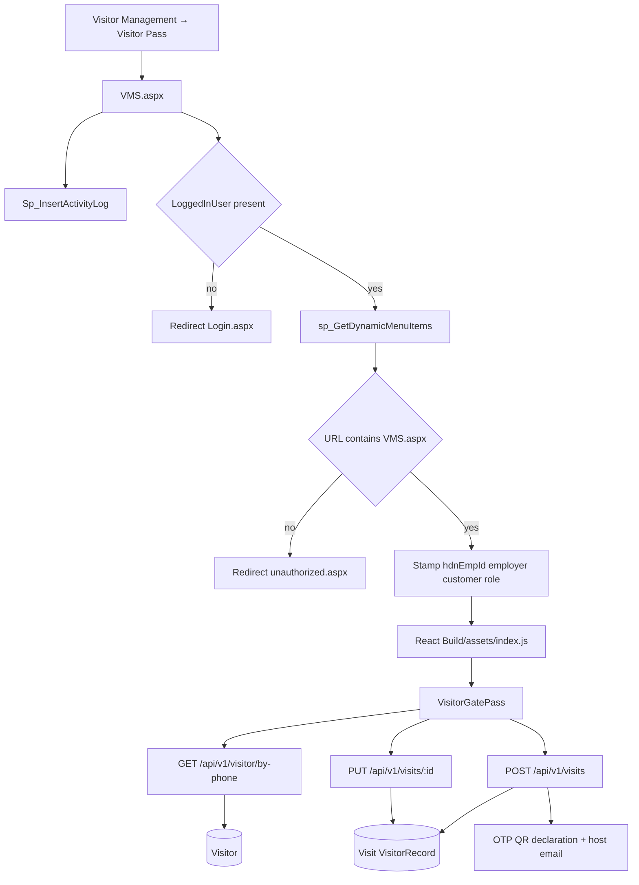
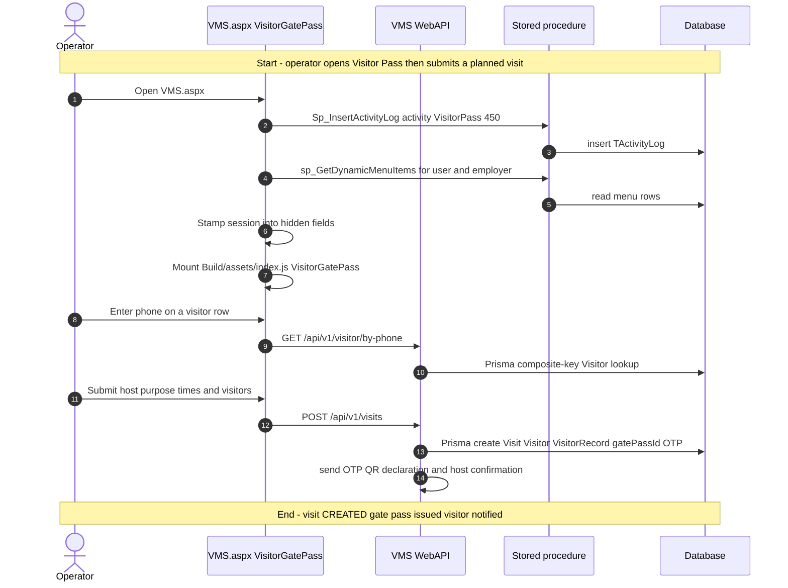
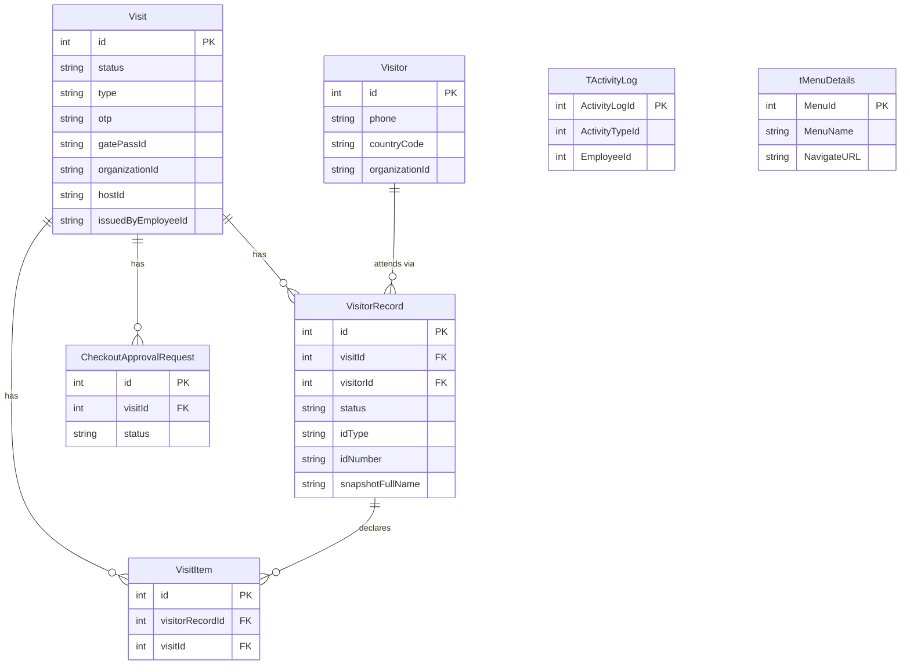

# Visitor Pass

## Overview

An operator opens **Visitor Management → Visitor Pass** (`~/HRM/VMS_React/VMS.aspx`, menu id **1177**, parentseq **1** under **Visitor Management** / **1176**) to pre-register a planned visit. The WebForms host logs activity `VisitorPass` (450), redirects to login when `Session["LoggedInUser"]` is missing, gates access when the user’s dynamic menu does not include `VMS.aspx`, stamps session identity into hidden fields, and mounts the shared VMS React bundle at `#root` (`Build/assets/index.js`).

Inside the SPA the screen is `VisitorGatePass` (route `/`). The operator picks a host employee, purpose of visit, visitor count (capped by org config `maxVisitorsAllowed`), scheduled entry/exit times, and one or more visitor rows (phone autofill for returning visitors). Submit creates a `Visit` (`type=PLANNED`, status `CREATED`) with `Visitor` / `VisitorRecord` rows, a gate-pass id (`ACRONYM-YEAR-N`), and encrypted OTP; the primary visitor gets OTP + QR + declaration link and the host gets a confirmation. Edit mode updates an existing visit and can regenerate OTP. Persistence is the separate VMS Express API through Prisma. There is **no stored procedure on the visit create / update write path**.

Canonical behaviour lives in the **VMS** Azure DevOps repo’s SystemModel-2 (`experience/surfaces/operator-surfaces.md`, `behavior/use-cases/register-planned-visit.md`, `behavior/workflows/visit-creation.md`, `behavior/workflows/gate-pass-issue.md`). The VMS frontend/backend source and `Build/` bundle are **not** present in the SourceCode workspace analyzed for this guide. There is no llm-wiki domain page for Visitor Pass.

**Who's involved:**

- **Operator (reception / gate security)** — opens Visitor Management → Visitor Pass when their menu includes `VMS.aspx`. Integrated SPA also expects `"Create Visit"` / `"Modify Visit"` / `"Create Pass On Behalf"` permission tabs.
- **Host (employee being visited)** — receives visit-creation confirmation; does not operate this screen.
- **Visitor** — receives OTP, QR, and declaration link; does not open this screen.

## Workflow

## Request journey

### Operator — create a planned visitor pass

No WebForms postback journey exists. The aspx has no PageMethods. Edit is the same SPA with `PUT /api/v1/visits/:id` (optionally regenerating OTP when `type=UPDATE` and `triggerMessage`).

## Entry points

`~/HRM/VMS_React/VMS.aspx` is the live Visitor Management → Visitor Pass host (`PageName` `VMS.aspx`, menu id **1177**). `Page_Load` logs `ActivityDescription.VisitorPass`, requires `Session["LoggedInUser"]`, gates with `DashboardBLL.GetMenuItems` (must contain `VMS.aspx`), and stamps hidden fields (`hdnEmpId`, `hdnEmployerId`, `hdnCustomerId`, and related). The React module mounts at `#root` via `Build/assets/index.js`.

VMS SystemModel-2 maps this aspx to SPA route `/` and component `VisitorGatePass`. Menu DML places it first under Visitor Management (parentseq 1), ahead of Check-In / Check-Out (1180), Visitor Dashboard (1178), and Visitors Analytics & Reports (1227). Tab DML includes **Create Pass On Behalf** (TabId 435 on menu 1177).

| UI page | Purpose |
|---|---|
| `HRM/VMS_REACT/VMS.aspx` | Visitor Pass WebForms host, activity log, menu gate, session stamp |
| `HRM/VMS_REACT/Build/assets/index.js` | Deployed VMS SPA bundle (not in SourceCode git tree) |
| VMS repo `frontend/src/pages/VisitorGatePass` | Create/edit planned visit form (SystemModel-2) |
| VMS repo `backend` `/api/v1/visits` | Create/update visit + notifications (SystemModel-2) |

## Code → database call chain

Host-side hops are verified in SourceCode. SPA → API → Prisma hops are from the VMS SystemModel-2 knowledge base (VMS repo source and Build bundle were not in this workspace).

| Entry | Method | Stored procedure / data access |
|---|---|---|
| Page load (activity) | `Page_Load` (`VMS.aspx.cs:28`) → `CommonUtil.LogActivity` (`Common.cs:52`) → `ActivityHelper.LogActivity` (`ActivityHelper.cs:32`) | `Sp_InsertActivityLog` → `TActivityLog` |
| Page load (access gate) | `Page_Load` (`VMS.aspx.cs:37-44`) → `DashboardBLL.GetMenuItems` (`DashboardBLL.cs:23`) → `DashboardDAL.GetMenuItems` (`DashboardDAL.cs:241`) | `sp_GetDynamicMenuItems` |
| SPA phone autofill | `getVisitorByPhoneAsync` → `GET /api/v1/visitor/by-phone` → `handleGetVisitorByPhone` (VMS repo) | Prisma composite-key read `Visitor` (no SP; never returns prior ID) |
| SPA create visit | `createVisitAsync` → `POST /api/v1/visits` → `createVisitService` / `createVisit` (VMS repo) | Prisma create `Visit` / upsert `Visitor` / create `VisitorRecord` + gate-pass id (no SP) |
| SPA edit visit | `updateVisitAsync` → `PUT /api/v1/visits/:id` → update visit service (VMS repo) | Prisma update; may regenerate OTP (no SP) |
| SPA notifications | `sendOTPNotification` / `sendVisitCreationEmailNotifications` (VMS repo) | MsgMesh / email; may queue via HRMS helpers (see Known gaps) |

## API endpoints

Not WebForms postback for visitor-pass create/edit. The host page has no PageMethods. After mount, the VMS React app calls the VMS Node API under `/api/v1` (base URL is configured in the VMS frontend env, not in the aspx).

| Verb | Route | Parameters | Purpose | Source |
|---|---|---|---|---|
| GET | `/api/v1/visitor/by-phone` | phone / countryCode query; JWT | Returning-visitor autofill | VMS SystemModel-2 `interface/apis/service-apis.md` |
| POST | `/api/v1/visits` | planned visit body (≥1 visitor, org present); JWT + org-access | Create planned visit + OTP notify | same |
| PUT | `/api/v1/visits/:visit_id` | path `visit_id`; update body; JWT + org-access | Edit visit / optional OTP resend | same |
| GET | `/api/v1/admin/admin-config/:organizationId` | path `organizationId` | Load caps and purpose dropdown (public on VMS API) | same |
| GET | `/api/v1/employees` | org context | Host employee picker | same |

Host-only side effects use Enterprise Library / ActivityAuditLog against core HRMS procedures (see call chain). No Core `HRMS.Core.WebAPI.Node` controller serves this screen’s visit CRUD.

## Stored procedures & tables involved

| Object | File path | Purpose | llm-wiki |
|---|---|---|---|
| [`Sp_InsertActivityLog`](/docs/database/hrms/Sp_InsertActivityLog) | `HRMS-DATABASE/HRMS/STOREPROCEDURE/Sp_InsertActivityLog.sql` | Activity row on every page open | — |
| [`sp_GetDynamicMenuItems`](/docs/database/hrms/sp_GetDynamicMenuItems) | `HRMS-DATABASE/HRMS/STOREPROCEDURE/sp_GetDynamicMenuItems.sql` | Menu rows for the access gate | — |
| `Visit` / `Visitor` / `VisitorRecord` (tables) | Live via VMS Prisma; Liquibase `HRM-VMS` has DML only (no `TABLES/` / `STOREPROCEDURE` for these objects) | Planned-visit create/edit targets | No llm-wiki page |

Visit create/update uses Prisma, not a stored procedure. Nested level under the two host SPs: neither calls another procedure or function. Existing Backstage database pages for both host SPs were left unchanged.

VMS backend repositories can call HRMS procedures for employee / org / email (`SP_EMPMD_GetEmpSummaryData`, `SP_EMPMD_GetEmpContactDet`, `SP_Admin_GetAllEmployeeListByOrg`, `SP_GetEmployerList`, `SP_AdminORG_GetEmployerDet`, `SP_CM_GetOrganizationDet`, `SP_CM_GetEmployerEmail`, `SP_VMS_GetEmployeesByGroupName`, `SP_SendEmail`) when resolving hosts or sending notifications. Those are **not** invoked by `VMS.aspx` and are not re-verified as part of this screen’s direct call chain in SourceCode.

## Table relationships

Visit / visitor graphs follow the VMS SystemModel-2 ERD (`data/relationships/erd.md`). Host activity/menu tables are core HRMS.

`hostId` / `organizationId` / `issuedByEmployeeId` are loose strings with no Prisma FK to HRMS employee or employer tables. `Visitor` is unique on `(organizationId, phone, countryCode)`.

## Known gaps

- VMS React source, Vite `Build/` output, and VMS Express API are **not** in the SourceCode workspace; SPA/API call-chain detail is taken from VMS SystemModel-2 (cached project sync), not re-read file:line from that repo.
- `HRMS-DATABASE/HRM-VMS` Liquibase baseline contains only DML; there are **no** checked-in SP/table scripts for Visit entities, and visit CRUD is Prisma-only.
- Physical database placement for Prisma tables may differ by environment (SystemModel “shared HRMS DB” vs DEV `HRM-VMS` for related config).
- Supporting HRMS SPs used by the VMS Node pool for employee/org/email were not expanded into Backstage database pages here because they are not direct calls from this aspx.
- No llm-wiki domain or table catalogue page for Visitor Pass / `VisitorGatePass`.
- Menu folder slug is `visitor-management` (`menuToFolderSlug("Visitor Management")`); AccessPoint leaves live under `accesspoint` / `access-point` separately.

## Reference

Confidence is medium: the ASP.NET host → `Sp_InsertActivityLog` / `sp_GetDynamicMenuItems` chain is clear in SourceCode. The React → VMS API → Prisma create/edit chain is documented in the VMS SystemModel-2 knowledge base, but the VMS application repo was not present in this workspace for line-level re-verification. Visit persistence has no SP layer.

### SourceCode

- `HRMS.Web/HRMS.Web/HRM/VMS_REACT/VMS.aspx`
- `HRMS.Web/HRMS.Web/HRM/VMS_REACT/VMS.aspx.cs`
- `HRMS.Shared/HRMS.DataContract/Common/Enums.cs` (`VisitorPass = 450`)
- `HRMS.Shared/HRMS.Common/Common.cs` (`LogActivity`)
- `HRMS.Shared/TDG.ActivityAuditLog/DAL/ActivityHelper.cs`
- `HRMS.Shared/HRMS.BusinessLayer/DashboardBLL.cs`
- `HRMS.Shared/HRMS.DataAccessLayer/DashboardDAL.cs`

### VMS repo (SystemModel-2; not in SourceCode workspace)

- `docs/SystemModels/SystemModel-2/experience/surfaces/operator-surfaces.md`
- `docs/SystemModels/SystemModel-2/behavior/use-cases/register-planned-visit.md`
- `docs/SystemModels/SystemModel-2/behavior/workflows/visit-creation.md`
- `docs/SystemModels/SystemModel-2/behavior/workflows/gate-pass-issue.md`
- `docs/SystemModels/SystemModel-2/interface/apis/service-apis.md`
- `docs/SystemModels/SystemModel-2/data/relationships/erd.md`
- `docs/SystemModels/SystemModel-2/data/entities/core-entities.yaml`
- `docs/SystemModels/SystemModel-2/operations/integrations/hrms-integrated-db.md`

### TDG HRMS DB

- `HRMS-DATABASE/HRMS/DML/109351_vms/TMenuDetails.sql` (MenuId 1177 → `~/HRM/VMS_React/VMS.aspx`)
- `HRMS-DATABASE/HRMS/DML/VMSMenuIssue.sql` (parentseq 1 for Visitor Pass)
- `HRMS-DATABASE/HRMS/DML/Tmenudetails DML.sql` (Visitor Management XML children)
- `HRMS-DATABASE/HRMS/DML/vms-110733/TTabDetails.sql` (Create Pass On Behalf)
- `HRMS-DATABASE/HRM-VMS/DML/` (config maintenance only; no Visit TABLE/SP scripts)
- `HRMS-DATABASE/HRMS/STOREPROCEDURE/Sp_InsertActivityLog.sql`
- `HRMS-DATABASE/HRMS/STOREPROCEDURE/sp_GetDynamicMenuItems.sql`
