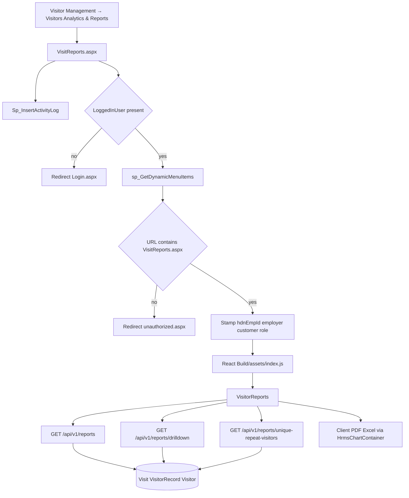
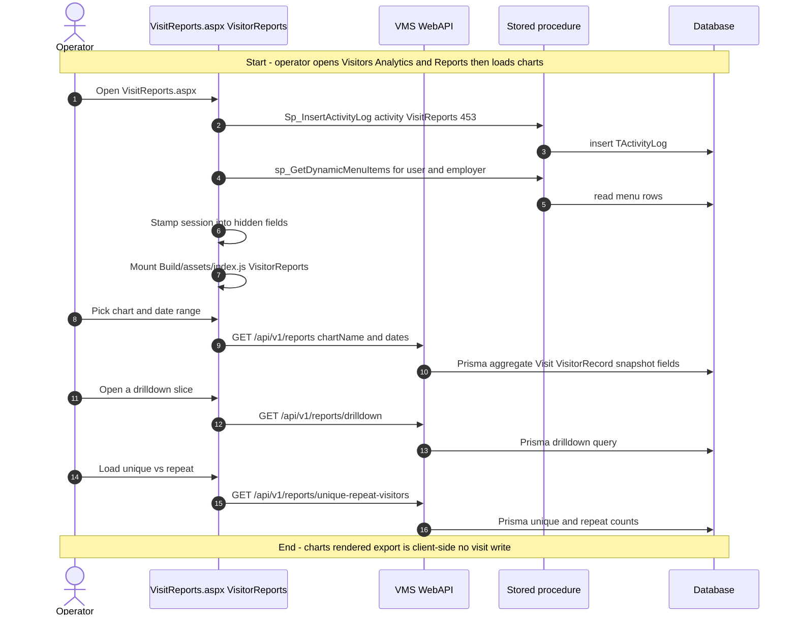
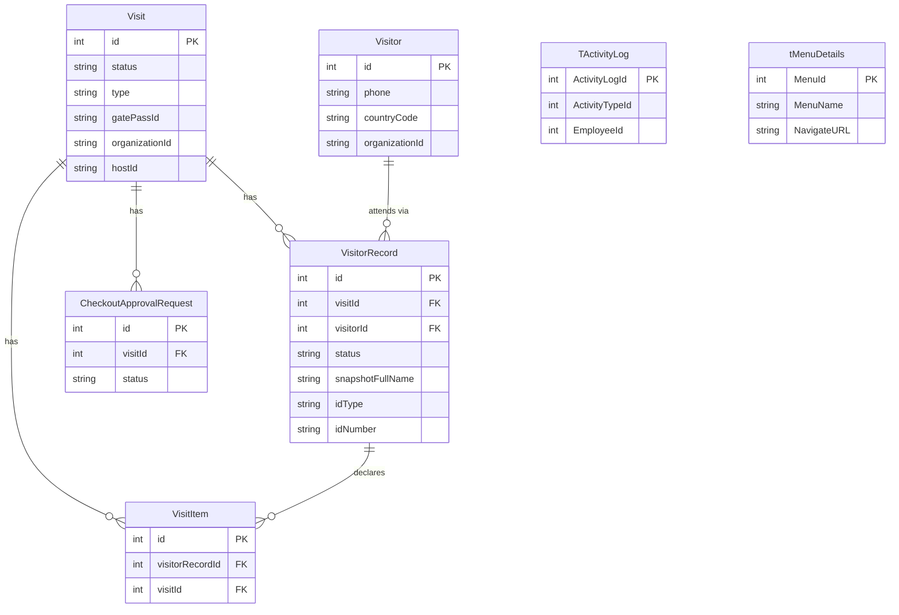

# Visitors Analytics & Reports

## Overview

An operator opens **Visitor Management → Visitors Analytics & Reports** (`~/HRM/VMS_React/VisitReports.aspx`, menu id **1227**, parentseq **4** under **Visitor Management** / **1176**) to review **read-only visitor analytics**: frequent visitors, peak visiting hours, average visit duration, and unique vs repeat visitors, with chart drilldowns and client-side export. The WebForms host logs activity `VisitReports` (453), redirects to login when `Session["LoggedInUser"]` is missing, gates access when the user’s dynamic menu does not include `VisitReports.aspx`, stamps session identity into hidden fields, and mounts the shared VMS React bundle at `#root` (`Build/assets/index.js`).

Inside the SPA the screen is `VisitorReports` (route `/VisitReports`). Charts load from the separate VMS Express API (`GET /api/v1/reports`, `/reports/drilldown`, `/reports/unique-repeat-visitors`). Aggregates are **computed on read** with Prisma against `Visit` / `VisitorRecord` / `Visitor` (snapshot identity preferred). There is **no stored procedure on the analytics read path** and **no separate warehouse table**.

Canonical behaviour lives in the **VMS** Azure DevOps repo’s SystemModel-2 (`experience/surfaces/operator-surfaces.md`, `behavior/use-cases/view-visitor-reports.md`, `data/entities/reporting-notes.md`, `interface/apis/service-apis.md`). The VMS frontend/backend source and `Build/` bundle are **not** present in the SourceCode workspace analyzed for this guide. There is no llm-wiki domain page for Visitors Analytics & Reports.

**Who's involved:**

- **Operator (admin / security / manager)** — opens Visitor Management → Visitors Analytics & Reports when their menu includes `VisitReports.aspx`. Integrated SPA may also apply `"Show All Visits"` scoping for related visit lists (SystemModel role-permission matrix); this leaf itself is analytics charts, not visit CRUD.
- **Host / visitor** — do not operate this screen; their visit history is the report source data.

## Workflow

## Request journey

### Operator — load visitor analytics charts

No WebForms postback journey exists. The aspx has no PageMethods. This leaf does not cancel or edit visits (those actions live on Visitor Dashboard).

## Entry points

`~/HRM/VMS_React/VisitReports.aspx` is the live Visitor Management → Visitors Analytics & Reports host (`PageName` `VisitReports.aspx`, menu id **1227**). `Page_Load` logs `ActivityDescription.VisitReports`, requires `Session["LoggedInUser"]`, gates with `DashboardBLL.GetMenuItems` (must contain `VisitReports.aspx`), and stamps hidden fields (`hdnEmpId`, `hdnEmployerId`, `hdnCustomerId`, and related). The React module mounts at `#root` via `Build/assets/index.js`.

VMS SystemModel-2 maps this aspx to SPA route `/VisitReports` and component `VisitorReports`. Menu DML places it fourth under Visitor Management (parentseq 4), after Visitor Pass (1177), Check-In / Check-Out (1180), and Visitor Dashboard (1178). Charts use `HrmsChartContainer` from `@hrms/hrms-components`.

| UI page | Purpose |
|---|---|
| `HRM/VMS_REACT/VisitReports.aspx` | Visitors Analytics & Reports WebForms host, activity log, menu gate, session stamp |
| `HRM/VMS_REACT/Build/assets/index.js` | Deployed VMS SPA bundle (not in SourceCode git tree) |
| VMS repo `frontend/src/pages/VisitorReports` | Analytics charts + drilldowns (SystemModel-2) |
| VMS repo `backend` `/api/v1/reports*` | Chart aggregates and drilldowns (SystemModel-2) |

## Code → database call chain

Host-side hops are verified in SourceCode. SPA → API → Prisma hops are from the VMS SystemModel-2 knowledge base (VMS repo source and Build bundle were not in this workspace).

| Entry | Method | Stored procedure / data access |
|---|---|---|
| Page load (activity) | `Page_Load` (`VisitReports.aspx.cs:28`) → `CommonUtil.LogActivity` (`Common.cs:52`) → `ActivityHelper.LogActivity` (`ActivityHelper.cs:32`) | `Sp_InsertActivityLog` → `TActivityLog` |
| Page load (access gate) | `Page_Load` (`VisitReports.aspx.cs:37-44`) → `DashboardBLL.GetMenuItems` (`DashboardBLL.cs:23`) → `DashboardDAL.GetMenuItems` (`DashboardDAL.cs:241`) | `sp_GetDynamicMenuItems` |
| SPA chart load | `VisitorReports` → `GET /api/v1/reports` → `handleGetAllReports` / `reports.service` (VMS repo) | Prisma via `getVisitorVisitCounts` / `getVisitsByHourRange` / `getAverageVisitDurations` (no SP) |
| SPA drilldown | → `GET /api/v1/reports/drilldown` → `handleGetReportDrilldown` | Prisma via `getFrequentVisitorsDrilldown` / `getPeakHoursDrilldown` / `getAverageDurationDrilldown` / unique-repeat drilldown (no SP) |
| SPA unique vs repeat | → `GET /api/v1/reports/unique-repeat-visitors` → `getUniqueRepeatVisitorsReportController` | Prisma via `getUniqueRepeatVisitorsReport` (no SP) |
| SPA export | `HrmsChartContainer` PDF/Excel (client) | No server write; no SP |

## API endpoints

Not WebForms postback for analytics. The host page has no PageMethods. After mount, the VMS React app calls the VMS Node API under `/api/v1` (base URL is configured in the VMS frontend env, not in the aspx).

| Verb | Route | Parameters | Purpose | Source |
|---|---|---|---|---|
| GET | `/api/v1/reports` | `chartName` + date range query; JWT + org-access | Chart series for frequent visitors / peak hours / average duration | VMS SystemModel-2 `interface/apis/service-apis.md` |
| GET | `/api/v1/reports/drilldown` | drilldown query for the active chart; JWT + org-access | Row-level drilldown | same |
| GET | `/api/v1/reports/unique-repeat-visitors` | date range; JWT + org-access | Unique vs repeat visitor counts | same |

Host-only side effects use Enterprise Library / ActivityAuditLog against core HRMS procedures (see call chain). No Core `HRMS.Core.WebAPI.Node` controller serves this screen’s chart reads. Report controllers often return raw objects/arrays (no standard `{ success, data }` envelope) per SystemModel API standards notes.

## Stored procedures & tables involved

| Object | File path | Purpose | llm-wiki |
|---|---|---|---|
| [`Sp_InsertActivityLog`](/docs/database/hrms/Sp_InsertActivityLog) | `HRMS-DATABASE/HRMS/STOREPROCEDURE/Sp_InsertActivityLog.sql` | Activity row on every page open | — |
| [`sp_GetDynamicMenuItems`](/docs/database/hrms/sp_GetDynamicMenuItems) | `HRMS-DATABASE/HRMS/STOREPROCEDURE/sp_GetDynamicMenuItems.sql` | Menu rows for the access gate | — |
| `Visit` / `Visitor` / `VisitorRecord` (tables) | Live via VMS Prisma; Liquibase `HRM-VMS` has DML only (no `TABLES/` / `STOREPROCEDURE` for these objects) | Analytics source rows (on-read aggregates) | No llm-wiki page |

Analytics reads use Prisma, not a stored procedure. Nested level under the two host SPs: neither calls another procedure or function. Existing Backstage database pages for both host SPs were left unchanged.

Product story **114265** (“Reporting and Analystics-API's -backend work”) describes the Reports page intent (frequent / location-wise / peak hours / duration / unique-repeat, export). Live API surface in SystemModel-2 documents the three `/reports*` GETs above; location-wise as a separate endpoint was not listed in `service-apis.md`.

## Table relationships

Visit / visitor graphs follow the VMS SystemModel-2 ERD (`data/relationships/erd.md`). Host activity/menu tables are core HRMS. Reports prefer `VisitorRecord` snapshot identity fields over live `Visitor` values.

There is no dedicated reporting / aggregate table. `hostId` / `organizationId` are loose strings with no Prisma FK to HRMS employee or employer tables.

## Known gaps

- VMS React source, Vite `Build/` output, and VMS Express API are **not** in the SourceCode workspace; SPA/API call-chain detail is taken from VMS SystemModel-2 (cached project sync), not re-read file:line from that repo.
- `HRMS-DATABASE/HRM-VMS` Liquibase baseline contains only DML; there are **no** checked-in SP/table scripts for Visit entities, and analytics is Prisma-only on read.
- Physical database placement for Prisma tables may differ by environment (SystemModel “shared HRMS DB” vs DEV `HRM-VMS` for related config).
- Exact `chartName` enum values and request query shapes were not re-verified from `reports.route.ts` in this workspace.
- WI **114265** mentions a location-wise report; SystemModel-2 `service-apis.md` / `reporting-notes.md` do not list a dedicated location chart function — treat as possible product vs docs drift.
- No llm-wiki domain or table catalogue page for Visitors Analytics & Reports / `VisitorReports`.
- Menu folder slug is `visitor-management` (`menuToFolderSlug("Visitor Management")`).

## Reference

Confidence is medium: the ASP.NET host → `Sp_InsertActivityLog` / `sp_GetDynamicMenuItems` chain is clear in SourceCode. The React → VMS API → Prisma analytics chain is documented in the VMS SystemModel-2 knowledge base, but the VMS application repo was not present in this workspace for line-level re-verification. Analytics persistence has no SP layer.

### SourceCode

- `HRMS.Web/HRMS.Web/HRM/VMS_REACT/VisitReports.aspx`
- `HRMS.Web/HRMS.Web/HRM/VMS_REACT/VisitReports.aspx.cs`
- `HRMS.Shared/HRMS.DataContract/Common/Enums.cs` (`VisitReports = 453`)
- `HRMS.Shared/HRMS.Common/Common.cs` (`LogActivity`)
- `HRMS.Shared/TDG.ActivityAuditLog/DAL/ActivityHelper.cs`
- `HRMS.Shared/HRMS.BusinessLayer/DashboardBLL.cs`
- `HRMS.Shared/HRMS.DataAccessLayer/DashboardDAL.cs`

### VMS repo (SystemModel-2; not in SourceCode workspace)

- `docs/SystemModels/SystemModel-2/experience/surfaces/operator-surfaces.md`
- `docs/SystemModels/SystemModel-2/behavior/use-cases/view-visitor-reports.md`
- `docs/SystemModels/SystemModel-2/data/entities/reporting-notes.md`
- `docs/SystemModels/SystemModel-2/interface/apis/service-apis.md`
- `docs/SystemModels/SystemModel-2/data/relationships/erd.md`
- `docs/SystemModels/SystemModel-2/architecture/decomposition/frontend.md`
- `docs/SystemModels/SystemModel-2/architecture/decomposition/backend.md`
- `docs/SystemModels/SystemModel-2/security/authorization/role-permission-matrix.md`

### TDG HRMS DB / ADO

- `HRMS-DATABASE/HRMS/DML/114265/menuInsertion.sql` (MenuId 1227 → `/HRM/VMS_REACT/VisitReports.aspx`)
- `HRMS-DATABASE/HRMS/DML/VMSMenuIssue.sql` (parentseq 4 for Visitors Analytics & Reports)
- `HRMS-DATABASE/HRMS/DML/Tmenudetails DML.sql` (Visitor Management XML children)
- `HRMS-DATABASE/HRM-VMS/DML/` (config maintenance only; no Visit TABLE/SP scripts)
- `HRMS-DATABASE/HRMS/STOREPROCEDURE/Sp_InsertActivityLog.sql`
- `HRMS-DATABASE/HRMS/STOREPROCEDURE/sp_GetDynamicMenuItems.sql`
- Azure DevOps work item **114265** (Reports / analytics API product story)
